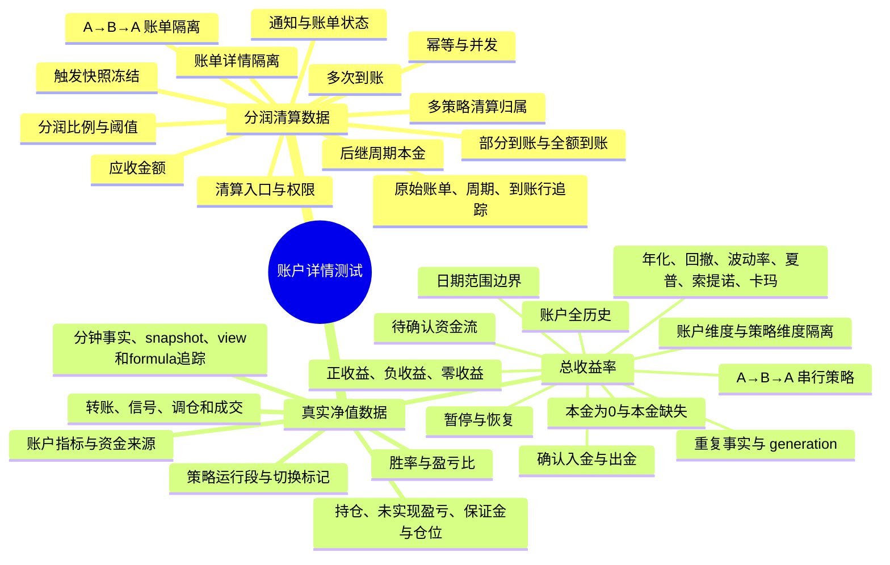

# 账户详情测试用例总文档

本文件是账户详情测试的唯一交付文档，按两个二级标签组织：**分润清算数据**、**真实净值数据**。

每条用例都保留独立场景、输入数据、步骤、预期结果、接口、数据来源和追踪信息；有来源的细化用例同时保留原始检查点。状态为“待口径绑定”的用例仍然保留，执行前只需补齐文档没有明确的字段或部署绑定，不应被合并成普通成功场景。

本版收敛为 **314 条**功能与计算用例：分润清算数据 **57 条**，真实净值数据 **257 条**。已移除页面控件、图表联动、导出、分页、刷新重登、权限冒烟和重复协议冒烟；保留资金来源、收益与风险公式、策略运行段、持仓聚合、信号/订单/成交数据、分润周期、到账状态、幂等和并发场景。

## 测试思维导图



## 一、分润清算数据


### 1.1 清算周期、分润账单、到账和权限


### ADC-CYC-035｜历史分润（现场可见 12 列；2999 当前为空）｜账单账户字段绑定 NT 身份
- 优先级：P1；状态：设计完成/待执行
- 测试字段：账号ID
- 前置条件：用专用账户 X（NT code=qa_ad_cyc_x）准备数据；2999 仅作页面观察样本，不直接覆盖其数据。以下每条独立恢复前置；所有时间为 UTC+8。DB 只准备输入和前置状态，目标业务动作经真实任务或 API 产生。
- 输入数据：账单 B1 account_id=X 的本地数字 ID，映射 NT code=qa_ad_cyc_x；Y 的另一张账单 NT code=qa_ad_cyc_y。
- 操作步骤：
  1. 准备本条独立输入，记录源身份及新发布代次。
  2. 打开账户 X 详情，读取对应接口及目标字段；核对原值、页面值、对象与时间范围。
- 预期结果：X 的 B1 行账号 ID 显示与页头一致的 qa_ad_cyc_x，不能显示 Y 或把本地数字 ID 当 NT 代码；账单写操作仍使用对应真实本地资源 ID。
- 数据追踪：quant_account_profiles; quant_profit_share_policies; quant_profit_share_cycles; quant_profit_share_bills; quant_profit_share_bill_attributions; quant_profit_share_receipts
- 接口/页面：N21/N22 账户账单与到账查询；正式到账走 N23，出账由独立计费任务；具体字段/路由以当前接口文档绑定。
- 原检查点：V2-UI-023, V2-UI-021
- 依据：T L1、M1/M2、7.1—7.4；P 最新分润说明与确认 7/9/10。

### ADC-CYC-036｜历史分润（现场可见 12 列；2999 当前为空）｜已出账费率冻结
- 优先级：P0；状态：设计完成/待执行
- 测试字段：分润比例
- 前置条件：用专用账户 X（NT code=qa_ad_cyc_x）准备数据；2999 仅作页面观察样本，不直接覆盖其数据。以下每条独立恢复前置；所有时间为 UTC+8。DB 只准备输入和前置状态，目标业务动作经真实任务或 API 产生。
- 输入数据：B1 触发时比例 35%、合格利润 5，应收 1.75；之后外部配置改为 50%。
- 操作步骤：
  1. 准备本条独立输入，记录源身份及新发布代次。
  2. 打开账户 X 详情，读取对应接口及目标字段；核对原值、页面值、对象与时间范围。
- 预期结果：B1 分润比例仍 35%、应收仍 1.75；新政策不回写旧单。后续新单按其有效政策取值。
- 数据追踪：quant_account_profiles; quant_profit_share_policies; quant_profit_share_cycles; quant_profit_share_bills; quant_profit_share_bill_attributions; quant_profit_share_receipts
- 接口/页面：N21/N22 账户账单与到账查询；正式到账走 N23，出账由独立计费任务；具体字段/路由以当前接口文档绑定。
- 原检查点：V2-BILL-020, V2-BILL-018
- 依据：T L1、M1/M2、7.1—7.4；P 最新分润说明与确认 7/9/10。

### ADC-CYC-037｜历史分润（现场可见 12 列；2999 当前为空）｜触发时间与到账时间分开
- 优先级：P0；状态：设计完成/待执行
- 测试字段：触发分润时间
- 前置条件：用专用账户 X（NT code=qa_ad_cyc_x）准备数据；2999 仅作页面观察样本，不直接覆盖其数据。以下每条独立恢复前置；所有时间为 UTC+8。DB 只准备输入和前置状态，目标业务动作经真实任务或 API 产生。
- 输入数据：B1 trigger_at=2026-10-01 10:00，首次实际到账=2026-10-03 16:00。
- 操作步骤：
  1. 准备本条独立输入，记录源身份及新发布代次。
  2. 打开账户 X 详情，读取对应接口及目标字段；核对原值、页面值、对象与时间范围。
- 预期结果：触发分润时间列固定为 10-01 10:00，不显示到账 10-03 16:00 或页面刷新时间；页面清算基准也以 trigger_at 为准。
- 数据追踪：quant_account_profiles; quant_profit_share_policies; quant_profit_share_cycles; quant_profit_share_bills; quant_profit_share_bill_attributions; quant_profit_share_receipts
- 接口/页面：N21/N22 账户账单与到账查询；正式到账走 N23，出账由独立计费任务；具体字段/路由以当前接口文档绑定。
- 原检查点：V2-REC-019, V2-UI-013
- 依据：T L1、M1/M2、7.1—7.4；P 最新分润说明与确认 7/9/10。

### ADC-CYC-038｜历史分润（现场可见 12 列；2999 当前为空）｜分润前钱包使用触发快照
- 优先级：P0；状态：设计完成/待执行
- 测试字段：钱包余额（分润前）
- 前置条件：用专用账户 X（NT code=qa_ad_cyc_x）准备数据；2999 仅作页面观察样本，不直接覆盖其数据。以下每条独立恢复前置；所有时间为 UTC+8。DB 只准备输入和前置状态，目标业务动作经真实任务或 API 产生。
- 输入数据：B1 触发精确钱包 105；之后新周期赚 3，当前钱包 108；无真实资金划转。
- 操作步骤：
  1. 准备本条独立输入，记录源身份及新发布代次。
  2. 打开账户 X 详情，读取对应接口及目标字段；核对原值、页面值、对象与时间范围。
- 预期结果：B1 分润前钱包固定为 105 USDT，不随实时钱包改为 108，也不是扣应收后的 103.25。
- 数据追踪：quant_account_profiles; quant_profit_share_policies; quant_profit_share_cycles; quant_profit_share_bills; quant_profit_share_bill_attributions; quant_profit_share_receipts; fact_performance_sample; fact_nav_sample; exchange_account_cash_flows
- 接口/页面：N21/N22 账户账单与到账查询；正式到账走 N23，出账由独立计费任务；具体字段/路由以当前接口文档绑定。
- 原检查点：V2-BILL-014, V2-BILL-018
- 依据：T L1、M1/M2、7.1—7.4；P 最新分润说明与确认 7/9/10。

### ADC-CYC-039｜历史分润（现场可见 12 列；2999 当前为空）｜分润前利润冻结且不混账户全历史
- 优先级：P0；状态：待口径绑定
- 测试字段：已实现收益（分润前）
- 前置条件：用专用账户 X（NT code=qa_ad_cyc_x）准备数据；2999 仅作页面观察样本，不直接覆盖其数据。以下每条独立恢复前置；所有时间为 UTC+8。DB 只准备输入和前置状态，目标业务动作经真实任务或 API 产生。
- 输入数据：账户全历史已实现 25，但 B1 可计费周期利润 5；触发本金 100、钱包 105。
- 操作步骤：
  1. 准备本条独立输入，记录源身份及新发布代次。
  2. 打开账户 X 详情，读取对应接口及目标字段；核对原值、页面值、对象与时间范围。
- 预期结果：B1 触发利润/已实现收益（分润前）按账单冻结语义取 5，不用账户全历史 25 计算应收；若 UI 同名字段实际定义为源累计已实现，则应明确展示 25 并与周期利润字段分开，不能混用。
- 数据追踪：quant_account_profiles; quant_profit_share_policies; quant_profit_share_cycles; quant_profit_share_bills; quant_profit_share_bill_attributions; quant_profit_share_receipts
- 接口/页面：N21/N22 账户账单与到账查询；正式到账走 N23，出账由独立计费任务；具体字段/路由以当前接口文档绑定。
- 原检查点：V2-BILL-014, V2-BILL-018
- 依据：T L1、M1/M2、7.1—7.4；P 最新分润说明与确认 7/9/10。
- 备注：空表现场无法确认“已实现收益（分润前）”绑定周期利润还是源累计已实现；两者取不同值的样本用于锁定，收费公式仍是周期合格利润×冻结费率。

### ADC-CYC-040｜历史分润（现场可见 12 列；2999 当前为空）｜恰达门槛的应收
- 优先级：P0；状态：设计完成/待执行
- 测试字段：应收分润金额
- 前置条件：用专用账户 X（NT code=qa_ad_cyc_x）准备数据；2999 仅作页面观察样本，不直接覆盖其数据。以下每条独立恢复前置；所有时间为 UTC+8。DB 只准备输入和前置状态，目标业务动作经真实任务或 API 产生。
- 输入数据：有效本金 100、门槛 5%、合格利润 5、钱包 105、分润比例 35%；精确源新鲜完整。
- 操作步骤：
  1. 准备 policy/cycle 与精确源，不直接写应收结果。
  2. 让正式计费任务消费并读取 B1。
  3. 核对 1.75 应收、触发引用及后继周期，再看表格。
- 预期结果：真实检测生成 B1 一张账单，应收=5×35%=1.75 USDT；前后金额字段关联同一触发快照，新周期本金 105。
- 数据追踪：quant_account_profiles; quant_profit_share_policies; quant_profit_share_cycles; quant_profit_share_bills; quant_profit_share_bill_attributions; quant_profit_share_receipts; fact_performance_sample; fact_nav_sample; exchange_account_cash_flows
- 接口/页面：N21/N22 账户账单与到账查询；正式到账走 N23，出账由独立计费任务；具体字段/路由以当前接口文档绑定。
- 原检查点：V2-BILL-014, V2-BILL-021
- 依据：T L1、M1/M2、7.1—7.4；P 最新分润说明与确认 7/9/10。

### ADC-CYC-041｜历史分润（现场可见 12 列；2999 当前为空）｜一次跨过多档只按实际利润出一单
- 优先级：P0；状态：设计完成/待执行
- 测试字段：应收分润金额
- 前置条件：用专用账户 X（NT code=qa_ad_cyc_x）准备数据；2999 仅作页面观察样本，不直接覆盖其数据。以下每条独立恢复前置；所有时间为 UTC+8。DB 只准备输入和前置状态，目标业务动作经真实任务或 API 产生。
- 输入数据：本金 100、门槛 5%、利润首次观察为 20、钱包 120、分润比例 35%。
- 操作步骤：
  1. 准备本条独立输入，记录源身份及新发布代次。
  2. 打开账户 X 详情，读取对应接口及目标字段；核对原值、页面值、对象与时间范围。
- 预期结果：一张应收 7 USDT 的账单，不能拆成四张 1.75，也不能仅对超额 15 收取 5.25。
- 数据追踪：quant_account_profiles; quant_profit_share_policies; quant_profit_share_cycles; quant_profit_share_bills; quant_profit_share_bill_attributions; quant_profit_share_receipts; fact_performance_sample; fact_nav_sample; exchange_account_cash_flows
- 接口/页面：N21/N22 账户账单与到账查询；正式到账走 N23，出账由独立计费任务；具体字段/路由以当前接口文档绑定。
- 原检查点：V2-BILL-017
- 依据：T L1、M1/M2、7.1—7.4；P 最新分润说明与确认 7/9/10。

### ADC-CYC-042｜历史分润（现场可见 12 列；2999 当前为空）｜未登记到账不伪造实收零记录
- 优先级：P0；状态：设计完成/待执行
- 测试字段：分润到账时间、实收分润金额
- 前置条件：用专用账户 X（NT code=qa_ad_cyc_x）准备数据；2999 仅作页面观察样本，不直接覆盖其数据。以下每条独立恢复前置；所有时间为 UTC+8。DB 只准备输入和前置状态，目标业务动作经真实任务或 API 产生。
- 输入数据：B1 应收 1.75，尚无 confirmed receipt，账单已正式生成。
- 操作步骤：
  1. 准备本条独立输入，记录源身份及新发布代次。
  2. 打开账户 X 详情，读取对应接口及目标字段；核对原值、页面值、对象与时间范围。
- 预期结果：确认到账金额缺失按当前占位展示；没有实际到账时间，不把触发时间复制为到账；后端未收为 1.75，清算 TAB 仍隐藏。已知空收款集合不等于已确认 0 元收款。
- 数据追踪：quant_account_profiles; quant_profit_share_policies; quant_profit_share_cycles; quant_profit_share_bills; quant_profit_share_bill_attributions; quant_profit_share_receipts
- 接口/页面：N21/N22 账户账单与到账查询；正式到账走 N23，出账由独立计费任务；具体字段/路由以当前接口文档绑定。
- 原检查点：V2-AGG-014, V2-REC-018, V2-UI-012
- 依据：T L1、M1/M2、7.1—7.4；P 最新分润说明与确认 7/9/10。

### ADC-CYC-043｜历史分润（现场可见 12 列；2999 当前为空）｜单次到账保留实际发生时刻
- 优先级：P0；状态：设计完成/待执行
- 测试字段：分润到账时间
- 前置条件：用专用账户 X（NT code=qa_ad_cyc_x）准备数据；2999 仅作页面观察样本，不直接覆盖其数据。以下每条独立恢复前置；所有时间为 UTC+8。DB 只准备输入和前置状态，目标业务动作经真实任务或 API 产生。
- 输入数据：B1 于 10-01 10:00 触发；N23 在 10-04 18:00 操作补录实际到账 2026-10-03T08:00:00Z。
- 操作步骤：
  1. 准备本条独立输入，记录源身份及新发布代次。
  2. 打开账户 X 详情，读取对应接口及目标字段；核对原值、页面值、对象与时间范围。
- 预期结果：到账时间为北京时间 10-03 16:00，非操作时间 10-04 18:00、非触发时间；原绝对时刻不变。
- 数据追踪：quant_account_profiles; quant_profit_share_policies; quant_profit_share_cycles; quant_profit_share_bills; quant_profit_share_bill_attributions; quant_profit_share_receipts
- 接口/页面：N21/N22 账户账单与到账查询；正式到账走 N23，出账由独立计费任务；具体字段/路由以当前接口文档绑定。
- 原检查点：V2-REC-015, V2-UI-013
- 依据：T L1、M1/M2、7.1—7.4；P 最新分润说明与确认 7/9/10。

### ADC-CYC-044｜历史分润（现场可见 12 列；2999 当前为空）｜多次到账保留每笔时间和累计金额
- 优先级：P1；状态：待口径绑定
- 测试字段：分润到账时间、实收分润金额
- 前置条件：用专用账户 X（NT code=qa_ad_cyc_x）准备数据；2999 仅作页面观察样本，不直接覆盖其数据。以下每条独立恢复前置；所有时间为 UTC+8。DB 只准备输入和前置状态，目标业务动作经真实任务或 API 产生。
- 输入数据：B1 应收 1.75；receipt R1=0.75，发生 10-03 16:00；R2=1.00，发生 10-04 11:00。
- 操作步骤：
  1. 准备本条独立输入，记录源身份及新发布代次。
  2. 打开账户 X 详情，读取对应接口及目标字段；核对原值、页面值、对象与时间范围。
- 预期结果：累计 confirmed 实收 1.75、待收 0；详情可追踪 R1/R2 各自实际时间。主表一格时间若取最新，应为 10-04 11:00；若另有已确认聚合语义则明确绑定，不能用操作时间或丢掉两笔事实。
- 数据追踪：quant_account_profiles; quant_profit_share_policies; quant_profit_share_cycles; quant_profit_share_bills; quant_profit_share_bill_attributions; quant_profit_share_receipts
- 接口/页面：N21/N22 账户账单与到账查询；正式到账走 N23，出账由独立计费任务；具体字段/路由以当前接口文档绑定。
- 原检查点：V2-REC-010, V2-REC-011, V2-REC-015
- 依据：T L1、M1/M2、7.1—7.4；P 最新分润说明与确认 7/9/10。
- 备注：主表多次到账时单格“分润到账时间”的展示选择尚未从空表验证，执行前绑定具体 API 字段。

### ADC-CYC-045｜历史分润（现场可见 12 列；2999 当前为空）｜登记不合成扣钱包结果
- 优先级：P0；状态：待口径绑定
- 测试字段：钱包余额（分润后）
- 前置条件：用专用账户 X（NT code=qa_ad_cyc_x）准备数据；2999 仅作页面观察样本，不直接覆盖其数据。以下每条独立恢复前置；所有时间为 UTC+8。DB 只准备输入和前置状态，目标业务动作经真实任务或 API 产生。
- 输入数据：B1 触发钱包 105、应收 1.75；之后钱包实际仍 105，没有资金流；指定商务登记 1.75。
- 操作步骤：
  1. 准备本条独立输入，记录源身份及新发布代次。
  2. 打开账户 X 详情，读取对应接口及目标字段；核对原值、页面值、对象与时间范围。
- 预期结果：登记前后真实钱包均 105；不能因登记直接显示合成的 103.25。分润后钱包字段须绑定实际 after_snapshot/ref：若存在对应 105 证据显示 105，若无证据则缺失，不用 105−1.75 推算。
- 数据追踪：quant_account_profiles; quant_profit_share_policies; quant_profit_share_cycles; quant_profit_share_bills; quant_profit_share_bill_attributions; quant_profit_share_receipts; fact_performance_sample; fact_nav_sample; exchange_account_cash_flows
- 接口/页面：N21/N22 账户账单与到账查询；正式到账走 N23，出账由独立计费任务；具体字段/路由以当前接口文档绑定。
- 原检查点：V2-REC-007, V2-REC-008, V2-UI-012
- 依据：T L1、M1/M2、7.1—7.4；P 最新分润说明与确认 7/9/10。
- 备注：固定业务不变量已确认；after 字段取触发后、登记时还是独立 after snapshot 需绑定 N21/N22 实际契约。

### ADC-CYC-046｜历史分润（现场可见 12 列；2999 当前为空）｜登记不把后继利润清零
- 优先级：P0；状态：待口径绑定
- 测试字段：已实现收益（分润后）
- 前置条件：用专用账户 X（NT code=qa_ad_cyc_x）准备数据；2999 仅作页面观察样本，不直接覆盖其数据。以下每条独立恢复前置；所有时间为 UTC+8。DB 只准备输入和前置状态，目标业务动作经真实任务或 API 产生。
- 输入数据：B1 触发钱包 105；新周期无流转又赚 3，钱包 108；随后登记 B1 的 1.75。
- 操作步骤：
  1. 准备本条独立输入，记录源身份及新发布代次。
  2. 打开账户 X 详情，读取对应接口及目标字段；核对原值、页面值、对象与时间范围。
- 预期结果：新周期利润登记后仍为 3；不能登记后显示 0 并丢失该利润。分润后已实现字段若绑定周期利润则为 3；若绑定源累计则按真实源累计，不由测试擅自重置。
- 数据追踪：quant_account_profiles; quant_profit_share_policies; quant_profit_share_cycles; quant_profit_share_bills; quant_profit_share_bill_attributions; quant_profit_share_receipts; fact_performance_sample; fact_nav_sample; exchange_account_cash_flows
- 接口/页面：N21/N22 账户账单与到账查询；正式到账走 N23，出账由独立计费任务；具体字段/路由以当前接口文档绑定。
- 原检查点：V2-REC-007, V2-REC-022
- 依据：T L1、M1/M2、7.1—7.4；P 最新分润说明与确认 7/9/10。
- 备注：需明确该表列绑定 frozen after snapshot、实时周期利润还是源累计；此处不改变主公式。

### ADC-CYC-047｜历史分润（现场可见 12 列；2999 当前为空）｜首次部分到账只增加原单实收
- 优先级：P0；状态：设计完成/待执行
- 测试字段：实收分润金额
- 前置条件：用专用账户 X（NT code=qa_ad_cyc_x）准备数据；2999 仅作页面观察样本，不直接覆盖其数据。以下每条独立恢复前置；所有时间为 UTC+8。DB 只准备输入和前置状态，目标业务动作经真实任务或 API 产生。
- 输入数据：B1 应收 1.75，N23 正式确认 R1=0.75；B2 另有应收 2.80 尚未收。
- 操作步骤：
  1. 准备本条独立输入，记录源身份及新发布代次。
  2. 打开账户 X 详情，读取对应接口及目标字段；核对原值、页面值、对象与时间范围。
- 预期结果：B1 实收 0.75、待收 1.00；B2 实收仍缺失、待收 2.80；不能把 0.75 同时计入两个账单。
- 数据追踪：quant_account_profiles; quant_profit_share_policies; quant_profit_share_cycles; quant_profit_share_bills; quant_profit_share_bill_attributions; quant_profit_share_receipts
- 接口/页面：N21/N22 账户账单与到账查询；正式到账走 N23，出账由独立计费任务；具体字段/路由以当前接口文档绑定。
- 原检查点：V2-REC-010
- 依据：T L1、M1/M2、7.1—7.4；P 最新分润说明与确认 7/9/10。

### ADC-CYC-048｜历史分润（现场可见 12 列；2999 当前为空）｜部分再补足准确累计
- 优先级：P0；状态：设计完成/待执行
- 测试字段：实收分润金额
- 前置条件：用专用账户 X（NT code=qa_ad_cyc_x）准备数据；2999 仅作页面观察样本，不直接覆盖其数据。以下每条独立恢复前置；所有时间为 UTC+8。DB 只准备输入和前置状态，目标业务动作经真实任务或 API 产生。
- 输入数据：B1 已 confirmed 0.75，最新 bill_version 有效；再次正式登记 1.00。
- 操作步骤：
  1. 准备本条独立输入，记录源身份及新发布代次。
  2. 打开账户 X 详情，读取对应接口及目标字段；核对原值、页面值、对象与时间范围。
- 预期结果：B1 实收=1.75、待收=0，两笔各一次；不显示最后一笔 1.00 取代累计，不计成 2.50。
- 数据追踪：quant_account_profiles; quant_profit_share_policies; quant_profit_share_cycles; quant_profit_share_bills; quant_profit_share_bill_attributions; quant_profit_share_receipts
- 接口/页面：N21/N22 账户账单与到账查询；正式到账走 N23，出账由独立计费任务；具体字段/路由以当前接口文档绑定。
- 原检查点：V2-REC-011
- 依据：T L1、M1/M2、7.1—7.4；P 最新分润说明与确认 7/9/10。

### ADC-CYC-049｜历史分润（现场可见 12 列；2999 当前为空）｜商务与研究员和操作者身份区分
- 优先级：P1；状态：设计完成/待执行
- 测试字段：商务
- 前置条件：用专用账户 X（NT code=qa_ad_cyc_x）准备数据；2999 仅作页面观察样本，不直接覆盖其数据。以下每条独立恢复前置；所有时间为 UTC+8。DB 只准备输入和前置状态，目标业务动作经真实任务或 API 产生。
- 输入数据：X 当前指定商务=商务甲；策略研究员=研究员乙；B1 操作记录为商务甲。
- 操作步骤：
  1. 准备本条独立输入，记录源身份及新发布代次。
  2. 打开账户 X 详情，读取对应接口及目标字段；核对原值、页面值、对象与时间范围。
- 预期结果：B1 商务列指向约定的账户/账单商务甲，不显示研究员乙或当前登录用户名；登记审计保留商务甲的真实身份。
- 数据追踪：quant_account_profiles; quant_profit_share_policies; quant_profit_share_cycles; quant_profit_share_bills; quant_profit_share_bill_attributions; quant_profit_share_receipts
- 接口/页面：N21/N22 账户账单与到账查询；正式到账走 N23，出账由独立计费任务；具体字段/路由以当前接口文档绑定。
- 原检查点：V2-REC-016, V2-UI-019
- 依据：T L1、M1/M2、7.1—7.4；P 最新分润说明与确认 7/9/10。

### ADC-CYC-050｜历史分润（现场可见 12 列；2999 当前为空）｜更换商务后按当前指定商务授权
- 优先级：P0；状态：待口径绑定
- 测试字段：商务、操作
- 前置条件：用专用账户 X（NT code=qa_ad_cyc_x）准备数据；2999 仅作页面观察样本，不直接覆盖其数据。以下每条独立恢复前置；所有时间为 UTC+8。DB 只准备输入和前置状态，目标业务动作经真实任务或 API 产生。
- 输入数据：B1 未收；X 当前商务由甲改为乙，版本已生效；分别由甲和乙打开/直调登记。
- 操作步骤：
  1. 准备本条独立输入，记录源身份及新发布代次。
  2. 打开账户 X 详情，读取对应接口及目标字段；核对原值、页面值、对象与时间范围。
- 预期结果：乙符合其他权限时可登记；甲不再因历史曾负责而放行。历史主表“商务”显示冻结负责人还是当前负责人须绑定契约，但不能据此绕过当前指定商务校验。
- 数据追踪：quant_account_profiles; quant_profit_share_policies; quant_profit_share_cycles; quant_profit_share_bills; quant_profit_share_bill_attributions; quant_profit_share_receipts
- 接口/页面：N21/N22 账户账单与到账查询；正式到账走 N23，出账由独立计费任务；具体字段/路由以当前接口文档绑定。
- 原检查点：V2-REC-016, V2-REC-017
- 依据：T L1、M1/M2、7.1—7.4；P 最新分润说明与确认 7/9/10。
- 备注：写入权限固定按当前指定商务；主表商务列的历史/当前字段语义需 N21/N22 对应字段确认。

### ADC-CYC-051｜历史分润（现场可见 12 列；2999 当前为空）｜仍有待收时指定商务可登记
- 优先级：P0；状态：设计完成/待执行
- 测试字段：操作
- 前置条件：用专用账户 X（NT code=qa_ad_cyc_x）准备数据；2999 仅作页面观察样本，不直接覆盖其数据。以下每条独立恢复前置；所有时间为 UTC+8。DB 只准备输入和前置状态，目标业务动作经真实任务或 API 产生。
- 输入数据：B1 应收 1.75、已收 0.75，当前指定商务登录且账号可访问，最新 bill_version。
- 操作步骤：
  1. 准备本条独立输入，记录源身份及新发布代次。
  2. 打开账户 X 详情，读取对应接口及目标字段；核对原值、页面值、对象与时间范围。
- 预期结果：操作区提供当前确认流程的登记入口，打开原表单；本次可登记上限 1.00，不能让按钮切到 B2。
- 数据追踪：quant_account_profiles; quant_profit_share_policies; quant_profit_share_cycles; quant_profit_share_bills; quant_profit_share_bill_attributions; quant_profit_share_receipts
- 接口/页面：N21/N22 账户账单与到账查询；正式到账走 N23，出账由独立计费任务；具体字段/路由以当前接口文档绑定。
- 原检查点：V2-UI-014, V2-UI-019, V2-REC-011
- 依据：T L1、M1/M2、7.1—7.4；P 最新分润说明与确认 7/9/10。

### ADC-CYC-052｜历史分润（现场可见 12 列；2999 当前为空）｜已收足不继续登记
- 优先级：P0；状态：设计完成/待执行
- 测试字段：操作
- 前置条件：用专用账户 X（NT code=qa_ad_cyc_x）准备数据；2999 仅作页面观察样本，不直接覆盖其数据。以下每条独立恢复前置；所有时间为 UTC+8。DB 只准备输入和前置状态，目标业务动作经真实任务或 API 产生。
- 输入数据：B1 应收=实收=1.75，余额 0。
- 操作步骤：
  1. 准备本条独立输入，记录源身份及新发布代次。
  2. 打开账户 X 详情，读取对应接口及目标字段；核对原值、页面值、对象与时间范围。
- 预期结果：登记入口按当前规则隐藏/禁用；直接提交正金额被拒且无新 receipt；查看详情仍可读取。
- 数据追踪：quant_account_profiles; quant_profit_share_policies; quant_profit_share_cycles; quant_profit_share_bills; quant_profit_share_bill_attributions; quant_profit_share_receipts
- 接口/页面：N21/N22 账户账单与到账查询；正式到账走 N23，出账由独立计费任务；具体字段/路由以当前接口文档绑定。
- 原检查点：V2-REC-011, V2-REC-012, V2-REC-027
- 依据：T L1、M1/M2、7.1—7.4；P 最新分润说明与确认 7/9/10。

### ADC-CYC-062｜分润清算 TAB 与周期基准（条件设计，现场未出现）｜触发后无流转无盈亏
- 优先级：P0；状态：设计完成/待执行
- 测试字段：清算周期本金、清算已实现收益、清算累计收益率
- 前置条件：用专用账户 X（NT code=qa_ad_cyc_x）准备数据；2999 仅作页面观察样本，不直接覆盖其数据。以下每条独立恢复前置；所有时间为 UTC+8。DB 只准备输入和前置状态，目标业务动作经真实任务或 API 产生。
- 输入数据：T1 钱包105；后续钱包105，无真实入出金，也没有新损益。
- 操作步骤：
  1. 准备本条独立输入，记录源身份及新发布代次。
  2. 打开账户 X 详情，读取对应接口及目标字段；核对原值、页面值、对象与时间范围。
- 预期结果：后继周期有效本金105，利润0，收益率0%；可用0与缺数据区分。
- 数据追踪：quant_account_profiles; quant_profit_share_policies; quant_profit_share_cycles; quant_profit_share_bills; quant_profit_share_bill_attributions; quant_profit_share_receipts; fact_performance_sample; fact_nav_sample; exchange_account_cash_flows
- 接口/页面：N01/N02 账户清算范围指标/曲线；N21/N22 账单和到账；N23 正式登记。范围参数以接口文档为准。
- 原检查点：V2-REC-001
- 依据：T J0/J1、Q8、7.1—7.4；P 首次到账显示 TAB 与最新确认账单触发起点。

### ADC-CYC-063｜分润清算 TAB 与周期基准（条件设计，现场未出现）｜触发后真实转出分润金额
- 优先级：P0；状态：设计完成/待执行
- 测试字段：清算周期本金、清算已实现收益、清算累计收益率
- 前置条件：用专用账户 X（NT code=qa_ad_cyc_x）准备数据；2999 仅作页面观察样本，不直接覆盖其数据。以下每条独立恢复前置；所有时间为 UTC+8。DB 只准备输入和前置状态，目标业务动作经真实任务或 API 产生。
- 输入数据：T1 钱包105；真实出金F1=1.75，当前钱包103.25，无新损益。
- 操作步骤：
  1. 准备本条独立输入，记录源身份及新发布代次。
  2. 打开账户 X 详情，读取对应接口及目标字段；核对原值、页面值、对象与时间范围。
- 预期结果：本金=105−1.75=103.25；利润0、收益率0%。出金只改有效本金与钱包，不当−1.75交易亏损。
- 数据追踪：quant_account_profiles; quant_profit_share_policies; quant_profit_share_cycles; quant_profit_share_bills; quant_profit_share_bill_attributions; quant_profit_share_receipts; fact_performance_sample; fact_nav_sample; exchange_account_cash_flows
- 接口/页面：N01/N02 账户清算范围指标/曲线；N21/N22 账单和到账；N23 正式登记。范围参数以接口文档为准。
- 原检查点：V2-REC-002
- 依据：T J0/J1、Q8、7.1—7.4；P 首次到账显示 TAB 与最新确认账单触发起点。

### ADC-CYC-064｜分润清算 TAB 与周期基准（条件设计，现场未出现）｜触发后提走全部旧盈利
- 优先级：P0；状态：设计完成/待执行
- 测试字段：清算周期本金、清算已实现收益、清算累计收益率
- 前置条件：用专用账户 X（NT code=qa_ad_cyc_x）准备数据；2999 仅作页面观察样本，不直接覆盖其数据。以下每条独立恢复前置；所有时间为 UTC+8。DB 只准备输入和前置状态，目标业务动作经真实任务或 API 产生。
- 输入数据：T1 钱包105；真实转出5，当前钱包100，无新损益。
- 操作步骤：
  1. 准备本条独立输入，记录源身份及新发布代次。
  2. 打开账户 X 详情，读取对应接口及目标字段；核对原值、页面值、对象与时间范围。
- 预期结果：有效本金100、利润0、收益率0%；不能把已计费的旧盈利5重新当本周期利润。
- 数据追踪：quant_account_profiles; quant_profit_share_policies; quant_profit_share_cycles; quant_profit_share_bills; quant_profit_share_bill_attributions; quant_profit_share_receipts; fact_performance_sample; fact_nav_sample; exchange_account_cash_flows
- 接口/页面：N01/N02 账户清算范围指标/曲线；N21/N22 账单和到账；N23 正式登记。范围参数以接口文档为准。
- 原检查点：V2-REC-003
- 依据：T J0/J1、Q8、7.1—7.4；P 首次到账显示 TAB 与最新确认账单触发起点。

### ADC-CYC-065｜分润清算 TAB 与周期基准（条件设计，现场未出现）｜出金后再盈利
- 优先级：P0；状态：设计完成/待执行
- 测试字段：清算周期本金、清算已实现收益、清算累计收益率
- 前置条件：用专用账户 X（NT code=qa_ad_cyc_x）准备数据；2999 仅作页面观察样本，不直接覆盖其数据。以下每条独立恢复前置；所有时间为 UTC+8。DB 只准备输入和前置状态，目标业务动作经真实任务或 API 产生。
- 输入数据：T1 钱包105；真实出1.75，本期又赚1，当前钱包104.25。
- 操作步骤：
  1. 准备本条独立输入，记录源身份及新发布代次。
  2. 打开账户 X 详情，读取对应接口及目标字段；核对原值、页面值、对象与时间范围。
- 预期结果：有效本金103.25，利润1，收益率1/103.25≈0.968523%；登记到账后仍保持这些值。
- 数据追踪：quant_account_profiles; quant_profit_share_policies; quant_profit_share_cycles; quant_profit_share_bills; quant_profit_share_bill_attributions; quant_profit_share_receipts; fact_performance_sample; fact_nav_sample; exchange_account_cash_flows
- 接口/页面：N01/N02 账户清算范围指标/曲线；N21/N22 账单和到账；N23 正式登记。范围参数以接口文档为准。
- 原检查点：V2-REC-004, V2-REC-007
- 依据：T J0/J1、Q8、7.1—7.4；P 首次到账显示 TAB 与最新确认账单触发起点。

### ADC-CYC-066｜分润清算 TAB 与周期基准（条件设计，现场未出现）｜出金后发生亏损
- 优先级：P0；状态：设计完成/待执行
- 测试字段：清算周期本金、清算已实现收益、清算累计收益率
- 前置条件：用专用账户 X（NT code=qa_ad_cyc_x）准备数据；2999 仅作页面观察样本，不直接覆盖其数据。以下每条独立恢复前置；所有时间为 UTC+8。DB 只准备输入和前置状态，目标业务动作经真实任务或 API 产生。
- 输入数据：T1 钱包105；真实出1.75，本期亏1，当前钱包102.25。
- 操作步骤：
  1. 准备本条独立输入，记录源身份及新发布代次。
  2. 打开账户 X 详情，读取对应接口及目标字段；核对原值、页面值、对象与时间范围。
- 预期结果：有效本金103.25，利润−1，收益率−1/103.25≈−0.968523%；不取绝对值，不把登记当归零。
- 数据追踪：quant_account_profiles; quant_profit_share_policies; quant_profit_share_cycles; quant_profit_share_bills; quant_profit_share_bill_attributions; quant_profit_share_receipts; fact_performance_sample; fact_nav_sample; exchange_account_cash_flows
- 接口/页面：N01/N02 账户清算范围指标/曲线；N21/N22 账单和到账；N23 正式登记。范围参数以接口文档为准。
- 原检查点：V2-REC-005, V2-REC-007
- 依据：T J0/J1、Q8、7.1—7.4；P 首次到账显示 TAB 与最新确认账单触发起点。

### ADC-CYC-067｜分润清算 TAB 与周期基准（条件设计，现场未出现）｜追加资本与出金同时影响本期本金
- 优先级：P0；状态：设计完成/待执行
- 测试字段：清算周期本金、清算已实现收益、清算累计收益率
- 前置条件：用专用账户 X（NT code=qa_ad_cyc_x）准备数据；2999 仅作页面观察样本，不直接覆盖其数据。以下每条独立恢复前置；所有时间为 UTC+8。DB 只准备输入和前置状态，目标业务动作经真实任务或 API 产生。
- 输入数据：T1钱包105；真实入20、真实出1.75，本期赚1，当前钱包124.25。
- 操作步骤：
  1. 准备本条独立输入，记录源身份及新发布代次。
  2. 打开账户 X 详情，读取对应接口及目标字段；核对原值、页面值、对象与时间范围。
- 预期结果：本金=105+20−1.75=123.25；利润1，收益率1/123.25≈0.811359%；20入金不计成盈利。
- 数据追踪：quant_account_profiles; quant_profit_share_policies; quant_profit_share_cycles; quant_profit_share_bills; quant_profit_share_bill_attributions; quant_profit_share_receipts; fact_performance_sample; fact_nav_sample; exchange_account_cash_flows
- 接口/页面：N01/N02 账户清算范围指标/曲线；N21/N22 账单和到账；N23 正式登记。范围参数以接口文档为准。
- 原检查点：V2-REC-006, V2-REC-007
- 依据：T J0/J1、Q8、7.1—7.4；P 首次到账显示 TAB 与最新确认账单触发起点。

### ADC-CYC-068｜分润清算 TAB 与周期基准（条件设计，现场未出现）｜从其他账户付款不合成资管出金
- 优先级：P0；状态：设计完成/待执行
- 测试字段：清算已实现收益、钱包余额（分润后）
- 前置条件：用专用账户 X（NT code=qa_ad_cyc_x）准备数据；2999 仅作页面观察样本，不直接覆盖其数据。以下每条独立恢复前置；所有时间为 UTC+8。DB 只准备输入和前置状态，目标业务动作经真实任务或 API 产生。
- 输入数据：资管X触发钱包105后又赚3至108；商务从其他账户付1.75并登记，X无真实资金流。
- 操作步骤：
  1. 准备本条独立输入，记录源身份及新发布代次。
  2. 打开账户 X 详情，读取对应接口及目标字段；核对原值、页面值、对象与时间范围。
- 预期结果：X钱包仍108、本期本金105、利润3；不合成F1=−1.75，不显示106.25或利润1.25。
- 数据追踪：quant_account_profiles; quant_profit_share_policies; quant_profit_share_cycles; quant_profit_share_bills; quant_profit_share_bill_attributions; quant_profit_share_receipts; fact_performance_sample; fact_nav_sample; exchange_account_cash_flows
- 接口/页面：N01/N02 账户清算范围指标/曲线；N21/N22 账单和到账；N23 正式登记。范围参数以接口文档为准。
- 原检查点：V2-REC-008
- 依据：T J0/J1、Q8、7.1—7.4；P 首次到账显示 TAB 与最新确认账单触发起点。

### ADC-CYC-069｜分润清算 TAB 与周期基准（条件设计，现场未出现）｜真实出金与登记不重复计流
- 优先级：P0；状态：设计完成/待执行
- 测试字段：清算周期本金、清算已实现收益
- 前置条件：用专用账户 X（NT code=qa_ad_cyc_x）准备数据；2999 仅作页面观察样本，不直接覆盖其数据。以下每条独立恢复前置；所有时间为 UTC+8。DB 只准备输入和前置状态，目标业务动作经真实任务或 API 产生。
- 输入数据：X真实出1.75已形成唯一资金流F1；此时钱包104.25、本金103.25、利润1；随后N23登记同金额1.75。
- 操作步骤：
  1. 准备本条独立输入，记录源身份及新发布代次。
  2. 打开账户 X 详情，读取对应接口及目标字段；核对原值、页面值、对象与时间范围。
- 预期结果：F1仅一次；登记后钱包104.25、本金103.25、利润1；不能再次减1.75。
- 数据追踪：quant_account_profiles; quant_profit_share_policies; quant_profit_share_cycles; quant_profit_share_bills; quant_profit_share_bill_attributions; quant_profit_share_receipts; fact_performance_sample; fact_nav_sample; exchange_account_cash_flows
- 接口/页面：N01/N02 账户清算范围指标/曲线；N21/N22 账单和到账；N23 正式登记。范围参数以接口文档为准。
- 原检查点：V2-REC-009
- 依据：T J0/J1、Q8、7.1—7.4；P 首次到账显示 TAB 与最新确认账单触发起点。

### ADC-CYC-070｜分润清算 TAB 与周期基准（条件设计，现场未出现）｜账户老历史不放宽新周期七天门槛
- 优先级：P0；状态：设计完成/待执行
- 测试字段：清算年化收益率、清算卡玛比率
- 前置条件：用专用账户 X（NT code=qa_ad_cyc_x）准备数据；2999 仅作页面观察样本，不直接覆盖其数据。以下每条独立恢复前置；所有时间为 UTC+8。DB 只准备输入和前置状态，目标业务动作经真实任务或 API 产生。
- 输入数据：账号已运行30天；最新已确认账单触发至当前仅6天23:59:59；清算收益率10%、有效最大回撤25%。
- 操作步骤：
  1. 准备本条独立输入，记录源身份及新发布代次。
  2. 打开账户 X 详情，读取对应接口及目标字段；核对原值、页面值、对象与时间范围。
- 预期结果：清算年化及卡玛不可用；真实净值数据TAB的全历史指标按各自范围保持可用，不借30天给清算年化。
- 数据追踪：quant_account_profiles; quant_profit_share_policies; quant_profit_share_cycles; quant_profit_share_bills; quant_profit_share_bill_attributions; quant_profit_share_receipts; fact_performance_sample; fact_nav_sample; exchange_account_cash_flows
- 接口/页面：N01/N02 账户清算范围指标/曲线；N21/N22 账单和到账；N23 正式登记。范围参数以接口文档为准。
- 原检查点：V2-REC-029, V2-MET-009
- 依据：T J0/J1、Q8、7.1—7.4；P 首次到账显示 TAB 与最新确认账单触发起点。

### ADC-CYC-071｜分润清算 TAB 与周期基准（条件设计，现场未出现）｜清算恰满七天
- 优先级：P0；状态：设计完成/待执行
- 测试字段：清算年化收益率、清算卡玛比率
- 前置条件：用专用账户 X（NT code=qa_ad_cyc_x）准备数据；2999 仅作页面观察样本，不直接覆盖其数据。以下每条独立恢复前置；所有时间为 UTC+8。DB 只准备输入和前置状态，目标业务动作经真实任务或 API 产生。
- 输入数据：最新已确认触发点距当前有效运行恰7天；清算收益率7%、清算最大回撤25%。
- 操作步骤：
  1. 准备本条独立输入，记录源身份及新发布代次。
  2. 打开账户 X 详情，读取对应接口及目标字段；核对原值、页面值、对象与时间范围。
- 预期结果：年化0.07/7×365=3.65（365%）；卡玛3.65/0.25=14.6；不多等一天，不混全历史回撤。
- 数据追踪：quant_account_profiles; quant_profit_share_policies; quant_profit_share_cycles; quant_profit_share_bills; quant_profit_share_bill_attributions; quant_profit_share_receipts; fact_performance_sample; fact_nav_sample; exchange_account_cash_flows
- 接口/页面：N01/N02 账户清算范围指标/曲线；N21/N22 账单和到账；N23 正式登记。范围参数以接口文档为准。
- 原检查点：V2-REC-029, V2-RISK-032, V2-MET-010
- 依据：T J0/J1、Q8、7.1—7.4；P 首次到账显示 TAB 与最新确认账单触发起点。

### ADC-CYC-072｜分润清算 TAB 与周期基准（条件设计，现场未出现）｜新周期样本不足不借历史样本
- 优先级：P1；状态：设计完成/待执行
- 测试字段：清算夏普比率、清算最大回撤
- 前置条件：用专用账户 X（NT code=qa_ad_cyc_x）准备数据；2999 仅作页面观察样本，不直接覆盖其数据。以下每条独立恢复前置；所有时间为 UTC+8。DB 只准备输入和前置状态，目标业务动作经真实任务或 API 产生。
- 输入数据：旧周期有100个完整日；新清算范围仅1个完整日，只有1个有效净值点。
- 操作步骤：
  1. 准备本条独立输入，记录源身份及新发布代次。
  2. 打开账户 X 详情，读取对应接口及目标字段；核对原值、页面值、对象与时间范围。
- 预期结果：新范围夏普和不能计算的回撤按自身不可用状态展示；不拼旧周期样本以生成看似完整结果；其他新周期可用金额正常。
- 数据追踪：quant_account_profiles; quant_profit_share_policies; quant_profit_share_cycles; quant_profit_share_bills; quant_profit_share_bill_attributions; quant_profit_share_receipts; fact_performance_sample; fact_nav_sample; exchange_account_cash_flows
- 接口/页面：N01/N02 账户清算范围指标/曲线；N21/N22 账单和到账；N23 正式登记。范围参数以接口文档为准。
- 原检查点：V2-REC-030, V2-UI-012
- 依据：T J0/J1、Q8、7.1—7.4；P 首次到账显示 TAB 与最新确认账单触发起点。

### ADC-CYC-073｜分润清算 TAB 与周期基准（条件设计，现场未出现）｜跨周期未平仓保留真实成本
- 优先级：P1；状态：待口径绑定
- 测试字段：清算交易统计
- 前置条件：用专用账户 X（NT code=qa_ad_cyc_x）准备数据；2999 仅作页面观察样本，不直接覆盖其数据。以下每条独立恢复前置；所有时间为 UTC+8。DB 只准备输入和前置状态，目标业务动作经真实任务或 API 产生。
- 输入数据：T1前以100买1，手续费0.1，T1后以110卖1，手续费0.1，恰形成完整平仓轮。
- 操作步骤：
  1. 准备本条独立输入，记录源身份及新发布代次。
  2. 打开账户 X 详情，读取对应接口及目标字段；核对原值、页面值、对象与时间范围。
- 预期结果：完整成本证据100及两次实际成交手续费0.2可追踪，轮次净利润9.8；清算范围轮次是否纳入按当前Q6/J1事件归属绑定，不能在T1切断成本后错误记109.9利润。
- 数据追踪：quant_account_profiles; quant_profit_share_policies; quant_profit_share_cycles; quant_profit_share_bills; quant_profit_share_bill_attributions; quant_profit_share_receipts; fact_performance_sample; fact_nav_sample; exchange_account_cash_flows; fact_fill
- 接口/页面：N01/N02 账户清算范围指标/曲线；N21/N22 账单和到账；N23 正式登记。范围参数以接口文档为准。
- 原检查点：V2-REC-031, V2-TRD-001, V2-TRD-004
- 依据：T J0/J1、Q8、7.1—7.4；P 首次到账显示 TAB 与最新确认账单触发起点。
- 备注：固定轮次净利润9.8；区间胜率/轮次分母何时计入必须绑定当前明确归属，不新增跨期分摊。

### ADC-CYC-077｜到账登记与收款详情（文档条件设计，现场空表未打开弹窗）｜保留原表单并直接确认成功
- 优先级：P0；状态：设计完成/待执行
- 测试字段：到账登记弹窗、到账金额、到账时间
- 前置条件：用专用账户 X（NT code=qa_ad_cyc_x）准备数据；2999 仅作页面观察样本，不直接覆盖其数据。以下每条独立恢复前置；所有时间为 UTC+8。DB 只准备输入和前置状态，目标业务动作经真实任务或 API 产生。
- 输入数据：指定商务甲登录；B1应收1.75、未收1.75；到账金额0.75，实际到账10-03 16:00；凭证不选。
- 操作步骤：
  1. 准备原账单、当前商务和最新版本，打开对应账单登记弹窗。
  2. 输入本条实际到账金额/时间/凭证状态，提交一次真实 N23；保留请求身份和结果。
  3. 回读原单与receipt、检查钱包/周期基准；核对弹窗和历史分润状态。
- 预期结果：原表单金额和时间准确；成功后产生一笔0.75的confirmed记录、待收1.00，不新增“提交后再审核/独立清算”环节，不要求填写产品未保留的额外可见ID。
- 数据追踪：quant_account_profiles; quant_profit_share_policies; quant_profit_share_cycles; quant_profit_share_bills; quant_profit_share_bill_attributions; quant_profit_share_receipts
- 接口/页面：N23 正式登记到账 → 直接 confirmed；N21/N22 回读原账单/到账记录。普通写入 JSON Body，使用最新 bill_version 和本条规定的 Idempotency-Key。
- 原检查点：V2-UI-014, V2-UI-015, V2-REC-010
- 依据：T M1/M2、7.3；接口文档调用约定及 N23；N24/N28 仅兼容。

### ADC-CYC-078｜到账登记与收款详情（文档条件设计，现场空表未打开弹窗）｜金额等于剩余应收可收足
- 优先级：P0；状态：设计完成/待执行
- 测试字段：到账金额
- 前置条件：用专用账户 X（NT code=qa_ad_cyc_x）准备数据；2999 仅作页面观察样本，不直接覆盖其数据。以下每条独立恢复前置；所有时间为 UTC+8。DB 只准备输入和前置状态，目标业务动作经真实任务或 API 产生。
- 输入数据：B1已confirmed0.75、最新version；本次到账1.00。
- 操作步骤：
  1. 准备原账单、当前商务和最新版本，打开对应账单登记弹窗。
  2. 输入本条实际到账金额/时间/凭证状态，提交一次真实 N23；保留请求身份和结果。
  3. 回读原单与receipt、检查钱包/周期基准；核对弹窗和历史分润状态。
- 预期结果：新增一笔1.00 confirmed；累计1.75、待收0；单据关联B1，B2不变。
- 数据追踪：quant_account_profiles; quant_profit_share_policies; quant_profit_share_cycles; quant_profit_share_bills; quant_profit_share_bill_attributions; quant_profit_share_receipts
- 接口/页面：N23 正式登记到账 → 直接 confirmed；N21/N22 回读原账单/到账记录。普通写入 JSON Body，使用最新 bill_version 和本条规定的 Idempotency-Key。
- 原检查点：V2-REC-011
- 依据：T M1/M2、7.3；接口文档调用约定及 N23；N24/N28 仅兼容。

### ADC-CYC-079｜到账登记与收款详情（文档条件设计，现场空表未打开弹窗）｜金额为零拒绝
- 优先级：P0；状态：设计完成/待执行
- 测试字段：到账金额
- 前置条件：用专用账户 X（NT code=qa_ad_cyc_x）准备数据；2999 仅作页面观察样本，不直接覆盖其数据。以下每条独立恢复前置；所有时间为 UTC+8。DB 只准备输入和前置状态，目标业务动作经真实任务或 API 产生。
- 输入数据：B1待收1.75；到账金额0，其他字段合法。
- 操作步骤：
  1. 准备原账单、当前商务和最新版本，打开对应账单登记弹窗。
  2. 输入本条实际到账金额/时间/凭证状态，提交一次真实 N23；保留请求身份和结果。
  3. 回读原单与receipt、检查钱包/周期基准；核对弹窗和历史分润状态。
- 预期结果：表单/接口拒绝0；无新receipt，实收缺失状态和未收1.75保持，不以0元确认显TAB。
- 数据追踪：quant_account_profiles; quant_profit_share_policies; quant_profit_share_cycles; quant_profit_share_bills; quant_profit_share_bill_attributions; quant_profit_share_receipts
- 接口/页面：N23 正式登记到账 → 直接 confirmed；N21/N22 回读原账单/到账记录。普通写入 JSON Body，使用最新 bill_version 和本条规定的 Idempotency-Key。
- 原检查点：V2-REC-013, V2-REC-018
- 依据：T M1/M2、7.3；接口文档调用约定及 N23；N24/N28 仅兼容。

### ADC-CYC-080｜到账登记与收款详情（文档条件设计，现场空表未打开弹窗）｜负金额拒绝
- 优先级：P0；状态：设计完成/待执行
- 测试字段：到账金额
- 前置条件：用专用账户 X（NT code=qa_ad_cyc_x）准备数据；2999 仅作页面观察样本，不直接覆盖其数据。以下每条独立恢复前置；所有时间为 UTC+8。DB 只准备输入和前置状态，目标业务动作经真实任务或 API 产生。
- 输入数据：B1待收1.75；到账金额−0.01，其他字段合法。
- 操作步骤：
  1. 准备原账单、当前商务和最新版本，打开对应账单登记弹窗。
  2. 输入本条实际到账金额/时间/凭证状态，提交一次真实 N23；保留请求身份和结果。
  3. 回读原单与receipt、检查钱包/周期基准；核对弹窗和历史分润状态。
- 预期结果：拒绝负金额；不形成退款/冲销，不减少实收、不增加待收、不改变起点。
- 数据追踪：quant_account_profiles; quant_profit_share_policies; quant_profit_share_cycles; quant_profit_share_bills; quant_profit_share_bill_attributions; quant_profit_share_receipts
- 接口/页面：N23 正式登记到账 → 直接 confirmed；N21/N22 回读原账单/到账记录。普通写入 JSON Body，使用最新 bill_version 和本条规定的 Idempotency-Key。
- 原检查点：V2-REC-013
- 依据：T M1/M2、7.3；接口文档调用约定及 N23；N24/N28 仅兼容。

### ADC-CYC-081｜到账登记与收款详情（文档条件设计，现场空表未打开弹窗）｜金额为空拒绝
- 优先级：P0；状态：设计完成/待执行
- 测试字段：到账金额
- 前置条件：用专用账户 X（NT code=qa_ad_cyc_x）准备数据；2999 仅作页面观察样本，不直接覆盖其数据。以下每条独立恢复前置；所有时间为 UTC+8。DB 只准备输入和前置状态，目标业务动作经真实任务或 API 产生。
- 输入数据：B1待收1.75；金额字段留空/请求中不传，各作为独立参数化实例。
- 操作步骤：
  1. 准备原账单、当前商务和最新版本，打开对应账单登记弹窗。
  2. 输入本条实际到账金额/时间/凭证状态，提交一次真实 N23；保留请求身份和结果。
  3. 回读原单与receipt、检查钱包/周期基准；核对弹窗和历史分润状态。
- 预期结果：两实例均拒绝；不自动默认剩余1.75或0，未发生任何confirmed写入。
- 数据追踪：quant_account_profiles; quant_profit_share_policies; quant_profit_share_cycles; quant_profit_share_bills; quant_profit_share_bill_attributions; quant_profit_share_receipts
- 接口/页面：N23 正式登记到账 → 直接 confirmed；N21/N22 回读原账单/到账记录。普通写入 JSON Body，使用最新 bill_version 和本条规定的 Idempotency-Key。
- 原检查点：V2-REC-013
- 依据：T M1/M2、7.3；接口文档调用约定及 N23；N24/N28 仅兼容。

### ADC-CYC-082｜到账登记与收款详情（文档条件设计，现场空表未打开弹窗）｜单笔超过应收拒绝
- 优先级：P0；状态：设计完成/待执行
- 测试字段：到账金额
- 前置条件：用专用账户 X（NT code=qa_ad_cyc_x）准备数据；2999 仅作页面观察样本，不直接覆盖其数据。以下每条独立恢复前置；所有时间为 UTC+8。DB 只准备输入和前置状态，目标业务动作经真实任务或 API 产生。
- 输入数据：B1未收1.75；提交1.76。
- 操作步骤：
  1. 准备原账单、当前商务和最新版本，打开对应账单登记弹窗。
  2. 输入本条实际到账金额/时间/凭证状态，提交一次真实 N23；保留请求身份和结果。
  3. 回读原单与receipt、检查钱包/周期基准；核对弹窗和历史分润状态。
- 预期结果：拒绝整笔1.76，无截取1.75的部分记账；B1原应收1.75/原实收状态不变。
- 数据追踪：quant_account_profiles; quant_profit_share_policies; quant_profit_share_cycles; quant_profit_share_bills; quant_profit_share_bill_attributions; quant_profit_share_receipts
- 接口/页面：N23 正式登记到账 → 直接 confirmed；N21/N22 回读原账单/到账记录。普通写入 JSON Body，使用最新 bill_version 和本条规定的 Idempotency-Key。
- 原检查点：V2-REC-012
- 依据：T M1/M2、7.3；接口文档调用约定及 N23；N24/N28 仅兼容。

### ADC-CYC-083｜到账登记与收款详情（文档条件设计，现场空表未打开弹窗）｜累计超过剩余拒绝
- 优先级：P0；状态：设计完成/待执行
- 测试字段：到账金额
- 前置条件：用专用账户 X（NT code=qa_ad_cyc_x）准备数据；2999 仅作页面观察样本，不直接覆盖其数据。以下每条独立恢复前置；所有时间为 UTC+8。DB 只准备输入和前置状态，目标业务动作经真实任务或 API 产生。
- 输入数据：B1已收0.75、剩1.00；本次1.01。
- 操作步骤：
  1. 准备原账单、当前商务和最新版本，打开对应账单登记弹窗。
  2. 输入本条实际到账金额/时间/凭证状态，提交一次真实 N23；保留请求身份和结果。
  3. 回读原单与receipt、检查钱包/周期基准；核对弹窗和历史分润状态。
- 预期结果：拒绝整笔1.01，原confirmed0.75保留、剩余仍1.00；不把累计1.76四舍五入成合法。
- 数据追踪：quant_account_profiles; quant_profit_share_policies; quant_profit_share_cycles; quant_profit_share_bills; quant_profit_share_bill_attributions; quant_profit_share_receipts
- 接口/页面：N23 正式登记到账 → 直接 confirmed；N21/N22 回读原账单/到账记录。普通写入 JSON Body，使用最新 bill_version 和本条规定的 Idempotency-Key。
- 原检查点：V2-REC-012
- 依据：T M1/M2、7.3；接口文档调用约定及 N23；N24/N28 仅兼容。

### ADC-CYC-084｜到账登记与收款详情（文档条件设计，现场空表未打开弹窗）｜超过支持小数精度拒绝或按已批准契约处理
- 优先级：P1；状态：待口径绑定
- 测试字段：到账金额
- 前置条件：用专用账户 X（NT code=qa_ad_cyc_x）准备数据；2999 仅作页面观察样本，不直接覆盖其数据。以下每条独立恢复前置；所有时间为 UTC+8。DB 只准备输入和前置状态，目标业务动作经真实任务或 API 产生。
- 输入数据：读取真实金额精度p；若当前p=2则提交0.751；若p不同，用恰p+1位且非零尾数的金额，仍小于应收。
- 操作步骤：
  1. 准备原账单、当前商务和最新版本，打开对应账单登记弹窗。
  2. 输入本条实际到账金额/时间/凭证状态，提交一次真实 N23；保留请求身份和结果。
  3. 回读原单与receipt、检查钱包/周期基准；核对弹窗和历史分润状态。
- 预期结果：按当前已确认金额契约拒绝超精度或明确标准化；不得静默用显示两位替代真实入账值。必须在执行前将p及唯一结果写入此例。
- 数据追踪：quant_account_profiles; quant_profit_share_policies; quant_profit_share_cycles; quant_profit_share_bills; quant_profit_share_bill_attributions; quant_profit_share_receipts
- 接口/页面：N23 正式登记到账 → 直接 confirmed；N21/N22 回读原账单/到账记录。普通写入 JSON Body，使用最新 bill_version 和本条规定的 Idempotency-Key。
- 原检查点：V2-REC-013, V2-UI-011
- 依据：T M1/M2、7.3；接口文档调用约定及 N23；N24/N28 仅兼容。
- 备注：原始文档摘要未提供字段最大precision，不擅设为2位；这条未绑定前不计可执行完成。

### ADC-CYC-085｜到账登记与收款详情（文档条件设计，现场空表未打开弹窗）｜时区等价输入同一绝对时刻
- 优先级：P1；状态：设计完成/待执行
- 测试字段：到账时间
- 前置条件：用专用账户 X（NT code=qa_ad_cyc_x）准备数据；2999 仅作页面观察样本，不直接覆盖其数据。以下每条独立恢复前置；所有时间为 UTC+8。DB 只准备输入和前置状态，目标业务动作经真实任务或 API 产生。
- 输入数据：独立两张同金额账单，分别提交2026-10-03T08:00:00Z与2026-10-03T16:00:00+08:00。
- 操作步骤：
  1. 准备原账单、当前商务和最新版本，打开对应账单登记弹窗。
  2. 输入本条实际到账金额/时间/凭证状态，提交一次真实 N23；保留请求身份和结果。
  3. 回读原单与receipt、检查钱包/周期基准；核对弹窗和历史分润状态。
- 预期结果：两笔保存同一绝对时刻，页面均显示北京时间10-03 16:00；不对带+08:00值重复加8小时。
- 数据追踪：quant_account_profiles; quant_profit_share_policies; quant_profit_share_cycles; quant_profit_share_bills; quant_profit_share_bill_attributions; quant_profit_share_receipts
- 接口/页面：N23 正式登记到账 → 直接 confirmed；N21/N22 回读原账单/到账记录。普通写入 JSON Body，使用最新 bill_version 和本条规定的 Idempotency-Key。
- 原检查点：V2-REC-015, V2-UI-013
- 依据：T M1/M2、7.3；接口文档调用约定及 N23；N24/N28 仅兼容。

### ADC-CYC-086｜到账登记与收款详情（文档条件设计，现场空表未打开弹窗）｜跨月晚补录保留实际到账时间
- 优先级：P1；状态：设计完成/待执行
- 测试字段：到账时间
- 前置条件：用专用账户 X（NT code=qa_ad_cyc_x）准备数据；2999 仅作页面观察样本，不直接覆盖其数据。以下每条独立恢复前置；所有时间为 UTC+8。DB 只准备输入和前置状态，目标业务动作经真实任务或 API 产生。
- 输入数据：B1于09-30 23:50触发；10-02操作登记实际到账09-30 23:59:30，金额0.75。
- 操作步骤：
  1. 准备原账单、当前商务和最新版本，打开对应账单登记弹窗。
  2. 输入本条实际到账金额/时间/凭证状态，提交一次真实 N23；保留请求身份和结果。
  3. 回读原单与receipt、检查钱包/周期基准；核对弹窗和历史分润状态。
- 预期结果：实际到账归属09-30 23:59:30；触发时间与操作时间分开，页面起点仍09-30 23:50；若月统计按到账时刻则归9月，不按操作时刻归10月。
- 数据追踪：quant_account_profiles; quant_profit_share_policies; quant_profit_share_cycles; quant_profit_share_bills; quant_profit_share_bill_attributions; quant_profit_share_receipts
- 接口/页面：N23 正式登记到账 → 直接 confirmed；N21/N22 回读原账单/到账记录。普通写入 JSON Body，使用最新 bill_version 和本条规定的 Idempotency-Key。
- 原检查点：V2-REC-015, V2-REC-019
- 依据：T M1/M2、7.3；接口文档调用约定及 N23；N24/N28 仅兼容。

### ADC-CYC-087｜到账登记与收款详情（文档条件设计，现场空表未打开弹窗）｜凭证为空仍可登记
- 优先级：P0；状态：设计完成/待执行
- 测试字段：到账凭证
- 前置条件：用专用账户 X（NT code=qa_ad_cyc_x）准备数据；2999 仅作页面观察样本，不直接覆盖其数据。以下每条独立恢复前置；所有时间为 UTC+8。DB 只准备输入和前置状态，目标业务动作经真实任务或 API 产生。
- 输入数据：B1剩1.75，指定商务提交0.75、合法到账时间，无附件。
- 操作步骤：
  1. 准备原账单、当前商务和最新版本，打开对应账单登记弹窗。
  2. 输入本条实际到账金额/时间/凭证状态，提交一次真实 N23；保留请求身份和结果。
  3. 回读原单与receipt、检查钱包/周期基准；核对弹窗和历史分润状态。
- 预期结果：成功confirmed0.75、待收1.00；不因缺凭证阻断，不额外加审核。
- 数据追踪：quant_account_profiles; quant_profit_share_policies; quant_profit_share_cycles; quant_profit_share_bills; quant_profit_share_bill_attributions; quant_profit_share_receipts
- 接口/页面：N23 正式登记到账 → 直接 confirmed；N21/N22 回读原账单/到账记录。普通写入 JSON Body，使用最新 bill_version 和本条规定的 Idempotency-Key。
- 原检查点：V2-REC-014
- 依据：T M1/M2、7.3；接口文档调用约定及 N23；N24/N28 仅兼容。

### ADC-CYC-088｜到账登记与收款详情（文档条件设计，现场空表未打开弹窗）｜带凭证准确关联本次收款
- 优先级：P1；状态：设计完成/待执行
- 测试字段：到账凭证
- 前置条件：用专用账户 X（NT code=qa_ad_cyc_x）准备数据；2999 仅作页面观察样本，不直接覆盖其数据。以下每条独立恢复前置；所有时间为 UTC+8。DB 只准备输入和前置状态，目标业务动作经真实任务或 API 产生。
- 输入数据：B1登记0.75并上传合法测试凭证F1；另账单B2已有不同F2。
- 操作步骤：
  1. 准备原账单、当前商务和最新版本，打开对应账单登记弹窗。
  2. 输入本条实际到账金额/时间/凭证状态，提交一次真实 N23；保留请求身份和结果。
  3. 回读原单与receipt、检查钱包/周期基准；核对弹窗和历史分润状态。
- 预期结果：R1关联F1，查看R1可读取F1；不串到F2；确认金额仍0.75，上传/查看不产生第二笔receipt。
- 数据追踪：quant_account_profiles; quant_profit_share_policies; quant_profit_share_cycles; quant_profit_share_bills; quant_profit_share_bill_attributions; quant_profit_share_receipts
- 接口/页面：N23 正式登记到账 → 直接 confirmed；N21/N22 回读原账单/到账记录。普通写入 JSON Body，使用最新 bill_version 和本条规定的 Idempotency-Key。
- 原检查点：V2-REC-014, V2-UI-021
- 依据：T M1/M2、7.3；接口文档调用约定及 N23；N24/N28 仅兼容。

### ADC-CYC-096｜到账登记与收款详情（文档条件设计，现场空表未打开弹窗）｜同幂等键同内容仅一笔
- 优先级：P0；状态：设计完成/待执行
- 测试字段：到账金额
- 前置条件：用专用账户 X（NT code=qa_ad_cyc_x）准备数据；2999 仅作页面观察样本，不直接覆盖其数据。以下每条独立恢复前置；所有时间为 UTC+8。DB 只准备输入和前置状态，目标业务动作经真实任务或 API 产生。
- 输入数据：B1待收1.75、bill_version=v；金额0.75、时间固定；Idempotency-Key=K1，同body连续发两次。
- 操作步骤：
  1. 准备原账单、当前商务和最新版本，打开对应账单登记弹窗。
  2. 输入本条实际到账金额/时间/凭证状态，提交一次真实 N23；保留请求身份和结果。
  3. 回读原单与receipt、检查钱包/周期基准；核对弹窗和历史分润状态。
- 预期结果：最终一笔有效confirmed0.75，累计0.75/待收1.00；重放响应按契约返回原业务结果，不能因旧version再计一笔或误报新业务成功。
- 数据追踪：quant_account_profiles; quant_profit_share_policies; quant_profit_share_cycles; quant_profit_share_bills; quant_profit_share_bill_attributions; quant_profit_share_receipts
- 接口/页面：N23 正式登记到账 → 直接 confirmed；N21/N22 回读原账单/到账记录。普通写入 JSON Body，使用最新 bill_version 和本条规定的 Idempotency-Key。
- 原检查点：V2-REC-023
- 依据：T M1/M2、7.3；接口文档调用约定及 N23；N24/N28 仅兼容。

### ADC-CYC-097｜到账登记与收款详情（文档条件设计，现场空表未打开弹窗）｜同幂等键不同内容冲突
- 优先级：P0；状态：设计完成/待执行
- 测试字段：到账金额
- 前置条件：用专用账户 X（NT code=qa_ad_cyc_x）准备数据；2999 仅作页面观察样本，不直接覆盖其数据。以下每条独立恢复前置；所有时间为 UTC+8。DB 只准备输入和前置状态，目标业务动作经真实任务或 API 产生。
- 输入数据：K1第一次成功0.75；仍用K1把body金额改为0.50，其他身份不变。
- 操作步骤：
  1. 准备原账单、当前商务和最新版本，打开对应账单登记弹窗。
  2. 输入本条实际到账金额/时间/凭证状态，提交一次真实 N23；保留请求身份和结果。
  3. 回读原单与receipt、检查钱包/周期基准；核对弹窗和历史分润状态。
- 预期结果：第二次冲突拒绝；累计仍0.75/剩1.00；不修改第一笔，不创建0.50的新receipt。
- 数据追踪：quant_account_profiles; quant_profit_share_policies; quant_profit_share_cycles; quant_profit_share_bills; quant_profit_share_bill_attributions; quant_profit_share_receipts
- 接口/页面：N23 正式登记到账 → 直接 confirmed；N21/N22 回读原账单/到账记录。普通写入 JSON Body，使用最新 bill_version 和本条规定的 Idempotency-Key。
- 原检查点：V2-REC-023
- 依据：T M1/M2、7.3；接口文档调用约定及 N23；N24/N28 仅兼容。

### ADC-CYC-098｜到账登记与收款详情（文档条件设计，现场空表未打开弹窗）｜双击登记不产生两笔
- 优先级：P0；状态：设计完成/待执行
- 测试字段：到账金额
- 前置条件：用专用账户 X（NT code=qa_ad_cyc_x）准备数据；2999 仅作页面观察样本，不直接覆盖其数据。以下每条独立恢复前置；所有时间为 UTC+8。DB 只准备输入和前置状态，目标业务动作经真实任务或 API 产生。
- 输入数据：弹窗填0.75、真实连续双击提交；记录浏览器实际发送请求及键。
- 操作步骤：
  1. 准备原账单、当前商务和最新版本，打开对应账单登记弹窗。
  2. 输入本条实际到账金额/时间/凭证状态，提交一次真实 N23；保留请求身份和结果。
  3. 回读原单与receipt、检查钱包/周期基准；核对弹窗和历史分润状态。
- 预期结果：前端应按当前请求策略复用同一业务幂等键或防重复提交；最终仅一笔0.75，不能因两个HTTP成功显示收1.50。
- 数据追踪：quant_account_profiles; quant_profit_share_policies; quant_profit_share_cycles; quant_profit_share_bills; quant_profit_share_bill_attributions; quant_profit_share_receipts
- 接口/页面：N23 正式登记到账 → 直接 confirmed；N21/N22 回读原账单/到账记录。普通写入 JSON Body，使用最新 bill_version 和本条规定的 Idempotency-Key。
- 原检查点：V2-REC-023
- 依据：T M1/M2、7.3；接口文档调用约定及 N23；N24/N28 仅兼容。

### ADC-CYC-099｜到账登记与收款详情（文档条件设计，现场空表未打开弹窗）｜旧账单 version 冲突不覆盖他人收款
- 优先级：P0；状态：设计完成/待执行
- 测试字段：到账金额
- 前置条件：用专用账户 X（NT code=qa_ad_cyc_x）准备数据；2999 仅作页面观察样本，不直接覆盖其数据。以下每条独立恢复前置；所有时间为 UTC+8。DB 只准备输入和前置状态，目标业务动作经真实任务或 API 产生。
- 输入数据：客户端A读取B1 version=v；客户端B先成功收0.75，version变新；A用旧v及新幂等键提交0.50。
- 操作步骤：
  1. 准备原账单、当前商务和最新版本，打开对应账单登记弹窗。
  2. 输入本条实际到账金额/时间/凭证状态，提交一次真实 N23；保留请求身份和结果。
  3. 回读原单与receipt、检查钱包/周期基准；核对弹窗和历史分润状态。
- 预期结果：A按版本契约冲突，不能覆盖B；累计仍0.75、待收1.00。A刷新最新对象后可另发一次合法新操作。
- 数据追踪：quant_account_profiles; quant_profit_share_policies; quant_profit_share_cycles; quant_profit_share_bills; quant_profit_share_bill_attributions; quant_profit_share_receipts
- 接口/页面：N23 正式登记到账 → 直接 confirmed；N21/N22 回读原账单/到账记录。普通写入 JSON Body，使用最新 bill_version 和本条规定的 Idempotency-Key。
- 原检查点：V2-REC-024, V2-REC-023
- 依据：T M1/M2、7.3；接口文档调用约定及 N23；N24/N28 仅兼容。

### ADC-CYC-100｜到账登记与收款详情（文档条件设计，现场空表未打开弹窗）｜并发超收至多一笔有效
- 优先级：P0；状态：设计完成/待执行
- 测试字段：到账金额
- 前置条件：用专用账户 X（NT code=qa_ad_cyc_x）准备数据；2999 仅作页面观察样本，不直接覆盖其数据。以下每条独立恢复前置；所有时间为 UTC+8。DB 只准备输入和前置状态，目标业务动作经真实任务或 API 产生。
- 输入数据：B1已收0.75、剩1.00；两个客户端同时读最新v，用不同K分别提交0.75。
- 操作步骤：
  1. 准备原账单、当前商务和最新版本，打开对应账单登记弹窗。
  2. 输入本条实际到账金额/时间/凭证状态，提交一次真实 N23；保留请求身份和结果。
  3. 回读原单与receipt、检查钱包/周期基准；核对弹窗和历史分润状态。
- 预期结果：不允许最终累计2.25；至多一个0.75成功，最终若一笔成功则累计1.50、剩0.25；另请求因版本/超收拒绝且无残留。
- 数据追踪：quant_account_profiles; quant_profit_share_policies; quant_profit_share_cycles; quant_profit_share_bills; quant_profit_share_bill_attributions; quant_profit_share_receipts
- 接口/页面：N23 正式登记到账 → 直接 confirmed；N21/N22 回读原账单/到账记录。普通写入 JSON Body，使用最新 bill_version 和本条规定的 Idempotency-Key。
- 原检查点：V2-REC-024
- 依据：T M1/M2、7.3；接口文档调用约定及 N23；N24/N28 仅兼容。

### ADC-CYC-101｜到账登记与收款详情（文档条件设计，现场空表未打开弹窗）｜合法并发更新不能丢成功记录
- 优先级：P0；状态：设计完成/待执行
- 测试字段：到账金额
- 前置条件：用专用账户 X（NT code=qa_ad_cyc_x）准备数据；2999 仅作页面观察样本，不直接覆盖其数据。以下每条独立恢复前置；所有时间为 UTC+8。DB 只准备输入和前置状态，目标业务动作经真实任务或 API 产生。
- 输入数据：B1剩1.75；两个请求金额0.50和0.75，不同K；若其中一个因版本拒绝，取最新v按真实终态重试该未成功请求。
- 操作步骤：
  1. 准备原账单、当前商务和最新版本，打开对应账单登记弹窗。
  2. 输入本条实际到账金额/时间/凭证状态，提交一次真实 N23；保留请求身份和结果。
  3. 回读原单与receipt、检查钱包/周期基准；核对弹窗和历史分润状态。
- 预期结果：最终两次真实成功分别保留，累计1.25、剩0.50；允许版本冲突再恢复，不要求首次并发都成功；不能丢任一已成功收款。
- 数据追踪：quant_account_profiles; quant_profit_share_policies; quant_profit_share_cycles; quant_profit_share_bills; quant_profit_share_bill_attributions; quant_profit_share_receipts
- 接口/页面：N23 正式登记到账 → 直接 confirmed；N21/N22 回读原账单/到账记录。普通写入 JSON Body，使用最新 bill_version 和本条规定的 Idempotency-Key。
- 原检查点：V2-REC-024
- 依据：T M1/M2、7.3；接口文档调用约定及 N23；N24/N28 仅兼容。

### ADC-CYC-102｜到账登记与收款详情（文档条件设计，现场空表未打开弹窗）｜响应丢失但服务端已成功恢复
- 优先级：P0；状态：设计完成/待执行
- 测试字段：到账金额
- 前置条件：用专用账户 X（NT code=qa_ad_cyc_x）准备数据；2999 仅作页面观察样本，不直接覆盖其数据。以下每条独立恢复前置；所有时间为 UTC+8。DB 只准备输入和前置状态，目标业务动作经真实任务或 API 产生。
- 输入数据：N23以K1提交0.75，服务端已提交confirmed但响应被受控丢弃。
- 操作步骤：
  1. 准备原账单、当前商务和最新版本，打开对应账单登记弹窗。
  2. 输入本条实际到账金额/时间/凭证状态，提交一次真实 N23；保留请求身份和结果。
  3. 回读原单与receipt、检查钱包/周期基准；核对弹窗和历史分润状态。
- 预期结果：先查原单/receipt判定已成功；复用K1同body重试后仍仅0.75一笔，剩1.00；页面从未知变明确成功，不能另发新K重复收。
- 数据追踪：quant_account_profiles; quant_profit_share_policies; quant_profit_share_cycles; quant_profit_share_bills; quant_profit_share_bill_attributions; quant_profit_share_receipts
- 接口/页面：N23 正式登记到账 → 直接 confirmed；N21/N22 回读原账单/到账记录。普通写入 JSON Body，使用最新 bill_version 和本条规定的 Idempotency-Key。
- 原检查点：V2-REC-025
- 依据：T M1/M2、7.3；接口文档调用约定及 N23；N24/N28 仅兼容。

### ADC-CYC-103｜到账登记与收款详情（文档条件设计，现场空表未打开弹窗）｜请求未提交的超时恢复
- 优先级：P0；状态：设计完成/待执行
- 测试字段：到账金额
- 前置条件：用专用账户 X（NT code=qa_ad_cyc_x）准备数据；2999 仅作页面观察样本，不直接覆盖其数据。以下每条独立恢复前置；所有时间为 UTC+8。DB 只准备输入和前置状态，目标业务动作经真实任务或 API 产生。
- 输入数据：N23的K1=0.75在服务端业务提交前失败；确认B1无该receipt且金额仍未收1.75。
- 操作步骤：
  1. 准备原账单、当前商务和最新版本，打开对应账单登记弹窗。
  2. 输入本条实际到账金额/时间/凭证状态，提交一次真实 N23；保留请求身份和结果。
  3. 回读原单与receipt、检查钱包/周期基准；核对弹窗和历史分润状态。
- 预期结果：同K1同body重试最终成功一次，累计0.75/剩1.00；在恢复前不把超时当已收。
- 数据追踪：quant_account_profiles; quant_profit_share_policies; quant_profit_share_cycles; quant_profit_share_bills; quant_profit_share_bill_attributions; quant_profit_share_receipts
- 接口/页面：N23 正式登记到账 → 直接 confirmed；N21/N22 回读原账单/到账记录。普通写入 JSON Body，使用最新 bill_version 和本条规定的 Idempotency-Key。
- 原检查点：V2-REC-026
- 依据：T M1/M2、7.3；接口文档调用约定及 N23；N24/N28 仅兼容。

### ADC-CYC-104｜到账登记与收款详情（文档条件设计，现场空表未打开弹窗）｜无幂等键不宣称跨重试安全
- 优先级：P1；状态：设计完成/待执行
- 测试字段：到账金额
- 前置条件：用专用账户 X（NT code=qa_ad_cyc_x）准备数据；2999 仅作页面观察样本，不直接覆盖其数据。以下每条独立恢复前置；所有时间为 UTC+8。DB 只准备输入和前置状态，目标业务动作经真实任务或 API 产生。
- 输入数据：独立合法登记未带Idempotency-Key；其他字段符合真实请求契约。
- 操作步骤：
  1. 准备原账单、当前商务和最新版本，打开对应账单登记弹窗。
  2. 输入本条实际到账金额/时间/凭证状态，提交一次真实 N23；保留请求身份和结果。
  3. 回读原单与receipt、检查钱包/周期基准；核对弹窗和历史分润状态。
- 预期结果：首次响应按文档处理；不能仅因两次body相同就断言系统保证跨重试去重。此例检查调用方使用策略及实际契约，不发起第二次可能重复收款来强造通过。
- 数据追踪：quant_account_profiles; quant_profit_share_policies; quant_profit_share_cycles; quant_profit_share_bills; quant_profit_share_bill_attributions; quant_profit_share_receipts
- 接口/页面：N23 正式登记到账 → 直接 confirmed；N21/N22 回读原账单/到账记录。普通写入 JSON Body，使用最新 bill_version 和本条规定的 Idempotency-Key。
- 原检查点：V2-REC-023
- 依据：T M1/M2、7.3；接口文档调用约定及 N23；N24/N28 仅兼容。
- 备注：接口文档明确普通写入建议幂等键，缺键无跨重试去重保证；自动化恢复路径必须发送稳定键。

### ADC-CYC-106｜到账登记与收款详情（文档条件设计，现场空表未打开弹窗）｜详情逐笔对账
- 优先级：P1；状态：设计完成/待执行
- 测试字段：收款详情、到账金额、到账时间、到账凭证
- 前置条件：用专用账户 X（NT code=qa_ad_cyc_x）准备数据；2999 仅作页面观察样本，不直接覆盖其数据。以下每条独立恢复前置；所有时间为 UTC+8。DB 只准备输入和前置状态，目标业务动作经真实任务或 API 产生。
- 输入数据：B1应收1.75；R1=0.75/10-03 16:00/凭证F1，R2=1.00/10-04 11:00/无凭证。
- 操作步骤：
  1. 准备原账单、当前商务和最新版本，打开对应账单登记弹窗。
  2. 输入本条实际到账金额/时间/凭证状态，提交一次真实 N23；保留请求身份和结果。
  3. 回读原单与receipt、检查钱包/周期基准；核对弹窗和历史分润状态。
- 预期结果：详情两笔各一次，金额合计1.75；时间、凭证状态分别对应R1/R2，不把F1复制给R2；未收为0。
- 数据追踪：quant_account_profiles; quant_profit_share_policies; quant_profit_share_cycles; quant_profit_share_bills; quant_profit_share_bill_attributions; quant_profit_share_receipts
- 接口/页面：N23 正式登记到账 → 直接 confirmed；N21/N22 回读原账单/到账记录。普通写入 JSON Body，使用最新 bill_version 和本条规定的 Idempotency-Key。
- 原检查点：V2-REC-010, V2-REC-011, V2-REC-014, V2-REC-015
- 依据：T M1/M2、7.3；接口文档调用约定及 N23；N24/N28 仅兼容。

### ADC-CYC-110｜到账登记与收款详情（文档条件设计，现场空表未打开弹窗）｜逾期部分未收人工跟进
- 优先级：P1；状态：待口径绑定
- 测试字段：触发分润时间、实收分润金额、操作
- 前置条件：用专用账户 X（NT code=qa_ad_cyc_x）准备数据；2999 仅作页面观察样本，不直接覆盖其数据。以下每条独立恢复前置；所有时间为 UTC+8。DB 只准备输入和前置状态，目标业务动作经真实任务或 API 产生。
- 输入数据：B1触发至当前24小时以上，已收0.75、剩1.00；策略来源仍running。
- 操作步骤：
  1. 准备原账单、当前商务和最新版本，打开对应账单登记弹窗。
  2. 输入本条实际到账金额/时间/凭证状态，提交一次真实 N23；保留请求身份和结果。
  3. 回读原单与receipt、检查钱包/周期基准；核对弹窗和历史分润状态。
- 预期结果：保留原应收1.75、实收0.75、剩1.00并按当前逾期口径呈现/人工跟进；不得自动停止策略、自动出金、重复制单或新增审核。24小时起算字段和边界需绑定技术7.6。
- 数据追踪：quant_account_profiles; quant_profit_share_policies; quant_profit_share_cycles; quant_profit_share_bills; quant_profit_share_bill_attributions; quant_profit_share_receipts
- 接口/页面：N23 正式登记到账 → 直接 confirmed；N21/N22 回读原账单/到账记录。普通写入 JSON Body，使用最新 bill_version 和本条规定的 Idempotency-Key。
- 原检查点：V2-BILL-029, V2-REC-010
- 依据：T M1/M2、7.3；接口文档调用约定及 N23；N24/N28 仅兼容。
- 备注：固定禁止额外资金/控制副作用；逾期从trigger还是通知时刻起算需按7.6当前正文精确绑定，不能用猜测形成缺陷。

### ADC-CYC-111｜到账登记与收款详情（文档条件设计，现场空表未打开弹窗）｜待收旧单与策略切换隔离
- 优先级：P0；状态：设计完成/待执行
- 测试字段：分润比例、应收分润金额
- 前置条件：用专用账户 X（NT code=qa_ad_cyc_x）准备数据；2999 仅作页面观察样本，不直接覆盖其数据。以下每条独立恢复前置；所有时间为 UTC+8。DB 只准备输入和前置状态，目标业务动作经真实任务或 API 产生。
- 输入数据：B1在A策略期间触发1.75、未收；X后切B；商务甲此时给B1登记0.75。
- 操作步骤：
  1. 准备原账单、当前商务和最新版本，打开对应账单登记弹窗。
  2. 输入本条实际到账金额/时间/凭证状态，提交一次真实 N23；保留请求身份和结果。
  3. 回读原单与receipt、检查钱包/周期基准；核对弹窗和历史分润状态。
- 预期结果：原B1仍对应原触发快照/35%费率，收款0.75只补B1；不因切策略生成新应收或改写旧策略归属；X全历史连续保留。
- 数据追踪：quant_account_profiles; quant_profit_share_policies; quant_profit_share_cycles; quant_profit_share_bills; quant_profit_share_bill_attributions; quant_profit_share_receipts; fact_performance_sample; fact_nav_sample; exchange_account_cash_flows; account_strategy_assignment; account_strategy_migration
- 接口/页面：N23 正式登记到账 → 直接 confirmed；N21/N22 回读原账单/到账记录。普通写入 JSON Body，使用最新 bill_version 和本条规定的 Idempotency-Key。
- 原检查点：V2-REC-028, V2-SEG-002, V2-BILL-018
- 依据：T M1/M2、7.3；接口文档调用约定及 N23；N24/N28 仅兼容。


### 1.2 页面历史分润入口


### PS-FLD-001｜分润清算数据｜到账凭证可选且不改变金额
- 优先级：P1；状态：设计完成/待执行
- 测试字段：凭证
- 场景数据：账单 B1 应收 20.00；第一次登记 8.00 且凭证为空；第二次登记 12.00 且凭证为合法图片/链接；再提交不支持的凭证类型。
- 操作步骤：分别使用 N23 登记两笔到账，读取 N21/N22 账单和到账详情，检查凭证字段与金额汇总。
- 预期结果：凭证为空不阻止符合规则的到账；合法凭证逐笔保留；非法凭证按接口契约拒绝；凭证变化不能改写应收、实收或待收金额。
- 数据追踪：quant_profit_share_bills、quant_profit_share_receipts、账单详情原始响应、idempotency_key。
- 接口/页面：N23 登记；N21/N22 回读；账户详情历史分润和账单详情。
- 原检查点：V2-REC-013、V2-UI-011。

### PS-FLD-002｜分润清算数据｜提交登记按服务端回读确认
- 优先级：P0；状态：设计完成/待执行
- 测试字段：提交登记
- 场景数据：B1 应收 20.00、当前指定商务有效；提交到账 8.00，使用稳定幂等键；模拟前端重复点击或响应超时。
- 操作步骤：提交 N23，记录请求体和服务端响应；随后回读 N21/N22，不以页面本地加数作为结果。
- 预期结果：服务端只产生一笔 8.00 receipt；页面实收 8.00、待收 12.00；响应丢失时重试同键可回读原结果；提交失败不能留下本地假成功状态。
- 数据追踪：quant_profit_share_bills、quant_profit_share_receipts、bill_version、Idempotency-Key、请求身份。
- 接口/页面：N23、N21、N22；账户详情到账弹窗和历史分润。
- 原检查点：V2-REC-023、V2-REC-024。

### PS-FLD-003｜分润清算数据｜账单详情保持账单身份和冻结事实
- 优先级：P0；状态：设计完成/待执行
- 测试字段：账单详情
- 场景数据：B1 应收 1.75、冻结比例 35%、触发钱包 105；B2 属于同一账户但应收 2.80；B1 有一笔 0.75 到账。
- 操作步骤：打开 B1 详情，再替换为 B2 和其他账户的账单 ID；分别读取冻结字段、到账明细和权限结果。
- 预期结果：B1 只返回 B1 的冻结收益、比例、应收和到账；不能串入 B2；非法身份或账单 ID 按契约拒绝/返回不存在；读取详情无业务副作用。
- 数据追踪：quant_profit_share_bills、quant_profit_share_bill_attributions、quant_profit_share_receipts、account_id、bill_id。
- 接口/页面：N22 账单详情、N21 列表、N23 登记权限。
- 原检查点：V2-UI-021、V2-UI-023。

## 二、真实净值数据


### 2.1 账户指标、收益、回撤和风险公式


### ADC-MET-001｜资金与来源｜保证金保留源金额
- 优先级：P0；状态：设计完成/待执行
- 测试字段：保证金（USDT）
- 前置条件：隔离测试账户；账户维度lifetime（除本行显式指定范围）；实际DDL、源字段、消费者及部署版本已绑定。公共事实和执行流程见本文件。
- 输入数据：M0：D=2000，G=205，U=125.30，C=20（正支出），F=+2；同刻源保证金E=2312.30、钱包W=2187。
- 操作步骤：
  1. 在独立测试身份准备本行原始事实和关联；保留输入行ID、源时间、计数器周期和账户映射，不写入预期指标。
  2. 让正式采集/分段/发布消费者处理，核对本次源行进入的batch、source_generation及generation；实际源为Prometheus时使用其已确认测试入口。
  3. 以新读取视图请求N01账户摘要与本字段N02趋势；按同一对象、统计范围、公式版本和来源时间独立对账。
  4. 在账户详情核对本字段的值、单位、缺失状态和趋势；保存证据后按本次身份清理。
- 预期结果：保证金=2312.30 USDT；不误显示钱包2187或持仓占用保证金100；源E只读取/按已确认适配映射，不为收益率改写。
- 数据追踪：quant_accounts; quant_account_profiles; fact_performance_sample; fact_nav_sample; quant_collection_batches; quant_account_snapshots
- 接口/页面：N01 GET Q/analytics/summary；N02 GET Q/analytics/series；subject_type=account，subject_id=本次专用数字account_id；按当前文档绑定scope/metric_basis/metric_source及字段参数。
- 原检查点：V2-SRC-001
- 依据：产品账号详情；技术2026-10-20 Q1/Q3/Q4/Q5/Q7及6.2/6.3；FIN
- 备注：源表按本行需要选择实际消费字段；不是要求同时写所有列出的表。2999仅作页面盘点入口，不直接覆盖其数据。

### ADC-MET-002｜资金与来源｜真实零保证金
- 优先级：P1；状态：设计完成/待执行
- 测试字段：保证金（USDT）
- 前置条件：隔离测试账户；账户维度lifetime（除本行显式指定范围）；实际DDL、源字段、消费者及部署版本已绑定。公共事实和执行流程见本文件。
- 输入数据：同刻来源E=0，字段状态可用；其他金额合法。
- 操作步骤：
  1. 在独立测试身份准备本行原始事实和关联；保留输入行ID、源时间、计数器周期和账户映射，不写入预期指标。
  2. 让正式采集/分段/发布消费者处理，核对本次源行进入的batch、source_generation及generation；实际源为Prometheus时使用其已确认测试入口。
  3. 以新读取视图请求N01账户摘要与本字段N02趋势；按同一对象、统计范围、公式版本和来源时间独立对账。
  4. 在账户详情核对本字段的值、单位、缺失状态和趋势；保存证据后按本次身份清理。
- 预期结果：保证金value=0且可用；页面显示0，不能转为缺失。
- 数据追踪：quant_accounts; quant_account_profiles; fact_performance_sample; fact_nav_sample; quant_collection_batches; quant_account_snapshots
- 接口/页面：N01 GET Q/analytics/summary；N02 GET Q/analytics/series；subject_type=account，subject_id=本次专用数字account_id；按当前文档绑定scope/metric_basis/metric_source及字段参数。
- 原检查点：V2-SRC-002
- 依据：产品账号详情；技术2026-10-20 Q1/Q3/Q4/Q5/Q7及6.2/6.3；FIN
- 备注：源表按本行需要选择实际消费字段；不是要求同时写所有列出的表。2999仅作页面盘点入口，不直接覆盖其数据。

### ADC-MET-003｜资金与来源｜负保证金不擅自裁零
- 优先级：P1；状态：设计完成/待执行
- 测试字段：保证金（USDT）
- 前置条件：隔离测试账户；账户维度lifetime（除本行显式指定范围）；实际DDL、源字段、消费者及部署版本已绑定。公共事实和执行流程见本文件。
- 输入数据：同刻来源E=-12.34，来源明确给出可用金额。
- 操作步骤：
  1. 在独立测试身份准备本行原始事实和关联；保留输入行ID、源时间、计数器周期和账户映射，不写入预期指标。
  2. 让正式采集/分段/发布消费者处理，核对本次源行进入的batch、source_generation及generation；实际源为Prometheus时使用其已确认测试入口。
  3. 以新读取视图请求N01账户摘要与本字段N02趋势；按同一对象、统计范围、公式版本和来源时间独立对账。
  4. 在账户详情核对本字段的值、单位、缺失状态和趋势；保存证据后按本次身份清理。
- 预期结果：保证金=-12.34 USDT，保留符号；不裁成0，不取绝对值。
- 数据追踪：quant_accounts; quant_account_profiles; fact_performance_sample; fact_nav_sample; quant_collection_batches; quant_account_snapshots
- 接口/页面：N01 GET Q/analytics/summary；N02 GET Q/analytics/series；subject_type=account，subject_id=本次专用数字account_id；按当前文档绑定scope/metric_basis/metric_source及字段参数。
- 原检查点：V2-SRC-001, V2-ASY-022
- 依据：产品账号详情；技术2026-10-20 Q1/Q3/Q4/Q5/Q7及6.2/6.3；FIN
- 备注：源表按本行需要选择实际消费字段；不是要求同时写所有列出的表。2999仅作页面盘点入口，不直接覆盖其数据。

### ADC-MET-004｜资金与来源｜保证金缺字段
- 优先级：P1；状态：设计完成/待执行
- 测试字段：保证金（USDT）
- 前置条件：隔离测试账户；账户维度lifetime（除本行显式指定范围）；实际DDL、源字段、消费者及部署版本已绑定。公共事实和执行流程见本文件。
- 输入数据：仅E缺键，G=205、D=2000完整。
- 操作步骤：
  1. 在独立测试身份准备本行原始事实和关联；保留输入行ID、源时间、计数器周期和账户映射，不写入预期指标。
  2. 让正式采集/分段/发布消费者处理，核对本次源行进入的batch、source_generation及generation；实际源为Prometheus时使用其已确认测试入口。
  3. 以新读取视图请求N01账户摘要与本字段N02趋势；按同一对象、统计范围、公式版本和来源时间独立对账。
  4. 在账户详情核对本字段的值、单位、缺失状态和趋势；保存证据后按本次身份清理。
- 预期结果：保证金不可用(value=null、原因可追踪、页面—)；总收益率仍10.25%，不整页失败。
- 数据追踪：quant_accounts; quant_account_profiles; fact_performance_sample; fact_nav_sample; quant_collection_batches; quant_account_snapshots
- 接口/页面：N01 GET Q/analytics/summary；N02 GET Q/analytics/series；subject_type=account，subject_id=本次专用数字account_id；按当前文档绑定scope/metric_basis/metric_source及字段参数。
- 原检查点：V2-SRC-003, V2-ASY-022
- 依据：产品账号详情；技术2026-10-20 Q1/Q3/Q4/Q5/Q7及6.2/6.3；FIN
- 备注：源表按本行需要选择实际消费字段；不是要求同时写所有列出的表。2999仅作页面盘点入口，不直接覆盖其数据。

### ADC-MET-005｜资金与来源｜保证金显式null
- 优先级：P1；状态：设计完成/待执行
- 测试字段：保证金（USDT）
- 前置条件：隔离测试账户；账户维度lifetime（除本行显式指定范围）；实际DDL、源字段、消费者及部署版本已绑定。公共事实和执行流程见本文件。
- 输入数据：E=null，来源字段显式不可用，G/D可算。
- 操作步骤：
  1. 在独立测试身份准备本行原始事实和关联；保留输入行ID、源时间、计数器周期和账户映射，不写入预期指标。
  2. 让正式采集/分段/发布消费者处理，核对本次源行进入的batch、source_generation及generation；实际源为Prometheus时使用其已确认测试入口。
  3. 以新读取视图请求N01账户摘要与本字段N02趋势；按同一对象、统计范围、公式版本和来源时间独立对账。
  4. 在账户详情核对本字段的值、单位、缺失状态和趋势；保存证据后按本次身份清理。
- 预期结果：保证金不可用且保留源原因；不得把null当0；总收益率仍10.25%。
- 数据追踪：quant_accounts; quant_account_profiles; fact_performance_sample; fact_nav_sample; quant_collection_batches; quant_account_snapshots
- 接口/页面：N01 GET Q/analytics/summary；N02 GET Q/analytics/series；subject_type=account，subject_id=本次专用数字account_id；按当前文档绑定scope/metric_basis/metric_source及字段参数。
- 原检查点：V2-SRC-004
- 依据：产品账号详情；技术2026-10-20 Q1/Q3/Q4/Q5/Q7及6.2/6.3；FIN
- 备注：源表按本行需要选择实际消费字段；不是要求同时写所有列出的表。2999仅作页面盘点入口，不直接覆盖其数据。

### ADC-MET-006｜资金与来源｜正浮盈
- 优先级：P1；状态：设计完成/待执行
- 测试字段：未实现盈亏（USDT）
- 前置条件：隔离测试账户；账户维度lifetime（除本行显式指定范围）；实际DDL、源字段、消费者及部署版本已绑定。公共事实和执行流程见本文件。
- 输入数据：M0 U=125.30。
- 操作步骤：
  1. 在独立测试身份准备本行原始事实和关联；保留输入行ID、源时间、计数器周期和账户映射，不写入预期指标。
  2. 让正式采集/分段/发布消费者处理，核对本次源行进入的batch、source_generation及generation；实际源为Prometheus时使用其已确认测试入口。
  3. 以新读取视图请求N01账户摘要与本字段N02趋势；按同一对象、统计范围、公式版本和来源时间独立对账。
  4. 在账户详情核对本字段的值、单位、缺失状态和趋势；保存证据后按本次身份清理。
- 预期结果：未实现盈亏=+125.30 USDT，与源同刻同身份；不能显示已实现205。
- 数据追踪：quant_accounts; quant_account_profiles; fact_performance_sample; fact_nav_sample; quant_collection_batches; quant_account_snapshots
- 接口/页面：N01 GET Q/analytics/summary；N02 GET Q/analytics/series；subject_type=account，subject_id=本次专用数字account_id；按当前文档绑定scope/metric_basis/metric_source及字段参数。
- 原检查点：V2-SRC-001
- 依据：产品账号详情；技术2026-10-20 Q1/Q3/Q4/Q5/Q7及6.2/6.3；FIN
- 备注：源表按本行需要选择实际消费字段；不是要求同时写所有列出的表。2999仅作页面盘点入口，不直接覆盖其数据。

### ADC-MET-007｜资金与来源｜负浮盈
- 优先级：P1；状态：设计完成/待执行
- 测试字段：未实现盈亏（USDT）
- 前置条件：隔离测试账户；账户维度lifetime（除本行显式指定范围）；实际DDL、源字段、消费者及部署版本已绑定。公共事实和执行流程见本文件。
- 输入数据：U=-75.25，其他来源字段独立提供。
- 操作步骤：
  1. 在独立测试身份准备本行原始事实和关联；保留输入行ID、源时间、计数器周期和账户映射，不写入预期指标。
  2. 让正式采集/分段/发布消费者处理，核对本次源行进入的batch、source_generation及generation；实际源为Prometheus时使用其已确认测试入口。
  3. 以新读取视图请求N01账户摘要与本字段N02趋势；按同一对象、统计范围、公式版本和来源时间独立对账。
  4. 在账户详情核对本字段的值、单位、缺失状态和趋势；保存证据后按本次身份清理。
- 预期结果：未实现盈亏=-75.25 USDT，保留负号。
- 数据追踪：quant_accounts; quant_account_profiles; fact_performance_sample; fact_nav_sample; quant_collection_batches; quant_account_snapshots
- 接口/页面：N01 GET Q/analytics/summary；N02 GET Q/analytics/series；subject_type=account，subject_id=本次专用数字account_id；按当前文档绑定scope/metric_basis/metric_source及字段参数。
- 原检查点：V2-SRC-001
- 依据：产品账号详情；技术2026-10-20 Q1/Q3/Q4/Q5/Q7及6.2/6.3；FIN
- 备注：源表按本行需要选择实际消费字段；不是要求同时写所有列出的表。2999仅作页面盘点入口，不直接覆盖其数据。

### ADC-MET-008｜资金与来源｜零浮盈
- 优先级：P1；状态：设计完成/待执行
- 测试字段：未实现盈亏（USDT）
- 前置条件：隔离测试账户；账户维度lifetime（除本行显式指定范围）；实际DDL、源字段、消费者及部署版本已绑定。公共事实和执行流程见本文件。
- 输入数据：来源U=0且可用，持仓允许存在。
- 操作步骤：
  1. 在独立测试身份准备本行原始事实和关联；保留输入行ID、源时间、计数器周期和账户映射，不写入预期指标。
  2. 让正式采集/分段/发布消费者处理，核对本次源行进入的batch、source_generation及generation；实际源为Prometheus时使用其已确认测试入口。
  3. 以新读取视图请求N01账户摘要与本字段N02趋势；按同一对象、统计范围、公式版本和来源时间独立对账。
  4. 在账户详情核对本字段的值、单位、缺失状态和趋势；保存证据后按本次身份清理。
- 预期结果：未实现盈亏为可用0；不能由0推断无持仓或无来源。
- 数据追踪：quant_accounts; quant_account_profiles; fact_performance_sample; fact_nav_sample; quant_collection_batches; quant_account_snapshots
- 接口/页面：N01 GET Q/analytics/summary；N02 GET Q/analytics/series；subject_type=account，subject_id=本次专用数字account_id；按当前文档绑定scope/metric_basis/metric_source及字段参数。
- 原检查点：V2-SRC-002
- 依据：产品账号详情；技术2026-10-20 Q1/Q3/Q4/Q5/Q7及6.2/6.3；FIN
- 备注：源表按本行需要选择实际消费字段；不是要求同时写所有列出的表。2999仅作页面盘点入口，不直接覆盖其数据。

### ADC-MET-009｜资金与来源｜浮盈缺失
- 优先级：P1；状态：设计完成/待执行
- 测试字段：未实现盈亏（USDT）
- 前置条件：隔离测试账户；账户维度lifetime（除本行显式指定范围）；实际DDL、源字段、消费者及部署版本已绑定。公共事实和执行流程见本文件。
- 输入数据：U=null，G=205、D=2000完整。
- 操作步骤：
  1. 在独立测试身份准备本行原始事实和关联；保留输入行ID、源时间、计数器周期和账户映射，不写入预期指标。
  2. 让正式采集/分段/发布消费者处理，核对本次源行进入的batch、source_generation及generation；实际源为Prometheus时使用其已确认测试入口。
  3. 以新读取视图请求N01账户摘要与本字段N02趋势；按同一对象、统计范围、公式版本和来源时间独立对账。
  4. 在账户详情核对本字段的值、单位、缺失状态和趋势；保存证据后按本次身份清理。
- 预期结果：未实现盈亏不可用；已实现205和总收益率10.25%仍可用。
- 数据追踪：quant_accounts; quant_account_profiles; fact_performance_sample; fact_nav_sample; quant_collection_batches; quant_account_snapshots
- 接口/页面：N01 GET Q/analytics/summary；N02 GET Q/analytics/series；subject_type=account，subject_id=本次专用数字account_id；按当前文档绑定scope/metric_basis/metric_source及字段参数。
- 原检查点：V2-SRC-004, V2-ASY-022
- 依据：产品账号详情；技术2026-10-20 Q1/Q3/Q4/Q5/Q7及6.2/6.3；FIN
- 备注：源表按本行需要选择实际消费字段；不是要求同时写所有列出的表。2999仅作页面盘点入口，不直接覆盖其数据。

### ADC-MET-010｜资金与来源｜全历史已实现正数
- 优先级：P0；状态：设计完成/待执行
- 测试字段：已实现盈亏（USDT）
- 前置条件：隔离测试账户；账户维度lifetime（除本行显式指定范围）；实际DDL、源字段、消费者及部署版本已绑定。公共事实和执行流程见本文件。
- 输入数据：M0 G=205，当前策略刚切换且无新收益。
- 操作步骤：
  1. 在独立测试身份准备本行原始事实和关联；保留输入行ID、源时间、计数器周期和账户映射，不写入预期指标。
  2. 让正式采集/分段/发布消费者处理，核对本次源行进入的batch、source_generation及generation；实际源为Prometheus时使用其已确认测试入口。
  3. 以新读取视图请求N01账户摘要与本字段N02趋势；按同一对象、统计范围、公式版本和来源时间独立对账。
  4. 在账户详情核对本字段的值、单位、缺失状态和趋势；保存证据后按本次身份清理。
- 预期结果：已实现盈亏205 USDT；不是当前策略新增0，也不是G-C+F=187。
- 数据追踪：quant_accounts; quant_account_profiles; fact_performance_sample; fact_nav_sample; exchange_account_cash_flows; quant_segmented_nt_facts; quant_segmented_performance_generations
- 接口/页面：N01 GET Q/analytics/summary；N02 GET Q/analytics/series；subject_type=account，subject_id=本次专用数字account_id；按当前文档绑定scope/metric_basis/metric_source及字段参数。
- 原检查点：V2-SRC-001, V2-MET-004
- 依据：产品账号详情；技术2026-10-20 Q1/Q3/Q4/Q5/Q7及6.2/6.3；PERF
- 备注：源表按本行需要选择实际消费字段；不是要求同时写所有列出的表。2999仅作页面盘点入口，不直接覆盖其数据。

### ADC-MET-011｜资金与来源｜全历史已实现负数
- 优先级：P1；状态：设计完成/待执行
- 测试字段：已实现盈亏（USDT）
- 前置条件：隔离测试账户；账户维度lifetime（除本行显式指定范围）；实际DDL、源字段、消费者及部署版本已绑定。公共事实和执行流程见本文件。
- 输入数据：G=-100，D=2000。
- 操作步骤：
  1. 在独立测试身份准备本行原始事实和关联；保留输入行ID、源时间、计数器周期和账户映射，不写入预期指标。
  2. 让正式采集/分段/发布消费者处理，核对本次源行进入的batch、source_generation及generation；实际源为Prometheus时使用其已确认测试入口。
  3. 以新读取视图请求N01账户摘要与本字段N02趋势；按同一对象、统计范围、公式版本和来源时间独立对账。
  4. 在账户详情核对本字段的值、单位、缺失状态和趋势；保存证据后按本次身份清理。
- 预期结果：已实现盈亏=-100 USDT；总收益率=-5%。
- 数据追踪：quant_accounts; quant_account_profiles; fact_performance_sample; fact_nav_sample; exchange_account_cash_flows; quant_segmented_nt_facts; quant_segmented_performance_generations
- 接口/页面：N01 GET Q/analytics/summary；N02 GET Q/analytics/series；subject_type=account，subject_id=本次专用数字account_id；按当前文档绑定scope/metric_basis/metric_source及字段参数。
- 原检查点：V2-MET-002
- 依据：产品账号详情；技术2026-10-20 Q1/Q3/Q4/Q5/Q7及6.2/6.3；PERF
- 备注：源表按本行需要选择实际消费字段；不是要求同时写所有列出的表。2999仅作页面盘点入口，不直接覆盖其数据。

### ADC-MET-012｜资金与来源｜已实现真实零
- 优先级：P1；状态：设计完成/待执行
- 测试字段：已实现盈亏（USDT）
- 前置条件：隔离测试账户；账户维度lifetime（除本行显式指定范围）；实际DDL、源字段、消费者及部署版本已绑定。公共事实和执行流程见本文件。
- 输入数据：G=0，D=2000。
- 操作步骤：
  1. 在独立测试身份准备本行原始事实和关联；保留输入行ID、源时间、计数器周期和账户映射，不写入预期指标。
  2. 让正式采集/分段/发布消费者处理，核对本次源行进入的batch、source_generation及generation；实际源为Prometheus时使用其已确认测试入口。
  3. 以新读取视图请求N01账户摘要与本字段N02趋势；按同一对象、统计范围、公式版本和来源时间独立对账。
  4. 在账户详情核对本字段的值、单位、缺失状态和趋势；保存证据后按本次身份清理。
- 预期结果：已实现盈亏为可用0；总收益率=0%，不是不可用。
- 数据追踪：quant_accounts; quant_account_profiles; fact_performance_sample; fact_nav_sample; exchange_account_cash_flows; quant_segmented_nt_facts; quant_segmented_performance_generations
- 接口/页面：N01 GET Q/analytics/summary；N02 GET Q/analytics/series；subject_type=account，subject_id=本次专用数字account_id；按当前文档绑定scope/metric_basis/metric_source及字段参数。
- 原检查点：V2-MET-002, V2-SRC-002
- 依据：产品账号详情；技术2026-10-20 Q1/Q3/Q4/Q5/Q7及6.2/6.3；PERF
- 备注：源表按本行需要选择实际消费字段；不是要求同时写所有列出的表。2999仅作页面盘点入口，不直接覆盖其数据。

### ADC-MET-013｜资金与来源｜已实现缺字段
- 优先级：P1；状态：设计完成/待执行
- 测试字段：已实现盈亏（USDT）
- 前置条件：隔离测试账户；账户维度lifetime（除本行显式指定范围）；实际DDL、源字段、消费者及部署版本已绑定。公共事实和执行流程见本文件。
- 输入数据：G缺键，D=2000、E及U有独立真实源。
- 操作步骤：
  1. 在独立测试身份准备本行原始事实和关联；保留输入行ID、源时间、计数器周期和账户映射，不写入预期指标。
  2. 让正式采集/分段/发布消费者处理，核对本次源行进入的batch、source_generation及generation；实际源为Prometheus时使用其已确认测试入口。
  3. 以新读取视图请求N01账户摘要与本字段N02趋势；按同一对象、统计范围、公式版本和来源时间独立对账。
  4. 在账户详情核对本字段的值、单位、缺失状态和趋势；保存证据后按本次身份清理。
- 预期结果：已实现及依赖G的总收益率不可用；E/U仍显示各自源金额。
- 数据追踪：quant_accounts; quant_account_profiles; fact_performance_sample; fact_nav_sample; exchange_account_cash_flows; quant_segmented_nt_facts; quant_segmented_performance_generations
- 接口/页面：N01 GET Q/analytics/summary；N02 GET Q/analytics/series；subject_type=account，subject_id=本次专用数字account_id；按当前文档绑定scope/metric_basis/metric_source及字段参数。
- 原检查点：V2-SRC-003
- 依据：产品账号详情；技术2026-10-20 Q1/Q3/Q4/Q5/Q7及6.2/6.3；PERF
- 备注：源表按本行需要选择实际消费字段；不是要求同时写所有列出的表。2999仅作页面盘点入口，不直接覆盖其数据。

### ADC-MET-014｜资金与来源｜浮盈变化不转为已实现
- 优先级：P1；状态：设计完成/待执行
- 测试字段：已实现盈亏（USDT）
- 前置条件：隔离测试账户；账户维度lifetime（除本行显式指定范围）；实际DDL、源字段、消费者及部署版本已绑定。公共事实和执行流程见本文件。
- 输入数据：两个同范围点G=205、D=2000不变，U从125.30变-50。
- 操作步骤：
  1. 在独立测试身份准备本行原始事实和关联；保留输入行ID、源时间、计数器周期和账户映射，不写入预期指标。
  2. 让正式采集/分段/发布消费者处理，核对本次源行进入的batch、source_generation及generation；实际源为Prometheus时使用其已确认测试入口。
  3. 以新读取视图请求N01账户摘要与本字段N02趋势；按同一对象、统计范围、公式版本和来源时间独立对账。
  4. 在账户详情核对本字段的值、单位、缺失状态和趋势；保存证据后按本次身份清理。
- 预期结果：两个点已实现均205，总收益率均10.25%；不把浮亏计入已实现。
- 数据追踪：quant_accounts; quant_account_profiles; fact_performance_sample; fact_nav_sample; exchange_account_cash_flows; quant_segmented_nt_facts; quant_segmented_performance_generations
- 接口/页面：N01 GET Q/analytics/summary；N02 GET Q/analytics/series；subject_type=account，subject_id=本次专用数字account_id；按当前文档绑定scope/metric_basis/metric_source及字段参数。
- 原检查点：V2-SRC-001, V2-SEG-016
- 依据：产品账号详情；技术2026-10-20 Q1/Q3/Q4/Q5/Q7及6.2/6.3；PERF
- 备注：源表按本行需要选择实际消费字段；不是要求同时写所有列出的表。2999仅作页面盘点入口，不直接覆盖其数据。

### ADC-MET-015｜资金与来源｜入出金不当成交盈亏
- 优先级：P1；状态：设计完成/待执行
- 测试字段：已实现盈亏（USDT）
- 前置条件：隔离测试账户；账户维度lifetime（除本行显式指定范围）；实际DDL、源字段、消费者及部署版本已绑定。公共事实和执行流程见本文件。
- 输入数据：D从1000经入500、出200变1300；G始终100。
- 操作步骤：
  1. 在独立测试身份准备本行原始事实和关联；保留输入行ID、源时间、计数器周期和账户映射，不写入预期指标。
  2. 让正式采集/分段/发布消费者处理，核对本次源行进入的batch、source_generation及generation；实际源为Prometheus时使用其已确认测试入口。
  3. 以新读取视图请求N01账户摘要与本字段N02趋势；按同一对象、统计范围、公式版本和来源时间独立对账。
  4. 在账户详情核对本字段的值、单位、缺失状态和趋势；保存证据后按本次身份清理。
- 预期结果：已实现仍100；资金变化总计+300，不能把G变400或-200。
- 数据追踪：quant_accounts; quant_account_profiles; fact_performance_sample; fact_nav_sample; exchange_account_cash_flows; quant_segmented_nt_facts; quant_segmented_performance_generations
- 接口/页面：N01 GET Q/analytics/summary；N02 GET Q/analytics/series；subject_type=account，subject_id=本次专用数字account_id；按当前文档绑定scope/metric_basis/metric_source及字段参数。
- 原检查点：V2-SRC-007, V2-SEG-013
- 依据：产品账号详情；技术2026-10-20 Q1/Q3/Q4/Q5/Q7及6.2/6.3；PERF
- 备注：源表按本行需要选择实际消费字段；不是要求同时写所有列出的表。2999仅作页面盘点入口，不直接覆盖其数据。

### ADC-MET-016｜资金与来源｜本金包含初始本金
- 优先级：P0；状态：设计完成/待执行
- 测试字段：总收益率
- 前置条件：隔离测试账户；账户维度lifetime（除本行显式指定范围）；实际DDL、源字段、消费者及部署版本已绑定。公共事实和执行流程见本文件。
- 输入数据：初始本金2000，后续转入0、转出0，G=205。
- 操作步骤：
  1. 在独立测试身份准备本行原始事实和关联；保留输入行ID、源时间、计数器周期和账户映射，不写入预期指标。
  2. 让正式采集/分段/发布消费者处理，核对本次源行进入的batch、source_generation及generation；实际源为Prometheus时使用其已确认测试入口。
  3. 以新读取视图请求N01账户摘要与本字段N02趋势；按同一对象、统计范围、公式版本和来源时间独立对账。
  4. 在账户详情核对本字段的值、单位、缺失状态和趋势；保存证据后按本次身份清理。
- 预期结果：有效最新本金D=2000，总收益率=10.25%；不以净新增0作分母。
- 数据追踪：quant_accounts; quant_account_profiles; fact_performance_sample; fact_nav_sample; exchange_account_cash_flows; quant_segmented_nt_facts; quant_segmented_performance_generations
- 接口/页面：N01 GET Q/analytics/summary；N02 GET Q/analytics/series；subject_type=account，subject_id=本次专用数字account_id；按当前文档绑定scope/metric_basis/metric_source及字段参数。
- 原检查点：V2-SRC-006, V2-MET-001
- 依据：产品账号详情；技术2026-10-20 Q1/Q3/Q4/Q5/Q7及6.2/6.3；PERF
- 备注：源表按本行需要选择实际消费字段；不是要求同时写所有列出的表。2999仅作页面盘点入口，不直接覆盖其数据。

### ADC-MET-017｜资金与来源｜本金按真实净流入更新
- 优先级：P0；状态：设计完成/待执行
- 测试字段：总收益率
- 前置条件：隔离测试账户；账户维度lifetime（除本行显式指定范围）；实际DDL、源字段、消费者及部署版本已绑定。公共事实和执行流程见本文件。
- 输入数据：初始1000，真实入500，真实出200，G=130。
- 操作步骤：
  1. 在独立测试身份准备本行原始事实和关联；保留输入行ID、源时间、计数器周期和账户映射，不写入预期指标。
  2. 让正式采集/分段/发布消费者处理，核对本次源行进入的batch、source_generation及generation；实际源为Prometheus时使用其已确认测试入口。
  3. 以新读取视图请求N01账户摘要与本字段N02趋势；按同一对象、统计范围、公式版本和来源时间独立对账。
  4. 在账户详情核对本字段的值、单位、缺失状态和趋势；保存证据后按本次身份清理。
- 预期结果：D=1300，收益率=10%；本金不是300，也不是1500。
- 数据追踪：quant_accounts; quant_account_profiles; fact_performance_sample; fact_nav_sample; exchange_account_cash_flows; quant_segmented_nt_facts; quant_segmented_performance_generations
- 接口/页面：N01 GET Q/analytics/summary；N02 GET Q/analytics/series；subject_type=account，subject_id=本次专用数字account_id；按当前文档绑定scope/metric_basis/metric_source及字段参数。
- 原检查点：V2-SRC-007, V2-SEG-013
- 依据：产品账号详情；技术2026-10-20 Q1/Q3/Q4/Q5/Q7及6.2/6.3；PERF
- 备注：源表按本行需要选择实际消费字段；不是要求同时写所有列出的表。2999仅作页面盘点入口，不直接覆盖其数据。

### ADC-MET-018｜资金与来源｜费用支出单独保留
- 优先级：P0；状态：设计完成/待执行
- 测试字段：总手续费（USDT）
- 前置条件：隔离测试账户；账户维度lifetime（除本行显式指定范围）；实际DDL、源字段、消费者及部署版本已绑定。公共事实和执行流程见本文件。
- 输入数据：已确认源适配给出正支出C=20，G=205。
- 操作步骤：
  1. 在独立测试身份准备本行原始事实和关联；保留输入行ID、源时间、计数器周期和账户映射，不写入预期指标。
  2. 让正式采集/分段/发布消费者处理，核对本次源行进入的batch、source_generation及generation；实际源为Prometheus时使用其已确认测试入口。
  3. 以新读取视图请求N01账户摘要与本字段N02趋势；按同一对象、统计范围、公式版本和来源时间独立对账。
  4. 在账户详情核对本字段的值、单位、缺失状态和趋势；保存证据后按本次身份清理。
- 预期结果：总手续费=20 USDT（支出语义）；已实现仍205，不能再次从G扣成185。
- 数据追踪：fact_fill; fact_funding_fee; fact_performance_sample; fact_nav_sample; quant_collection_batches
- 接口/页面：N01 GET Q/analytics/summary；N02 GET Q/analytics/series；subject_type=account，subject_id=本次专用数字account_id；按当前文档绑定scope/metric_basis/metric_source及字段参数。
- 原检查点：V2-SRC-005, V2-TRD-009
- 依据：产品账号详情；技术2026-10-20 Q1/Q3/Q4/Q5/Q7及6.2/6.3；FEE
- 备注：C按当前已确认正支出口径；来源负支出→C的符号转换由适配证据证明，不能直接取绝对值覆盖返佣。

### ADC-MET-019｜资金与来源｜手续费真实零
- 优先级：P1；状态：设计完成/待执行
- 测试字段：总手续费（USDT）
- 前置条件：隔离测试账户；账户维度lifetime（除本行显式指定范围）；实际DDL、源字段、消费者及部署版本已绑定。公共事实和执行流程见本文件。
- 输入数据：费用来源完整、C=0。
- 操作步骤：
  1. 在独立测试身份准备本行原始事实和关联；保留输入行ID、源时间、计数器周期和账户映射，不写入预期指标。
  2. 让正式采集/分段/发布消费者处理，核对本次源行进入的batch、source_generation及generation；实际源为Prometheus时使用其已确认测试入口。
  3. 以新读取视图请求N01账户摘要与本字段N02趋势；按同一对象、统计范围、公式版本和来源时间独立对账。
  4. 在账户详情核对本字段的值、单位、缺失状态和趋势；保存证据后按本次身份清理。
- 预期结果：总手续费为可用0 USDT。
- 数据追踪：fact_fill; fact_funding_fee; fact_performance_sample; fact_nav_sample; quant_collection_batches
- 接口/页面：N01 GET Q/analytics/summary；N02 GET Q/analytics/series；subject_type=account，subject_id=本次专用数字account_id；按当前文档绑定scope/metric_basis/metric_source及字段参数。
- 原检查点：V2-SRC-002
- 依据：产品账号详情；技术2026-10-20 Q1/Q3/Q4/Q5/Q7及6.2/6.3；FEE
- 备注：源表按本行需要选择实际消费字段；不是要求同时写所有列出的表。2999仅作页面盘点入口，不直接覆盖其数据。

### ADC-MET-020｜资金与来源｜手续费缺失不补零
- 优先级：P1；状态：设计完成/待执行
- 测试字段：总手续费（USDT）
- 前置条件：隔离测试账户；账户维度lifetime（除本行显式指定范围）；实际DDL、源字段、消费者及部署版本已绑定。公共事实和执行流程见本文件。
- 输入数据：C=null，G=205、D=2000。
- 操作步骤：
  1. 在独立测试身份准备本行原始事实和关联；保留输入行ID、源时间、计数器周期和账户映射，不写入预期指标。
  2. 让正式采集/分段/发布消费者处理，核对本次源行进入的batch、source_generation及generation；实际源为Prometheus时使用其已确认测试入口。
  3. 以新读取视图请求N01账户摘要与本字段N02趋势；按同一对象、统计范围、公式版本和来源时间独立对账。
  4. 在账户详情核对本字段的值、单位、缺失状态和趋势；保存证据后按本次身份清理。
- 预期结果：手续费不可用；总收益率仍10.25%，不因缺C把全部收益指标清空。
- 数据追踪：fact_fill; fact_funding_fee; fact_performance_sample; fact_nav_sample; quant_collection_batches
- 接口/页面：N01 GET Q/analytics/summary；N02 GET Q/analytics/series；subject_type=account，subject_id=本次专用数字account_id；按当前文档绑定scope/metric_basis/metric_source及字段参数。
- 原检查点：V2-SRC-004, V2-ASY-022
- 依据：产品账号详情；技术2026-10-20 Q1/Q3/Q4/Q5/Q7及6.2/6.3；FEE
- 备注：源表按本行需要选择实际消费字段；不是要求同时写所有列出的表。2999仅作页面盘点入口，不直接覆盖其数据。

### ADC-MET-021｜资金与来源｜收到资金费
- 优先级：P1；状态：设计完成/待执行
- 测试字段：累计资费（USDT）
- 前置条件：隔离测试账户；账户维度lifetime（除本行显式指定范围）；实际DDL、源字段、消费者及部署版本已绑定。公共事实和执行流程见本文件。
- 输入数据：F=+2 USDT，G=205。
- 操作步骤：
  1. 在独立测试身份准备本行原始事实和关联；保留输入行ID、源时间、计数器周期和账户映射，不写入预期指标。
  2. 让正式采集/分段/发布消费者处理，核对本次源行进入的batch、source_generation及generation；实际源为Prometheus时使用其已确认测试入口。
  3. 以新读取视图请求N01账户摘要与本字段N02趋势；按同一对象、统计范围、公式版本和来源时间独立对账。
  4. 在账户详情核对本字段的值、单位、缺失状态和趋势；保存证据后按本次身份清理。
- 预期结果：累计资费=+2 USDT；不能显示费率，也不重复增加G或收益率。
- 数据追踪：fact_fill; fact_funding_fee; fact_performance_sample; fact_nav_sample; quant_collection_batches
- 接口/页面：N01 GET Q/analytics/summary；N02 GET Q/analytics/series；subject_type=account，subject_id=本次专用数字account_id；按当前文档绑定scope/metric_basis/metric_source及字段参数。
- 原检查点：V2-SRC-005, V2-SRC-019
- 依据：产品账号详情；技术2026-10-20 Q1/Q3/Q4/Q5/Q7及6.2/6.3；FEE
- 备注：源表按本行需要选择实际消费字段；不是要求同时写所有列出的表。2999仅作页面盘点入口，不直接覆盖其数据。

### ADC-MET-022｜资金与来源｜支付资金费
- 优先级：P1；状态：设计完成/待执行
- 测试字段：累计资费（USDT）
- 前置条件：隔离测试账户；账户维度lifetime（除本行显式指定范围）；实际DDL、源字段、消费者及部署版本已绑定。公共事实和执行流程见本文件。
- 输入数据：F=-3.25 USDT。
- 操作步骤：
  1. 在独立测试身份准备本行原始事实和关联；保留输入行ID、源时间、计数器周期和账户映射，不写入预期指标。
  2. 让正式采集/分段/发布消费者处理，核对本次源行进入的batch、source_generation及generation；实际源为Prometheus时使用其已确认测试入口。
  3. 以新读取视图请求N01账户摘要与本字段N02趋势；按同一对象、统计范围、公式版本和来源时间独立对账。
  4. 在账户详情核对本字段的值、单位、缺失状态和趋势；保存证据后按本次身份清理。
- 预期结果：累计资费=-3.25 USDT，保留支付符号。
- 数据追踪：fact_fill; fact_funding_fee; fact_performance_sample; fact_nav_sample; quant_collection_batches
- 接口/页面：N01 GET Q/analytics/summary；N02 GET Q/analytics/series；subject_type=account，subject_id=本次专用数字account_id；按当前文档绑定scope/metric_basis/metric_source及字段参数。
- 原检查点：V2-SRC-005
- 依据：产品账号详情；技术2026-10-20 Q1/Q3/Q4/Q5/Q7及6.2/6.3；FEE
- 备注：源表按本行需要选择实际消费字段；不是要求同时写所有列出的表。2999仅作页面盘点入口，不直接覆盖其数据。

### ADC-MET-023｜资金与来源｜资金费真实零
- 优先级：P1；状态：设计完成/待执行
- 测试字段：累计资费（USDT）
- 前置条件：隔离测试账户；账户维度lifetime（除本行显式指定范围）；实际DDL、源字段、消费者及部署版本已绑定。公共事实和执行流程见本文件。
- 输入数据：资金费来源完整，F=0。
- 操作步骤：
  1. 在独立测试身份准备本行原始事实和关联；保留输入行ID、源时间、计数器周期和账户映射，不写入预期指标。
  2. 让正式采集/分段/发布消费者处理，核对本次源行进入的batch、source_generation及generation；实际源为Prometheus时使用其已确认测试入口。
  3. 以新读取视图请求N01账户摘要与本字段N02趋势；按同一对象、统计范围、公式版本和来源时间独立对账。
  4. 在账户详情核对本字段的值、单位、缺失状态和趋势；保存证据后按本次身份清理。
- 预期结果：累计资费为可用0 USDT。
- 数据追踪：fact_fill; fact_funding_fee; fact_performance_sample; fact_nav_sample; quant_collection_batches
- 接口/页面：N01 GET Q/analytics/summary；N02 GET Q/analytics/series；subject_type=account，subject_id=本次专用数字account_id；按当前文档绑定scope/metric_basis/metric_source及字段参数。
- 原检查点：V2-SRC-002
- 依据：产品账号详情；技术2026-10-20 Q1/Q3/Q4/Q5/Q7及6.2/6.3；FEE
- 备注：源表按本行需要选择实际消费字段；不是要求同时写所有列出的表。2999仅作页面盘点入口，不直接覆盖其数据。

### ADC-MET-024｜资金与来源｜资金费缺失
- 优先级：P1；状态：设计完成/待执行
- 测试字段：累计资费（USDT）
- 前置条件：隔离测试账户；账户维度lifetime（除本行显式指定范围）；实际DDL、源字段、消费者及部署版本已绑定。公共事实和执行流程见本文件。
- 输入数据：F=null，其余资金及G/D完整。
- 操作步骤：
  1. 在独立测试身份准备本行原始事实和关联；保留输入行ID、源时间、计数器周期和账户映射，不写入预期指标。
  2. 让正式采集/分段/发布消费者处理，核对本次源行进入的batch、source_generation及generation；实际源为Prometheus时使用其已确认测试入口。
  3. 以新读取视图请求N01账户摘要与本字段N02趋势；按同一对象、统计范围、公式版本和来源时间独立对账。
  4. 在账户详情核对本字段的值、单位、缺失状态和趋势；保存证据后按本次身份清理。
- 预期结果：累计资费不可用；保证金等独立源值和总收益率仍可用。
- 数据追踪：fact_fill; fact_funding_fee; fact_performance_sample; fact_nav_sample; quant_collection_batches
- 接口/页面：N01 GET Q/analytics/summary；N02 GET Q/analytics/series；subject_type=account，subject_id=本次专用数字account_id；按当前文档绑定scope/metric_basis/metric_source及字段参数。
- 原检查点：V2-SRC-004, V2-ASY-022
- 依据：产品账号详情；技术2026-10-20 Q1/Q3/Q4/Q5/Q7及6.2/6.3；FEE
- 备注：源表按本行需要选择实际消费字段；不是要求同时写所有列出的表。2999仅作页面盘点入口，不直接覆盖其数据。

### ADC-MET-025｜资金与来源｜重复累计快照不累加
- 优先级：P0；状态：设计完成/待执行
- 测试字段：总手续费（USDT）
- 前置条件：隔离测试账户；账户维度lifetime（除本行显式指定范围）；实际DDL、源字段、消费者及部署版本已绑定。公共事实和执行流程见本文件。
- 输入数据：同一费用计数器周期累计0→10→15→15；完整账户期初累计0。
- 操作步骤：
  1. 在独立测试身份准备本行原始事实和关联；保留输入行ID、源时间、计数器周期和账户映射，不写入预期指标。
  2. 让正式采集/分段/发布消费者处理，核对本次源行进入的batch、source_generation及generation；实际源为Prometheus时使用其已确认测试入口。
  3. 以新读取视图请求N01账户摘要与本字段N02趋势；按同一对象、统计范围、公式版本和来源时间独立对账。
  4. 在账户详情核对本字段的值、单位、缺失状态和趋势；保存证据后按本次身份清理。
- 预期结果：期末总手续费=15；10→15段增量5；不是40，也不因重复15变30。
- 数据追踪：fact_fill; fact_funding_fee; fact_performance_sample; fact_nav_sample; quant_collection_batches
- 接口/页面：N01 GET Q/analytics/summary；N02 GET Q/analytics/series；subject_type=account，subject_id=本次专用数字account_id；按当前文档绑定scope/metric_basis/metric_source及字段参数。
- 原检查点：V2-SRC-008, V2-SRC-011
- 依据：产品账号详情；技术2026-10-20 Q1/Q3/Q4/Q5/Q7及6.2/6.3；FEE
- 备注：源表按本行需要选择实际消费字段；不是要求同时写所有列出的表。2999仅作页面盘点入口，不直接覆盖其数据。

### ADC-MET-026｜资金与来源｜计数器重置保留各周期增量
- 优先级：P0；状态：设计完成/待执行
- 测试字段：总手续费（USDT）
- 前置条件：隔离测试账户；账户维度lifetime（除本行显式指定范围）；实际DDL、源字段、消费者及部署版本已绑定。公共事实和执行流程见本文件。
- 输入数据：周期A累计0→100后封存；周期B从0→8，运行实例证据完整。
- 操作步骤：
  1. 在独立测试身份准备本行原始事实和关联；保留输入行ID、源时间、计数器周期和账户映射，不写入预期指标。
  2. 让正式采集/分段/发布消费者处理，核对本次源行进入的batch、source_generation及generation；实际源为Prometheus时使用其已确认测试入口。
  3. 以新读取视图请求N01账户摘要与本字段N02趋势；按同一对象、统计范围、公式版本和来源时间独立对账。
  4. 在账户详情核对本字段的值、单位、缺失状态和趋势；保存证据后按本次身份清理。
- 预期结果：全历史手续费=108；周期B增量8；不产生-92或漏掉旧周期100。
- 数据追踪：fact_fill; fact_funding_fee; fact_performance_sample; fact_nav_sample; quant_collection_batches
- 接口/页面：N01 GET Q/analytics/summary；N02 GET Q/analytics/series；subject_type=account，subject_id=本次专用数字account_id；按当前文档绑定scope/metric_basis/metric_source及字段参数。
- 原检查点：V2-SRC-009, V2-SRC-010
- 依据：产品账号详情；技术2026-10-20 Q1/Q3/Q4/Q5/Q7及6.2/6.3；FEE
- 备注：源表按本行需要选择实际消费字段；不是要求同时写所有列出的表。2999仅作页面盘点入口，不直接覆盖其数据。

### ADC-MET-027｜资金与来源｜费率不当金额相加
- 优先级：P1；状态：设计完成/待执行
- 测试字段：累计资费（USDT）
- 前置条件：隔离测试账户；账户维度lifetime（除本行显式指定范围）；实际DDL、源字段、消费者及部署版本已绑定。公共事实和执行流程见本文件。
- 输入数据：两条资金费amount为+2、-0.75 USDT，rate为0.0001、-0.00005。
- 操作步骤：
  1. 在独立测试身份准备本行原始事实和关联；保留输入行ID、源时间、计数器周期和账户映射，不写入预期指标。
  2. 让正式采集/分段/发布消费者处理，核对本次源行进入的batch、source_generation及generation；实际源为Prometheus时使用其已确认测试入口。
  3. 以新读取视图请求N01账户摘要与本字段N02趋势；按同一对象、统计范围、公式版本和来源时间独立对账。
  4. 在账户详情核对本字段的值、单位、缺失状态和趋势；保存证据后按本次身份清理。
- 预期结果：累计资费=1.25 USDT；不是费率和0.00005。
- 数据追踪：fact_fill; fact_funding_fee; fact_performance_sample; fact_nav_sample; quant_collection_batches
- 接口/页面：N01 GET Q/analytics/summary；N02 GET Q/analytics/series；subject_type=account，subject_id=本次专用数字account_id；按当前文档绑定scope/metric_basis/metric_source及字段参数。
- 原检查点：V2-SRC-019
- 依据：产品账号详情；技术2026-10-20 Q1/Q3/Q4/Q5/Q7及6.2/6.3；FEE
- 备注：源表按本行需要选择实际消费字段；不是要求同时写所有列出的表。2999仅作页面盘点入口，不直接覆盖其数据。

### ADC-MET-028｜资金与来源｜相同事实多来源不重复入账
- 优先级：P0；状态：设计完成/待执行
- 测试字段：已实现盈亏（USDT）
- 前置条件：隔离测试账户；账户维度lifetime（除本行显式指定范围）；实际DDL、源字段、消费者及部署版本已绑定。公共事实和执行流程见本文件。
- 输入数据：同一G事实在performance和nav都有G=205且身份、时间和周期相同。
- 操作步骤：
  1. 在独立测试身份准备本行原始事实和关联；保留输入行ID、源时间、计数器周期和账户映射，不写入预期指标。
  2. 让正式采集/分段/发布消费者处理，核对本次源行进入的batch、source_generation及generation；实际源为Prometheus时使用其已确认测试入口。
  3. 以新读取视图请求N01账户摘要与本字段N02趋势；按同一对象、统计范围、公式版本和来源时间独立对账。
  4. 在账户详情核对本字段的值、单位、缺失状态和趋势；保存证据后按本次身份清理。
- 预期结果：已实现=205；收益率=10.25%，不合成410。
- 数据追踪：quant_accounts; quant_account_profiles; fact_performance_sample; fact_nav_sample; exchange_account_cash_flows; quant_segmented_nt_facts; quant_segmented_performance_generations
- 接口/页面：N01 GET Q/analytics/summary；N02 GET Q/analytics/series；subject_type=account，subject_id=本次专用数字account_id；按当前文档绑定scope/metric_basis/metric_source及字段参数。
- 原检查点：V2-SRC-013
- 依据：产品账号详情；技术2026-10-20 Q1/Q3/Q4/Q5/Q7及6.2/6.3；PERF
- 备注：源表按本行需要选择实际消费字段；不是要求同时写所有列出的表。2999仅作页面盘点入口，不直接覆盖其数据。

### ADC-MET-029｜资金与来源｜重复成交或资金事实去重
- 优先级：P1；状态：设计完成/待执行
- 测试字段：已实现盈亏（USDT）
- 前置条件：隔离测试账户；账户维度lifetime（除本行显式指定范围）；实际DDL、源字段、消费者及部署版本已绑定。公共事实和执行流程见本文件。
- 输入数据：同一来源身份的已实现增量+10投递两次；基线G=195。
- 操作步骤：
  1. 在独立测试身份准备本行原始事实和关联；保留输入行ID、源时间、计数器周期和账户映射，不写入预期指标。
  2. 让正式采集/分段/发布消费者处理，核对本次源行进入的batch、source_generation及generation；实际源为Prometheus时使用其已确认测试入口。
  3. 以新读取视图请求N01账户摘要与本字段N02趋势；按同一对象、统计范围、公式版本和来源时间独立对账。
  4. 在账户详情核对本字段的值、单位、缺失状态和趋势；保存证据后按本次身份清理。
- 预期结果：G=205，收益率=10.25%；不能G=215。
- 数据追踪：quant_accounts; quant_account_profiles; fact_performance_sample; fact_nav_sample; exchange_account_cash_flows; quant_segmented_nt_facts; quant_segmented_performance_generations
- 接口/页面：N01 GET Q/analytics/summary；N02 GET Q/analytics/series；subject_type=account，subject_id=本次专用数字account_id；按当前文档绑定scope/metric_basis/metric_source及字段参数。
- 原检查点：V2-SRC-011
- 依据：产品账号详情；技术2026-10-20 Q1/Q3/Q4/Q5/Q7及6.2/6.3；PERF
- 备注：源表按本行需要选择实际消费字段；不是要求同时写所有列出的表。2999仅作页面盘点入口，不直接覆盖其数据。

### ADC-MET-030｜资金与来源｜同名账户不串金额
- 优先级：P1；状态：设计完成/待执行
- 测试字段：保证金（USDT）
- 前置条件：隔离测试账户；账户维度lifetime（除本行显式指定范围）；实际DDL、源字段、消费者及部署版本已绑定。公共事实和执行流程见本文件。
- 输入数据：本账户E=2312.30；另一账户同名E=9999，且其NT局部ID不同。
- 操作步骤：
  1. 在独立测试身份准备本行原始事实和关联；保留输入行ID、源时间、计数器周期和账户映射，不写入预期指标。
  2. 让正式采集/分段/发布消费者处理，核对本次源行进入的batch、source_generation及generation；实际源为Prometheus时使用其已确认测试入口。
  3. 以新读取视图请求N01账户摘要与本字段N02趋势；按同一对象、统计范围、公式版本和来源时间独立对账。
  4. 在账户详情核对本字段的值、单位、缺失状态和趋势；保存证据后按本次身份清理。
- 预期结果：本详情保证金仅2312.30；不按名称合并为12311.30。
- 数据追踪：quant_accounts; quant_account_profiles; fact_performance_sample; fact_nav_sample; quant_collection_batches; quant_account_snapshots
- 接口/页面：N01 GET Q/analytics/summary；N02 GET Q/analytics/series；subject_type=account，subject_id=本次专用数字account_id；按当前文档绑定scope/metric_basis/metric_source及字段参数。
- 原检查点：V2-SRC-012, V2-SRC-015
- 依据：产品账号详情；技术2026-10-20 Q1/Q3/Q4/Q5/Q7及6.2/6.3；FIN
- 备注：源表按本行需要选择实际消费字段；不是要求同时写所有列出的表。2999仅作页面盘点入口，不直接覆盖其数据。

### ADC-MET-031｜总收益率与产品净值｜正收益固定算例
- 优先级：P0；状态：设计完成/待执行
- 测试字段：总收益率
- 前置条件：隔离测试账户；账户维度lifetime（除本行显式指定范围）；实际DDL、源字段、消费者及部署版本已绑定。公共事实和执行流程见本文件。
- 输入数据：G=205，D=2000，不预填r或NAV。
- 操作步骤：
  1. 在独立测试身份准备本行分钟资金和已实现序列及真实运行时间，不写入收益率、净值、回撤或风险比率。
  2. 让正式消费者计算并发布；逐分钟独立算r=G/D和NAV=1+r，逐日记录入选边界与日收益。
  3. 同一范围分别请求N01摘要、N02分钟/日展示趋势；核对计算值、频率、formula_version及实际输入代次。
  4. 在账户详情核对卡片与对应趋势；真实0与不可用分别检查，保存输入和逐步计算证据后清理。
- 预期结果：r=0.1025，页面10.25%；内部产品NAV=1.1025。
- 数据追踪：quant_accounts; quant_account_profiles; fact_performance_sample; fact_nav_sample; exchange_account_cash_flows; quant_segmented_nt_facts; quant_segmented_performance_generations
- 接口/页面：N01 GET Q/analytics/summary；N02 GET Q/analytics/series；subject_type=account，subject_id=本次专用数字account_id；按当前文档绑定scope/metric_basis/metric_source及字段参数。
- 原检查点：V2-MET-001
- 依据：产品账号详情；技术2026-10-20 Q1/Q3/Q4/Q5/Q7及6.2/6.3；PERF
- 备注：源表按本行需要选择实际消费字段；不是要求同时写所有列出的表。2999仅作页面盘点入口，不直接覆盖其数据。

### ADC-MET-032｜总收益率与产品净值｜负收益固定算例
- 优先级：P1；状态：设计完成/待执行
- 测试字段：总收益率
- 前置条件：隔离测试账户；账户维度lifetime（除本行显式指定范围）；实际DDL、源字段、消费者及部署版本已绑定。公共事实和执行流程见本文件。
- 输入数据：G=-100，D=2000。
- 操作步骤：
  1. 在独立测试身份准备本行分钟资金和已实现序列及真实运行时间，不写入收益率、净值、回撤或风险比率。
  2. 让正式消费者计算并发布；逐分钟独立算r=G/D和NAV=1+r，逐日记录入选边界与日收益。
  3. 同一范围分别请求N01摘要、N02分钟/日展示趋势；核对计算值、频率、formula_version及实际输入代次。
  4. 在账户详情核对卡片与对应趋势；真实0与不可用分别检查，保存输入和逐步计算证据后清理。
- 预期结果：r=-0.05，页面-5%；产品NAV=0.95。
- 数据追踪：quant_accounts; quant_account_profiles; fact_performance_sample; fact_nav_sample; exchange_account_cash_flows; quant_segmented_nt_facts; quant_segmented_performance_generations
- 接口/页面：N01 GET Q/analytics/summary；N02 GET Q/analytics/series；subject_type=account，subject_id=本次专用数字account_id；按当前文档绑定scope/metric_basis/metric_source及字段参数。
- 原检查点：V2-MET-002
- 依据：产品账号详情；技术2026-10-20 Q1/Q3/Q4/Q5/Q7及6.2/6.3；PERF
- 备注：源表按本行需要选择实际消费字段；不是要求同时写所有列出的表。2999仅作页面盘点入口，不直接覆盖其数据。

### ADC-MET-033｜总收益率与产品净值｜真实零收益
- 优先级：P1；状态：设计完成/待执行
- 测试字段：总收益率
- 前置条件：隔离测试账户；账户维度lifetime（除本行显式指定范围）；实际DDL、源字段、消费者及部署版本已绑定。公共事实和执行流程见本文件。
- 输入数据：G=0，D=2000。
- 操作步骤：
  1. 在独立测试身份准备本行分钟资金和已实现序列及真实运行时间，不写入收益率、净值、回撤或风险比率。
  2. 让正式消费者计算并发布；逐分钟独立算r=G/D和NAV=1+r，逐日记录入选边界与日收益。
  3. 同一范围分别请求N01摘要、N02分钟/日展示趋势；核对计算值、频率、formula_version及实际输入代次。
  4. 在账户详情核对卡片与对应趋势；真实0与不可用分别检查，保存输入和逐步计算证据后清理。
- 预期结果：r=0且可用，NAV=1；不能因0显示—。
- 数据追踪：quant_accounts; quant_account_profiles; fact_performance_sample; fact_nav_sample; exchange_account_cash_flows; quant_segmented_nt_facts; quant_segmented_performance_generations
- 接口/页面：N01 GET Q/analytics/summary；N02 GET Q/analytics/series；subject_type=account，subject_id=本次专用数字account_id；按当前文档绑定scope/metric_basis/metric_source及字段参数。
- 原检查点：V2-MET-002
- 依据：产品账号详情；技术2026-10-20 Q1/Q3/Q4/Q5/Q7及6.2/6.3；PERF
- 备注：源表按本行需要选择实际消费字段；不是要求同时写所有列出的表。2999仅作页面盘点入口，不直接覆盖其数据。

### ADC-MET-034｜总收益率与产品净值｜零本金
- 优先级：P0；状态：设计完成/待执行
- 测试字段：总收益率
- 前置条件：隔离测试账户；账户维度lifetime（除本行显式指定范围）；实际DDL、源字段、消费者及部署版本已绑定。公共事实和执行流程见本文件。
- 输入数据：G=10，D=0。
- 操作步骤：
  1. 在独立测试身份准备本行分钟资金和已实现序列及真实运行时间，不写入收益率、净值、回撤或风险比率。
  2. 让正式消费者计算并发布；逐分钟独立算r=G/D和NAV=1+r，逐日记录入选边界与日收益。
  3. 同一范围分别请求N01摘要、N02分钟/日展示趋势；核对计算值、频率、formula_version及实际输入代次。
  4. 在账户详情核对卡片与对应趋势；真实0与不可用分别检查，保存输入和逐步计算证据后清理。
- 预期结果：总收益率及依赖该r的NAV不可用，value=null；不返回Infinity/NaN，不500。
- 数据追踪：quant_accounts; quant_account_profiles; fact_performance_sample; fact_nav_sample; exchange_account_cash_flows; quant_segmented_nt_facts; quant_segmented_performance_generations
- 接口/页面：N01 GET Q/analytics/summary；N02 GET Q/analytics/series；subject_type=account，subject_id=本次专用数字account_id；按当前文档绑定scope/metric_basis/metric_source及字段参数。
- 原检查点：V2-MET-003
- 依据：产品账号详情；技术2026-10-20 Q1/Q3/Q4/Q5/Q7及6.2/6.3；PERF
- 备注：源表按本行需要选择实际消费字段；不是要求同时写所有列出的表。2999仅作页面盘点入口，不直接覆盖其数据。

### ADC-MET-035｜总收益率与产品净值｜负本金
- 优先级：P1；状态：设计完成/待执行
- 测试字段：总收益率
- 前置条件：隔离测试账户；账户维度lifetime（除本行显式指定范围）；实际DDL、源字段、消费者及部署版本已绑定。公共事实和执行流程见本文件。
- 输入数据：G=10，D=-100。
- 操作步骤：
  1. 在独立测试身份准备本行分钟资金和已实现序列及真实运行时间，不写入收益率、净值、回撤或风险比率。
  2. 让正式消费者计算并发布；逐分钟独立算r=G/D和NAV=1+r，逐日记录入选边界与日收益。
  3. 同一范围分别请求N01摘要、N02分钟/日展示趋势；核对计算值、频率、formula_version及实际输入代次。
  4. 在账户详情核对卡片与对应趋势；真实0与不可用分别检查，保存输入和逐步计算证据后清理。
- 预期结果：总收益率及依赖该r的NAV不可用；不输出-10%伪装正常。
- 数据追踪：quant_accounts; quant_account_profiles; fact_performance_sample; fact_nav_sample; exchange_account_cash_flows; quant_segmented_nt_facts; quant_segmented_performance_generations
- 接口/页面：N01 GET Q/analytics/summary；N02 GET Q/analytics/series；subject_type=account，subject_id=本次专用数字account_id；按当前文档绑定scope/metric_basis/metric_source及字段参数。
- 原检查点：V2-MET-003
- 依据：产品账号详情；技术2026-10-20 Q1/Q3/Q4/Q5/Q7及6.2/6.3；PERF
- 备注：源表按本行需要选择实际消费字段；不是要求同时写所有列出的表。2999仅作页面盘点入口，不直接覆盖其数据。

### ADC-MET-036｜总收益率与产品净值｜本金显式null
- 优先级：P1；状态：设计完成/待执行
- 测试字段：总收益率
- 前置条件：隔离测试账户；账户维度lifetime（除本行显式指定范围）；实际DDL、源字段、消费者及部署版本已绑定。公共事实和执行流程见本文件。
- 输入数据：G=10，D=null。
- 操作步骤：
  1. 在独立测试身份准备本行分钟资金和已实现序列及真实运行时间，不写入收益率、净值、回撤或风险比率。
  2. 让正式消费者计算并发布；逐分钟独立算r=G/D和NAV=1+r，逐日记录入选边界与日收益。
  3. 同一范围分别请求N01摘要、N02分钟/日展示趋势；核对计算值、频率、formula_version及实际输入代次。
  4. 在账户详情核对卡片与对应趋势；真实0与不可用分别检查，保存输入和逐步计算证据后清理。
- 预期结果：总收益率不可用，保留本金缺失原因；不以0或最新保证金替换D。
- 数据追踪：quant_accounts; quant_account_profiles; fact_performance_sample; fact_nav_sample; exchange_account_cash_flows; quant_segmented_nt_facts; quant_segmented_performance_generations
- 接口/页面：N01 GET Q/analytics/summary；N02 GET Q/analytics/series；subject_type=account，subject_id=本次专用数字account_id；按当前文档绑定scope/metric_basis/metric_source及字段参数。
- 原检查点：V2-MET-003
- 依据：产品账号详情；技术2026-10-20 Q1/Q3/Q4/Q5/Q7及6.2/6.3；PERF
- 备注：源表按本行需要选择实际消费字段；不是要求同时写所有列出的表。2999仅作页面盘点入口，不直接覆盖其数据。

### ADC-MET-037｜总收益率与产品净值｜仅有划转净额不能替代本金
- 优先级：P0；状态：设计完成/待执行
- 测试字段：总收益率
- 前置条件：隔离测试账户；账户维度lifetime（除本行显式指定范围）；实际DDL、源字段、消费者及部署版本已绑定。公共事实和执行流程见本文件。
- 输入数据：初始本金证据缺失，仅后续累计净入100，G=10。
- 操作步骤：
  1. 在独立测试身份准备本行分钟资金和已实现序列及真实运行时间，不写入收益率、净值、回撤或风险比率。
  2. 让正式消费者计算并发布；逐分钟独立算r=G/D和NAV=1+r，逐日记录入选边界与日收益。
  3. 同一范围分别请求N01摘要、N02分钟/日展示趋势；核对计算值、频率、formula_version及实际输入代次。
  4. 在账户详情核对卡片与对应趋势；真实0与不可用分别检查，保存输入和逐步计算证据后清理。
- 预期结果：总收益率不可用；不能无证据按10/100输出10%。
- 数据追踪：quant_accounts; quant_account_profiles; fact_performance_sample; fact_nav_sample; exchange_account_cash_flows; quant_segmented_nt_facts; quant_segmented_performance_generations
- 接口/页面：N01 GET Q/analytics/summary；N02 GET Q/analytics/series；subject_type=account，subject_id=本次专用数字account_id；按当前文档绑定scope/metric_basis/metric_source及字段参数。
- 原检查点：V2-SRC-017, V2-MET-003
- 依据：产品账号详情；技术2026-10-20 Q1/Q3/Q4/Q5/Q7及6.2/6.3；PERF
- 备注：源表按本行需要选择实际消费字段；不是要求同时写所有列出的表。2999仅作页面盘点入口，不直接覆盖其数据。

### ADC-MET-038｜总收益率与产品净值｜追加本金后使用最新完整本金
- 优先级：P0；状态：设计完成/待执行
- 测试字段：总收益率
- 前置条件：隔离测试账户；账户维度lifetime（除本行显式指定范围）；实际DDL、源字段、消费者及部署版本已绑定。公共事实和执行流程见本文件。
- 输入数据：原D=1000、G=100；真实入1000后D=2000，G不变。
- 操作步骤：
  1. 在独立测试身份准备本行分钟资金和已实现序列及真实运行时间，不写入收益率、净值、回撤或风险比率。
  2. 让正式消费者计算并发布；逐分钟独立算r=G/D和NAV=1+r，逐日记录入选边界与日收益。
  3. 同一范围分别请求N01摘要、N02分钟/日展示趋势；核对计算值、频率、formula_version及实际输入代次。
  4. 在账户详情核对卡片与对应趋势；真实0与不可用分别检查，保存输入和逐步计算证据后清理。
- 预期结果：当前账户收益率由10%变5%，NAV=1.05；不使用资金段本金和3000得到3.3333%。
- 数据追踪：quant_accounts; quant_account_profiles; fact_performance_sample; fact_nav_sample; exchange_account_cash_flows; quant_segmented_nt_facts; quant_segmented_performance_generations
- 接口/页面：N01 GET Q/analytics/summary；N02 GET Q/analytics/series；subject_type=account，subject_id=本次专用数字account_id；按当前文档绑定scope/metric_basis/metric_source及字段参数。
- 原检查点：V2-MET-004, V2-SEG-011
- 依据：产品账号详情；技术2026-10-20 Q1/Q3/Q4/Q5/Q7及6.2/6.3；PERF
- 备注：源表按本行需要选择实际消费字段；不是要求同时写所有列出的表。2999仅作页面盘点入口，不直接覆盖其数据。

### ADC-MET-039｜总收益率与产品净值｜部分出金后使用最新本金
- 优先级：P0；状态：设计完成/待执行
- 测试字段：总收益率
- 前置条件：隔离测试账户；账户维度lifetime（除本行显式指定范围）；实际DDL、源字段、消费者及部署版本已绑定。公共事实和执行流程见本文件。
- 输入数据：D=2000、G=100；真实出500后D=1500。
- 操作步骤：
  1. 在独立测试身份准备本行分钟资金和已实现序列及真实运行时间，不写入收益率、净值、回撤或风险比率。
  2. 让正式消费者计算并发布；逐分钟独立算r=G/D和NAV=1+r，逐日记录入选边界与日收益。
  3. 同一范围分别请求N01摘要、N02分钟/日展示趋势；核对计算值、频率、formula_version及实际输入代次。
  4. 在账户详情核对卡片与对应趋势；真实0与不可用分别检查，保存输入和逐步计算证据后清理。
- 预期结果：当前r=1/15≈0.0666666666666667，页面约6.6667%；G仍100。
- 数据追踪：quant_accounts; quant_account_profiles; fact_performance_sample; fact_nav_sample; exchange_account_cash_flows; quant_segmented_nt_facts; quant_segmented_performance_generations
- 接口/页面：N01 GET Q/analytics/summary；N02 GET Q/analytics/series；subject_type=account，subject_id=本次专用数字account_id；按当前文档绑定scope/metric_basis/metric_source及字段参数。
- 原检查点：V2-SEG-012, V2-MET-004
- 依据：产品账号详情；技术2026-10-20 Q1/Q3/Q4/Q5/Q7及6.2/6.3；PERF
- 备注：源表按本行需要选择实际消费字段；不是要求同时写所有列出的表。2999仅作页面盘点入口，不直接覆盖其数据。

### ADC-MET-040｜总收益率与产品净值｜切换策略不清空收益
- 优先级：P0；状态：设计完成/待执行
- 测试字段：总收益率
- 前置条件：隔离测试账户；账户维度lifetime（除本行显式指定范围）；实际DDL、源字段、消费者及部署版本已绑定。公共事实和执行流程见本文件。
- 输入数据：A期间G增量100，切B后G增量0；D从1000变2000。
- 操作步骤：
  1. 在独立测试身份准备本行分钟资金和已实现序列及真实运行时间，不写入收益率、净值、回撤或风险比率。
  2. 让正式消费者计算并发布；逐分钟独立算r=G/D和NAV=1+r，逐日记录入选边界与日收益。
  3. 同一范围分别请求N01摘要、N02分钟/日展示趋势；核对计算值、频率、formula_version及实际输入代次。
  4. 在账户详情核对卡片与对应趋势；真实0与不可用分别检查，保存输入和逐步计算证据后清理。
- 预期结果：账户全历史G=100，r=5%；不能变0或按旧本金算10%。
- 数据追踪：quant_accounts; quant_account_profiles; fact_performance_sample; fact_nav_sample; exchange_account_cash_flows; quant_segmented_nt_facts; quant_segmented_performance_generations
- 接口/页面：N01 GET Q/analytics/summary；N02 GET Q/analytics/series；subject_type=account，subject_id=本次专用数字account_id；按当前文档绑定scope/metric_basis/metric_source及字段参数。
- 原检查点：V2-MET-004, V2-SEG-002
- 依据：产品账号详情；技术2026-10-20 Q1/Q3/Q4/Q5/Q7及6.2/6.3；PERF
- 备注：源表按本行需要选择实际消费字段；不是要求同时写所有列出的表。2999仅作页面盘点入口，不直接覆盖其数据。

### ADC-MET-041｜总收益率与产品净值｜A到B再回A保留全部收益
- 优先级：P0；状态：设计完成/待执行
- 测试字段：总收益率
- 前置条件：隔离测试账户；账户维度lifetime（除本行显式指定范围）；实际DDL、源字段、消费者及部署版本已绑定。公共事实和执行流程见本文件。
- 输入数据：三段已实现增量+10、-5、+25；最新D=1000。
- 操作步骤：
  1. 在独立测试身份准备本行分钟资金和已实现序列及真实运行时间，不写入收益率、净值、回撤或风险比率。
  2. 让正式消费者计算并发布；逐分钟独立算r=G/D和NAV=1+r，逐日记录入选边界与日收益。
  3. 同一范围分别请求N01摘要、N02分钟/日展示趋势；核对计算值、频率、formula_version及实际输入代次。
  4. 在账户详情核对卡片与对应趋势；真实0与不可用分别检查，保存输入和逐步计算证据后清理。
- 预期结果：账户G=30，r=3%，NAV=1.03；不只算当前A段25或A两段35。
- 数据追踪：quant_accounts; quant_account_profiles; fact_performance_sample; fact_nav_sample; exchange_account_cash_flows; quant_segmented_nt_facts; quant_segmented_performance_generations
- 接口/页面：N01 GET Q/analytics/summary；N02 GET Q/analytics/series；subject_type=account，subject_id=本次专用数字account_id；按当前文档绑定scope/metric_basis/metric_source及字段参数。
- 原检查点：V2-SEG-002
- 依据：产品账号详情；技术2026-10-20 Q1/Q3/Q4/Q5/Q7及6.2/6.3；PERF
- 备注：源表按本行需要选择实际消费字段；不是要求同时写所有列出的表。2999仅作页面盘点入口，不直接覆盖其数据。

### ADC-MET-042｜总收益率与产品净值｜采样增多不重复本金
- 优先级：P1；状态：设计完成/待执行
- 测试字段：总收益率
- 前置条件：隔离测试账户；账户维度lifetime（除本行显式指定范围）；实际DDL、源字段、消费者及部署版本已绑定。公共事实和执行流程见本文件。
- 输入数据：同一账户同一资金段D=2000、期末G=205；额外增加10条重复/中间快照。
- 操作步骤：
  1. 在独立测试身份准备本行分钟资金和已实现序列及真实运行时间，不写入收益率、净值、回撤或风险比率。
  2. 让正式消费者计算并发布；逐分钟独立算r=G/D和NAV=1+r，逐日记录入选边界与日收益。
  3. 同一范围分别请求N01摘要、N02分钟/日展示趋势；核对计算值、频率、formula_version及实际输入代次。
  4. 在账户详情核对卡片与对应趋势；真实0与不可用分别检查，保存输入和逐步计算证据后清理。
- 预期结果：期末r始终10.25%，不是205/(2000×快照数)。
- 数据追踪：quant_accounts; quant_account_profiles; fact_performance_sample; fact_nav_sample; exchange_account_cash_flows; quant_segmented_nt_facts; quant_segmented_performance_generations
- 接口/页面：N01 GET Q/analytics/summary；N02 GET Q/analytics/series；subject_type=account，subject_id=本次专用数字account_id；按当前文档绑定scope/metric_basis/metric_source及字段参数。
- 原检查点：V2-MET-007
- 依据：产品账号详情；技术2026-10-20 Q1/Q3/Q4/Q5/Q7及6.2/6.3；PERF
- 备注：源表按本行需要选择实际消费字段；不是要求同时写所有列出的表。2999仅作页面盘点入口，不直接覆盖其数据。

### ADC-MET-043｜总收益率与产品净值｜手续费和资费不重复修正分子
- 优先级：P0；状态：设计完成/待执行
- 测试字段：总收益率
- 前置条件：隔离测试账户；账户维度lifetime（除本行显式指定范围）；实际DDL、源字段、消费者及部署版本已绑定。公共事实和执行流程见本文件。
- 输入数据：M0 G=205，C=20，F=+2，D=2000。
- 操作步骤：
  1. 在独立测试身份准备本行分钟资金和已实现序列及真实运行时间，不写入收益率、净值、回撤或风险比率。
  2. 让正式消费者计算并发布；逐分钟独立算r=G/D和NAV=1+r，逐日记录入选边界与日收益。
  3. 同一范围分别请求N01摘要、N02分钟/日展示趋势；核对计算值、频率、formula_version及实际输入代次。
  4. 在账户详情核对卡片与对应趋势；真实0与不可用分别检查，保存输入和逐步计算证据后清理。
- 预期结果：账户r=10.25%；不能使用(205-20+2)/2000=9.35%。
- 数据追踪：quant_accounts; quant_account_profiles; fact_performance_sample; fact_nav_sample; exchange_account_cash_flows; quant_segmented_nt_facts; quant_segmented_performance_generations
- 接口/页面：N01 GET Q/analytics/summary；N02 GET Q/analytics/series；subject_type=account，subject_id=本次专用数字account_id；按当前文档绑定scope/metric_basis/metric_source及字段参数。
- 原检查点：V2-MET-001, V2-SRC-005
- 依据：产品账号详情；技术2026-10-20 Q1/Q3/Q4/Q5/Q7及6.2/6.3；PERF
- 备注：源表按本行需要选择实际消费字段；不是要求同时写所有列出的表。2999仅作页面盘点入口，不直接覆盖其数据。

### ADC-MET-044｜总收益率与产品净值｜浮盈变化不改变已实现口径收益率
- 优先级：P1；状态：设计完成/待执行
- 测试字段：总收益率
- 前置条件：隔离测试账户；账户维度lifetime（除本行显式指定范围）；实际DDL、源字段、消费者及部署版本已绑定。公共事实和执行流程见本文件。
- 输入数据：G=205、D=2000不变，U分别+100和-100。
- 操作步骤：
  1. 在独立测试身份准备本行分钟资金和已实现序列及真实运行时间，不写入收益率、净值、回撤或风险比率。
  2. 让正式消费者计算并发布；逐分钟独立算r=G/D和NAV=1+r，逐日记录入选边界与日收益。
  3. 同一范围分别请求N01摘要、N02分钟/日展示趋势；核对计算值、频率、formula_version及实际输入代次。
  4. 在账户详情核对卡片与对应趋势；真实0与不可用分别检查，保存输入和逐步计算证据后清理。
- 预期结果：两个时点r均10.25%，NAV均1.1025；不使用(G+U)/D。
- 数据追踪：quant_accounts; quant_account_profiles; fact_performance_sample; fact_nav_sample; exchange_account_cash_flows; quant_segmented_nt_facts; quant_segmented_performance_generations
- 接口/页面：N01 GET Q/analytics/summary；N02 GET Q/analytics/series；subject_type=account，subject_id=本次专用数字account_id；按当前文档绑定scope/metric_basis/metric_source及字段参数。
- 原检查点：V2-MET-001, V2-SRC-001
- 依据：产品账号详情；技术2026-10-20 Q1/Q3/Q4/Q5/Q7及6.2/6.3；PERF
- 备注：源表按本行需要选择实际消费字段；不是要求同时写所有列出的表。2999仅作页面盘点入口，不直接覆盖其数据。

### ADC-MET-045｜总收益率与产品净值｜仅切换分润基准不改变全历史收益
- 优先级：P1；状态：设计完成/待执行
- 测试字段：总收益率
- 前置条件：隔离测试账户；账户维度lifetime（除本行显式指定范围）；实际DDL、源字段、消费者及部署版本已绑定。公共事实和执行流程见本文件。
- 输入数据：G=205、D=2000不变；仅准备不同Gbase/旧已确认账单展示起点。
- 操作步骤：
  1. 在独立测试身份准备本行分钟资金和已实现序列及真实运行时间，不写入收益率、净值、回撤或风险比率。
  2. 让正式消费者计算并发布；逐分钟独立算r=G/D和NAV=1+r，逐日记录入选边界与日收益。
  3. 同一范围分别请求N01摘要、N02分钟/日展示趋势；核对计算值、频率、formula_version及实际输入代次。
  4. 在账户详情核对卡片与对应趋势；真实0与不可用分别检查，保存输入和逐步计算证据后清理。
- 预期结果：lifetime账户r仍10.25%；不减去分润基准、不加入已分润收益重复资本。
- 数据追踪：quant_accounts; quant_account_profiles; fact_performance_sample; fact_nav_sample; exchange_account_cash_flows; quant_segmented_nt_facts; quant_segmented_performance_generations
- 接口/页面：N01 GET Q/analytics/summary；N02 GET Q/analytics/series；subject_type=account，subject_id=本次专用数字account_id；按当前文档绑定scope/metric_basis/metric_source及字段参数。
- 原检查点：V2-MET-004, V2-REC-009
- 依据：产品账号详情；技术2026-10-20 Q1/Q3/Q4/Q5/Q7及6.2/6.3；PERF
- 备注：源表按本行需要选择实际消费字段；不是要求同时写所有列出的表。2999仅作页面盘点入口，不直接覆盖其数据。

### ADC-MET-046｜总收益率与产品净值｜另一账户同策略不进入本详情
- 优先级：P1；状态：设计完成/待执行
- 测试字段：总收益率
- 前置条件：隔离测试账户；账户维度lifetime（除本行显式指定范围）；实际DDL、源字段、消费者及部署版本已绑定。公共事实和执行流程见本文件。
- 输入数据：本账户G=205、D=2000；同策略另账户G=900、D=3000。
- 操作步骤：
  1. 在独立测试身份准备本行分钟资金和已实现序列及真实运行时间，不写入收益率、净值、回撤或风险比率。
  2. 让正式消费者计算并发布；逐分钟独立算r=G/D和NAV=1+r，逐日记录入选边界与日收益。
  3. 同一范围分别请求N01摘要、N02分钟/日展示趋势；核对计算值、频率、formula_version及实际输入代次。
  4. 在账户详情核对卡片与对应趋势；真实0与不可用分别检查，保存输入和逐步计算证据后清理。
- 预期结果：本账户r=10.25%，不是合并1105/5000=22.1%。
- 数据追踪：quant_accounts; quant_account_profiles; fact_performance_sample; fact_nav_sample; exchange_account_cash_flows; quant_segmented_nt_facts; quant_segmented_performance_generations
- 接口/页面：N01 GET Q/analytics/summary；N02 GET Q/analytics/series；subject_type=account，subject_id=本次专用数字account_id；按当前文档绑定scope/metric_basis/metric_source及字段参数。
- 原检查点：V2-SRC-015, V2-AGG-008
- 依据：产品账号详情；技术2026-10-20 Q1/Q3/Q4/Q5/Q7及6.2/6.3；PERF
- 备注：源表按本行需要选择实际消费字段；不是要求同时写所有列出的表。2999仅作页面盘点入口，不直接覆盖其数据。

### ADC-MET-048｜总收益率与产品净值｜细小收益以原值计算
- 优先级：P1；状态：设计完成/待执行
- 测试字段：总收益率
- 前置条件：隔离测试账户；账户维度lifetime（除本行显式指定范围）；实际DDL、源字段、消费者及部署版本已绑定。公共事实和执行流程见本文件。
- 输入数据：G=0.00000001，D=3。
- 操作步骤：
  1. 在独立测试身份准备本行分钟资金和已实现序列及真实运行时间，不写入收益率、净值、回撤或风险比率。
  2. 让正式消费者计算并发布；逐分钟独立算r=G/D和NAV=1+r，逐日记录入选边界与日收益。
  3. 同一范围分别请求N01摘要、N02分钟/日展示趋势；核对计算值、频率、formula_version及实际输入代次。
  4. 在账户详情核对卡片与对应趋势；真实0与不可用分别检查，保存输入和逐步计算证据后清理。
- 预期结果：r=0.000000003333333333333333…，NAV=1.000000003333333333333333…；即使页面舍入为0%，原值和排序不归零。
- 数据追踪：quant_accounts; quant_account_profiles; fact_performance_sample; fact_nav_sample; exchange_account_cash_flows; quant_segmented_nt_facts; quant_segmented_performance_generations
- 接口/页面：N01 GET Q/analytics/summary；N02 GET Q/analytics/series；subject_type=account，subject_id=本次专用数字account_id；按当前文档绑定scope/metric_basis/metric_source及字段参数。
- 原检查点：V2-UI-010, V2-MET-001
- 依据：产品账号详情；技术2026-10-20 Q1/Q3/Q4/Q5/Q7及6.2/6.3；PERF
- 备注：源表按本行需要选择实际消费字段；不是要求同时写所有列出的表。2999仅作页面盘点入口，不直接覆盖其数据。

### ADC-MET-049｜总收益率与产品净值｜停止账户历史不被删除
- 优先级：P1；状态：设计完成/待执行
- 测试字段：已实现盈亏（USDT）
- 前置条件：隔离测试账户；账户维度lifetime（除本行显式指定范围）；实际DDL、源字段、消费者及部署版本已绑定。公共事实和执行流程见本文件。
- 输入数据：账户已确认停止，历史G=205、D=2000，仍有访问权限。
- 操作步骤：
  1. 在独立测试身份准备本行分钟资金和已实现序列及真实运行时间，不写入收益率、净值、回撤或风险比率。
  2. 让正式消费者计算并发布；逐分钟独立算r=G/D和NAV=1+r，逐日记录入选边界与日收益。
  3. 同一范围分别请求N01摘要、N02分钟/日展示趋势；核对计算值、频率、formula_version及实际输入代次。
  4. 在账户详情核对卡片与对应趋势；真实0与不可用分别检查，保存输入和逐步计算证据后清理。
- 预期结果：账户详情历史已实现205、r10.25%保留；不能因当前无运行将全部历史清空。
- 数据追踪：quant_accounts; quant_account_profiles; fact_performance_sample; fact_nav_sample; exchange_account_cash_flows; quant_segmented_nt_facts; quant_segmented_performance_generations
- 接口/页面：N01 GET Q/analytics/summary；N02 GET Q/analytics/series；subject_type=account，subject_id=本次专用数字account_id；按当前文档绑定scope/metric_basis/metric_source及字段参数。
- 原检查点：V2-SEG-007, V2-MET-004
- 依据：产品账号详情；技术2026-10-20 Q1/Q3/Q4/Q5/Q7及6.2/6.3；PERF
- 备注：源表按本行需要选择实际消费字段；不是要求同时写所有列出的表。2999仅作页面盘点入口，不直接覆盖其数据。

### ADC-MET-050｜年化收益率与时长｜七天前一分钟
- 优先级：P0；状态：设计完成/待执行
- 测试字段：年化收益率
- 前置条件：隔离测试账户；账户维度lifetime（除本行显式指定范围）；实际DDL、源字段、消费者及部署版本已绑定。公共事实和执行流程见本文件。
- 输入数据：r=0.05；有效时长6天23小时59分钟。
- 操作步骤：
  1. 在独立测试身份准备本行分钟资金和已实现序列及真实运行时间，不写入收益率、净值、回撤或风险比率。
  2. 让正式消费者计算并发布；逐分钟独立算r=G/D和NAV=1+r，逐日记录入选边界与日收益。
  3. 同一范围分别请求N01摘要、N02分钟/日展示趋势；核对计算值、频率、formula_version及实际输入代次。
  4. 在账户详情核对卡片与对应趋势；真实0与不可用分别检查，保存输入和逐步计算证据后清理。
- 预期结果：年化不可用；r仍5%；不能按7天保底计算。
- 数据追踪：account_strategy_assignment; account_strategy_migration; fact_order; fact_fill; fact_performance_sample; quant_segmented_performance_generations
- 接口/页面：N01 GET Q/analytics/summary；N02 GET Q/analytics/series；subject_type=account，subject_id=本次专用数字account_id；按当前文档绑定scope/metric_basis/metric_source及字段参数。
- 原检查点：V2-MET-009
- 依据：产品账号详情；技术2026-10-20 Q1/Q3/Q4/Q5/Q7及6.2/6.3；TIME
- 备注：源表按本行需要选择实际消费字段；不是要求同时写所有列出的表。2999仅作页面盘点入口，不直接覆盖其数据。

### ADC-MET-051｜年化收益率与时长｜恰满七天
- 优先级：P0；状态：设计完成/待执行
- 测试字段：年化收益率
- 前置条件：隔离测试账户；账户维度lifetime（除本行显式指定范围）；实际DDL、源字段、消费者及部署版本已绑定。公共事实和执行流程见本文件。
- 输入数据：r=0.05，d=7。
- 操作步骤：
  1. 在独立测试身份准备本行分钟资金和已实现序列及真实运行时间，不写入收益率、净值、回撤或风险比率。
  2. 让正式消费者计算并发布；逐分钟独立算r=G/D和NAV=1+r，逐日记录入选边界与日收益。
  3. 同一范围分别请求N01摘要、N02分钟/日展示趋势；核对计算值、频率、formula_version及实际输入代次。
  4. 在账户详情核对卡片与对应趋势；真实0与不可用分别检查，保存输入和逐步计算证据后清理。
- 预期结果：年化=2.607142857142857…，页面260.7142857142857…%。
- 数据追踪：account_strategy_assignment; account_strategy_migration; fact_order; fact_fill; fact_performance_sample; quant_segmented_performance_generations
- 接口/页面：N01 GET Q/analytics/summary；N02 GET Q/analytics/series；subject_type=account，subject_id=本次专用数字account_id；按当前文档绑定scope/metric_basis/metric_source及字段参数。
- 原检查点：V2-MET-010
- 依据：产品账号详情；技术2026-10-20 Q1/Q3/Q4/Q5/Q7及6.2/6.3；TIME
- 备注：源表按本行需要选择实际消费字段；不是要求同时写所有列出的表。2999仅作页面盘点入口，不直接覆盖其数据。

### ADC-MET-052｜年化收益率与时长｜超过七天按实际十天
- 优先级：P0；状态：设计完成/待执行
- 测试字段：年化收益率
- 前置条件：隔离测试账户；账户维度lifetime（除本行显式指定范围）；实际DDL、源字段、消费者及部署版本已绑定。公共事实和执行流程见本文件。
- 输入数据：r=0.05，d=10。
- 操作步骤：
  1. 在独立测试身份准备本行分钟资金和已实现序列及真实运行时间，不写入收益率、净值、回撤或风险比率。
  2. 让正式消费者计算并发布；逐分钟独立算r=G/D和NAV=1+r，逐日记录入选边界与日收益。
  3. 同一范围分别请求N01摘要、N02分钟/日展示趋势；核对计算值、频率、formula_version及实际输入代次。
  4. 在账户详情核对卡片与对应趋势；真实0与不可用分别检查，保存输入和逐步计算证据后清理。
- 预期结果：年化=1.825，页面182.5%；不是按7天计算，也不是CAGR。
- 数据追踪：account_strategy_assignment; account_strategy_migration; fact_order; fact_fill; fact_performance_sample; quant_segmented_performance_generations
- 接口/页面：N01 GET Q/analytics/summary；N02 GET Q/analytics/series；subject_type=account，subject_id=本次专用数字account_id；按当前文档绑定scope/metric_basis/metric_source及字段参数。
- 原检查点：V2-MET-011
- 依据：产品账号详情；技术2026-10-20 Q1/Q3/Q4/Q5/Q7及6.2/6.3；TIME
- 备注：源表按本行需要选择实际消费字段；不是要求同时写所有列出的表。2999仅作页面盘点入口，不直接覆盖其数据。

### ADC-MET-053｜年化收益率与时长｜保留小数天
- 优先级：P1；状态：设计完成/待执行
- 测试字段：年化收益率
- 前置条件：隔离测试账户；账户维度lifetime（除本行显式指定范围）；实际DDL、源字段、消费者及部署版本已绑定。公共事实和执行流程见本文件。
- 输入数据：r=0.05，d=7.5（180小时）。
- 操作步骤：
  1. 在独立测试身份准备本行分钟资金和已实现序列及真实运行时间，不写入收益率、净值、回撤或风险比率。
  2. 让正式消费者计算并发布；逐分钟独立算r=G/D和NAV=1+r，逐日记录入选边界与日收益。
  3. 同一范围分别请求N01摘要、N02分钟/日展示趋势；核对计算值、频率、formula_version及实际输入代次。
  4. 在账户详情核对卡片与对应趋势；真实0与不可用分别检查，保存输入和逐步计算证据后清理。
- 预期结果：年化=2.433333333333333…，页面243.3333333333333…%；不能把d截成7或8。
- 数据追踪：account_strategy_assignment; account_strategy_migration; fact_order; fact_fill; fact_performance_sample; quant_segmented_performance_generations
- 接口/页面：N01 GET Q/analytics/summary；N02 GET Q/analytics/series；subject_type=account，subject_id=本次专用数字account_id；按当前文档绑定scope/metric_basis/metric_source及字段参数。
- 原检查点：V2-MET-011
- 依据：产品账号详情；技术2026-10-20 Q1/Q3/Q4/Q5/Q7及6.2/6.3；TIME
- 备注：源表按本行需要选择实际消费字段；不是要求同时写所有列出的表。2999仅作页面盘点入口，不直接覆盖其数据。

### ADC-MET-054｜年化收益率与时长｜满七天真实零
- 优先级：P1；状态：设计完成/待执行
- 测试字段：年化收益率
- 前置条件：隔离测试账户；账户维度lifetime（除本行显式指定范围）；实际DDL、源字段、消费者及部署版本已绑定。公共事实和执行流程见本文件。
- 输入数据：r=0，d=7。
- 操作步骤：
  1. 在独立测试身份准备本行分钟资金和已实现序列及真实运行时间，不写入收益率、净值、回撤或风险比率。
  2. 让正式消费者计算并发布；逐分钟独立算r=G/D和NAV=1+r，逐日记录入选边界与日收益。
  3. 同一范围分别请求N01摘要、N02分钟/日展示趋势；核对计算值、频率、formula_version及实际输入代次。
  4. 在账户详情核对卡片与对应趋势；真实0与不可用分别检查，保存输入和逐步计算证据后清理。
- 预期结果：年化为可用0，与不足七天不可用区分。
- 数据追踪：account_strategy_assignment; account_strategy_migration; fact_order; fact_fill; fact_performance_sample; quant_segmented_performance_generations
- 接口/页面：N01 GET Q/analytics/summary；N02 GET Q/analytics/series；subject_type=account，subject_id=本次专用数字account_id；按当前文档绑定scope/metric_basis/metric_source及字段参数。
- 原检查点：V2-MET-012
- 依据：产品账号详情；技术2026-10-20 Q1/Q3/Q4/Q5/Q7及6.2/6.3；TIME
- 备注：源表按本行需要选择实际消费字段；不是要求同时写所有列出的表。2999仅作页面盘点入口，不直接覆盖其数据。

### ADC-MET-055｜年化收益率与时长｜亏损简单年化允许低于负百分百
- 优先级：P1；状态：设计完成/待执行
- 测试字段：年化收益率
- 前置条件：隔离测试账户；账户维度lifetime（除本行显式指定范围）；实际DDL、源字段、消费者及部署版本已绑定。公共事实和执行流程见本文件。
- 输入数据：r=-0.05，d=7。
- 操作步骤：
  1. 在独立测试身份准备本行分钟资金和已实现序列及真实运行时间，不写入收益率、净值、回撤或风险比率。
  2. 让正式消费者计算并发布；逐分钟独立算r=G/D和NAV=1+r，逐日记录入选边界与日收益。
  3. 同一范围分别请求N01摘要、N02分钟/日展示趋势；核对计算值、频率、formula_version及实际输入代次。
  4. 在账户详情核对卡片与对应趋势；真实0与不可用分别检查，保存输入和逐步计算证据后清理。
- 预期结果：年化=-2.607142857142857…，页面-260.7142857142857…%；不裁成-100%。
- 数据追踪：account_strategy_assignment; account_strategy_migration; fact_order; fact_fill; fact_performance_sample; quant_segmented_performance_generations
- 接口/页面：N01 GET Q/analytics/summary；N02 GET Q/analytics/series；subject_type=account，subject_id=本次专用数字account_id；按当前文档绑定scope/metric_basis/metric_source及字段参数。
- 原检查点：V2-MET-013
- 依据：产品账号详情；技术2026-10-20 Q1/Q3/Q4/Q5/Q7及6.2/6.3；TIME
- 备注：源表按本行需要选择实际消费字段；不是要求同时写所有列出的表。2999仅作页面盘点入口，不直接覆盖其数据。

### ADC-MET-056｜年化收益率与时长｜一年365天
- 优先级：P1；状态：设计完成/待执行
- 测试字段：年化收益率
- 前置条件：隔离测试账户；账户维度lifetime（除本行显式指定范围）；实际DDL、源字段、消费者及部署版本已绑定。公共事实和执行流程见本文件。
- 输入数据：r=0.05，d=365。
- 操作步骤：
  1. 在独立测试身份准备本行分钟资金和已实现序列及真实运行时间，不写入收益率、净值、回撤或风险比率。
  2. 让正式消费者计算并发布；逐分钟独立算r=G/D和NAV=1+r，逐日记录入选边界与日收益。
  3. 同一范围分别请求N01摘要、N02分钟/日展示趋势；核对计算值、频率、formula_version及实际输入代次。
  4. 在账户详情核对卡片与对应趋势；真实0与不可用分别检查，保存输入和逐步计算证据后清理。
- 预期结果：年化=0.05，页面5%。
- 数据追踪：account_strategy_assignment; account_strategy_migration; fact_order; fact_fill; fact_performance_sample; quant_segmented_performance_generations
- 接口/页面：N01 GET Q/analytics/summary；N02 GET Q/analytics/series；subject_type=account，subject_id=本次专用数字account_id；按当前文档绑定scope/metric_basis/metric_source及字段参数。
- 原检查点：V2-MET-011
- 依据：产品账号详情；技术2026-10-20 Q1/Q3/Q4/Q5/Q7及6.2/6.3；TIME
- 备注：源表按本行需要选择实际消费字段；不是要求同时写所有列出的表。2999仅作页面盘点入口，不直接覆盖其数据。

### ADC-MET-057｜年化收益率与时长｜366天仍乘365
- 优先级：P1；状态：设计完成/待执行
- 测试字段：年化收益率
- 前置条件：隔离测试账户；账户维度lifetime（除本行显式指定范围）；实际DDL、源字段、消费者及部署版本已绑定。公共事实和执行流程见本文件。
- 输入数据：r=0.05，d=366。
- 操作步骤：
  1. 在独立测试身份准备本行分钟资金和已实现序列及真实运行时间，不写入收益率、净值、回撤或风险比率。
  2. 让正式消费者计算并发布；逐分钟独立算r=G/D和NAV=1+r，逐日记录入选边界与日收益。
  3. 同一范围分别请求N01摘要、N02分钟/日展示趋势；核对计算值、频率、formula_version及实际输入代次。
  4. 在账户详情核对卡片与对应趋势；真实0与不可用分别检查，保存输入和逐步计算证据后清理。
- 预期结果：年化=0.0498633879781420765…，页面4.9863387978142…%；不改乘366。
- 数据追踪：account_strategy_assignment; account_strategy_migration; fact_order; fact_fill; fact_performance_sample; quant_segmented_performance_generations
- 接口/页面：N01 GET Q/analytics/summary；N02 GET Q/analytics/series；subject_type=account，subject_id=本次专用数字account_id；按当前文档绑定scope/metric_basis/metric_source及字段参数。
- 原检查点：V2-MET-011
- 依据：产品账号详情；技术2026-10-20 Q1/Q3/Q4/Q5/Q7及6.2/6.3；TIME
- 备注：源表按本行需要选择实际消费字段；不是要求同时写所有列出的表。2999仅作页面盘点入口，不直接覆盖其数据。

### ADC-MET-058｜年化收益率与时长｜时长缺失
- 优先级：P1；状态：设计完成/待执行
- 测试字段：年化收益率
- 前置条件：隔离测试账户；账户维度lifetime（除本行显式指定范围）；实际DDL、源字段、消费者及部署版本已绑定。公共事实和执行流程见本文件。
- 输入数据：r=0.05且可用，但无首单/合法时长输入。
- 操作步骤：
  1. 在独立测试身份准备本行分钟资金和已实现序列及真实运行时间，不写入收益率、净值、回撤或风险比率。
  2. 让正式消费者计算并发布；逐分钟独立算r=G/D和NAV=1+r，逐日记录入选边界与日收益。
  3. 同一范围分别请求N01摘要、N02分钟/日展示趋势；核对计算值、频率、formula_version及实际输入代次。
  4. 在账户详情核对卡片与对应趋势；真实0与不可用分别检查，保存输入和逐步计算证据后清理。
- 预期结果：年化不可用且保留时长来源原因；总收益率仍5%。
- 数据追踪：account_strategy_assignment; account_strategy_migration; fact_order; fact_fill; fact_performance_sample; quant_segmented_performance_generations
- 接口/页面：N01 GET Q/analytics/summary；N02 GET Q/analytics/series；subject_type=account，subject_id=本次专用数字account_id；按当前文档绑定scope/metric_basis/metric_source及字段参数。
- 原检查点：V2-MET-014
- 依据：产品账号详情；技术2026-10-20 Q1/Q3/Q4/Q5/Q7及6.2/6.3；TIME
- 备注：源表按本行需要选择实际消费字段；不是要求同时写所有列出的表。2999仅作页面盘点入口，不直接覆盖其数据。

### ADC-MET-059｜年化收益率与时长｜创建与首单相差多日
- 优先级：P0；状态：设计完成/待执行
- 测试字段：年化收益率
- 前置条件：隔离测试账户；账户维度lifetime（除本行显式指定范围）；实际DDL、源字段、消费者及部署版本已绑定。公共事实和执行流程见本文件。
- 输入数据：账户创建/绑定距截止30天，首笔真实量化订单距截止10天，持续运行。r=0.05。
- 操作步骤：
  1. 在独立测试身份准备本行分钟资金和已实现序列及真实运行时间，不写入收益率、净值、回撤或风险比率。
  2. 让正式消费者计算并发布；逐分钟独立算r=G/D和NAV=1+r，逐日记录入选边界与日收益。
  3. 同一范围分别请求N01摘要、N02分钟/日展示趋势；核对计算值、频率、formula_version及实际输入代次。
  4. 在账户详情核对卡片与对应趋势；真实0与不可用分别检查，保存输入和逐步计算证据后清理。
- 预期结果：使用首单时长10天，年化182.5%，不能按30天算60.8333%。
- 数据追踪：account_strategy_assignment; account_strategy_migration; fact_order; fact_fill; fact_performance_sample; quant_segmented_performance_generations
- 接口/页面：N01 GET Q/analytics/summary；N02 GET Q/analytics/series；subject_type=account，subject_id=本次专用数字account_id；按当前文档绑定scope/metric_basis/metric_source及字段参数。
- 原检查点：V2-MET-014
- 依据：产品账号详情；技术2026-10-20 Q1/Q3/Q4/Q5/Q7及6.2/6.3；TIME
- 备注：源表按本行需要选择实际消费字段；不是要求同时写所有列出的表。2999仅作页面盘点入口，不直接覆盖其数据。

### ADC-MET-060｜年化收益率与时长｜切策略不从新绑定重新计时
- 优先级：P0；状态：设计完成/待执行
- 测试字段：年化收益率
- 前置条件：隔离测试账户；账户维度lifetime（除本行显式指定范围）；实际DDL、源字段、消费者及部署版本已绑定。公共事实和执行流程见本文件。
- 输入数据：首单距截止10天，1天前切策略，r=0.05。
- 操作步骤：
  1. 在独立测试身份准备本行分钟资金和已实现序列及真实运行时间，不写入收益率、净值、回撤或风险比率。
  2. 让正式消费者计算并发布；逐分钟独立算r=G/D和NAV=1+r，逐日记录入选边界与日收益。
  3. 同一范围分别请求N01摘要、N02分钟/日展示趋势；核对计算值、频率、formula_version及实际输入代次。
  4. 在账户详情核对卡片与对应趋势；真实0与不可用分别检查，保存输入和逐步计算证据后清理。
- 预期结果：账户年化182.5%；不能按当前策略1天判账户年化不可用。
- 数据追踪：account_strategy_assignment; account_strategy_migration; fact_order; fact_fill; fact_performance_sample; quant_segmented_performance_generations
- 接口/页面：N01 GET Q/analytics/summary；N02 GET Q/analytics/series；subject_type=account，subject_id=本次专用数字account_id；按当前文档绑定scope/metric_basis/metric_source及字段参数。
- 原检查点：V2-MET-014, V2-SEG-002
- 依据：产品账号详情；技术2026-10-20 Q1/Q3/Q4/Q5/Q7及6.2/6.3；TIME
- 备注：源表按本行需要选择实际消费字段；不是要求同时写所有列出的表。2999仅作页面盘点入口，不直接覆盖其数据。

### ADC-MET-061｜年化收益率与时长｜历史点门槛按当时判断
- 优先级：P0；状态：设计完成/待执行
- 测试字段：年化收益率
- 前置条件：隔离测试账户；账户维度lifetime（除本行显式指定范围）；实际DDL、源字段、消费者及部署版本已绑定。公共事实和执行流程见本文件。
- 输入数据：同一账户当前已运行10天，N02请求包含第6天和第7天历史点；两点当时r均0.05。
- 操作步骤：
  1. 在独立测试身份准备本行分钟资金和已实现序列及真实运行时间，不写入收益率、净值、回撤或风险比率。
  2. 让正式消费者计算并发布；逐分钟独立算r=G/D和NAV=1+r，逐日记录入选边界与日收益。
  3. 同一范围分别请求N01摘要、N02分钟/日展示趋势；核对计算值、频率、formula_version及实际输入代次。
  4. 在账户详情核对卡片与对应趋势；真实0与不可用分别检查，保存输入和逐步计算证据后清理。
- 预期结果：第6天年化null；第7天2.607142857142857…；不能用当前10天资格为早期点补算。
- 数据追踪：account_strategy_assignment; account_strategy_migration; fact_order; fact_fill; fact_performance_sample; quant_segmented_performance_generations
- 接口/页面：N01 GET Q/analytics/summary；N02 GET Q/analytics/series；subject_type=account，subject_id=本次专用数字account_id；按当前文档绑定scope/metric_basis/metric_source及字段参数。
- 原检查点：V2-MET-015
- 依据：产品账号详情；技术2026-10-20 Q1/Q3/Q4/Q5/Q7及6.2/6.3；TIME
- 备注：源表按本行需要选择实际消费字段；不是要求同时写所有列出的表。2999仅作页面盘点入口，不直接覆盖其数据。

### ADC-MET-062｜年化收益率与时长｜旧公式缓存不得复用
- 优先级：P0；状态：设计完成/待执行
- 测试字段：年化收益率
- 前置条件：隔离测试账户；账户维度lifetime（除本行显式指定范围）；实际DDL、源字段、消费者及部署版本已绑定。公共事实和执行流程见本文件。
- 输入数据：同对象不足7天，旧generation带有按max(d,7)计算的年化；新版本发布。
- 操作步骤：
  1. 准备本行独立事实并记录旧发布包与旧读取视图；不修改派生结果来制造通过。
  2. 通过正常任务执行追加/修订/发布或已确认的受控故障，再分别读取旧冻结视图和新视图。
  3. 比较N01、N02的对象、范围、来源时间、公式版本和输入引用，核对本行唯一状态或数值预期。
  4. 核对页面及趋势的显示、恢复行为；保存新旧证据后只清理本次身份关联资源。
- 预期结果：新读取的年化null，formula_version为当前门槛版本；不得将旧数值标成新版本。
- 数据追踪：quant_collection_batches; quant_segmented_performance_generations; quant_read_views; quant_curve_points_minute; quant_curve_points_rollup
- 接口/页面：N01 GET Q/analytics/summary；N02 GET Q/analytics/series；subject_type=account，subject_id=本次专用数字account_id；按当前文档绑定scope/metric_basis/metric_source及字段参数。
- 原检查点：V2-MET-016, V2-ASY-025
- 依据：产品账号详情；技术2026-10-20 Q1/Q3/Q4/Q5/Q7及6.2/6.3；META
- 备注：源表按本行需要选择实际消费字段；不是要求同时写所有列出的表。2999仅作页面盘点入口，不直接覆盖其数据。

### ADC-MET-063｜年化收益率与时长｜运行时长零
- 优先级：P1；状态：设计完成/待执行
- 测试字段：年化收益率
- 前置条件：隔离测试账户；账户维度lifetime（除本行显式指定范围）；实际DDL、源字段、消费者及部署版本已绑定。公共事实和执行流程见本文件。
- 输入数据：r=0.05，d=0。
- 操作步骤：
  1. 在独立测试身份准备本行分钟资金和已实现序列及真实运行时间，不写入收益率、净值、回撤或风险比率。
  2. 让正式消费者计算并发布；逐分钟独立算r=G/D和NAV=1+r，逐日记录入选边界与日收益。
  3. 同一范围分别请求N01摘要、N02分钟/日展示趋势；核对计算值、频率、formula_version及实际输入代次。
  4. 在账户详情核对卡片与对应趋势；真实0与不可用分别检查，保存输入和逐步计算证据后清理。
- 预期结果：年化不可用且标准JSON；不返回除零、Infinity或500。
- 数据追踪：account_strategy_assignment; account_strategy_migration; fact_order; fact_fill; fact_performance_sample; quant_segmented_performance_generations
- 接口/页面：N01 GET Q/analytics/summary；N02 GET Q/analytics/series；subject_type=account，subject_id=本次专用数字account_id；按当前文档绑定scope/metric_basis/metric_source及字段参数。
- 原检查点：V2-MET-009, V2-ASY-022
- 依据：产品账号详情；技术2026-10-20 Q1/Q3/Q4/Q5/Q7及6.2/6.3；TIME
- 备注：源表按本行需要选择实际消费字段；不是要求同时写所有列出的表。2999仅作页面盘点入口，不直接覆盖其数据。

### ADC-MET-064｜年化收益率与时长｜来源缺首单估计状态不可伪装
- 优先级：P1；状态：待口径绑定
- 测试字段：年化收益率
- 前置条件：隔离测试账户；账户维度lifetime（除本行显式指定范围）；实际DDL、源字段、消费者及部署版本已绑定。公共事实和执行流程见本文件。
- 输入数据：无可验证首笔量化订单，存在替代起点及已有批准的估计规则。
- 操作步骤：
  1. 在独立测试身份准备本行分钟资金和已实现序列及真实运行时间，不写入收益率、净值、回撤或风险比率。
  2. 让正式消费者计算并发布；逐分钟独立算r=G/D和NAV=1+r，逐日记录入选边界与日收益。
  3. 同一范围分别请求N01摘要、N02分钟/日展示趋势；核对计算值、频率、formula_version及实际输入代次。
  4. 在账户详情核对卡片与对应趋势；真实0与不可用分别检查，保存输入和逐步计算证据后清理。
- 预期结果：若沿用已批准替代时长，必须标estimated并保留起点依据；无法绑定该规则时本例待口径绑定，不能默认用创建时间。
- 数据追踪：account_strategy_assignment; account_strategy_migration; fact_order; fact_fill; fact_performance_sample; quant_segmented_performance_generations
- 接口/页面：N01 GET Q/analytics/summary；N02 GET Q/analytics/series；subject_type=account，subject_id=本次专用数字account_id；按当前文档绑定scope/metric_basis/metric_source及字段参数。
- 原检查点：V2-MET-014
- 依据：产品账号详情；技术2026-10-20 Q1/Q3/Q4/Q5/Q7及6.2/6.3；TIME
- 备注：需绑定技术现有首单缺失回退规则及明确预期时长，不新创回退公式。

### ADC-MET-065｜实时与最大回撤｜完整分钟峰谷及新高
- 优先级：P0；状态：设计完成/待执行
- 测试字段：实时回撤、最大回撤
- 前置条件：隔离测试账户；账户维度lifetime（除本行显式指定范围）；实际DDL、源字段、消费者及部署版本已绑定。公共事实和执行流程见本文件。
- 输入数据：DD0：D恒1000；G按时间0→200→-100→100→300，对应NAV1→1.2→0.9→1.1→1.3。
- 操作步骤：
  1. 在独立测试身份准备本行分钟资金和已实现序列及真实运行时间，不写入收益率、净值、回撤或风险比率。
  2. 让正式消费者计算并发布；逐分钟独立算r=G/D和NAV=1+r，逐日记录入选边界与日收益。
  3. 同一范围分别请求N01摘要、N02分钟/日展示趋势；核对计算值、频率、formula_version及实际输入代次。
  4. 在账户详情核对卡片与对应趋势；真实0与不可用分别检查，保存输入和逐步计算证据后清理。
- 预期结果：最大回撤=0.25（25%）；末实时回撤=0。
- 数据追踪：fact_performance_sample; fact_nav_sample; quant_segmented_nt_facts; quant_segmented_performance_generations; quant_curve_points_minute; quant_curve_points_rollup
- 接口/页面：N01 GET Q/analytics/summary；N02 GET Q/analytics/series；subject_type=account，subject_id=本次专用数字account_id；按当前文档绑定scope/metric_basis/metric_source及字段参数。
- 原检查点：V2-RISK-001
- 依据：产品账号详情；技术2026-10-20 Q1/Q3/Q4/Q5/Q7及6.2/6.3；RISK
- 备注：源表按本行需要选择实际消费字段；不是要求同时写所有列出的表。2999仅作页面盘点入口，不直接覆盖其数据。

### ADC-MET-066｜实时与最大回撤｜同一天出现峰谷
- 优先级：P0；状态：设计完成/待执行
- 测试字段：实时回撤、最大回撤
- 前置条件：隔离测试账户；账户维度lifetime（除本行显式指定范围）；实际DDL、源字段、消费者及部署版本已绑定。公共事实和执行流程见本文件。
- 输入数据：D恒1000；同一日分钟G=0→200→-100→100。
- 操作步骤：
  1. 在独立测试身份准备本行分钟资金和已实现序列及真实运行时间，不写入收益率、净值、回撤或风险比率。
  2. 让正式消费者计算并发布；逐分钟独立算r=G/D和NAV=1+r，逐日记录入选边界与日收益。
  3. 同一范围分别请求N01摘要、N02分钟/日展示趋势；核对计算值、频率、formula_version及实际输入代次。
  4. 在账户详情核对卡片与对应趋势；真实0与不可用分别检查，保存输入和逐步计算证据后清理。
- 预期结果：最大回撤25%；末实时回撤=1/12≈8.3333333333333%，为正数。
- 数据追踪：fact_performance_sample; fact_nav_sample; quant_segmented_nt_facts; quant_segmented_performance_generations; quant_curve_points_minute; quant_curve_points_rollup
- 接口/页面：N01 GET Q/analytics/summary；N02 GET Q/analytics/series；subject_type=account，subject_id=本次专用数字account_id；按当前文档绑定scope/metric_basis/metric_source及字段参数。
- 原检查点：V2-RISK-002
- 依据：产品账号详情；技术2026-10-20 Q1/Q3/Q4/Q5/Q7及6.2/6.3；RISK
- 备注：源表按本行需要选择实际消费字段；不是要求同时写所有列出的表。2999仅作页面盘点入口，不直接覆盖其数据。

### ADC-MET-067｜实时与最大回撤｜先低后高不倒推峰值
- 优先级：P1；状态：设计完成/待执行
- 测试字段：实时回撤、最大回撤
- 前置条件：隔离测试账户；账户维度lifetime（除本行显式指定范围）；实际DDL、源字段、消费者及部署版本已绑定。公共事实和执行流程见本文件。
- 输入数据：D恒1000；G=-100→0→200，NAV0.9→1→1.2，测试范围无更早高点。
- 操作步骤：
  1. 在独立测试身份准备本行分钟资金和已实现序列及真实运行时间，不写入收益率、净值、回撤或风险比率。
  2. 让正式消费者计算并发布；逐分钟独立算r=G/D和NAV=1+r，逐日记录入选边界与日收益。
  3. 同一范围分别请求N01摘要、N02分钟/日展示趋势；核对计算值、频率、formula_version及实际输入代次。
  4. 在账户详情核对卡片与对应趋势；真实0与不可用分别检查，保存输入和逐步计算证据后清理。
- 预期结果：实时回撤=0、最大回撤=0；不使用后来的1.2回算早先0.9生成25%。
- 数据追踪：fact_performance_sample; fact_nav_sample; quant_segmented_nt_facts; quant_segmented_performance_generations; quant_curve_points_minute; quant_curve_points_rollup
- 接口/页面：N01 GET Q/analytics/summary；N02 GET Q/analytics/series；subject_type=account，subject_id=本次专用数字account_id；按当前文档绑定scope/metric_basis/metric_source及字段参数。
- 原检查点：V2-RISK-003
- 依据：产品账号详情；技术2026-10-20 Q1/Q3/Q4/Q5/Q7及6.2/6.3；RISK
- 备注：源表按本行需要选择实际消费字段；不是要求同时写所有列出的表。2999仅作页面盘点入口，不直接覆盖其数据。

### ADC-MET-068｜实时与最大回撤｜持续相同净值
- 优先级：P1；状态：设计完成/待执行
- 测试字段：实时回撤、最大回撤
- 前置条件：隔离测试账户；账户维度lifetime（除本行显式指定范围）；实际DDL、源字段、消费者及部署版本已绑定。公共事实和执行流程见本文件。
- 输入数据：D恒1000、G恒100，至少3个真实分钟点。
- 操作步骤：
  1. 在独立测试身份准备本行分钟资金和已实现序列及真实运行时间，不写入收益率、净值、回撤或风险比率。
  2. 让正式消费者计算并发布；逐分钟独立算r=G/D和NAV=1+r，逐日记录入选边界与日收益。
  3. 同一范围分别请求N01摘要、N02分钟/日展示趋势；核对计算值、频率、formula_version及实际输入代次。
  4. 在账户详情核对卡片与对应趋势；真实0与不可用分别检查，保存输入和逐步计算证据后清理。
- 预期结果：实时回撤和最大回撤均为可用0。
- 数据追踪：fact_performance_sample; fact_nav_sample; quant_segmented_nt_facts; quant_segmented_performance_generations; quant_curve_points_minute; quant_curve_points_rollup
- 接口/页面：N01 GET Q/analytics/summary；N02 GET Q/analytics/series；subject_type=account，subject_id=本次专用数字account_id；按当前文档绑定scope/metric_basis/metric_source及字段参数。
- 原检查点：V2-RISK-004
- 依据：产品账号详情；技术2026-10-20 Q1/Q3/Q4/Q5/Q7及6.2/6.3；RISK
- 备注：源表按本行需要选择实际消费字段；不是要求同时写所有列出的表。2999仅作页面盘点入口，不直接覆盖其数据。

### ADC-MET-069｜实时与最大回撤｜净值单调上升
- 优先级：P1；状态：设计完成/待执行
- 测试字段：实时回撤、最大回撤
- 前置条件：隔离测试账户；账户维度lifetime（除本行显式指定范围）；实际DDL、源字段、消费者及部署版本已绑定。公共事实和执行流程见本文件。
- 输入数据：D恒1000，G=0→100→200→300。
- 操作步骤：
  1. 在独立测试身份准备本行分钟资金和已实现序列及真实运行时间，不写入收益率、净值、回撤或风险比率。
  2. 让正式消费者计算并发布；逐分钟独立算r=G/D和NAV=1+r，逐日记录入选边界与日收益。
  3. 同一范围分别请求N01摘要、N02分钟/日展示趋势；核对计算值、频率、formula_version及实际输入代次。
  4. 在账户详情核对卡片与对应趋势；真实0与不可用分别检查，保存输入和逐步计算证据后清理。
- 预期结果：实时回撤和最大回撤均为可用0。
- 数据追踪：fact_performance_sample; fact_nav_sample; quant_segmented_nt_facts; quant_segmented_performance_generations; quant_curve_points_minute; quant_curve_points_rollup
- 接口/页面：N01 GET Q/analytics/summary；N02 GET Q/analytics/series；subject_type=account，subject_id=本次专用数字account_id；按当前文档绑定scope/metric_basis/metric_source及字段参数。
- 原检查点：V2-RISK-004
- 依据：产品账号详情；技术2026-10-20 Q1/Q3/Q4/Q5/Q7及6.2/6.3；RISK
- 备注：源表按本行需要选择实际消费字段；不是要求同时写所有列出的表。2999仅作页面盘点入口，不直接覆盖其数据。

### ADC-MET-070｜实时与最大回撤｜当前恢复但最大值保留
- 优先级：P1；状态：设计完成/待执行
- 测试字段：实时回撤、最大回撤
- 前置条件：隔离测试账户；账户维度lifetime（除本行显式指定范围）；实际DDL、源字段、消费者及部署版本已绑定。公共事实和执行流程见本文件。
- 输入数据：NAV1→1.2→0.9→1.3→1.17，均由G/D构成。
- 操作步骤：
  1. 在独立测试身份准备本行分钟资金和已实现序列及真实运行时间，不写入收益率、净值、回撤或风险比率。
  2. 让正式消费者计算并发布；逐分钟独立算r=G/D和NAV=1+r，逐日记录入选边界与日收益。
  3. 同一范围分别请求N01摘要、N02分钟/日展示趋势；核对计算值、频率、formula_version及实际输入代次。
  4. 在账户详情核对卡片与对应趋势；真实0与不可用分别检查，保存输入和逐步计算证据后清理。
- 预期结果：末实时回撤10%，最大回撤仍25%；新高后不能清除已发生最大回撤。
- 数据追踪：fact_performance_sample; fact_nav_sample; quant_segmented_nt_facts; quant_segmented_performance_generations; quant_curve_points_minute; quant_curve_points_rollup
- 接口/页面：N01 GET Q/analytics/summary；N02 GET Q/analytics/series；subject_type=account，subject_id=本次专用数字account_id；按当前文档绑定scope/metric_basis/metric_source及字段参数。
- 原检查点：V2-RISK-001
- 依据：产品账号详情；技术2026-10-20 Q1/Q3/Q4/Q5/Q7及6.2/6.3；RISK
- 备注：源表按本行需要选择实际消费字段；不是要求同时写所有列出的表。2999仅作页面盘点入口，不直接覆盖其数据。

### ADC-MET-071｜实时与最大回撤｜重复分钟事实去重
- 优先级：P1；状态：设计完成/待执行
- 测试字段：实时回撤、最大回撤
- 前置条件：隔离测试账户；账户维度lifetime（除本行显式指定范围）；实际DDL、源字段、消费者及部署版本已绑定。公共事实和执行流程见本文件。
- 输入数据：DD0中峰值1.2和谷值0.9的相同来源记录各投递2次。
- 操作步骤：
  1. 在独立测试身份准备本行分钟资金和已实现序列及真实运行时间，不写入收益率、净值、回撤或风险比率。
  2. 让正式消费者计算并发布；逐分钟独立算r=G/D和NAV=1+r，逐日记录入选边界与日收益。
  3. 同一范围分别请求N01摘要、N02分钟/日展示趋势；核对计算值、频率、formula_version及实际输入代次。
  4. 在账户详情核对卡片与对应趋势；真实0与不可用分别检查，保存输入和逐步计算证据后清理。
- 预期结果：最大回撤仍25%、末实时0，样本去重身份可追踪。
- 数据追踪：fact_performance_sample; fact_nav_sample; quant_segmented_nt_facts; quant_segmented_performance_generations; quant_curve_points_minute; quant_curve_points_rollup
- 接口/页面：N01 GET Q/analytics/summary；N02 GET Q/analytics/series；subject_type=account，subject_id=本次专用数字account_id；按当前文档绑定scope/metric_basis/metric_source及字段参数。
- 原检查点：V2-RISK-005
- 依据：产品账号详情；技术2026-10-20 Q1/Q3/Q4/Q5/Q7及6.2/6.3；RISK
- 备注：源表按本行需要选择实际消费字段；不是要求同时写所有列出的表。2999仅作页面盘点入口，不直接覆盖其数据。

### ADC-MET-072｜实时与最大回撤｜乱序到达按事件时间恢复
- 优先级：P1；状态：设计完成/待执行
- 测试字段：实时回撤、最大回撤
- 前置条件：隔离测试账户；账户维度lifetime（除本行显式指定范围）；实际DDL、源字段、消费者及部署版本已绑定。公共事实和执行流程见本文件。
- 输入数据：DD0按到达顺序1、0.9、1.3、1.2、1.1投递，事件时间仍为DD0顺序。
- 操作步骤：
  1. 在独立测试身份准备本行分钟资金和已实现序列及真实运行时间，不写入收益率、净值、回撤或风险比率。
  2. 让正式消费者计算并发布；逐分钟独立算r=G/D和NAV=1+r，逐日记录入选边界与日收益。
  3. 同一范围分别请求N01摘要、N02分钟/日展示趋势；核对计算值、频率、formula_version及实际输入代次。
  4. 在账户详情核对卡片与对应趋势；真实0与不可用分别检查，保存输入和逐步计算证据后清理。
- 预期结果：正常修订发布后最大回撤25%、末实时0；不按到达顺序制造额外回撤。
- 数据追踪：fact_performance_sample; fact_nav_sample; quant_segmented_nt_facts; quant_segmented_performance_generations; quant_curve_points_minute; quant_curve_points_rollup
- 接口/页面：N01 GET Q/analytics/summary；N02 GET Q/analytics/series；subject_type=account，subject_id=本次专用数字account_id；按当前文档绑定scope/metric_basis/metric_source及字段参数。
- 原检查点：V2-RISK-005
- 依据：产品账号详情；技术2026-10-20 Q1/Q3/Q4/Q5/Q7及6.2/6.3；RISK
- 备注：源表按本行需要选择实际消费字段；不是要求同时写所有列出的表。2999仅作页面盘点入口，不直接覆盖其数据。

### ADC-MET-073｜实时与最大回撤｜缺谷值时不伪装完整
- 优先级：P1；状态：待口径绑定
- 测试字段：最大回撤
- 前置条件：隔离测试账户；账户维度lifetime（除本行显式指定范围）；实际DDL、源字段、消费者及部署版本已绑定。公共事实和执行流程见本文件。
- 输入数据：同日真实序列1→1.2→0.9→1.1，但0.9尚未到达。
- 操作步骤：
  1. 在独立测试身份准备本行分钟资金和已实现序列及真实运行时间，不写入收益率、净值、回撤或风险比率。
  2. 让正式消费者计算并发布；逐分钟独立算r=G/D和NAV=1+r，逐日记录入选边界与日收益。
  3. 同一范围分别请求N01摘要、N02分钟/日展示趋势；核对计算值、频率、formula_version及实际输入代次。
  4. 在账户详情核对卡片与对应趋势；真实0与不可用分别检查，保存输入和逐步计算证据后清理。
- 预期结果：覆盖状态明确为缺点/稀疏或按当前规则不可用；不能声称完整分钟覆盖。若允许稀疏计算，已观测值仅1/12；数值输出契约待绑定。
- 数据追踪：fact_performance_sample; fact_nav_sample; quant_segmented_nt_facts; quant_segmented_performance_generations; quant_curve_points_minute; quant_curve_points_rollup
- 接口/页面：N01 GET Q/analytics/summary；N02 GET Q/analytics/series；subject_type=account，subject_id=本次专用数字account_id；按当前文档绑定scope/metric_basis/metric_source及字段参数。
- 原检查点：V2-RISK-006
- 依据：产品账号详情；技术2026-10-20 Q1/Q3/Q4/Q5/Q7及6.2/6.3；RISK
- 备注：需绑定现有缺分钟覆盖契约；不把缺一分钟本身一律规定为整指标不可用。

### ADC-MET-074｜实时与最大回撤｜迟到谷值恢复真实最大值
- 优先级：P0；状态：设计完成/待执行
- 测试字段：最大回撤
- 前置条件：隔离测试账户；账户维度lifetime（除本行显式指定范围）；实际DDL、源字段、消费者及部署版本已绑定。公共事实和执行流程见本文件。
- 输入数据：承接上一输入，真实事件时间的0.9到达并经正式修订重算。
- 操作步骤：
  1. 准备本行独立事实并记录旧发布包与旧读取视图；不修改派生结果来制造通过。
  2. 通过正常任务执行追加/修订/发布或已确认的受控故障，再分别读取旧冻结视图和新视图。
  3. 比较N01、N02的对象、范围、来源时间、公式版本和输入引用，核对本行唯一状态或数值预期。
  4. 核对页面及趋势的显示、恢复行为；保存新旧证据后只清理本次身份关联资源。
- 预期结果：新发布最大回撤=25%；缺点覆盖原因按实际完整性消除，不能永久停留在8.3333%。
- 数据追踪：fact_performance_sample; fact_nav_sample; quant_segmented_nt_facts; quant_segmented_performance_generations; quant_curve_points_minute; quant_curve_points_rollup
- 接口/页面：N01 GET Q/analytics/summary；N02 GET Q/analytics/series；subject_type=account，subject_id=本次专用数字account_id；按当前文档绑定scope/metric_basis/metric_source及字段参数。
- 原检查点：V2-RISK-006, V2-ASY-004
- 依据：产品账号详情；技术2026-10-20 Q1/Q3/Q4/Q5/Q7及6.2/6.3；RISK
- 备注：源表按本行需要选择实际消费字段；不是要求同时写所有列出的表。2999仅作页面盘点入口，不直接覆盖其数据。

### ADC-MET-075｜实时与最大回撤｜缺本金只隔离依赖指标
- 优先级：P1；状态：设计完成/待执行
- 测试字段：实时回撤、最大回撤
- 前置条件：隔离测试账户；账户维度lifetime（除本行显式指定范围）；实际DDL、源字段、消费者及部署版本已绑定。公共事实和执行流程见本文件。
- 输入数据：所有分钟G存在，但全部D缺失且没有其他合法本金。
- 操作步骤：
  1. 在独立测试身份准备本行分钟资金和已实现序列及真实运行时间，不写入收益率、净值、回撤或风险比率。
  2. 让正式消费者计算并发布；逐分钟独立算r=G/D和NAV=1+r，逐日记录入选边界与日收益。
  3. 同一范围分别请求N01摘要、N02分钟/日展示趋势；核对计算值、频率、formula_version及实际输入代次。
  4. 在账户详情核对卡片与对应趋势；真实0与不可用分别检查，保存输入和逐步计算证据后清理。
- 预期结果：产品NAV、实时回撤、最大回撤均不可用；原始G及独立U仍可用，不用权益净值替换产品净值。
- 数据追踪：fact_performance_sample; fact_nav_sample; quant_segmented_nt_facts; quant_segmented_performance_generations; quant_curve_points_minute; quant_curve_points_rollup
- 接口/页面：N01 GET Q/analytics/summary；N02 GET Q/analytics/series；subject_type=account，subject_id=本次专用数字account_id；按当前文档绑定scope/metric_basis/metric_source及字段参数。
- 原检查点：V2-RISK-007, V2-MET-003
- 依据：产品账号详情；技术2026-10-20 Q1/Q3/Q4/Q5/Q7及6.2/6.3；RISK
- 备注：源表按本行需要选择实际消费字段；不是要求同时写所有列出的表。2999仅作页面盘点入口，不直接覆盖其数据。

### ADC-MET-076｜实时与最大回撤｜零峰值不除零
- 优先级：P1；状态：设计完成/待执行
- 测试字段：实时回撤、最大回撤
- 前置条件：隔离测试账户；账户维度lifetime（除本行显式指定范围）；实际DDL、源字段、消费者及部署版本已绑定。公共事实和执行流程见本文件。
- 输入数据：测试范围只有D=1000、G=-1000的有效资金输入，产品NAV始终0；不存在正峰值。
- 操作步骤：
  1. 在独立测试身份准备本行分钟资金和已实现序列及真实运行时间，不写入收益率、净值、回撤或风险比率。
  2. 让正式消费者计算并发布；逐分钟独立算r=G/D和NAV=1+r，逐日记录入选边界与日收益。
  3. 同一范围分别请求N01摘要、N02分钟/日展示趋势；核对计算值、频率、formula_version及实际输入代次。
  4. 在账户详情核对卡片与对应趋势；真实0与不可用分别检查，保存输入和逐步计算证据后清理。
- 预期结果：回撤不可计算，value=null且有零峰值原因；不返回NaN/Infinity或500。
- 数据追踪：fact_performance_sample; fact_nav_sample; quant_segmented_nt_facts; quant_segmented_performance_generations; quant_curve_points_minute; quant_curve_points_rollup
- 接口/页面：N01 GET Q/analytics/summary；N02 GET Q/analytics/series；subject_type=account，subject_id=本次专用数字account_id；按当前文档绑定scope/metric_basis/metric_source及字段参数。
- 原检查点：V2-RISK-007
- 依据：产品账号详情；技术2026-10-20 Q1/Q3/Q4/Q5/Q7及6.2/6.3；RISK
- 备注：源表按本行需要选择实际消费字段；不是要求同时写所有列出的表。2999仅作页面盘点入口，不直接覆盖其数据。

### ADC-MET-077｜实时与最大回撤｜浮盈变化不替换产品净值
- 优先级：P0；状态：设计完成/待执行
- 测试字段：实时回撤、最大回撤
- 前置条件：隔离测试账户；账户维度lifetime（除本行显式指定范围）；实际DDL、源字段、消费者及部署版本已绑定。公共事实和执行流程见本文件。
- 输入数据：D=1000、G=100恒定，U按0→300→-300变化。
- 操作步骤：
  1. 在独立测试身份准备本行分钟资金和已实现序列及真实运行时间，不写入收益率、净值、回撤或风险比率。
  2. 让正式消费者计算并发布；逐分钟独立算r=G/D和NAV=1+r，逐日记录入选边界与日收益。
  3. 同一范围分别请求N01摘要、N02分钟/日展示趋势；核对计算值、频率、formula_version及实际输入代次。
  4. 在账户详情核对卡片与对应趋势；真实0与不可用分别检查，保存输入和逐步计算证据后清理。
- 预期结果：产品NAV恒1.1，实时/最大回撤均0；不能从保证金/权益变化产生回撤。
- 数据追踪：fact_performance_sample; fact_nav_sample; quant_segmented_nt_facts; quant_segmented_performance_generations; quant_curve_points_minute; quant_curve_points_rollup
- 接口/页面：N01 GET Q/analytics/summary；N02 GET Q/analytics/series；subject_type=account，subject_id=本次专用数字account_id；按当前文档绑定scope/metric_basis/metric_source及字段参数。
- 原检查点：V2-RISK-010, V2-MET-001
- 依据：产品账号详情；技术2026-10-20 Q1/Q3/Q4/Q5/Q7及6.2/6.3；RISK
- 备注：源表按本行需要选择实际消费字段；不是要求同时写所有列出的表。2999仅作页面盘点入口，不直接覆盖其数据。

### ADC-MET-078｜实时与最大回撤｜费用变化不额外扣产品净值
- 优先级：P1；状态：设计完成/待执行
- 测试字段：实时回撤、最大回撤
- 前置条件：隔离测试账户；账户维度lifetime（除本行显式指定范围）；实际DDL、源字段、消费者及部署版本已绑定。公共事实和执行流程见本文件。
- 输入数据：D=1000、G=100恒定，C从0变20，F从0变-3；源保证金相应变动。
- 操作步骤：
  1. 在独立测试身份准备本行分钟资金和已实现序列及真实运行时间，不写入收益率、净值、回撤或风险比率。
  2. 让正式消费者计算并发布；逐分钟独立算r=G/D和NAV=1+r，逐日记录入选边界与日收益。
  3. 同一范围分别请求N01摘要、N02分钟/日展示趋势；核对计算值、频率、formula_version及实际输入代次。
  4. 在账户详情核对卡片与对应趋势；真实0与不可用分别检查，保存输入和逐步计算证据后清理。
- 预期结果：产品NAV仍1.1，实时/最大回撤0；不能再次用G-C+F重算该账户产品净值。
- 数据追踪：fact_performance_sample; fact_nav_sample; quant_segmented_nt_facts; quant_segmented_performance_generations; quant_curve_points_minute; quant_curve_points_rollup
- 接口/页面：N01 GET Q/analytics/summary；N02 GET Q/analytics/series；subject_type=account，subject_id=本次专用数字account_id；按当前文档绑定scope/metric_basis/metric_source及字段参数。
- 原检查点：V2-RISK-010, V2-SRC-005
- 依据：产品账号详情；技术2026-10-20 Q1/Q3/Q4/Q5/Q7及6.2/6.3；RISK
- 备注：源表按本行需要选择实际消费字段；不是要求同时写所有列出的表。2999仅作页面盘点入口，不直接覆盖其数据。

### ADC-MET-079｜实时与最大回撤｜资金变化按账户产品公式体现
- 优先级：P0；状态：设计完成/待执行
- 测试字段：实时回撤
- 前置条件：隔离测试账户；账户维度lifetime（除本行显式指定范围）；实际DDL、源字段、消费者及部署版本已绑定。公共事实和执行流程见本文件。
- 输入数据：先D=1000、G=200，后真实入1000使D=2000、G仍200；NAV1.2→1.1。
- 操作步骤：
  1. 在独立测试身份准备本行分钟资金和已实现序列及真实运行时间，不写入收益率、净值、回撤或风险比率。
  2. 让正式消费者计算并发布；逐分钟独立算r=G/D和NAV=1+r，逐日记录入选边界与日收益。
  3. 同一范围分别请求N01摘要、N02分钟/日展示趋势；核对计算值、频率、formula_version及实际输入代次。
  4. 在账户详情核对卡片与对应趋势；真实0与不可用分别检查，保存输入和逐步计算证据后清理。
- 预期结果：按已确认账户产品NAV计算实时回撤=1/12≈8.3333333333333%；不擅自改成时间加权消除该变化。
- 数据追踪：fact_performance_sample; fact_nav_sample; quant_segmented_nt_facts; quant_segmented_performance_generations; quant_curve_points_minute; quant_curve_points_rollup
- 接口/页面：N01 GET Q/analytics/summary；N02 GET Q/analytics/series；subject_type=account，subject_id=本次专用数字account_id；按当前文档绑定scope/metric_basis/metric_source及字段参数。
- 原检查点：V2-SEG-011, V2-RISK-010
- 依据：产品账号详情；技术2026-10-20 Q1/Q3/Q4/Q5/Q7及6.2/6.3；RISK
- 备注：源表按本行需要选择实际消费字段；不是要求同时写所有列出的表。2999仅作页面盘点入口，不直接覆盖其数据。

### ADC-MET-080｜实时与最大回撤｜日展示保留日内最大回撤
- 优先级：P0；状态：设计完成/待执行
- 测试字段：实时回撤、最大回撤
- 前置条件：隔离测试账户；账户维度lifetime（除本行显式指定范围）；实际DDL、源字段、消费者及部署版本已绑定。公共事实和执行流程见本文件。
- 输入数据：同日NAV1→1.2→0.9→1.1；N02 granularity=1d。
- 操作步骤：
  1. 在独立测试身份准备本行分钟资金和已实现序列及真实运行时间，不写入收益率、净值、回撤或风险比率。
  2. 让正式消费者计算并发布；逐分钟独立算r=G/D和NAV=1+r，逐日记录入选边界与日收益。
  3. 同一范围分别请求N01摘要、N02分钟/日展示趋势；核对计算值、频率、formula_version及实际输入代次。
  4. 在账户详情核对卡片与对应趋势；真实0与不可用分别检查，保存输入和逐步计算证据后清理。
- 预期结果：日展示最大回撤25%，末实时8.3333333333333%；不得仅用日末1.1重算成最大0。
- 数据追踪：fact_performance_sample; fact_nav_sample; quant_segmented_nt_facts; quant_segmented_performance_generations; quant_curve_points_minute; quant_curve_points_rollup
- 接口/页面：N01 GET Q/analytics/summary；N02 GET Q/analytics/series；subject_type=account，subject_id=本次专用数字account_id；按当前文档绑定scope/metric_basis/metric_source及字段参数。
- 原检查点：V2-RISK-002, V2-UI-001
- 依据：产品账号详情；技术2026-10-20 Q1/Q3/Q4/Q5/Q7及6.2/6.3；RISK
- 备注：源表按本行需要选择实际消费字段；不是要求同时写所有列出的表。2999仅作页面盘点入口，不直接覆盖其数据。

### ADC-MET-081｜实时与最大回撤｜详情正回撤不套管理顶部公式
- 优先级：P0；状态：设计完成/待执行
- 测试字段：实时回撤
- 前置条件：隔离测试账户；账户维度lifetime（除本行显式指定范围）；实际DDL、源字段、消费者及部署版本已绑定。公共事实和执行流程见本文件。
- 输入数据：同样账户产品NAV高点1.2、当前0.9；账号管理顶部同时存在非正保证金回撤。
- 操作步骤：
  1. 在独立测试身份准备本行分钟资金和已实现序列及真实运行时间，不写入收益率、净值、回撤或风险比率。
  2. 让正式消费者计算并发布；逐分钟独立算r=G/D和NAV=1+r，逐日记录入选边界与日收益。
  3. 同一范围分别请求N01摘要、N02分钟/日展示趋势；核对计算值、频率、formula_version及实际输入代次。
  4. 在账户详情核对卡片与对应趋势；真实0与不可用分别检查，保存输入和逐步计算证据后清理。
- 预期结果：账户详情实时回撤=+25%；不能显示-25%或替换为账号管理顶部公式。
- 数据追踪：fact_performance_sample; fact_nav_sample; quant_segmented_nt_facts; quant_segmented_performance_generations; quant_curve_points_minute; quant_curve_points_rollup
- 接口/页面：N01 GET Q/analytics/summary；N02 GET Q/analytics/series；subject_type=account，subject_id=本次专用数字account_id；按当前文档绑定scope/metric_basis/metric_source及字段参数。
- 原检查点：V2-RISK-010
- 依据：产品账号详情；技术2026-10-20 Q1/Q3/Q4/Q5/Q7及6.2/6.3；RISK
- 备注：2999当前页面出现负值只是部署观察；预期依据当前确认的详情产品净值正回撤规则。

### ADC-MET-082｜实时与最大回撤｜没有合格分钟样本
- 优先级：P1；状态：设计完成/待执行
- 测试字段：实时回撤、最大回撤
- 前置条件：隔离测试账户；账户维度lifetime（除本行显式指定范围）；实际DDL、源字段、消费者及部署版本已绑定。公共事实和执行流程见本文件。
- 输入数据：账户身份存在但无任何合格G/D分钟点。
- 操作步骤：
  1. 在独立测试身份准备本行分钟资金和已实现序列及真实运行时间，不写入收益率、净值、回撤或风险比率。
  2. 让正式消费者计算并发布；逐分钟独立算r=G/D和NAV=1+r，逐日记录入选边界与日收益。
  3. 同一范围分别请求N01摘要、N02分钟/日展示趋势；核对计算值、频率、formula_version及实际输入代次。
  4. 在账户详情核对卡片与对应趋势；真实0与不可用分别检查，保存输入和逐步计算证据后清理。
- 预期结果：两个回撤指标不可用；不能把空序列展示为真实0。
- 数据追踪：fact_performance_sample; fact_nav_sample; quant_segmented_nt_facts; quant_segmented_performance_generations; quant_curve_points_minute; quant_curve_points_rollup
- 接口/页面：N01 GET Q/analytics/summary；N02 GET Q/analytics/series；subject_type=account，subject_id=本次专用数字account_id；按当前文档绑定scope/metric_basis/metric_source及字段参数。
- 原检查点：V2-RISK-007, V2-ASY-022
- 依据：产品账号详情；技术2026-10-20 Q1/Q3/Q4/Q5/Q7及6.2/6.3；RISK
- 备注：源表按本行需要选择实际消费字段；不是要求同时写所有列出的表。2999仅作页面盘点入口，不直接覆盖其数据。

### ADC-MET-083｜日样本构造与波动率｜十个闭合日标准样本
- 优先级：P0；状态：设计完成/待执行
- 测试字段：波动率（标准差）
- 前置条件：隔离测试账户；账户维度lifetime（除本行显式指定范围）；实际DDL、源字段、消费者及部署版本已绑定。公共事实和执行流程见本文件。
- 输入数据：R10：日收益[1%,-1%,2%,-2%,1%]重复2遍；d=10，r=1.5%。
- 操作步骤：
  1. 在独立测试身份准备本行分钟资金和已实现序列及真实运行时间，不写入收益率、净值、回撤或风险比率。
  2. 让正式消费者计算并发布；逐分钟独立算r=G/D和NAV=1+r，逐日记录入选边界与日收益。
  3. 同一范围分别请求N01摘要、N02分钟/日展示趋势；核对计算值、频率、formula_version及实际输入代次。
  4. 在账户详情核对卡片与对应趋势；真实0与不可用分别检查，保存输入和逐步计算证据后清理。
- 预期结果：n=10，日样本均值0.002；σ日=0.01549193338482966754…；σ年=0.29597297173897484114…；卡片按年化波动单位展示约29.59729717%。
- 数据追踪：fact_performance_sample; fact_nav_sample; quant_segmented_nt_facts; quant_segmented_performance_generations; quant_curve_points_minute; quant_curve_points_rollup
- 接口/页面：N01 GET Q/analytics/summary；N02 GET Q/analytics/series；subject_type=account，subject_id=本次专用数字account_id；按当前文档绑定scope/metric_basis/metric_source及字段参数。
- 原检查点：V2-RISK-018
- 依据：产品账号详情；技术2026-10-20 Q1/Q3/Q4/Q5/Q7及6.2/6.3；RISK
- 备注：源表按本行需要选择实际消费字段；不是要求同时写所有列出的表。2999仅作页面盘点入口，不直接覆盖其数据。

### ADC-MET-084｜日样本构造与波动率｜五个闭合日使用n减一
- 优先级：P0；状态：设计完成/待执行
- 测试字段：波动率（标准差）
- 前置条件：隔离测试账户；账户维度lifetime（除本行显式指定范围）；实际DDL、源字段、消费者及部署版本已绑定。公共事实和执行流程见本文件。
- 输入数据：R5：日收益+1%,-1%,+2%,-2%,+1%。
- 操作步骤：
  1. 在独立测试身份准备本行分钟资金和已实现序列及真实运行时间，不写入收益率、净值、回撤或风险比率。
  2. 让正式消费者计算并发布；逐分钟独立算r=G/D和NAV=1+r，逐日记录入选边界与日收益。
  3. 同一范围分别请求N01摘要、N02分钟/日展示趋势；核对计算值、频率、formula_version及实际输入代次。
  4. 在账户详情核对卡片与对应趋势；真实0与不可用分别检查，保存输入和逐步计算证据后清理。
- 预期结果：n=5，σ日=0.01643167672515498340…；σ年=0.31392674304684524599…；不是总体标准差。
- 数据追踪：fact_performance_sample; fact_nav_sample; quant_segmented_nt_facts; quant_segmented_performance_generations; quant_curve_points_minute; quant_curve_points_rollup
- 接口/页面：N01 GET Q/analytics/summary；N02 GET Q/analytics/series；subject_type=account，subject_id=本次专用数字account_id；按当前文档绑定scope/metric_basis/metric_source及字段参数。
- 原检查点：V2-RISK-018
- 依据：产品账号详情；技术2026-10-20 Q1/Q3/Q4/Q5/Q7及6.2/6.3；RISK
- 备注：源表按本行需要选择实际消费字段；不是要求同时写所有列出的表。2999仅作页面盘点入口，不直接覆盖其数据。

### ADC-MET-085｜日样本构造与波动率｜没有有效闭合日
- 优先级：P1；状态：设计完成/待执行
- 测试字段：波动率（标准差）
- 前置条件：隔离测试账户；账户维度lifetime（除本行显式指定范围）；实际DDL、源字段、消费者及部署版本已绑定。公共事实和执行流程见本文件。
- 输入数据：有当日分钟数据，但n=0。
- 操作步骤：
  1. 在独立测试身份准备本行分钟资金和已实现序列及真实运行时间，不写入收益率、净值、回撤或风险比率。
  2. 让正式消费者计算并发布；逐分钟独立算r=G/D和NAV=1+r，逐日记录入选边界与日收益。
  3. 同一范围分别请求N01摘要、N02分钟/日展示趋势；核对计算值、频率、formula_version及实际输入代次。
  4. 在账户详情核对卡片与对应趋势；真实0与不可用分别检查，保存输入和逐步计算证据后清理。
- 预期结果：波动率不可用；分钟资金字段继续显示，不将未闭合日补成完整样本。
- 数据追踪：fact_performance_sample; fact_nav_sample; quant_segmented_nt_facts; quant_segmented_performance_generations; quant_curve_points_minute; quant_curve_points_rollup
- 接口/页面：N01 GET Q/analytics/summary；N02 GET Q/analytics/series；subject_type=account，subject_id=本次专用数字account_id；按当前文档绑定scope/metric_basis/metric_source及字段参数。
- 原检查点：V2-RISK-019, V2-RISK-014
- 依据：产品账号详情；技术2026-10-20 Q1/Q3/Q4/Q5/Q7及6.2/6.3；RISK
- 备注：源表按本行需要选择实际消费字段；不是要求同时写所有列出的表。2999仅作页面盘点入口，不直接覆盖其数据。

### ADC-MET-086｜日样本构造与波动率｜仅一个有效日
- 优先级：P1；状态：设计完成/待执行
- 测试字段：波动率（标准差）
- 前置条件：隔离测试账户；账户维度lifetime（除本行显式指定范围）；实际DDL、源字段、消费者及部署版本已绑定。公共事实和执行流程见本文件。
- 输入数据：有效日收益仅+1%，n=1。
- 操作步骤：
  1. 在独立测试身份准备本行分钟资金和已实现序列及真实运行时间，不写入收益率、净值、回撤或风险比率。
  2. 让正式消费者计算并发布；逐分钟独立算r=G/D和NAV=1+r，逐日记录入选边界与日收益。
  3. 同一范围分别请求N01摘要、N02分钟/日展示趋势；核对计算值、频率、formula_version及实际输入代次。
  4. 在账户详情核对卡片与对应趋势；真实0与不可用分别检查，保存输入和逐步计算证据后清理。
- 预期结果：波动率不可用；不能把样本方差除以0或报0。
- 数据追踪：fact_performance_sample; fact_nav_sample; quant_segmented_nt_facts; quant_segmented_performance_generations; quant_curve_points_minute; quant_curve_points_rollup
- 接口/页面：N01 GET Q/analytics/summary；N02 GET Q/analytics/series；subject_type=account，subject_id=本次专用数字account_id；按当前文档绑定scope/metric_basis/metric_source及字段参数。
- 原检查点：V2-RISK-019
- 依据：产品账号详情；技术2026-10-20 Q1/Q3/Q4/Q5/Q7及6.2/6.3；RISK
- 备注：源表按本行需要选择实际消费字段；不是要求同时写所有列出的表。2999仅作页面盘点入口，不直接覆盖其数据。

### ADC-MET-087｜日样本构造与波动率｜恰两个有效日
- 优先级：P1；状态：设计完成/待执行
- 测试字段：波动率（标准差）
- 前置条件：隔离测试账户；账户维度lifetime（除本行显式指定范围）；实际DDL、源字段、消费者及部署版本已绑定。公共事实和执行流程见本文件。
- 输入数据：日收益+1%、-1%，n=2。
- 操作步骤：
  1. 在独立测试身份准备本行分钟资金和已实现序列及真实运行时间，不写入收益率、净值、回撤或风险比率。
  2. 让正式消费者计算并发布；逐分钟独立算r=G/D和NAV=1+r，逐日记录入选边界与日收益。
  3. 同一范围分别请求N01摘要、N02分钟/日展示趋势；核对计算值、频率、formula_version及实际输入代次。
  4. 在账户详情核对卡片与对应趋势；真实0与不可用分别检查，保存输入和逐步计算证据后清理。
- 预期结果：σ日=0.01414213562373095048…；σ年=0.27018512172212592061…，可用。
- 数据追踪：fact_performance_sample; fact_nav_sample; quant_segmented_nt_facts; quant_segmented_performance_generations; quant_curve_points_minute; quant_curve_points_rollup
- 接口/页面：N01 GET Q/analytics/summary；N02 GET Q/analytics/series；subject_type=account，subject_id=本次专用数字account_id；按当前文档绑定scope/metric_basis/metric_source及字段参数。
- 原检查点：V2-RISK-019
- 依据：产品账号详情；技术2026-10-20 Q1/Q3/Q4/Q5/Q7及6.2/6.3；RISK
- 备注：源表按本行需要选择实际消费字段；不是要求同时写所有列出的表。2999仅作页面盘点入口，不直接覆盖其数据。

### ADC-MET-088｜日样本构造与波动率｜所有日收益相同
- 优先级：P1；状态：设计完成/待执行
- 测试字段：波动率（标准差）
- 前置条件：隔离测试账户；账户维度lifetime（除本行显式指定范围）；实际DDL、源字段、消费者及部署版本已绑定。公共事实和执行流程见本文件。
- 输入数据：3个有效日收益均+1%。
- 操作步骤：
  1. 在独立测试身份准备本行分钟资金和已实现序列及真实运行时间，不写入收益率、净值、回撤或风险比率。
  2. 让正式消费者计算并发布；逐分钟独立算r=G/D和NAV=1+r，逐日记录入选边界与日收益。
  3. 同一范围分别请求N01摘要、N02分钟/日展示趋势；核对计算值、频率、formula_version及实际输入代次。
  4. 在账户详情核对卡片与对应趋势；真实0与不可用分别检查，保存输入和逐步计算证据后清理。
- 预期结果：σ日=0、σ年=0，波动率为可用0；夏普分母0单独不可用。
- 数据追踪：fact_performance_sample; fact_nav_sample; quant_segmented_nt_facts; quant_segmented_performance_generations; quant_curve_points_minute; quant_curve_points_rollup
- 接口/页面：N01 GET Q/analytics/summary；N02 GET Q/analytics/series；subject_type=account，subject_id=本次专用数字account_id；按当前文档绑定scope/metric_basis/metric_source及字段参数。
- 原检查点：V2-RISK-020
- 依据：产品账号详情；技术2026-10-20 Q1/Q3/Q4/Q5/Q7及6.2/6.3；RISK
- 备注：源表按本行需要选择实际消费字段；不是要求同时写所有列出的表。2999仅作页面盘点入口，不直接覆盖其数据。

### ADC-MET-089｜日样本构造与波动率｜本金变化按日末本金
- 优先级：P0；状态：设计完成/待执行
- 测试字段：波动率（标准差）
- 前置条件：隔离测试账户；账户维度lifetime（除本行显式指定范围）；实际DDL、源字段、消费者及部署版本已绑定。公共事实和执行流程见本文件。
- 输入数据：日1已实现增量10、末本金1000；日2增量20、末本金2000。
- 操作步骤：
  1. 在独立测试身份准备本行分钟资金和已实现序列及真实运行时间，不写入收益率、净值、回撤或风险比率。
  2. 让正式消费者计算并发布；逐分钟独立算r=G/D和NAV=1+r，逐日记录入选边界与日收益。
  3. 同一范围分别请求N01摘要、N02分钟/日展示趋势；核对计算值、频率、formula_version及实际输入代次。
  4. 在账户详情核对卡片与对应趋势；真实0与不可用分别检查，保存输入和逐步计算证据后清理。
- 预期结果：两个日收益均1%，σ日/年均0；不能按USDT金额10/20算出非零波动。
- 数据追踪：fact_performance_sample; fact_nav_sample; quant_segmented_nt_facts; quant_segmented_performance_generations; quant_curve_points_minute; quant_curve_points_rollup
- 接口/页面：N01 GET Q/analytics/summary；N02 GET Q/analytics/series；subject_type=account，subject_id=本次专用数字account_id；按当前文档绑定scope/metric_basis/metric_source及字段参数。
- 原检查点：V2-RISK-011, V2-RISK-017
- 依据：产品账号详情；技术2026-10-20 Q1/Q3/Q4/Q5/Q7及6.2/6.3；RISK
- 备注：源表按本行需要选择实际消费字段；不是要求同时写所有列出的表。2999仅作页面盘点入口，不直接覆盖其数据。

### ADC-MET-090｜日样本构造与波动率｜日内多次划转不用平均本金
- 优先级：P0；状态：设计完成/待执行
- 测试字段：波动率（标准差）
- 前置条件：隔离测试账户；账户维度lifetime（除本行显式指定范围）；实际DDL、源字段、消费者及部署版本已绑定。公共事实和执行流程见本文件。
- 输入数据：同日初D=1000，日内入1000、出500，末D=1500，日已实现增量15。
- 操作步骤：
  1. 在独立测试身份准备本行分钟资金和已实现序列及真实运行时间，不写入收益率、净值、回撤或风险比率。
  2. 让正式消费者计算并发布；逐分钟独立算r=G/D和NAV=1+r，逐日记录入选边界与日收益。
  3. 同一范围分别请求N01摘要、N02分钟/日展示趋势；核对计算值、频率、formula_version及实际输入代次。
  4. 在账户详情核对卡片与对应趋势；真实0与不可用分别检查，保存输入和逐步计算证据后清理。
- 预期结果：本日收益=1%；不是15/1000=1.5%，也不取日内平均D。
- 数据追踪：fact_performance_sample; fact_nav_sample; quant_segmented_nt_facts; quant_segmented_performance_generations; quant_curve_points_minute; quant_curve_points_rollup
- 接口/页面：N01 GET Q/analytics/summary；N02 GET Q/analytics/series；subject_type=account，subject_id=本次专用数字account_id；按当前文档绑定scope/metric_basis/metric_source及字段参数。
- 原检查点：V2-RISK-011
- 依据：产品账号详情；技术2026-10-20 Q1/Q3/Q4/Q5/Q7及6.2/6.3；RISK
- 备注：源表按本行需要选择实际消费字段；不是要求同时写所有列出的表。2999仅作页面盘点入口，不直接覆盖其数据。

### ADC-MET-091｜日样本构造与波动率｜日界前取最后合格真实样本
- 优先级：P1；状态：设计完成/待执行
- 测试字段：波动率（标准差）
- 前置条件：隔离测试账户；账户维度lifetime（除本行显式指定范围）；实际DDL、源字段、消费者及部署版本已绑定。公共事实和执行流程见本文件。
- 输入数据：UTC+8午夜边界前20分钟和1分钟均有合格点，G分别9、10，D均1000；前日G=0。
- 操作步骤：
  1. 在独立测试身份准备本行分钟资金和已实现序列及真实运行时间，不写入收益率、净值、回撤或风险比率。
  2. 让正式消费者计算并发布；逐分钟独立算r=G/D和NAV=1+r，逐日记录入选边界与日收益。
  3. 同一范围分别请求N01摘要、N02分钟/日展示趋势；核对计算值、频率、formula_version及实际输入代次。
  4. 在账户详情核对卡片与对应趋势；真实0与不可用分别检查，保存输入和逐步计算证据后清理。
- 预期结果：日末取边界前1分钟，日增量10、本日收益1%；不是0.9%。
- 数据追踪：fact_performance_sample; fact_nav_sample; quant_segmented_nt_facts; quant_segmented_performance_generations; quant_curve_points_minute; quant_curve_points_rollup
- 接口/页面：N01 GET Q/analytics/summary；N02 GET Q/analytics/series；subject_type=account，subject_id=本次专用数字account_id；按当前文档绑定scope/metric_basis/metric_source及字段参数。
- 原检查点：V2-RISK-012
- 依据：产品账号详情；技术2026-10-20 Q1/Q3/Q4/Q5/Q7及6.2/6.3；RISK
- 备注：源表按本行需要选择实际消费字段；不是要求同时写所有列出的表。2999仅作页面盘点入口，不直接覆盖其数据。

### ADC-MET-092｜日样本构造与波动率｜窗口内末样本可用
- 优先级：P1；状态：设计完成/待执行
- 测试字段：波动率（标准差）
- 前置条件：隔离测试账户；账户维度lifetime（除本行显式指定范围）；实际DDL、源字段、消费者及部署版本已绑定。公共事实和执行流程见本文件。
- 输入数据：日界前29分59秒为最后真实合格样本，G=10、D=1000，前日G=0。
- 操作步骤：
  1. 在独立测试身份准备本行分钟资金和已实现序列及真实运行时间，不写入收益率、净值、回撤或风险比率。
  2. 让正式消费者计算并发布；逐分钟独立算r=G/D和NAV=1+r，逐日记录入选边界与日收益。
  3. 同一范围分别请求N01摘要、N02分钟/日展示趋势；核对计算值、频率、formula_version及实际输入代次。
  4. 在账户详情核对卡片与对应趋势；真实0与不可用分别检查，保存输入和逐步计算证据后清理。
- 预期结果：该点具备30分钟窗内资格，本日收益1%；不可因没有整点样本丢弃。
- 数据追踪：fact_performance_sample; fact_nav_sample; quant_segmented_nt_facts; quant_segmented_performance_generations; quant_curve_points_minute; quant_curve_points_rollup
- 接口/页面：N01 GET Q/analytics/summary；N02 GET Q/analytics/series；subject_type=account，subject_id=本次专用数字account_id；按当前文档绑定scope/metric_basis/metric_source及字段参数。
- 原检查点：V2-RISK-013
- 依据：产品账号详情；技术2026-10-20 Q1/Q3/Q4/Q5/Q7及6.2/6.3；RISK
- 备注：源表按本行需要选择实际消费字段；不是要求同时写所有列出的表。2999仅作页面盘点入口，不直接覆盖其数据。

### ADC-MET-093｜日样本构造与波动率｜恰30分钟边界
- 优先级：P1；状态：待口径绑定
- 测试字段：波动率（标准差）
- 前置条件：隔离测试账户；账户维度lifetime（除本行显式指定范围）；实际DDL、源字段、消费者及部署版本已绑定。公共事实和执行流程见本文件。
- 输入数据：最后真实样本位于日界前恰30分钟，G=10、D=1000。
- 操作步骤：
  1. 在独立测试身份准备本行分钟资金和已实现序列及真实运行时间，不写入收益率、净值、回撤或风险比率。
  2. 让正式消费者计算并发布；逐分钟独立算r=G/D和NAV=1+r，逐日记录入选边界与日收益。
  3. 同一范围分别请求N01摘要、N02分钟/日展示趋势；核对计算值、频率、formula_version及实际输入代次。
  4. 在账户详情核对卡片与对应趋势；真实0与不可用分别检查，保存输入和逐步计算证据后清理。
- 预期结果：需按已批准窗口下限包含关系决定该点资格；本例在绑定前不得计执行通过。若包含，则本日收益1%。
- 数据追踪：fact_performance_sample; fact_nav_sample; quant_segmented_nt_facts; quant_segmented_performance_generations; quant_curve_points_minute; quant_curve_points_rollup
- 接口/页面：N01 GET Q/analytics/summary；N02 GET Q/analytics/series；subject_type=account，subject_id=本次专用数字account_id；按当前文档绑定scope/metric_basis/metric_source及字段参数。
- 原检查点：V2-RISK-013
- 依据：产品账号详情；技术2026-10-20 Q1/Q3/Q4/Q5/Q7及6.2/6.3；RISK
- 备注：只待精确窗口包含关系，不改变分钟精度/日收益公式。

### ADC-MET-094｜日样本构造与波动率｜超过30分钟的样本不得顶替
- 优先级：P1；状态：设计完成/待执行
- 测试字段：波动率（标准差）
- 前置条件：隔离测试账户；账户维度lifetime（除本行显式指定范围）；实际DDL、源字段、消费者及部署版本已绑定。公共事实和执行流程见本文件。
- 输入数据：最后合格点在日界前30分1秒，之后无真实合格点。
- 操作步骤：
  1. 在独立测试身份准备本行分钟资金和已实现序列及真实运行时间，不写入收益率、净值、回撤或风险比率。
  2. 让正式消费者计算并发布；逐分钟独立算r=G/D和NAV=1+r，逐日记录入选边界与日收益。
  3. 同一范围分别请求N01摘要、N02分钟/日展示趋势；核对计算值、频率、formula_version及实际输入代次。
  4. 在账户详情核对卡片与对应趋势；真实0与不可用分别检查，保存输入和逐步计算证据后清理。
- 预期结果：本日无合格日末输入，不将过老点当日末；日样本数不增加。
- 数据追踪：fact_performance_sample; fact_nav_sample; quant_segmented_nt_facts; quant_segmented_performance_generations; quant_curve_points_minute; quant_curve_points_rollup
- 接口/页面：N01 GET Q/analytics/summary；N02 GET Q/analytics/series；subject_type=account，subject_id=本次专用数字account_id；按当前文档绑定scope/metric_basis/metric_source及字段参数。
- 原检查点：V2-RISK-013
- 依据：产品账号详情；技术2026-10-20 Q1/Q3/Q4/Q5/Q7及6.2/6.3；RISK
- 备注：源表按本行需要选择实际消费字段；不是要求同时写所有列出的表。2999仅作页面盘点入口，不直接覆盖其数据。

### ADC-MET-095｜日样本构造与波动率｜未来样本排除
- 优先级：P1；状态：设计完成/待执行
- 测试字段：波动率（标准差）
- 前置条件：隔离测试账户；账户维度lifetime（除本行显式指定范围）；实际DDL、源字段、消费者及部署版本已绑定。公共事实和执行流程见本文件。
- 输入数据：日界前1分钟真实G=10；另有边界后1分钟G=999，D=1000。
- 操作步骤：
  1. 在独立测试身份准备本行分钟资金和已实现序列及真实运行时间，不写入收益率、净值、回撤或风险比率。
  2. 让正式消费者计算并发布；逐分钟独立算r=G/D和NAV=1+r，逐日记录入选边界与日收益。
  3. 同一范围分别请求N01摘要、N02分钟/日展示趋势；核对计算值、频率、formula_version及实际输入代次。
  4. 在账户详情核对卡片与对应趋势；真实0与不可用分别检查，保存输入和逐步计算证据后清理。
- 预期结果：已闭合日按G=10而非999；不使用未来观测改写该日收益。
- 数据追踪：fact_performance_sample; fact_nav_sample; quant_segmented_nt_facts; quant_segmented_performance_generations; quant_curve_points_minute; quant_curve_points_rollup
- 接口/页面：N01 GET Q/analytics/summary；N02 GET Q/analytics/series；subject_type=account，subject_id=本次专用数字account_id；按当前文档绑定scope/metric_basis/metric_source及字段参数。
- 原检查点：V2-RISK-015
- 依据：产品账号详情；技术2026-10-20 Q1/Q3/Q4/Q5/Q7及6.2/6.3；RISK
- 备注：源表按本行需要选择实际消费字段；不是要求同时写所有列出的表。2999仅作页面盘点入口，不直接覆盖其数据。

### ADC-MET-096｜日样本构造与波动率｜日末null样本不得当成真实零
- 优先级：P1；状态：待口径绑定
- 测试字段：波动率（标准差）
- 前置条件：隔离测试账户；账户维度lifetime（除本行显式指定范围）；实际DDL、源字段、消费者及部署版本已绑定。公共事实和执行流程见本文件。
- 输入数据：边界前5分钟G=10、D=1000合法；更晚1分钟G=null显式无效。
- 操作步骤：
  1. 在独立测试身份准备本行分钟资金和已实现序列及真实运行时间，不写入收益率、净值、回撤或风险比率。
  2. 让正式消费者计算并发布；逐分钟独立算r=G/D和NAV=1+r，逐日记录入选边界与日收益。
  3. 同一范围分别请求N01摘要、N02分钟/日展示趋势；核对计算值、频率、formula_version及实际输入代次。
  4. 在账户详情核对卡片与对应趋势；真实0与不可用分别检查，保存输入和逐步计算证据后清理。
- 预期结果：若最后有效样本选取规则允许回取，取5分钟前本日收益1%；不得把显式null当G=0。具体无效点回取优先级绑定现有loader。
- 数据追踪：fact_performance_sample; fact_nav_sample; quant_segmented_nt_facts; quant_segmented_performance_generations; quant_curve_points_minute; quant_curve_points_rollup
- 接口/页面：N01 GET Q/analytics/summary；N02 GET Q/analytics/series；subject_type=account，subject_id=本次专用数字account_id；按当前文档绑定scope/metric_basis/metric_source及字段参数。
- 原检查点：V2-RISK-012, V2-RISK-015
- 依据：产品账号详情；技术2026-10-20 Q1/Q3/Q4/Q5/Q7及6.2/6.3；RISK
- 备注：需确认显式无效点是否使该日整体失效，还是按最后有效样本回取；不是收益率公式变更。

### ADC-MET-097｜日样本构造与波动率｜未确认划转不更新日末资本
- 优先级：P1；状态：设计完成/待执行
- 测试字段：波动率（标准差）
- 前置条件：隔离测试账户；账户维度lifetime（除本行显式指定范围）；实际DDL、源字段、消费者及部署版本已绑定。公共事实和执行流程见本文件。
- 输入数据：日末D=1000已确认；另有待确认入金1000，真实日增量G=10。
- 操作步骤：
  1. 在独立测试身份准备本行分钟资金和已实现序列及真实运行时间，不写入收益率、净值、回撤或风险比率。
  2. 让正式消费者计算并发布；逐分钟独立算r=G/D和NAV=1+r，逐日记录入选边界与日收益。
  3. 同一范围分别请求N01摘要、N02分钟/日展示趋势；核对计算值、频率、formula_version及实际输入代次。
  4. 在账户详情核对卡片与对应趋势；真实0与不可用分别检查，保存输入和逐步计算证据后清理。
- 预期结果：合格本金仍1000，本日收益1%；不能提前用2000稀释到0.5%。
- 数据追踪：fact_performance_sample; fact_nav_sample; quant_segmented_nt_facts; quant_segmented_performance_generations; quant_curve_points_minute; quant_curve_points_rollup
- 接口/页面：N01 GET Q/analytics/summary；N02 GET Q/analytics/series；subject_type=account，subject_id=本次专用数字account_id；按当前文档绑定scope/metric_basis/metric_source及字段参数。
- 原检查点：V2-RISK-015
- 依据：产品账号详情；技术2026-10-20 Q1/Q3/Q4/Q5/Q7及6.2/6.3；RISK
- 备注：源表按本行需要选择实际消费字段；不是要求同时写所有列出的表。2999仅作页面盘点入口，不直接覆盖其数据。

### ADC-MET-098｜日样本构造与波动率｜中间缺日不压成一天
- 优先级：P0；状态：设计完成/待执行
- 测试字段：波动率（标准差）
- 前置条件：隔离测试账户；账户维度lifetime（除本行显式指定范围）；实际DDL、源字段、消费者及部署版本已绑定。公共事实和执行流程见本文件。
- 输入数据：日1末G=10；日2无合格样本；日3末G=30，D=1000。
- 操作步骤：
  1. 在独立测试身份准备本行分钟资金和已实现序列及真实运行时间，不写入收益率、净值、回撤或风险比率。
  2. 让正式消费者计算并发布；逐分钟独立算r=G/D和NAV=1+r，逐日记录入选边界与日收益。
  3. 同一范围分别请求N01摘要、N02分钟/日展示趋势；核对计算值、频率、formula_version及实际输入代次。
  4. 在账户详情核对卡片与对应趋势；真实0与不可用分别检查，保存输入和逐步计算证据后清理。
- 预期结果：不得把跨两日增量20当成日3单日2%，也不虚构日2为0%；只有具备合法相邻日端点的样本进入统计。
- 数据追踪：fact_performance_sample; fact_nav_sample; quant_segmented_nt_facts; quant_segmented_performance_generations; quant_curve_points_minute; quant_curve_points_rollup
- 接口/页面：N01 GET Q/analytics/summary；N02 GET Q/analytics/series；subject_type=account，subject_id=本次专用数字account_id；按当前文档绑定scope/metric_basis/metric_source及字段参数。
- 原检查点：V2-RISK-016
- 依据：产品账号详情；技术2026-10-20 Q1/Q3/Q4/Q5/Q7及6.2/6.3；RISK
- 备注：源表按本行需要选择实际消费字段；不是要求同时写所有列出的表。2999仅作页面盘点入口，不直接覆盖其数据。

### ADC-MET-099｜日样本构造与波动率｜北京时间边界不按UTC日切
- 优先级：P1；状态：设计完成/待执行
- 测试字段：波动率（标准差）
- 前置条件：隔离测试账户；账户维度lifetime（除本行显式指定范围）；实际DDL、源字段、消费者及部署版本已绑定。公共事实和执行流程见本文件。
- 输入数据：相同事实分别用2026-09-02T00:00:00+08:00和2026-09-01T16:00:00Z表示日界；此前一分钟增量10。
- 操作步骤：
  1. 在独立测试身份准备本行分钟资金和已实现序列及真实运行时间，不写入收益率、净值、回撤或风险比率。
  2. 让正式消费者计算并发布；逐分钟独立算r=G/D和NAV=1+r，逐日记录入选边界与日收益。
  3. 同一范围分别请求N01摘要、N02分钟/日展示趋势；核对计算值、频率、formula_version及实际输入代次。
  4. 在账户详情核对卡片与对应趋势；真实0与不可用分别检查，保存输入和逐步计算证据后清理。
- 预期结果：两种时间表示选中同一绝对时刻和相同日收益1%；不能错误延后8小时切日。
- 数据追踪：fact_performance_sample; fact_nav_sample; quant_segmented_nt_facts; quant_segmented_performance_generations; quant_curve_points_minute; quant_curve_points_rollup
- 接口/页面：N01 GET Q/analytics/summary；N02 GET Q/analytics/series；subject_type=account，subject_id=本次专用数字account_id；按当前文档绑定scope/metric_basis/metric_source及字段参数。
- 原检查点：V2-SRC-016, V2-RISK-012
- 依据：产品账号详情；技术2026-10-20 Q1/Q3/Q4/Q5/Q7及6.2/6.3；RISK
- 备注：源表按本行需要选择实际消费字段；不是要求同时写所有列出的表。2999仅作页面盘点入口，不直接覆盖其数据。

### ADC-MET-100｜夏普比率与无风险利率｜页面均值不同于样本均值
- 优先级：P0；状态：设计完成/待执行
- 测试字段：夏普比率
- 前置条件：隔离测试账户；账户维度lifetime（除本行显式指定范围）；实际DDL、源字段、消费者及部署版本已绑定。公共事实和执行流程见本文件。
- 输入数据：R10，r=0.015，d=10；显式年利率5%。
- 操作步骤：
  1. 准备本行R10风险事实，并经已确认的利率配置/依赖替身入口准备利率证据；没有对应事实表时不伪造DB写入。
  2. 让正式利率读取、风险计算和发布执行，记录来源、可用日期、刷新请求及缓存有效性。
  3. 请求N01夏普及相关独立指标、N02同范围趋势，按页面收益率/天数和日样本标准差独立计算。
  4. 核对页面夏普值或不可用状态，以及不依赖利率的指标仍正常；保存证据后恢复本次配置和数据。
- 预期结果：页面μ=0.0015，不是样本均值0.002；rf日=0.00013368061711344035…；夏普日=0.08819553692533401067…；卡片年化夏普=1.68497336707290526810…。
- 数据追踪：fact_performance_sample; fact_nav_sample; quant_segmented_performance_generations
- 接口/页面：N01 GET Q/analytics/summary；N02 GET Q/analytics/series；subject_type=account，subject_id=本次专用数字account_id；按当前文档绑定scope/metric_basis/metric_source及字段参数。
- 原检查点：V2-RISK-021, V2-RISK-026
- 依据：产品账号详情；技术2026-10-20 Q1/Q3/Q4/Q5/Q7及6.2/6.3；RATE
- 备注：源表按本行需要选择实际消费字段；不是要求同时写所有列出的表。2999仅作页面盘点入口，不直接覆盖其数据。

### ADC-MET-101｜夏普比率与无风险利率｜卡片与趋势频率
- 优先级：P0；状态：设计完成/待执行
- 测试字段：夏普比率
- 前置条件：隔离测试账户；账户维度lifetime（除本行显式指定范围）；实际DDL、源字段、消费者及部署版本已绑定。公共事实和执行流程见本文件。
- 输入数据：同一R10截止点，同一利率5%，N01和N02读同范围。
- 操作步骤：
  1. 准备本行R10风险事实，并经已确认的利率配置/依赖替身入口准备利率证据；没有对应事实表时不伪造DB写入。
  2. 让正式利率读取、风险计算和发布执行，记录来源、可用日期、刷新请求及缓存有效性。
  3. 请求N01夏普及相关独立指标、N02同范围趋势，按页面收益率/天数和日样本标准差独立计算。
  4. 核对页面夏普值或不可用状态，以及不依赖利率的指标仍正常；保存证据后恢复本次配置和数据。
- 预期结果：summary卡片=1.68497336707290526810…；series日值=0.08819553692533401067…；二者比√365，annualized_value/频率元数据对应。
- 数据追踪：fact_performance_sample; fact_nav_sample; quant_segmented_performance_generations
- 接口/页面：N01 GET Q/analytics/summary；N02 GET Q/analytics/series；subject_type=account，subject_id=本次专用数字account_id；按当前文档绑定scope/metric_basis/metric_source及字段参数。
- 原检查点：V2-RISK-028
- 依据：产品账号详情；技术2026-10-20 Q1/Q3/Q4/Q5/Q7及6.2/6.3；RATE
- 备注：源表按本行需要选择实际消费字段；不是要求同时写所有列出的表。2999仅作页面盘点入口，不直接覆盖其数据。

### ADC-MET-102｜夏普比率与无风险利率｜零标准差
- 优先级：P1；状态：设计完成/待执行
- 测试字段：夏普比率
- 前置条件：隔离测试账户；账户维度lifetime（除本行显式指定范围）；实际DDL、源字段、消费者及部署版本已绑定。公共事实和执行流程见本文件。
- 输入数据：多个有效日收益均1%，页面r/d可用，rf年5%。
- 操作步骤：
  1. 准备本行R10风险事实，并经已确认的利率配置/依赖替身入口准备利率证据；没有对应事实表时不伪造DB写入。
  2. 让正式利率读取、风险计算和发布执行，记录来源、可用日期、刷新请求及缓存有效性。
  3. 请求N01夏普及相关独立指标、N02同范围趋势，按页面收益率/天数和日样本标准差独立计算。
  4. 核对页面夏普值或不可用状态，以及不依赖利率的指标仍正常；保存证据后恢复本次配置和数据。
- 预期结果：夏普不可用、value=null；波动率仍为可用0，不返回Infinity。
- 数据追踪：fact_performance_sample; fact_nav_sample; quant_segmented_performance_generations
- 接口/页面：N01 GET Q/analytics/summary；N02 GET Q/analytics/series；subject_type=account，subject_id=本次专用数字account_id；按当前文档绑定scope/metric_basis/metric_source及字段参数。
- 原检查点：V2-RISK-020
- 依据：产品账号详情；技术2026-10-20 Q1/Q3/Q4/Q5/Q7及6.2/6.3；RATE
- 备注：源表按本行需要选择实际消费字段；不是要求同时写所有列出的表。2999仅作页面盘点入口，不直接覆盖其数据。

### ADC-MET-103｜夏普比率与无风险利率｜显式配置优先自动源
- 优先级：P1；状态：设计完成/待执行
- 测试字段：夏普比率
- 前置条件：隔离测试账户；账户维度lifetime（除本行显式指定范围）；实际DDL、源字段、消费者及部署版本已绑定。公共事实和执行流程见本文件。
- 输入数据：R10；显式配置年5%，FRED年4%，财政部年3%，均有可用日期。
- 操作步骤：
  1. 准备本行R10风险事实，并经已确认的利率配置/依赖替身入口准备利率证据；没有对应事实表时不伪造DB写入。
  2. 让正式利率读取、风险计算和发布执行，记录来源、可用日期、刷新请求及缓存有效性。
  3. 请求N01夏普及相关独立指标、N02同范围趋势，按页面收益率/天数和日样本标准差独立计算。
  4. 核对页面夏普值或不可用状态，以及不依赖利率的指标仍正常；保存证据后恢复本次配置和数据。
- 预期结果：使用年5%；卡片1.68497336707290526810…；来源标配置，不能择最高/最新自动源覆盖。
- 数据追踪：fact_performance_sample; fact_nav_sample; quant_segmented_performance_generations
- 接口/页面：N01 GET Q/analytics/summary；N02 GET Q/analytics/series；subject_type=account，subject_id=本次专用数字account_id；按当前文档绑定scope/metric_basis/metric_source及字段参数。
- 原检查点：V2-RISK-022
- 依据：产品账号详情；技术2026-10-20 Q1/Q3/Q4/Q5/Q7及6.2/6.3；RATE
- 备注：源表按本行需要选择实际消费字段；不是要求同时写所有列出的表。2999仅作页面盘点入口，不直接覆盖其数据。

### ADC-MET-104｜夏普比率与无风险利率｜FRED成功
- 优先级：P1；状态：设计完成/待执行
- 测试字段：夏普比率
- 前置条件：隔离测试账户；账户维度lifetime（除本行显式指定范围）；实际DDL、源字段、消费者及部署版本已绑定。公共事实和执行流程见本文件。
- 输入数据：无显式配置；FRED一年期收益率5%有效；财政部可用4%。
- 操作步骤：
  1. 准备本行R10风险事实，并经已确认的利率配置/依赖替身入口准备利率证据；没有对应事实表时不伪造DB写入。
  2. 让正式利率读取、风险计算和发布执行，记录来源、可用日期、刷新请求及缓存有效性。
  3. 请求N01夏普及相关独立指标、N02同范围趋势，按页面收益率/天数和日样本标准差独立计算。
  4. 核对页面夏普值或不可用状态，以及不依赖利率的指标仍正常；保存证据后恢复本次配置和数据。
- 预期结果：选择FRED5%，卡片夏普1.68497336707290526810…；保留FRED来源与可用日期。
- 数据追踪：fact_performance_sample; fact_nav_sample; quant_segmented_performance_generations
- 接口/页面：N01 GET Q/analytics/summary；N02 GET Q/analytics/series；subject_type=account，subject_id=本次专用数字account_id；按当前文档绑定scope/metric_basis/metric_source及字段参数。
- 原检查点：V2-RISK-023
- 依据：产品账号详情；技术2026-10-20 Q1/Q3/Q4/Q5/Q7及6.2/6.3；RATE
- 备注：源表按本行需要选择实际消费字段；不是要求同时写所有列出的表。2999仅作页面盘点入口，不直接覆盖其数据。

### ADC-MET-105｜夏普比率与无风险利率｜FRED失败财政部成功
- 优先级：P1；状态：设计完成/待执行
- 测试字段：夏普比率
- 前置条件：隔离测试账户；账户维度lifetime（除本行显式指定范围）；实际DDL、源字段、消费者及部署版本已绑定。公共事实和执行流程见本文件。
- 输入数据：无显式配置；FRED失败，财政部一年期5%有效。
- 操作步骤：
  1. 准备本行R10风险事实，并经已确认的利率配置/依赖替身入口准备利率证据；没有对应事实表时不伪造DB写入。
  2. 让正式利率读取、风险计算和发布执行，记录来源、可用日期、刷新请求及缓存有效性。
  3. 请求N01夏普及相关独立指标、N02同范围趋势，按页面收益率/天数和日样本标准差独立计算。
  4. 核对页面夏普值或不可用状态，以及不依赖利率的指标仍正常；保存证据后恢复本次配置和数据。
- 预期结果：选择财政部5%，卡片夏普1.68497336707290526810…；不能因首源失败直接缺失或默认0。
- 数据追踪：fact_performance_sample; fact_nav_sample; quant_segmented_performance_generations
- 接口/页面：N01 GET Q/analytics/summary；N02 GET Q/analytics/series；subject_type=account，subject_id=本次专用数字account_id；按当前文档绑定scope/metric_basis/metric_source及字段参数。
- 原检查点：V2-RISK-023
- 依据：产品账号详情；技术2026-10-20 Q1/Q3/Q4/Q5/Q7及6.2/6.3；RATE
- 备注：源表按本行需要选择实际消费字段；不是要求同时写所有列出的表。2999仅作页面盘点入口，不直接覆盖其数据。

### ADC-MET-106｜夏普比率与无风险利率｜两源失败但旧值仍有效
- 优先级：P1；状态：设计完成/待执行
- 测试字段：夏普比率
- 前置条件：隔离测试账户；账户维度lifetime（除本行显式指定范围）；实际DDL、源字段、消费者及部署版本已绑定。公共事实和执行流程见本文件。
- 输入数据：本轮FRED/财政部都失败，保存的年5%旧值可用日期距截止13天。
- 操作步骤：
  1. 准备本行R10风险事实，并经已确认的利率配置/依赖替身入口准备利率证据；没有对应事实表时不伪造DB写入。
  2. 让正式利率读取、风险计算和发布执行，记录来源、可用日期、刷新请求及缓存有效性。
  3. 请求N01夏普及相关独立指标、N02同范围趋势，按页面收益率/天数和日样本标准差独立计算。
  4. 核对页面夏普值或不可用状态，以及不依赖利率的指标仍正常；保存证据后恢复本次配置和数据。
- 预期结果：可按有效旧利率5%计算卡片1.68497336707290526810…；保留真实来源日期，不能标为本轮新采样。
- 数据追踪：fact_performance_sample; fact_nav_sample; quant_segmented_performance_generations
- 接口/页面：N01 GET Q/analytics/summary；N02 GET Q/analytics/series；subject_type=account，subject_id=本次专用数字account_id；按当前文档绑定scope/metric_basis/metric_source及字段参数。
- 原检查点：V2-RISK-024, V2-RISK-025
- 依据：产品账号详情；技术2026-10-20 Q1/Q3/Q4/Q5/Q7及6.2/6.3；RATE
- 备注：源表按本行需要选择实际消费字段；不是要求同时写所有列出的表。2999仅作页面盘点入口，不直接覆盖其数据。

### ADC-MET-107｜夏普比率与无风险利率｜两源失败且旧值过期
- 优先级：P0；状态：设计完成/待执行
- 测试字段：夏普比率
- 前置条件：隔离测试账户；账户维度lifetime（除本行显式指定范围）；实际DDL、源字段、消费者及部署版本已绑定。公共事实和执行流程见本文件。
- 输入数据：无配置；自动源均失败，唯一旧利率5%的可用日期距截止15天。
- 操作步骤：
  1. 准备本行R10风险事实，并经已确认的利率配置/依赖替身入口准备利率证据；没有对应事实表时不伪造DB写入。
  2. 让正式利率读取、风险计算和发布执行，记录来源、可用日期、刷新请求及缓存有效性。
  3. 请求N01夏普及相关独立指标、N02同范围趋势，按页面收益率/天数和日样本标准差独立计算。
  4. 核对页面夏普值或不可用状态，以及不依赖利率的指标仍正常；保存证据后恢复本次配置和数据。
- 预期结果：夏普不可用；不能取过期值或默认0；波动率0.29597297173897484114…及索提诺2.86574597618142002687…仍可用。
- 数据追踪：fact_performance_sample; fact_nav_sample; quant_segmented_performance_generations
- 接口/页面：N01 GET Q/analytics/summary；N02 GET Q/analytics/series；subject_type=account，subject_id=本次专用数字account_id；按当前文档绑定scope/metric_basis/metric_source及字段参数。
- 原检查点：V2-RISK-024, V2-RISK-031
- 依据：产品账号详情；技术2026-10-20 Q1/Q3/Q4/Q5/Q7及6.2/6.3；RATE
- 备注：源表按本行需要选择实际消费字段；不是要求同时写所有列出的表。2999仅作页面盘点入口，不直接覆盖其数据。

### ADC-MET-108｜夏普比率与无风险利率｜无任何利率证据
- 优先级：P1；状态：设计完成/待执行
- 测试字段：夏普比率
- 前置条件：隔离测试账户；账户维度lifetime（除本行显式指定范围）；实际DDL、源字段、消费者及部署版本已绑定。公共事实和执行流程见本文件。
- 输入数据：无配置、无缓存、两自动源失败。
- 操作步骤：
  1. 准备本行R10风险事实，并经已确认的利率配置/依赖替身入口准备利率证据；没有对应事实表时不伪造DB写入。
  2. 让正式利率读取、风险计算和发布执行，记录来源、可用日期、刷新请求及缓存有效性。
  3. 请求N01夏普及相关独立指标、N02同范围趋势，按页面收益率/天数和日样本标准差独立计算。
  4. 核对页面夏普值或不可用状态，以及不依赖利率的指标仍正常；保存证据后恢复本次配置和数据。
- 预期结果：夏普不可用并显示原因；不得默认为无风险0；独立指标不受连带清空。
- 数据追踪：fact_performance_sample; fact_nav_sample; quant_segmented_performance_generations
- 接口/页面：N01 GET Q/analytics/summary；N02 GET Q/analytics/series；subject_type=account，subject_id=本次专用数字account_id；按当前文档绑定scope/metric_basis/metric_source及字段参数。
- 原检查点：V2-RISK-024, V2-RISK-031
- 依据：产品账号详情；技术2026-10-20 Q1/Q3/Q4/Q5/Q7及6.2/6.3；RATE
- 备注：源表按本行需要选择实际消费字段；不是要求同时写所有列出的表。2999仅作页面盘点入口，不直接覆盖其数据。

### ADC-MET-109｜夏普比率与无风险利率｜十四天边界
- 优先级：P1；状态：待口径绑定
- 测试字段：夏普比率
- 前置条件：隔离测试账户；账户维度lifetime（除本行显式指定范围）；实际DDL、源字段、消费者及部署版本已绑定。公共事实和执行流程见本文件。
- 输入数据：唯一利率年5%，available_date距截止恰14天；无其他有效值。
- 操作步骤：
  1. 准备本行R10风险事实，并经已确认的利率配置/依赖替身入口准备利率证据；没有对应事实表时不伪造DB写入。
  2. 让正式利率读取、风险计算和发布执行，记录来源、可用日期、刷新请求及缓存有效性。
  3. 请求N01夏普及相关独立指标、N02同范围趋势，按页面收益率/天数和日样本标准差独立计算。
  4. 核对页面夏普值或不可用状态，以及不依赖利率的指标仍正常；保存证据后恢复本次配置和数据。
- 预期结果：按已批准日期有效窗包含关系处理；绑定前待口径绑定。若14天含边界，则夏普为R10标准值1.68497336707290526810…。
- 数据追踪：fact_performance_sample; fact_nav_sample; quant_segmented_performance_generations
- 接口/页面：N01 GET Q/analytics/summary；N02 GET Q/analytics/series；subject_type=account，subject_id=本次专用数字account_id；按当前文档绑定scope/metric_basis/metric_source及字段参数。
- 原检查点：V2-RISK-025
- 依据：产品账号详情；技术2026-10-20 Q1/Q3/Q4/Q5/Q7及6.2/6.3；RATE
- 备注：需确认自然日期/精确时长及14天边界包含关系；不改变主公式。

### ADC-MET-110｜夏普比率与无风险利率｜未来可用利率排除
- 优先级：P1；状态：设计完成/待执行
- 测试字段：夏普比率
- 前置条件：隔离测试账户；账户维度lifetime（除本行显式指定范围）；实际DDL、源字段、消费者及部署版本已绑定。公共事实和执行流程见本文件。
- 输入数据：存在available_date晚于统计截止的年5%利率；没有其他合格值。
- 操作步骤：
  1. 准备本行R10风险事实，并经已确认的利率配置/依赖替身入口准备利率证据；没有对应事实表时不伪造DB写入。
  2. 让正式利率读取、风险计算和发布执行，记录来源、可用日期、刷新请求及缓存有效性。
  3. 请求N01夏普及相关独立指标、N02同范围趋势，按页面收益率/天数和日样本标准差独立计算。
  4. 核对页面夏普值或不可用状态，以及不依赖利率的指标仍正常；保存证据后恢复本次配置和数据。
- 预期结果：历史该点夏普不可用；不能用后来公布的数据回填为当时可见。
- 数据追踪：fact_performance_sample; fact_nav_sample; quant_segmented_performance_generations
- 接口/页面：N01 GET Q/analytics/summary；N02 GET Q/analytics/series；subject_type=account，subject_id=本次专用数字account_id；按当前文档绑定scope/metric_basis/metric_source及字段参数。
- 原检查点：V2-RISK-025
- 依据：产品账号详情；技术2026-10-20 Q1/Q3/Q4/Q5/Q7及6.2/6.3；RATE
- 备注：源表按本行需要选择实际消费字段；不是要求同时写所有列出的表。2999仅作页面盘点入口，不直接覆盖其数据。

### ADC-MET-111｜夏普比率与无风险利率｜一年利率转日利率不直接除365
- 优先级：P0；状态：设计完成/待执行
- 测试字段：夏普比率
- 前置条件：隔离测试账户；账户维度lifetime（除本行显式指定范围）；实际DDL、源字段、消费者及部署版本已绑定。公共事实和执行流程见本文件。
- 输入数据：R10；rf年=0.05。
- 操作步骤：
  1. 准备本行R10风险事实，并经已确认的利率配置/依赖替身入口准备利率证据；没有对应事实表时不伪造DB写入。
  2. 让正式利率读取、风险计算和发布执行，记录来源、可用日期、刷新请求及缓存有效性。
  3. 请求N01夏普及相关独立指标、N02同范围趋势，按页面收益率/天数和日样本标准差独立计算。
  4. 核对页面夏普值或不可用状态，以及不依赖利率的指标仍正常；保存证据后恢复本次配置和数据。
- 预期结果：rf日=(1.05)^(1/365)-1=0.00013368061711344035…；不得使用0.05/365=0.000136986301369863…；卡片标准值1.68497336707290526810…。
- 数据追踪：fact_performance_sample; fact_nav_sample; quant_segmented_performance_generations
- 接口/页面：N01 GET Q/analytics/summary；N02 GET Q/analytics/series；subject_type=account，subject_id=本次专用数字account_id；按当前文档绑定scope/metric_basis/metric_source及字段参数。
- 原检查点：V2-RISK-026
- 依据：产品账号详情；技术2026-10-20 Q1/Q3/Q4/Q5/Q7及6.2/6.3；RATE
- 备注：源表按本行需要选择实际消费字段；不是要求同时写所有列出的表。2999仅作页面盘点入口，不直接覆盖其数据。

### ADC-MET-112｜夏普比率与无风险利率｜有效配置零利率不是缺失兜底
- 优先级：P1；状态：设计完成/待执行
- 测试字段：夏普比率
- 前置条件：隔离测试账户；账户维度lifetime（除本行显式指定范围）；实际DDL、源字段、消费者及部署版本已绑定。公共事实和执行流程见本文件。
- 输入数据：经批准的显式配置rf年=0，R10。
- 操作步骤：
  1. 准备本行R10风险事实，并经已确认的利率配置/依赖替身入口准备利率证据；没有对应事实表时不伪造DB写入。
  2. 让正式利率读取、风险计算和发布执行，记录来源、可用日期、刷新请求及缓存有效性。
  3. 请求N01夏普及相关独立指标、N02同范围趋势，按页面收益率/天数和日样本标准差独立计算。
  4. 核对页面夏普值或不可用状态，以及不依赖利率的指标仍正常；保存证据后恢复本次配置和数据。
- 预期结果：rf日=0；夏普年=(0.0015/0.01549193338482966754…)*√365=1.8498310733685927571355428786732297215276217921269；有效零源可用，但不能由抓取失败生成。
- 数据追踪：fact_performance_sample; fact_nav_sample; quant_segmented_performance_generations
- 接口/页面：N01 GET Q/analytics/summary；N02 GET Q/analytics/series；subject_type=account，subject_id=本次专用数字account_id；按当前文档绑定scope/metric_basis/metric_source及字段参数。
- 原检查点：V2-RISK-022, V2-RISK-026
- 依据：产品账号详情；技术2026-10-20 Q1/Q3/Q4/Q5/Q7及6.2/6.3；RATE
- 备注：源表按本行需要选择实际消费字段；不是要求同时写所有列出的表。2999仅作页面盘点入口，不直接覆盖其数据。

### ADC-MET-114｜夏普比率与无风险利率｜页面运行天数缺失
- 优先级：P1；状态：设计完成/待执行
- 测试字段：夏普比率
- 前置条件：隔离测试账户；账户维度lifetime（除本行显式指定范围）；实际DDL、源字段、消费者及部署版本已绑定。公共事实和执行流程见本文件。
- 输入数据：日收益样本R10完整，但页面r的有效运行天数缺失。
- 操作步骤：
  1. 准备本行R10风险事实，并经已确认的利率配置/依赖替身入口准备利率证据；没有对应事实表时不伪造DB写入。
  2. 让正式利率读取、风险计算和发布执行，记录来源、可用日期、刷新请求及缓存有效性。
  3. 请求N01夏普及相关独立指标、N02同范围趋势，按页面收益率/天数和日样本标准差独立计算。
  4. 核对页面夏普值或不可用状态，以及不依赖利率的指标仍正常；保存证据后恢复本次配置和数据。
- 预期结果：夏普分子不可计算，夏普不可用；不能用日样本数10悄悄代替缺失时长。
- 数据追踪：fact_performance_sample; fact_nav_sample; quant_segmented_performance_generations
- 接口/页面：N01 GET Q/analytics/summary；N02 GET Q/analytics/series；subject_type=account，subject_id=本次专用数字account_id；按当前文档绑定scope/metric_basis/metric_source及字段参数。
- 原检查点：V2-RISK-021, V2-MET-014
- 依据：产品账号详情；技术2026-10-20 Q1/Q3/Q4/Q5/Q7及6.2/6.3；RATE
- 备注：源表按本行需要选择实际消费字段；不是要求同时写所有列出的表。2999仅作页面盘点入口，不直接覆盖其数据。

### ADC-MET-115｜索提诺比率｜目标零且除全部样本数
- 优先级：P0；状态：设计完成/待执行
- 测试字段：索提诺比率
- 前置条件：隔离测试账户；账户维度lifetime（除本行显式指定范围）；实际DDL、源字段、消费者及部署版本已绑定。公共事实和执行流程见本文件。
- 输入数据：R10；页面μ=0.0015；负日共4个，负收益平方和0.001，全部n=10。
- 操作步骤：
  1. 在独立测试身份准备本行分钟资金和已实现序列及真实运行时间，不写入收益率、净值、回撤或风险比率。
  2. 让正式消费者计算并发布；逐分钟独立算r=G/D和NAV=1+r，逐日记录入选边界与日收益。
  3. 同一范围分别请求N01摘要、N02分钟/日展示趋势；核对计算值、频率、formula_version及实际输入代次。
  4. 在账户详情核对卡片与对应趋势；真实0与不可用分别检查，保存输入和逐步计算证据后清理。
- 预期结果：下行偏差=√(0.001/10)=0.01；日索提诺0.15；卡片年化=2.86574597618142002687…；不能除负日数4。
- 数据追踪：fact_performance_sample; fact_nav_sample; quant_segmented_nt_facts; quant_segmented_performance_generations; quant_curve_points_minute; quant_curve_points_rollup
- 接口/页面：N01 GET Q/analytics/summary；N02 GET Q/analytics/series；subject_type=account，subject_id=本次专用数字account_id；按当前文档绑定scope/metric_basis/metric_source及字段参数。
- 原检查点：V2-RISK-029
- 依据：产品账号详情；技术2026-10-20 Q1/Q3/Q4/Q5/Q7及6.2/6.3；RISK
- 备注：源表按本行需要选择实际消费字段；不是要求同时写所有列出的表。2999仅作页面盘点入口，不直接覆盖其数据。

### ADC-MET-116｜索提诺比率｜卡片年化趋势日值
- 优先级：P0；状态：设计完成/待执行
- 测试字段：索提诺比率
- 前置条件：隔离测试账户；账户维度lifetime（除本行显式指定范围）；实际DDL、源字段、消费者及部署版本已绑定。公共事实和执行流程见本文件。
- 输入数据：同R10范围N01/N02。
- 操作步骤：
  1. 在独立测试身份准备本行分钟资金和已实现序列及真实运行时间，不写入收益率、净值、回撤或风险比率。
  2. 让正式消费者计算并发布；逐分钟独立算r=G/D和NAV=1+r，逐日记录入选边界与日收益。
  3. 同一范围分别请求N01摘要、N02分钟/日展示趋势；核对计算值、频率、formula_version及实际输入代次。
  4. 在账户详情核对卡片与对应趋势；真实0与不可用分别检查，保存输入和逐步计算证据后清理。
- 预期结果：N01=2.86574597618142002687…，N02日值=0.15；比值√365，频率元数据正确。
- 数据追踪：fact_performance_sample; fact_nav_sample; quant_segmented_nt_facts; quant_segmented_performance_generations; quant_curve_points_minute; quant_curve_points_rollup
- 接口/页面：N01 GET Q/analytics/summary；N02 GET Q/analytics/series；subject_type=account，subject_id=本次专用数字account_id；按当前文档绑定scope/metric_basis/metric_source及字段参数。
- 原检查点：V2-RISK-028
- 依据：产品账号详情；技术2026-10-20 Q1/Q3/Q4/Q5/Q7及6.2/6.3；RISK
- 备注：源表按本行需要选择实际消费字段；不是要求同时写所有列出的表。2999仅作页面盘点入口，不直接覆盖其数据。

### ADC-MET-117｜索提诺比率｜全正日收益
- 优先级：P1；状态：设计完成/待执行
- 测试字段：索提诺比率
- 前置条件：隔离测试账户；账户维度lifetime（除本行显式指定范围）；实际DDL、源字段、消费者及部署版本已绑定。公共事实和执行流程见本文件。
- 输入数据：3个有效日均+1%，页面r/d可算。
- 操作步骤：
  1. 在独立测试身份准备本行分钟资金和已实现序列及真实运行时间，不写入收益率、净值、回撤或风险比率。
  2. 让正式消费者计算并发布；逐分钟独立算r=G/D和NAV=1+r，逐日记录入选边界与日收益。
  3. 同一范围分别请求N01摘要、N02分钟/日展示趋势；核对计算值、频率、formula_version及实际输入代次。
  4. 在账户详情核对卡片与对应趋势；真实0与不可用分别检查，保存输入和逐步计算证据后清理。
- 预期结果：下行偏差0，索提诺不可用；不输出Infinity或任意大数。
- 数据追踪：fact_performance_sample; fact_nav_sample; quant_segmented_nt_facts; quant_segmented_performance_generations; quant_curve_points_minute; quant_curve_points_rollup
- 接口/页面：N01 GET Q/analytics/summary；N02 GET Q/analytics/series；subject_type=account，subject_id=本次专用数字account_id；按当前文档绑定scope/metric_basis/metric_source及字段参数。
- 原检查点：V2-RISK-030
- 依据：产品账号详情；技术2026-10-20 Q1/Q3/Q4/Q5/Q7及6.2/6.3；RISK
- 备注：源表按本行需要选择实际消费字段；不是要求同时写所有列出的表。2999仅作页面盘点入口，不直接覆盖其数据。

### ADC-MET-118｜索提诺比率｜全部日收益为零
- 优先级：P1；状态：设计完成/待执行
- 测试字段：索提诺比率
- 前置条件：隔离测试账户；账户维度lifetime（除本行显式指定范围）；实际DDL、源字段、消费者及部署版本已绑定。公共事实和执行流程见本文件。
- 输入数据：3日收益0，页面r=0。
- 操作步骤：
  1. 在独立测试身份准备本行分钟资金和已实现序列及真实运行时间，不写入收益率、净值、回撤或风险比率。
  2. 让正式消费者计算并发布；逐分钟独立算r=G/D和NAV=1+r，逐日记录入选边界与日收益。
  3. 同一范围分别请求N01摘要、N02分钟/日展示趋势；核对计算值、频率、formula_version及实际输入代次。
  4. 在账户详情核对卡片与对应趋势；真实0与不可用分别检查，保存输入和逐步计算证据后清理。
- 预期结果：下行偏差0，索提诺不可用；不是0/0得到可用0。
- 数据追踪：fact_performance_sample; fact_nav_sample; quant_segmented_nt_facts; quant_segmented_performance_generations; quant_curve_points_minute; quant_curve_points_rollup
- 接口/页面：N01 GET Q/analytics/summary；N02 GET Q/analytics/series；subject_type=account，subject_id=本次专用数字account_id；按当前文档绑定scope/metric_basis/metric_source及字段参数。
- 原检查点：V2-RISK-030
- 依据：产品账号详情；技术2026-10-20 Q1/Q3/Q4/Q5/Q7及6.2/6.3；RISK
- 备注：源表按本行需要选择实际消费字段；不是要求同时写所有列出的表。2999仅作页面盘点入口，不直接覆盖其数据。

### ADC-MET-119｜索提诺比率｜全负日收益
- 优先级：P1；状态：设计完成/待执行
- 测试字段：索提诺比率
- 前置条件：隔离测试账户；账户维度lifetime（除本行显式指定范围）；实际DDL、源字段、消费者及部署版本已绑定。公共事实和执行流程见本文件。
- 输入数据：10个日收益均-1%，D恒1000，G累计-100，页面r=-0.10、d=10。
- 操作步骤：
  1. 在独立测试身份准备本行分钟资金和已实现序列及真实运行时间，不写入收益率、净值、回撤或风险比率。
  2. 让正式消费者计算并发布；逐分钟独立算r=G/D和NAV=1+r，逐日记录入选边界与日收益。
  3. 同一范围分别请求N01摘要、N02分钟/日展示趋势；核对计算值、频率、formula_version及实际输入代次。
  4. 在账户详情核对卡片与对应趋势；真实0与不可用分别检查，保存输入和逐步计算证据后清理。
- 预期结果：下行偏差0.01，页面μ=-0.01；日索提诺=-1，卡片年化=-√365≈-19.10497317454280018…。
- 数据追踪：fact_performance_sample; fact_nav_sample; quant_segmented_nt_facts; quant_segmented_performance_generations; quant_curve_points_minute; quant_curve_points_rollup
- 接口/页面：N01 GET Q/analytics/summary；N02 GET Q/analytics/series；subject_type=account，subject_id=本次专用数字account_id；按当前文档绑定scope/metric_basis/metric_source及字段参数。
- 原检查点：V2-RISK-030
- 依据：产品账号详情；技术2026-10-20 Q1/Q3/Q4/Q5/Q7及6.2/6.3；RISK
- 备注：源表按本行需要选择实际消费字段；不是要求同时写所有列出的表。2999仅作页面盘点入口，不直接覆盖其数据。

### ADC-MET-120｜索提诺比率｜均值为零但下行非零
- 优先级：P1；状态：设计完成/待执行
- 测试字段：索提诺比率
- 前置条件：隔离测试账户；账户维度lifetime（除本行显式指定范围）；实际DDL、源字段、消费者及部署版本已绑定。公共事实和执行流程见本文件。
- 输入数据：10日交替+1%、-1%，D恒1000，末G=0，r=0、d=10。
- 操作步骤：
  1. 在独立测试身份准备本行分钟资金和已实现序列及真实运行时间，不写入收益率、净值、回撤或风险比率。
  2. 让正式消费者计算并发布；逐分钟独立算r=G/D和NAV=1+r，逐日记录入选边界与日收益。
  3. 同一范围分别请求N01摘要、N02分钟/日展示趋势；核对计算值、频率、formula_version及实际输入代次。
  4. 在账户详情核对卡片与对应趋势；真实0与不可用分别检查，保存输入和逐步计算证据后清理。
- 预期结果：下行偏差=√0.00005；索提诺日/年均为可用0。
- 数据追踪：fact_performance_sample; fact_nav_sample; quant_segmented_nt_facts; quant_segmented_performance_generations; quant_curve_points_minute; quant_curve_points_rollup
- 接口/页面：N01 GET Q/analytics/summary；N02 GET Q/analytics/series；subject_type=account，subject_id=本次专用数字account_id；按当前文档绑定scope/metric_basis/metric_source及字段参数。
- 原检查点：V2-RISK-030
- 依据：产品账号详情；技术2026-10-20 Q1/Q3/Q4/Q5/Q7及6.2/6.3；RISK
- 备注：源表按本行需要选择实际消费字段；不是要求同时写所有列出的表。2999仅作页面盘点入口，不直接覆盖其数据。

### ADC-MET-121｜索提诺比率｜不扣无风险利率
- 优先级：P0；状态：设计完成/待执行
- 测试字段：索提诺比率
- 前置条件：隔离测试账户；账户维度lifetime（除本行显式指定范围）；实际DDL、源字段、消费者及部署版本已绑定。公共事实和执行流程见本文件。
- 输入数据：R10，先rf年5%后改10%，其他原始事实不变。
- 操作步骤：
  1. 在独立测试身份准备本行分钟资金和已实现序列及真实运行时间，不写入收益率、净值、回撤或风险比率。
  2. 让正式消费者计算并发布；逐分钟独立算r=G/D和NAV=1+r，逐日记录入选边界与日收益。
  3. 同一范围分别请求N01摘要、N02分钟/日展示趋势；核对计算值、频率、formula_version及实际输入代次。
  4. 在账户详情核对卡片与对应趋势；真实0与不可用分别检查，保存输入和逐步计算证据后清理。
- 预期结果：两个发布点索提诺年均2.86574597618142002687…；不跟随无风险利率改变。
- 数据追踪：fact_performance_sample; fact_nav_sample; quant_segmented_nt_facts; quant_segmented_performance_generations; quant_curve_points_minute; quant_curve_points_rollup
- 接口/页面：N01 GET Q/analytics/summary；N02 GET Q/analytics/series；subject_type=account，subject_id=本次专用数字account_id；按当前文档绑定scope/metric_basis/metric_source及字段参数。
- 原检查点：V2-RISK-029, V2-RISK-031
- 依据：产品账号详情；技术2026-10-20 Q1/Q3/Q4/Q5/Q7及6.2/6.3；RISK
- 备注：源表按本行需要选择实际消费字段；不是要求同时写所有列出的表。2999仅作页面盘点入口，不直接覆盖其数据。

### ADC-MET-122｜索提诺比率｜美债不可用独立计算
- 优先级：P1；状态：设计完成/待执行
- 测试字段：索提诺比率
- 前置条件：隔离测试账户；账户维度lifetime（除本行显式指定范围）；实际DDL、源字段、消费者及部署版本已绑定。公共事实和执行流程见本文件。
- 输入数据：R10；美债所有来源不可用。
- 操作步骤：
  1. 在独立测试身份准备本行分钟资金和已实现序列及真实运行时间，不写入收益率、净值、回撤或风险比率。
  2. 让正式消费者计算并发布；逐分钟独立算r=G/D和NAV=1+r，逐日记录入选边界与日收益。
  3. 同一范围分别请求N01摘要、N02分钟/日展示趋势；核对计算值、频率、formula_version及实际输入代次。
  4. 在账户详情核对卡片与对应趋势；真实0与不可用分别检查，保存输入和逐步计算证据后清理。
- 预期结果：索提诺年2.86574597618142002687…仍可用；仅夏普不可用。
- 数据追踪：fact_performance_sample; fact_nav_sample; quant_segmented_nt_facts; quant_segmented_performance_generations; quant_curve_points_minute; quant_curve_points_rollup
- 接口/页面：N01 GET Q/analytics/summary；N02 GET Q/analytics/series；subject_type=account，subject_id=本次专用数字account_id；按当前文档绑定scope/metric_basis/metric_source及字段参数。
- 原检查点：V2-RISK-031
- 依据：产品账号详情；技术2026-10-20 Q1/Q3/Q4/Q5/Q7及6.2/6.3；RISK
- 备注：源表按本行需要选择实际消费字段；不是要求同时写所有列出的表。2999仅作页面盘点入口，不直接覆盖其数据。

### ADC-MET-123｜索提诺比率｜无有效日样本
- 优先级：P1；状态：设计完成/待执行
- 测试字段：索提诺比率
- 前置条件：隔离测试账户；账户维度lifetime（除本行显式指定范围）；实际DDL、源字段、消费者及部署版本已绑定。公共事实和执行流程见本文件。
- 输入数据：日界输入都不合格，n=0，页面r仍有独立当前值。
- 操作步骤：
  1. 在独立测试身份准备本行分钟资金和已实现序列及真实运行时间，不写入收益率、净值、回撤或风险比率。
  2. 让正式消费者计算并发布；逐分钟独立算r=G/D和NAV=1+r，逐日记录入选边界与日收益。
  3. 同一范围分别请求N01摘要、N02分钟/日展示趋势；核对计算值、频率、formula_version及实际输入代次。
  4. 在账户详情核对卡片与对应趋势；真实0与不可用分别检查，保存输入和逐步计算证据后清理。
- 预期结果：索提诺不可用，不借用旧周期日样本或把无样本当0。
- 数据追踪：fact_performance_sample; fact_nav_sample; quant_segmented_nt_facts; quant_segmented_performance_generations; quant_curve_points_minute; quant_curve_points_rollup
- 接口/页面：N01 GET Q/analytics/summary；N02 GET Q/analytics/series；subject_type=account，subject_id=本次专用数字account_id；按当前文档绑定scope/metric_basis/metric_source及字段参数。
- 原检查点：V2-RISK-030, V2-ASY-012
- 依据：产品账号详情；技术2026-10-20 Q1/Q3/Q4/Q5/Q7及6.2/6.3；RISK
- 备注：源表按本行需要选择实际消费字段；不是要求同时写所有列出的表。2999仅作页面盘点入口，不直接覆盖其数据。

### ADC-MET-124｜索提诺比率｜不把日样本均值当分子
- 优先级：P0；状态：设计完成/待执行
- 测试字段：索提诺比率
- 前置条件：隔离测试账户；账户维度lifetime（除本行显式指定范围）；实际DDL、源字段、消费者及部署版本已绑定。公共事实和执行流程见本文件。
- 输入数据：R10日样本均值0.002，页面r/d=0.0015。
- 操作步骤：
  1. 在独立测试身份准备本行分钟资金和已实现序列及真实运行时间，不写入收益率、净值、回撤或风险比率。
  2. 让正式消费者计算并发布；逐分钟独立算r=G/D和NAV=1+r，逐日记录入选边界与日收益。
  3. 同一范围分别请求N01摘要、N02分钟/日展示趋势；核对计算值、频率、formula_version及实际输入代次。
  4. 在账户详情核对卡片与对应趋势；真实0与不可用分别检查，保存输入和逐步计算证据后清理。
- 预期结果：日索提诺必须0.15，不是0.2；年值2.86574597618142002687…，不是3.82099463490856…。
- 数据追踪：fact_performance_sample; fact_nav_sample; quant_segmented_nt_facts; quant_segmented_performance_generations; quant_curve_points_minute; quant_curve_points_rollup
- 接口/页面：N01 GET Q/analytics/summary；N02 GET Q/analytics/series；subject_type=account，subject_id=本次专用数字account_id；按当前文档绑定scope/metric_basis/metric_source及字段参数。
- 原检查点：V2-RISK-021, V2-RISK-029
- 依据：产品账号详情；技术2026-10-20 Q1/Q3/Q4/Q5/Q7及6.2/6.3；RISK
- 备注：源表按本行需要选择实际消费字段；不是要求同时写所有列出的表。2999仅作页面盘点入口，不直接覆盖其数据。

### ADC-MET-125｜卡玛比率｜R10完整同范围计算
- 优先级：P0；状态：设计完成/待执行
- 测试字段：卡玛比率
- 前置条件：隔离测试账户；账户维度lifetime（除本行显式指定范围）；实际DDL、源字段、消费者及部署版本已绑定。公共事实和执行流程见本文件。
- 输入数据：R10；年化=0.5475，分钟产品NAV最大回撤=1/51。
- 操作步骤：
  1. 在独立测试身份准备本行分钟资金和已实现序列及真实运行时间，不写入收益率、净值、回撤或风险比率。
  2. 让正式消费者计算并发布；逐分钟独立算r=G/D和NAV=1+r，逐日记录入选边界与日收益。
  3. 同一范围分别请求N01摘要、N02分钟/日展示趋势；核对计算值、频率、formula_version及实际输入代次。
  4. 在账户详情核对卡片与对应趋势；真实0与不可用分别检查，保存输入和逐步计算证据后清理。
- 预期结果：卡玛=0.5475÷(1/51)=27.9225；分子/分母均由本账户同范围真实输入计算。
- 数据追踪：fact_performance_sample; fact_nav_sample; quant_segmented_nt_facts; quant_segmented_performance_generations; quant_curve_points_minute; quant_curve_points_rollup
- 接口/页面：N01 GET Q/analytics/summary；N02 GET Q/analytics/series；subject_type=account，subject_id=本次专用数字account_id；按当前文档绑定scope/metric_basis/metric_source及字段参数。
- 原检查点：V2-RISK-032
- 依据：产品账号详情；技术2026-10-20 Q1/Q3/Q4/Q5/Q7及6.2/6.3；RISK
- 备注：源表按本行需要选择实际消费字段；不是要求同时写所有列出的表。2999仅作页面盘点入口，不直接覆盖其数据。

### ADC-MET-126｜卡玛比率｜未满七天拒算
- 优先级：P0；状态：设计完成/待执行
- 测试字段：卡玛比率
- 前置条件：隔离测试账户；账户维度lifetime（除本行显式指定范围）；实际DDL、源字段、消费者及部署版本已绑定。公共事实和执行流程见本文件。
- 输入数据：运行6天23小时59分钟，r=0.05，最大回撤10%。
- 操作步骤：
  1. 在独立测试身份准备本行分钟资金和已实现序列及真实运行时间，不写入收益率、净值、回撤或风险比率。
  2. 让正式消费者计算并发布；逐分钟独立算r=G/D和NAV=1+r，逐日记录入选边界与日收益。
  3. 同一范围分别请求N01摘要、N02分钟/日展示趋势；核对计算值、频率、formula_version及实际输入代次。
  4. 在账户详情核对卡片与对应趋势；真实0与不可用分别检查，保存输入和逐步计算证据后清理。
- 预期结果：年化和卡玛均不可用；即使有最大回撤也不按7天保底算。
- 数据追踪：fact_performance_sample; fact_nav_sample; quant_segmented_nt_facts; quant_segmented_performance_generations; quant_curve_points_minute; quant_curve_points_rollup
- 接口/页面：N01 GET Q/analytics/summary；N02 GET Q/analytics/series；subject_type=account，subject_id=本次专用数字account_id；按当前文档绑定scope/metric_basis/metric_source及字段参数。
- 原检查点：V2-MET-009, V2-RISK-033
- 依据：产品账号详情；技术2026-10-20 Q1/Q3/Q4/Q5/Q7及6.2/6.3；RISK
- 备注：源表按本行需要选择实际消费字段；不是要求同时写所有列出的表。2999仅作页面盘点入口，不直接覆盖其数据。

### ADC-MET-127｜卡玛比率｜零最大回撤
- 优先级：P1；状态：设计完成/待执行
- 测试字段：卡玛比率
- 前置条件：隔离测试账户；账户维度lifetime（除本行显式指定范围）；实际DDL、源字段、消费者及部署版本已绑定。公共事实和执行流程见本文件。
- 输入数据：r=0.05、d=10，净值单调上涨、最大回撤=0。
- 操作步骤：
  1. 在独立测试身份准备本行分钟资金和已实现序列及真实运行时间，不写入收益率、净值、回撤或风险比率。
  2. 让正式消费者计算并发布；逐分钟独立算r=G/D和NAV=1+r，逐日记录入选边界与日收益。
  3. 同一范围分别请求N01摘要、N02分钟/日展示趋势；核对计算值、频率、formula_version及实际输入代次。
  4. 在账户详情核对卡片与对应趋势；真实0与不可用分别检查，保存输入和逐步计算证据后清理。
- 预期结果：年化182.5%可用；卡玛不可用，不输出Infinity。
- 数据追踪：fact_performance_sample; fact_nav_sample; quant_segmented_nt_facts; quant_segmented_performance_generations; quant_curve_points_minute; quant_curve_points_rollup
- 接口/页面：N01 GET Q/analytics/summary；N02 GET Q/analytics/series；subject_type=account，subject_id=本次专用数字account_id；按当前文档绑定scope/metric_basis/metric_source及字段参数。
- 原检查点：V2-RISK-033
- 依据：产品账号详情；技术2026-10-20 Q1/Q3/Q4/Q5/Q7及6.2/6.3；RISK
- 备注：源表按本行需要选择实际消费字段；不是要求同时写所有列出的表。2999仅作页面盘点入口，不直接覆盖其数据。

### ADC-MET-128｜卡玛比率｜零年化但有回撤
- 优先级：P1；状态：设计完成/待执行
- 测试字段：卡玛比率
- 前置条件：隔离测试账户；账户维度lifetime（除本行显式指定范围）；实际DDL、源字段、消费者及部署版本已绑定。公共事实和执行流程见本文件。
- 输入数据：10日后G=0、D=1000，历史NAV1→1.1→1，最大回撤=1/11。
- 操作步骤：
  1. 在独立测试身份准备本行分钟资金和已实现序列及真实运行时间，不写入收益率、净值、回撤或风险比率。
  2. 让正式消费者计算并发布；逐分钟独立算r=G/D和NAV=1+r，逐日记录入选边界与日收益。
  3. 同一范围分别请求N01摘要、N02分钟/日展示趋势；核对计算值、频率、formula_version及实际输入代次。
  4. 在账户详情核对卡片与对应趋势；真实0与不可用分别检查，保存输入和逐步计算证据后清理。
- 预期结果：年化=0且可用；卡玛=0，不因分子0变为不可用。
- 数据追踪：fact_performance_sample; fact_nav_sample; quant_segmented_nt_facts; quant_segmented_performance_generations; quant_curve_points_minute; quant_curve_points_rollup
- 接口/页面：N01 GET Q/analytics/summary；N02 GET Q/analytics/series；subject_type=account，subject_id=本次专用数字account_id；按当前文档绑定scope/metric_basis/metric_source及字段参数。
- 原检查点：V2-MET-012, V2-RISK-032
- 依据：产品账号详情；技术2026-10-20 Q1/Q3/Q4/Q5/Q7及6.2/6.3；RISK
- 备注：源表按本行需要选择实际消费字段；不是要求同时写所有列出的表。2999仅作页面盘点入口，不直接覆盖其数据。

### ADC-MET-129｜卡玛比率｜负年化保留符号
- 优先级：P1；状态：设计完成/待执行
- 测试字段：卡玛比率
- 前置条件：隔离测试账户；账户维度lifetime（除本行显式指定范围）；实际DDL、源字段、消费者及部署版本已绑定。公共事实和执行流程见本文件。
- 输入数据：r=-0.05、d=10；分钟NAV1→0.95且无更深回撤，最大回撤0.05。
- 操作步骤：
  1. 在独立测试身份准备本行分钟资金和已实现序列及真实运行时间，不写入收益率、净值、回撤或风险比率。
  2. 让正式消费者计算并发布；逐分钟独立算r=G/D和NAV=1+r，逐日记录入选边界与日收益。
  3. 同一范围分别请求N01摘要、N02分钟/日展示趋势；核对计算值、频率、formula_version及实际输入代次。
  4. 在账户详情核对卡片与对应趋势；真实0与不可用分别检查，保存输入和逐步计算证据后清理。
- 预期结果：年化=-1.825，卡玛=-36.5；不取分子绝对值。
- 数据追踪：fact_performance_sample; fact_nav_sample; quant_segmented_nt_facts; quant_segmented_performance_generations; quant_curve_points_minute; quant_curve_points_rollup
- 接口/页面：N01 GET Q/analytics/summary；N02 GET Q/analytics/series；subject_type=account，subject_id=本次专用数字account_id；按当前文档绑定scope/metric_basis/metric_source及字段参数。
- 原检查点：V2-RISK-032, V2-MET-013
- 依据：产品账号详情；技术2026-10-20 Q1/Q3/Q4/Q5/Q7及6.2/6.3；RISK
- 备注：源表按本行需要选择实际消费字段；不是要求同时写所有列出的表。2999仅作页面盘点入口，不直接覆盖其数据。

### ADC-MET-130｜卡玛比率｜缺最大回撤依赖
- 优先级：P1；状态：设计完成/待执行
- 测试字段：卡玛比率
- 前置条件：隔离测试账户；账户维度lifetime（除本行显式指定范围）；实际DDL、源字段、消费者及部署版本已绑定。公共事实和执行流程见本文件。
- 输入数据：年化1.825可用；同范围分钟NAV不足以给出最大回撤。
- 操作步骤：
  1. 在独立测试身份准备本行分钟资金和已实现序列及真实运行时间，不写入收益率、净值、回撤或风险比率。
  2. 让正式消费者计算并发布；逐分钟独立算r=G/D和NAV=1+r，逐日记录入选边界与日收益。
  3. 同一范围分别请求N01摘要、N02分钟/日展示趋势；核对计算值、频率、formula_version及实际输入代次。
  4. 在账户详情核对卡片与对应趋势；真实0与不可用分别检查，保存输入和逐步计算证据后清理。
- 预期结果：卡玛不可用；不能用管理顶部回撤、另一周期回撤或另一账户值替代。
- 数据追踪：fact_performance_sample; fact_nav_sample; quant_segmented_nt_facts; quant_segmented_performance_generations; quant_curve_points_minute; quant_curve_points_rollup
- 接口/页面：N01 GET Q/analytics/summary；N02 GET Q/analytics/series；subject_type=account，subject_id=本次专用数字account_id；按当前文档绑定scope/metric_basis/metric_source及字段参数。
- 原检查点：V2-RISK-033
- 依据：产品账号详情；技术2026-10-20 Q1/Q3/Q4/Q5/Q7及6.2/6.3；RISK
- 备注：源表按本行需要选择实际消费字段；不是要求同时写所有列出的表。2999仅作页面盘点入口，不直接覆盖其数据。

### ADC-MET-131｜卡玛比率｜范围不一致拒绝拼接
- 优先级：P0；状态：设计完成/待执行
- 测试字段：卡玛比率
- 前置条件：隔离测试账户；账户维度lifetime（除本行显式指定范围）；实际DDL、源字段、消费者及部署版本已绑定。公共事实和执行流程见本文件。
- 输入数据：当前lifetime年化1.825；仅有最近90天最大回撤0.1且lifetime回撤缺失。
- 操作步骤：
  1. 在独立测试身份准备本行分钟资金和已实现序列及真实运行时间，不写入收益率、净值、回撤或风险比率。
  2. 让正式消费者计算并发布；逐分钟独立算r=G/D和NAV=1+r，逐日记录入选边界与日收益。
  3. 同一范围分别请求N01摘要、N02分钟/日展示趋势；核对计算值、频率、formula_version及实际输入代次。
  4. 在账户详情核对卡片与对应趋势；真实0与不可用分别检查，保存输入和逐步计算证据后清理。
- 预期结果：lifetime卡玛不可用，不能拼出18.25并标同范围正常。
- 数据追踪：fact_performance_sample; fact_nav_sample; quant_segmented_nt_facts; quant_segmented_performance_generations; quant_curve_points_minute; quant_curve_points_rollup
- 接口/页面：N01 GET Q/analytics/summary；N02 GET Q/analytics/series；subject_type=account，subject_id=本次专用数字account_id；按当前文档绑定scope/metric_basis/metric_source及字段参数。
- 原检查点：V2-RISK-033, V2-ASY-012
- 依据：产品账号详情；技术2026-10-20 Q1/Q3/Q4/Q5/Q7及6.2/6.3；RISK
- 备注：源表按本行需要选择实际消费字段；不是要求同时写所有列出的表。2999仅作页面盘点入口，不直接覆盖其数据。

### ADC-MET-132｜卡玛比率｜不平均策略卡玛
- 优先级：P1；状态：设计完成/待执行
- 测试字段：卡玛比率
- 前置条件：隔离测试账户；账户维度lifetime（除本行显式指定范围）；实际DDL、源字段、消费者及部署版本已绑定。公共事实和执行流程见本文件。
- 输入数据：同一账户历史跑A/B，两策略各自卡玛2/8；账户R10数据完整。
- 操作步骤：
  1. 在独立测试身份准备本行分钟资金和已实现序列及真实运行时间，不写入收益率、净值、回撤或风险比率。
  2. 让正式消费者计算并发布；逐分钟独立算r=G/D和NAV=1+r，逐日记录入选边界与日收益。
  3. 同一范围分别请求N01摘要、N02分钟/日展示趋势；核对计算值、频率、formula_version及实际输入代次。
  4. 在账户详情核对卡片与对应趋势；真实0与不可用分别检查，保存输入和逐步计算证据后清理。
- 预期结果：账户卡玛27.9225；不是5，也不按策略权重平均。
- 数据追踪：fact_performance_sample; fact_nav_sample; quant_segmented_nt_facts; quant_segmented_performance_generations; quant_curve_points_minute; quant_curve_points_rollup
- 接口/页面：N01 GET Q/analytics/summary；N02 GET Q/analytics/series；subject_type=account，subject_id=本次专用数字account_id；按当前文档绑定scope/metric_basis/metric_source及字段参数。
- 原检查点：V2-RISK-032, V2-SEG-002
- 依据：产品账号详情；技术2026-10-20 Q1/Q3/Q4/Q5/Q7及6.2/6.3；RISK
- 备注：源表按本行需要选择实际消费字段；不是要求同时写所有列出的表。2999仅作页面盘点入口，不直接覆盖其数据。

### ADC-MET-133｜字段状态、趋势与发布一致性｜日趋势金额点保持观测语义
- 优先级：P1；状态：待口径绑定
- 测试字段：保证金（USDT）
- 前置条件：隔离测试账户；账户维度lifetime（除本行显式指定范围）；实际DDL、源字段、消费者及部署版本已绑定。公共事实和执行流程见本文件。
- 输入数据：同日真实分钟保证金1000→1200→1100，N02日展示。
- 操作步骤：
  1. 在独立测试身份准备本行原始事实和关联；保留输入行ID、源时间、计数器周期和账户映射，不写入预期指标。
  2. 让正式采集/分段/发布消费者处理，核对本次源行进入的batch、source_generation及generation；实际源为Prometheus时使用其已确认测试入口。
  3. 以新读取视图请求N01账户摘要与本字段N02趋势；按同一对象、统计范围、公式版本和来源时间独立对账。
  4. 在账户详情核对本字段的值、单位、缺失状态和趋势；保存证据后按本次身份清理。
- 预期结果：日趋势按已确认取点语义显示该日金额；不得将同一余额三个快照累加成3300；金额聚合取点规则需绑定。
- 数据追踪：quant_accounts; quant_account_profiles; fact_performance_sample; fact_nav_sample; quant_collection_batches; quant_account_snapshots
- 接口/页面：N01 GET Q/analytics/summary；N02 GET Q/analytics/series；subject_type=account，subject_id=本次专用数字account_id；按当前文档绑定scope/metric_basis/metric_source及字段参数。
- 原检查点：V2-UI-001, V2-SRC-001
- 依据：产品账号详情；技术2026-10-20 Q1/Q3/Q4/Q5/Q7及6.2/6.3；FIN
- 备注：N02各金额字段日点末值/聚合语义需要当前响应/文档绑定，不能自行假定所有金额都sum。

### ADC-MET-135｜字段状态、趋势与发布一致性｜曲线读历史前缀
- 优先级：P1；状态：设计完成/待执行
- 测试字段：已实现盈亏（USDT）
- 前置条件：隔离测试账户；账户维度lifetime（除本行显式指定范围）；实际DDL、源字段、消费者及部署版本已绑定。公共事实和执行流程见本文件。
- 输入数据：G按分钟0→100→205，D=2000。
- 操作步骤：
  1. 在独立测试身份准备本行分钟资金和已实现序列及真实运行时间，不写入收益率、净值、回撤或风险比率。
  2. 让正式消费者计算并发布；逐分钟独立算r=G/D和NAV=1+r，逐日记录入选边界与日收益。
  3. 同一范围分别请求N01摘要、N02分钟/日展示趋势；核对计算值、频率、formula_version及实际输入代次。
  4. 在账户详情核对卡片与对应趋势；真实0与不可用分别检查，保存输入和逐步计算证据后清理。
- 预期结果：对应历史点G为0/100/205，不把当前205填到全部历史；r为0/5%/10.25%。
- 数据追踪：quant_accounts; quant_account_profiles; fact_performance_sample; fact_nav_sample; exchange_account_cash_flows; quant_segmented_nt_facts; quant_segmented_performance_generations
- 接口/页面：N01 GET Q/analytics/summary；N02 GET Q/analytics/series；subject_type=account，subject_id=本次专用数字account_id；按当前文档绑定scope/metric_basis/metric_source及字段参数。
- 原检查点：V2-MET-015
- 依据：产品账号详情；技术2026-10-20 Q1/Q3/Q4/Q5/Q7及6.2/6.3；PERF
- 备注：源表按本行需要选择实际消费字段；不是要求同时写所有列出的表。2999仅作页面盘点入口，不直接覆盖其数据。

### ADC-MET-136｜字段状态、趋势与发布一致性｜趋势只呈现当时已发生费用
- 优先级：P1；状态：设计完成/待执行
- 测试字段：总手续费（USDT）
- 前置条件：隔离测试账户；账户维度lifetime（除本行显式指定范围）；实际DDL、源字段、消费者及部署版本已绑定。公共事实和执行流程见本文件。
- 输入数据：C累计0→10→20，真实源时点明确。
- 操作步骤：
  1. 在独立测试身份准备本行原始事实和关联；保留输入行ID、源时间、计数器周期和账户映射，不写入预期指标。
  2. 让正式采集/分段/发布消费者处理，核对本次源行进入的batch、source_generation及generation；实际源为Prometheus时使用其已确认测试入口。
  3. 以新读取视图请求N01账户摘要与本字段N02趋势；按同一对象、统计范围、公式版本和来源时间独立对账。
  4. 在账户详情核对本字段的值、单位、缺失状态和趋势；保存证据后按本次身份清理。
- 预期结果：各历史点累计C=0/10/20；不是全点20，也不把累计当增量累加30。
- 数据追踪：fact_fill; fact_funding_fee; fact_performance_sample; fact_nav_sample; quant_collection_batches
- 接口/页面：N01 GET Q/analytics/summary；N02 GET Q/analytics/series；subject_type=account，subject_id=本次专用数字account_id；按当前文档绑定scope/metric_basis/metric_source及字段参数。
- 原检查点：V2-SRC-008, V2-UI-001
- 依据：产品账号详情；技术2026-10-20 Q1/Q3/Q4/Q5/Q7及6.2/6.3；FEE
- 备注：源表按本行需要选择实际消费字段；不是要求同时写所有列出的表。2999仅作页面盘点入口，不直接覆盖其数据。

### ADC-MET-137｜字段状态、趋势与发布一致性｜有符号累计趋势
- 优先级：P1；状态：设计完成/待执行
- 测试字段：累计资费（USDT）
- 前置条件：隔离测试账户；账户维度lifetime（除本行显式指定范围）；实际DDL、源字段、消费者及部署版本已绑定。公共事实和执行流程见本文件。
- 输入数据：按事件顺序资金费+2、-3、+1，初值0。
- 操作步骤：
  1. 在独立测试身份准备本行原始事实和关联；保留输入行ID、源时间、计数器周期和账户映射，不写入预期指标。
  2. 让正式采集/分段/发布消费者处理，核对本次源行进入的batch、source_generation及generation；实际源为Prometheus时使用其已确认测试入口。
  3. 以新读取视图请求N01账户摘要与本字段N02趋势；按同一对象、统计范围、公式版本和来源时间独立对账。
  4. 在账户详情核对本字段的值、单位、缺失状态和趋势；保存证据后按本次身份清理。
- 预期结果：累计历史点2/-1/0；末值为可用0，不能将支付取绝对值后显示6。
- 数据追踪：fact_fill; fact_funding_fee; fact_performance_sample; fact_nav_sample; quant_collection_batches
- 接口/页面：N01 GET Q/analytics/summary；N02 GET Q/analytics/series；subject_type=account，subject_id=本次专用数字account_id；按当前文档绑定scope/metric_basis/metric_source及字段参数。
- 原检查点：V2-SRC-005, V2-SRC-019
- 依据：产品账号详情；技术2026-10-20 Q1/Q3/Q4/Q5/Q7及6.2/6.3；FEE
- 备注：源表按本行需要选择实际消费字段；不是要求同时写所有列出的表。2999仅作页面盘点入口，不直接覆盖其数据。

### ADC-MET-138｜字段状态、趋势与发布一致性｜同刻卡片和曲线末点对账
- 优先级：P1；状态：设计完成/待执行
- 测试字段：总收益率、年化收益率
- 前置条件：隔离测试账户；账户维度lifetime（除本行显式指定范围）；实际DDL、源字段、消费者及部署版本已绑定。公共事实和执行流程见本文件。
- 输入数据：同账户同范围相同截止点r=0.05，d=10；N01和N02均已消费同一输入。
- 操作步骤：
  1. 准备本行独立事实并记录旧发布包与旧读取视图；不修改派生结果来制造通过。
  2. 通过正常任务执行追加/修订/发布或已确认的受控故障，再分别读取旧冻结视图和新视图。
  3. 比较N01、N02的对象、范围、来源时间、公式版本和输入引用，核对本行唯一状态或数值预期。
  4. 核对页面及趋势的显示、恢复行为；保存新旧证据后只清理本次身份关联资源。
- 预期结果：r均0.05，年化均1.825；差异只能来自明确不同窗口/截止点，不能静默拼不同对象。
- 数据追踪：quant_collection_batches; quant_segmented_performance_generations; quant_read_views; quant_curve_points_minute; quant_curve_points_rollup
- 接口/页面：N01 GET Q/analytics/summary；N02 GET Q/analytics/series；subject_type=account，subject_id=本次专用数字account_id；按当前文档绑定scope/metric_basis/metric_source及字段参数。
- 原检查点：V2-MET-011, V2-ASY-002
- 依据：产品账号详情；技术2026-10-20 Q1/Q3/Q4/Q5/Q7及6.2/6.3；META
- 备注：源表按本行需要选择实际消费字段；不是要求同时写所有列出的表。2999仅作页面盘点入口，不直接覆盖其数据。

### ADC-MET-139｜字段状态、趋势与发布一致性｜两字段同范围约束
- 优先级：P1；状态：设计完成/待执行
- 测试字段：实时回撤、最大回撤
- 前置条件：隔离测试账户；账户维度lifetime（除本行显式指定范围）；实际DDL、源字段、消费者及部署版本已绑定。公共事实和执行流程见本文件。
- 输入数据：DD0只运行至NAV1.1，maxDD=25%，currentDD=8.3333333333333%。
- 操作步骤：
  1. 在独立测试身份准备本行分钟资金和已实现序列及真实运行时间，不写入收益率、净值、回撤或风险比率。
  2. 让正式消费者计算并发布；逐分钟独立算r=G/D和NAV=1+r，逐日记录入选边界与日收益。
  3. 同一范围分别请求N01摘要、N02分钟/日展示趋势；核对计算值、频率、formula_version及实际输入代次。
  4. 在账户详情核对卡片与对应趋势；真实0与不可用分别检查，保存输入和逐步计算证据后清理。
- 预期结果：实时≤最大；两值非负，且来自相同范围；页面不得交换两卡/两图。
- 数据追踪：quant_collection_batches; quant_segmented_performance_generations; quant_read_views; quant_curve_points_minute; quant_curve_points_rollup
- 接口/页面：N01 GET Q/analytics/summary；N02 GET Q/analytics/series；subject_type=account，subject_id=本次专用数字account_id；按当前文档绑定scope/metric_basis/metric_source及字段参数。
- 原检查点：V2-RISK-002, V2-RISK-010
- 依据：产品账号详情；技术2026-10-20 Q1/Q3/Q4/Q5/Q7及6.2/6.3；META
- 备注：源表按本行需要选择实际消费字段；不是要求同时写所有列出的表。2999仅作页面盘点入口，不直接覆盖其数据。

### ADC-MET-140｜字段状态、趋势与发布一致性｜新旧版本混杂不得伪装同批
- 优先级：P1；状态：设计完成/待执行
- 测试字段：夏普比率、索提诺比率、波动率（标准差）
- 前置条件：隔离测试账户；账户维度lifetime（除本行显式指定范围）；实际DDL、源字段、消费者及部署版本已绑定。公共事实和执行流程见本文件。
- 输入数据：R10新源已发布一部分，另一部分仍为旧formula_version/旧范围。
- 操作步骤：
  1. 准备本行独立事实并记录旧发布包与旧读取视图；不修改派生结果来制造通过。
  2. 通过正常任务执行追加/修订/发布或已确认的受控故障，再分别读取旧冻结视图和新视图。
  3. 比较N01、N02的对象、范围、来源时间、公式版本和输入引用，核对本行唯一状态或数值预期。
  4. 核对页面及趋势的显示、恢复行为；保存新旧证据后只清理本次身份关联资源。
- 预期结果：每项版本与引用真实可追踪；不可拼接为同范围新结果。需要完整同代的依赖按现有状态规则等待或保留有标记旧值。
- 数据追踪：quant_collection_batches; quant_segmented_performance_generations; quant_read_views; quant_curve_points_minute; quant_curve_points_rollup
- 接口/页面：N01 GET Q/analytics/summary；N02 GET Q/analytics/series；subject_type=account，subject_id=本次专用数字account_id；按当前文档绑定scope/metric_basis/metric_source及字段参数。
- 原检查点：V2-ASY-002, V2-ASY-003, V2-ASY-025
- 依据：产品账号详情；技术2026-10-20 Q1/Q3/Q4/Q5/Q7及6.2/6.3；META
- 备注：源表按本行需要选择实际消费字段；不是要求同时写所有列出的表。2999仅作页面盘点入口，不直接覆盖其数据。

### ADC-MET-141｜字段状态、趋势与发布一致性｜旧冻结视图与新输入隔离
- 优先级：P0；状态：设计完成/待执行
- 测试字段：总收益率
- 前置条件：隔离测试账户；账户维度lifetime（除本行显式指定范围）；实际DDL、源字段、消费者及部署版本已绑定。公共事实和执行流程见本文件。
- 输入数据：旧视图G=100、D=1000；追加真实G至200后新发布，D不变。
- 操作步骤：
  1. 准备本行独立事实并记录旧发布包与旧读取视图；不修改派生结果来制造通过。
  2. 通过正常任务执行追加/修订/发布或已确认的受控故障，再分别读取旧冻结视图和新视图。
  3. 比较N01、N02的对象、范围、来源时间、公式版本和输入引用，核对本行唯一状态或数值预期。
  4. 核对页面及趋势的显示、恢复行为；保存新旧证据后只清理本次身份关联资源。
- 预期结果：旧冻结视图r=10%；新读取视图r=20%；旧snapshot_id不冒充已经消费新源。
- 数据追踪：quant_collection_batches; quant_segmented_performance_generations; quant_read_views; quant_curve_points_minute; quant_curve_points_rollup
- 接口/页面：N01 GET Q/analytics/summary；N02 GET Q/analytics/series；subject_type=account，subject_id=本次专用数字account_id；按当前文档绑定scope/metric_basis/metric_source及字段参数。
- 原检查点：V2-ASY-003, V2-ASY-004
- 依据：产品账号详情；技术2026-10-20 Q1/Q3/Q4/Q5/Q7及6.2/6.3；META
- 备注：源表按本行需要选择实际消费字段；不是要求同时写所有列出的表。2999仅作页面盘点入口，不直接覆盖其数据。

### ADC-MET-143｜字段状态、趋势与发布一致性｜百分比与小数单位
- 优先级：P1；状态：设计完成/待执行
- 测试字段：总收益率、年化收益率、实时回撤、最大回撤、波动率（标准差）
- 前置条件：隔离测试账户；账户维度lifetime（除本行显式指定范围）；实际DDL、源字段、消费者及部署版本已绑定。公共事实和执行流程见本文件。
- 输入数据：分别准备r=0.05、annual=1.825、curDD=0.025、maxDD=0.1、vol=0.3。
- 操作步骤：
  1. 准备本行独立事实并记录旧发布包与旧读取视图；不修改派生结果来制造通过。
  2. 通过正常任务执行追加/修订/发布或已确认的受控故障，再分别读取旧冻结视图和新视图。
  3. 比较N01、N02的对象、范围、来源时间、公式版本和输入引用，核对本行唯一状态或数值预期。
  4. 核对页面及趋势的显示、恢复行为；保存新旧证据后只清理本次身份关联资源。
- 预期结果：页面分别为5%、182.5%、2.5%、10%、30%；API原值保持小数，不二次乘100；回撤正号规则不反转。
- 数据追踪：quant_collection_batches; quant_segmented_performance_generations; quant_read_views; quant_curve_points_minute; quant_curve_points_rollup
- 接口/页面：N01 GET Q/analytics/summary；N02 GET Q/analytics/series；subject_type=account，subject_id=本次专用数字account_id；按当前文档绑定scope/metric_basis/metric_source及字段参数。
- 原检查点：V2-UI-010
- 依据：产品账号详情；技术2026-10-20 Q1/Q3/Q4/Q5/Q7及6.2/6.3；META
- 备注：该行可用真实数据复算结果覆盖映射；若直接注入派生值，仅记录读取/单位展示覆盖，不记录公式通过。

### ADC-MET-144｜字段状态、趋势与发布一致性｜比率字段不显示成百分比
- 优先级：P1；状态：设计完成/待执行
- 测试字段：夏普比率、索提诺比率、卡玛比率
- 前置条件：隔离测试账户；账户维度lifetime（除本行显式指定范围）；实际DDL、源字段、消费者及部署版本已绑定。公共事实和执行流程见本文件。
- 输入数据：以R10实际计算出夏普1.684973367…、索提诺2.865745976…、卡玛27.9225。
- 操作步骤：
  1. 准备本行独立事实并记录旧发布包与旧读取视图；不修改派生结果来制造通过。
  2. 通过正常任务执行追加/修订/发布或已确认的受控故障，再分别读取旧冻结视图和新视图。
  3. 比较N01、N02的对象、范围、来源时间、公式版本和输入引用，核对本行唯一状态或数值预期。
  4. 核对页面及趋势的显示、恢复行为；保存新旧证据后只清理本次身份关联资源。
- 预期结果：三卡按倍数/无量纲比率显示，不能变成168.497%、286.575%、2792.25%；显示精度按当前UI基线绑定。
- 数据追踪：quant_collection_batches; quant_segmented_performance_generations; quant_read_views; quant_curve_points_minute; quant_curve_points_rollup
- 接口/页面：N01 GET Q/analytics/summary；N02 GET Q/analytics/series；subject_type=account，subject_id=本次专用数字account_id；按当前文档绑定scope/metric_basis/metric_source及字段参数。
- 原检查点：V2-UI-010, V2-RISK-028, V2-RISK-032
- 依据：产品账号详情；技术2026-10-20 Q1/Q3/Q4/Q5/Q7及6.2/6.3；META
- 备注：源表按本行需要选择实际消费字段；不是要求同时写所有列出的表。2999仅作页面盘点入口，不直接覆盖其数据。


### 2.2 已分配策略运行段


### ADC-CYC-001｜已分配策略（现场可见 13 列）｜策略 ID 使用正确策略身份
- 优先级：P1；状态：待口径绑定
- 测试字段：策略ID
- 前置条件：用专用账户 X（NT code=qa_ad_cyc_x）准备数据；2999 仅作页面观察样本，不直接覆盖其数据。以下每条独立恢复前置；所有时间为 UTC+8。DB 只准备输入和前置状态，目标业务动作经真实任务或 API 产生。
- 输入数据：X 关联策略 A：本地 definition=strat_qa_a、NT code=qa_alpha；Y 关联另一策略 B：strat_qa_b/code=qa_beta。
- 操作步骤：
  1. 准备本条独立输入，记录源身份及新发布代次。
  2. 打开账户 X 详情，读取对应接口及目标字段；核对原值、页面值、对象与时间范围。
- 预期结果：X 的该行 ID 对应 qa_alpha 的约定显示身份；请求和详情定位同一个 strat_qa_a/qa_alpha，不显示 X 的账户 ID 或 B 的 ID。页面 ID 使用本地 ID 还是 NT code 以 N09 明确字段绑定，不互换写入 ID。
- 数据追踪：quant_accounts; quant_account_profiles; quant_strategy_definitions; quant_strategy_account_runs; account_strategy_assignment; account_strategy_migration; fact_performance_sample; fact_nav_sample; quant_segmented_performance_generations
- 接口/页面：N09 账户运行/关联策略查询；N01 指标（按行范围）；必要时 E07 账户详情。具体路由沿用接口文档，不另造重算接口。
- 原检查点：V2-SEG-001, V2-UI-023
- 依据：T K1/K2、Q1—Q7；20261020-coverage-matrix.md 对应检查点。
- 备注：现场已确认列名，需把 N09 响应中的具体显示 ID 字段补齐；不把字段缺口判为产品失败。

### ADC-CYC-002｜已分配策略（现场可见 13 列）｜同名策略凭 ID 关联
- 优先级：P1；状态：设计完成/待执行
- 测试字段：策略名称
- 前置条件：用专用账户 X（NT code=qa_ad_cyc_x）准备数据；2999 仅作页面观察样本，不直接覆盖其数据。以下每条独立恢复前置；所有时间为 UTC+8。DB 只准备输入和前置状态，目标业务动作经真实任务或 API 产生。
- 输入数据：A 与 B 均名为“双均线”；X 仅关联 A，Y 仅关联 B。
- 操作步骤：
  1. 准备本条独立输入，记录源身份及新发布代次。
  2. 打开账户 X 详情，读取对应接口及目标字段；核对原值、页面值、对象与时间范围。
- 预期结果：X 显示“双均线”，该行关联 A；不因为名称相同混入 B 的费用、收益或详情链接。
- 数据追踪：quant_accounts; quant_account_profiles; quant_strategy_definitions; quant_strategy_account_runs; account_strategy_assignment; account_strategy_migration; fact_performance_sample; fact_nav_sample; quant_segmented_performance_generations
- 接口/页面：N09 账户运行/关联策略查询；N01 指标（按行范围）；必要时 E07 账户详情。具体路由沿用接口文档，不另造重算接口。
- 原检查点：V2-UI-023, V2-SEG-001
- 依据：T K1/K2、Q1—Q7；20261020-coverage-matrix.md 对应检查点。

### ADC-CYC-003｜已分配策略（现场可见 13 列）｜长名称完整识别
- 优先级：P2；状态：设计完成/待执行
- 测试字段：策略名称
- 前置条件：用专用账户 X（NT code=qa_ad_cyc_x）准备数据；2999 仅作页面观察样本，不直接覆盖其数据。以下每条独立恢复前置；所有时间为 UTC+8。DB 只准备输入和前置状态，目标业务动作经真实任务或 API 产生。
- 输入数据：A 名称为“账户详情边界测试策略_ABCDEFGHIJKLMNOPQRSTUVWXYZ_0123456789”。
- 操作步骤：
  1. 准备本条独立输入，记录源身份及新发布代次。
  2. 打开账户 X 详情，读取对应接口及目标字段；核对原值、页面值、对象与时间范围。
- 预期结果：名称无乱码；若单元格截断，悬浮或详情可识别完整原文，列宽不覆盖研究员与操作入口；不缩短接口原值。
- 数据追踪：quant_accounts; quant_account_profiles; quant_strategy_definitions; quant_strategy_account_runs; account_strategy_assignment; account_strategy_migration; fact_performance_sample; fact_nav_sample; quant_segmented_performance_generations
- 接口/页面：N09 账户运行/关联策略查询；N01 指标（按行范围）；必要时 E07 账户详情。具体路由沿用接口文档，不另造重算接口。
- 原检查点：V2-UI-023, V2-UI-011
- 依据：T K1/K2、Q1—Q7；20261020-coverage-matrix.md 对应检查点。

### ADC-CYC-004｜已分配策略（现场可见 13 列）｜策略研究员与账户商务分开
- 优先级：P1；状态：设计完成/待执行
- 测试字段：研究员
- 前置条件：用专用账户 X（NT code=qa_ad_cyc_x）准备数据；2999 仅作页面观察样本，不直接覆盖其数据。以下每条独立恢复前置；所有时间为 UTC+8。DB 只准备输入和前置状态，目标业务动作经真实任务或 API 产生。
- 输入数据：A 当前研究员=研究员甲；X 指定商务=商务乙；当前登录人=管理员丙。
- 操作步骤：
  1. 准备本条独立输入，记录源身份及新发布代次。
  2. 打开账户 X 详情，读取对应接口及目标字段；核对原值、页面值、对象与时间范围。
- 预期结果：研究员列显示“研究员甲”，不显示“商务乙”或“管理员丙”；研究员变更不把历史收益重新归到别的策略。
- 数据追踪：quant_accounts; quant_account_profiles; quant_strategy_definitions; quant_strategy_account_runs; account_strategy_assignment; account_strategy_migration; fact_performance_sample; fact_nav_sample; quant_segmented_performance_generations
- 接口/页面：N09 账户运行/关联策略查询；N01 指标（按行范围）；必要时 E07 账户详情。具体路由沿用接口文档，不另造重算接口。
- 原检查点：V2-AGG-015, V2-UI-023
- 依据：T K1/K2、Q1—Q7；20261020-coverage-matrix.md 对应检查点。

### ADC-CYC-005｜已分配策略（现场可见 13 列）｜研究员缺失不串入其他人员
- 优先级：P1；状态：设计完成/待执行
- 测试字段：研究员
- 前置条件：用专用账户 X（NT code=qa_ad_cyc_x）准备数据；2999 仅作页面观察样本，不直接覆盖其数据。以下每条独立恢复前置；所有时间为 UTC+8。DB 只准备输入和前置状态，目标业务动作经真实任务或 API 产生。
- 输入数据：A 的研究员字段为空；B 的研究员为研究员乙；X 的商务为商务甲。
- 操作步骤：
  1. 准备本条独立输入，记录源身份及新发布代次。
  2. 打开账户 X 详情，读取对应接口及目标字段；核对原值、页面值、对象与时间范围。
- 预期结果：A 的研究员显示当前缺失占位，不以研究员乙或商务甲补齐；该行其他可用字段正常展示。
- 数据追踪：quant_accounts; quant_account_profiles; quant_strategy_definitions; quant_strategy_account_runs; account_strategy_assignment; account_strategy_migration; fact_performance_sample; fact_nav_sample; quant_segmented_performance_generations
- 接口/页面：N09 账户运行/关联策略查询；N01 指标（按行范围）；必要时 E07 账户详情。具体路由沿用接口文档，不另造重算接口。
- 原检查点：V2-UI-012, V2-AGG-015
- 依据：T K1/K2、Q1—Q7；20261020-coverage-matrix.md 对应检查点。

### ADC-CYC-006｜已分配策略（现场可见 13 列）｜来源已确认运行
- 优先级：P0；状态：设计完成/待执行
- 测试字段：运行状态
- 前置条件：用专用账户 X（NT code=qa_ad_cyc_x）准备数据；2999 仅作页面观察样本，不直接覆盖其数据。以下每条独立恢复前置；所有时间为 UTC+8。DB 只准备输入和前置状态，目标业务动作经真实任务或 API 产生。
- 输入数据：A 分配有效；NT 在 2026-10-20 10:00 确认 running，采集该观测已发布。
- 操作步骤：
  1. 准备本条独立输入，记录源身份及新发布代次。
  2. 打开账户 X 详情，读取对应接口及目标字段；核对原值、页面值、对象与时间范围。
- 预期结果：A 行显示运行中；保留确认时间/来源证据，不只以 enabled=true 判运行。
- 数据追踪：quant_accounts; quant_account_profiles; quant_strategy_definitions; quant_strategy_account_runs; account_strategy_assignment; account_strategy_migration; fact_performance_sample; fact_nav_sample; quant_segmented_performance_generations
- 接口/页面：N09 账户运行/关联策略查询；N01 指标（按行范围）；必要时 E07 账户详情。具体路由沿用接口文档，不另造重算接口。
- 原检查点：V2-SEG-001, V2-AGG-001
- 依据：T K1/K2、Q1—Q7；20261020-coverage-matrix.md 对应检查点。

### ADC-CYC-007｜已分配策略（现场可见 13 列）｜来源已确认停止
- 优先级：P0；状态：设计完成/待执行
- 测试字段：运行状态、结束时间
- 前置条件：用专用账户 X（NT code=qa_ad_cyc_x）准备数据；2999 仅作页面观察样本，不直接覆盖其数据。以下每条独立恢复前置；所有时间为 UTC+8。DB 只准备输入和前置状态，目标业务动作经真实任务或 API 产生。
- 输入数据：A 在 2026-10-05 12:00 已确认停止；B 在 12:00 后开始运行。
- 操作步骤：
  1. 准备本条独立输入，记录源身份及新发布代次。
  2. 打开账户 X 详情，读取对应接口及目标字段；核对原值、页面值、对象与时间范围。
- 预期结果：A 历史行显示已停止/已结束及其真实结束时间；B 当前行运行中，A 历史仍存在。
- 数据追踪：quant_accounts; quant_account_profiles; quant_strategy_definitions; quant_strategy_account_runs; account_strategy_assignment; account_strategy_migration; fact_performance_sample; fact_nav_sample; quant_segmented_performance_generations
- 接口/页面：N09 账户运行/关联策略查询；N01 指标（按行范围）；必要时 E07 账户详情。具体路由沿用接口文档，不另造重算接口。
- 原检查点：V2-SEG-007, V2-SEG-008
- 依据：T K1/K2、Q1—Q7；20261020-coverage-matrix.md 对应检查点。

### ADC-CYC-008｜已分配策略（现场可见 13 列）｜停止命令待确认不提前停机
- 优先级：P0；状态：待停止状态绑定
- 测试字段：运行状态
- 前置条件：用专用账户 X（NT code=qa_ad_cyc_x）准备数据；2999 仅作页面观察样本，不直接覆盖其数据。以下每条独立恢复前置；所有时间为 UTC+8。DB 只准备输入和前置状态，目标业务动作经真实任务或 API 产生。
- 输入数据：10:00 提交停止请求；当前为排队或超时；10:01 来源仍确认 A running。
- 操作步骤：
  1. 准备本条独立输入，记录源身份及新发布代次。
  2. 打开账户 X 详情，读取对应接口及目标字段；核对原值、页面值、对象与时间范围。
- 预期结果：行状态仍基于来源运行证据，不提前显示已停止；运行时间不凭点击时刻截断。仅验证外部动作后的读取，当前页无启停按钮用例。
- 数据追踪：quant_accounts; quant_account_profiles; quant_strategy_definitions; quant_strategy_account_runs; account_strategy_assignment; account_strategy_migration; fact_performance_sample; fact_nav_sample; quant_segmented_performance_generations
- 接口/页面：N09 账户运行/关联策略查询；N01 指标（按行范围）；必要时 E07 账户详情。具体路由沿用接口文档，不另造重算接口。
- 原检查点：V2-SEG-009
- 依据：T K1/K2、Q1—Q7；20261020-coverage-matrix.md 对应检查点。

### ADC-CYC-009｜已分配策略（现场可见 13 列）｜缺心跳与确认停止分开
- 优先级：P1；状态：设计完成/待执行
- 测试字段：运行状态
- 前置条件：用专用账户 X（NT code=qa_ad_cyc_x）准备数据；2999 仅作页面观察样本，不直接覆盖其数据。以下每条独立恢复前置；所有时间为 UTC+8。DB 只准备输入和前置状态，目标业务动作经真实任务或 API 产生。
- 输入数据：最后有效 running 观测后心跳缺失，未收到 stopped 证据；当前质量为 unknown/stale。
- 操作步骤：
  1. 准备本条独立输入，记录源身份及新发布代次。
  2. 打开账户 X 详情，读取对应接口及目标字段；核对原值、页面值、对象与时间范围。
- 预期结果：按契约显示未知/旧状态及必要状态标识，不伪造成确认停止；不生成一个虚构结束时间。
- 数据追踪：quant_accounts; quant_account_profiles; quant_strategy_definitions; quant_strategy_account_runs; account_strategy_assignment; account_strategy_migration; fact_performance_sample; fact_nav_sample; quant_segmented_performance_generations
- 接口/页面：N09 账户运行/关联策略查询；N01 指标（按行范围）；必要时 E07 账户详情。具体路由沿用接口文档，不另造重算接口。
- 原检查点：V2-SEG-010, V2-UI-012
- 依据：T K1/K2、Q1—Q7；20261020-coverage-matrix.md 对应检查点。

### ADC-CYC-010｜已分配策略（现场可见 13 列）｜运行时间列显示真实起始时间
- 优先级：P1；状态：设计完成/待执行
- 测试字段：运行时间
- 前置条件：用专用账户 X（NT code=qa_ad_cyc_x）准备数据；2999 仅作页面观察样本，不直接覆盖其数据。以下每条独立恢复前置；所有时间为 UTC+8。DB 只准备输入和前置状态，目标业务动作经真实任务或 API 产生。
- 输入数据：A 起点=2026-10-01T16:00:00Z（北京时间 10-02 00:00）。
- 操作步骤：
  1. 准备本条独立输入，记录源身份及新发布代次。
  2. 打开账户 X 详情，读取对应接口及目标字段；核对原值、页面值、对象与时间范围。
- 预期结果：运行时间列按页面日期格式显示 2026-10-02 对应起点，不把该列当运行天数；时区只转换一次，不显示 10-01 或 10-02 08:00。
- 数据追踪：quant_accounts; quant_account_profiles; quant_strategy_definitions; quant_strategy_account_runs; account_strategy_assignment; account_strategy_migration; fact_performance_sample; fact_nav_sample; quant_segmented_performance_generations
- 接口/页面：N09 账户运行/关联策略查询；N01 指标（按行范围）；必要时 E07 账户详情。具体路由沿用接口文档，不另造重算接口。
- 原检查点：V2-UI-013, V2-SRC-016
- 依据：T K1/K2、Q1—Q7；20261020-coverage-matrix.md 对应检查点。

### ADC-CYC-011｜已分配策略（现场可见 13 列）｜A→B→A 三段历史保留
- 优先级：P0；状态：待口径绑定
- 测试字段：策略ID、运行时间、结束时间
- 前置条件：用专用账户 X（NT code=qa_ad_cyc_x）准备数据；2999 仅作页面观察样本，不直接覆盖其数据。以下每条独立恢复前置；所有时间为 UTC+8。DB 只准备输入和前置状态，目标业务动作经真实任务或 API 产生。
- 输入数据：A1=[10-01 00:00,10-03 00:00)，B=[10-03 00:00,10-05 00:00)，A2=[10-05 00:00,当前)。三段身份均独立。
- 操作步骤：
  1. 准备本条独立输入，记录源身份及新发布代次。
  2. 打开账户 X 详情，读取对应接口及目标字段；核对原值、页面值、对象与时间范围。
- 预期结果：运行历史保留三段及各真实起止，A1/A2 不因策略同 ID 合成一个横跨 B 的连续段；若 UI 按策略汇总，必须仍能追溯三个实际运行段，不能虚构连续运行。
- 数据追踪：quant_accounts; quant_account_profiles; quant_strategy_definitions; quant_strategy_account_runs; account_strategy_assignment; account_strategy_migration; fact_performance_sample; fact_nav_sample; quant_segmented_performance_generations
- 接口/页面：N09 账户运行/关联策略查询；N01 指标（按行范围）；必要时 E07 账户详情。具体路由沿用接口文档，不另造重算接口。
- 原检查点：V2-SEG-002, V2-SEG-021
- 依据：T K1/K2、Q1—Q7；20261020-coverage-matrix.md 对应检查点。
- 备注：需绑定 N09 当前行组织方式：逐运行段还是策略汇总；三段源证据和不跨 B 插值为固定判定。

### ADC-CYC-012｜已分配策略（现场可见 13 列）｜历史结束时间使用真实切换点
- 优先级：P1；状态：设计完成/待执行
- 测试字段：结束时间
- 前置条件：用专用账户 X（NT code=qa_ad_cyc_x）准备数据；2999 仅作页面观察样本，不直接覆盖其数据。以下每条独立恢复前置；所有时间为 UTC+8。DB 只准备输入和前置状态，目标业务动作经真实任务或 API 产生。
- 输入数据：A 结束=2026-10-03 12:34:56+08:00，B 同刻切入，无确认停机空窗。
- 操作步骤：
  1. 准备本条独立输入，记录源身份及新发布代次。
  2. 打开账户 X 详情，读取对应接口及目标字段；核对原值、页面值、对象与时间范围。
- 预期结果：A 结束时间对应 10-03 12:34:56（若 UI 仅日期则为 10-03）；不得用最后采样 12:30 或页面刷新 12:35 替代。
- 数据追踪：quant_accounts; quant_account_profiles; quant_strategy_definitions; quant_strategy_account_runs; account_strategy_assignment; account_strategy_migration; fact_performance_sample; fact_nav_sample; quant_segmented_performance_generations
- 接口/页面：N09 账户运行/关联策略查询；N01 指标（按行范围）；必要时 E07 账户详情。具体路由沿用接口文档，不另造重算接口。
- 原检查点：V2-SEG-004, V2-SEG-006, V2-UI-013
- 依据：T K1/K2、Q1—Q7；20261020-coverage-matrix.md 对应检查点。

### ADC-CYC-013｜已分配策略（现场可见 13 列）｜未结束与缺结束证据不编造
- 优先级：P1；状态：设计完成/待执行
- 测试字段：结束时间
- 前置条件：用专用账户 X（NT code=qa_ad_cyc_x）准备数据；2999 仅作页面观察样本，不直接覆盖其数据。以下每条独立恢复前置；所有时间为 UTC+8。DB 只准备输入和前置状态，目标业务动作经真实任务或 API 产生。
- 输入数据：A 正在运行，effective_to 为空；另独立准备一段已知历史但结束证据缺失的记录。
- 操作步骤：
  1. 准备本条独立输入，记录源身份及新发布代次。
  2. 打开账户 X 详情，读取对应接口及目标字段；核对原值、页面值、对象与时间范围。
- 预期结果：运行段未结束显示当前约定占位；历史缺结束证据保留缺失，不填当前时间或下一次采样时间。两种状态各留证据。
- 数据追踪：quant_accounts; quant_account_profiles; quant_strategy_definitions; quant_strategy_account_runs; account_strategy_assignment; account_strategy_migration; fact_performance_sample; fact_nav_sample; quant_segmented_performance_generations
- 接口/页面：N09 账户运行/关联策略查询；N01 指标（按行范围）；必要时 E07 账户详情。具体路由沿用接口文档，不另造重算接口。
- 原检查点：V2-SEG-022, V2-UI-012
- 依据：T K1/K2、Q1—Q7；20261020-coverage-matrix.md 对应检查点。

### ADC-CYC-014｜已分配策略（现场可见 13 列）｜行收益只取本账户本策略段
- 优先级：P0；状态：设计完成/待执行
- 测试字段：累计收益率
- 前置条件：用专用账户 X（NT code=qa_ad_cyc_x）准备数据；2999 仅作页面观察样本，不直接覆盖其数据。以下每条独立恢复前置；所有时间为 UTC+8。DB 只准备输入和前置状态，目标业务动作经真实任务或 API 产生。
- 输入数据：X 的 A 段本金 100、已实现增量 10；X 的 B 段本金 200、增量 40；Y 的 A 段本金 100、增量 30。
- 操作步骤：
  1. 准备本条独立输入，记录源身份及新发布代次。
  2. 打开账户 X 详情，读取对应接口及目标字段；核对原值、页面值、对象与时间范围。
- 预期结果：X/A 行累计收益率=10/100=10%，不采用 X 全历史 50/200=25%，也不采用 A 跨账户 40/200=20%。
- 数据追踪：quant_accounts; quant_account_profiles; quant_strategy_definitions; quant_strategy_account_runs; account_strategy_assignment; account_strategy_migration; fact_performance_sample; fact_nav_sample; quant_segmented_performance_generations
- 接口/页面：N09 账户运行/关联策略查询；N01 指标（按行范围）；必要时 E07 账户详情。具体路由沿用接口文档，不另造重算接口。
- 原检查点：V2-AGG-003, V2-SEG-002, V2-MET-006
- 依据：T K1/K2、Q1—Q7；20261020-coverage-matrix.md 对应检查点。

### ADC-CYC-015｜已分配策略（现场可见 13 列）｜负收益保留负号
- 优先级：P1；状态：设计完成/待执行
- 测试字段：累计收益率
- 前置条件：用专用账户 X（NT code=qa_ad_cyc_x）准备数据；2999 仅作页面观察样本，不直接覆盖其数据。以下每条独立恢复前置；所有时间为 UTC+8。DB 只准备输入和前置状态，目标业务动作经真实任务或 API 产生。
- 输入数据：X/A 段本金 100、已实现增量 −5，来源完整。
- 操作步骤：
  1. 准备本条独立输入，记录源身份及新发布代次。
  2. 打开账户 X 详情，读取对应接口及目标字段；核对原值、页面值、对象与时间范围。
- 预期结果：行收益率原值 −0.05，页面 −5%，不取绝对值、不按缺失展示。
- 数据追踪：quant_accounts; quant_account_profiles; quant_strategy_definitions; quant_strategy_account_runs; account_strategy_assignment; account_strategy_migration; fact_performance_sample; fact_nav_sample; quant_segmented_performance_generations
- 接口/页面：N09 账户运行/关联策略查询；N01 指标（按行范围）；必要时 E07 账户详情。具体路由沿用接口文档，不另造重算接口。
- 原检查点：V2-AGG-003, V2-UI-010, V2-UI-011
- 依据：T K1/K2、Q1—Q7；20261020-coverage-matrix.md 对应检查点。

### ADC-CYC-016｜已分配策略（现场可见 13 列）｜可用零收益不显示缺失
- 优先级：P1；状态：设计完成/待执行
- 测试字段：累计收益率
- 前置条件：用专用账户 X（NT code=qa_ad_cyc_x）准备数据；2999 仅作页面观察样本，不直接覆盖其数据。以下每条独立恢复前置；所有时间为 UTC+8。DB 只准备输入和前置状态，目标业务动作经真实任务或 API 产生。
- 输入数据：X/A 段本金 100、已实现增量 0，来源完整。
- 操作步骤：
  1. 准备本条独立输入，记录源身份及新发布代次。
  2. 打开账户 X 详情，读取对应接口及目标字段；核对原值、页面值、对象与时间范围。
- 预期结果：原值 0，页面 0%（按当前精度），不是“--”；来源缺失另作缺数据。
- 数据追踪：quant_accounts; quant_account_profiles; quant_strategy_definitions; quant_strategy_account_runs; account_strategy_assignment; account_strategy_migration; fact_performance_sample; fact_nav_sample; quant_segmented_performance_generations
- 接口/页面：N09 账户运行/关联策略查询；N01 指标（按行范围）；必要时 E07 账户详情。具体路由沿用接口文档，不另造重算接口。
- 原检查点：V2-AGG-003, V2-UI-012
- 依据：T K1/K2、Q1—Q7；20261020-coverage-matrix.md 对应检查点。

### ADC-CYC-017｜已分配策略（现场可见 13 列）｜同策略内真实加资按资金段计分母
- 优先级：P0；状态：设计完成/待执行
- 测试字段：累计收益率
- 前置条件：用专用账户 X（NT code=qa_ad_cyc_x）准备数据；2999 仅作页面观察样本，不直接覆盖其数据。以下每条独立恢复前置；所有时间为 UTC+8。DB 只准备输入和前置状态，目标业务动作经真实任务或 API 产生。
- 输入数据：X/A 第一段本金 100、收益 10；真实入金 100 后第二段本金 200、收益 40；每段各有 20 张采样。
- 操作步骤：
  1. 准备本条独立输入，记录源身份及新发布代次。
  2. 打开账户 X 详情，读取对应接口及目标字段；核对原值、页面值、对象与时间范围。
- 预期结果：行累计收益率=(10+40)/(100+200)=16.666666…%；不按最新本金算 25%，不把 40 张采样本金累加。
- 数据追踪：quant_accounts; quant_account_profiles; quant_strategy_definitions; quant_strategy_account_runs; account_strategy_assignment; account_strategy_migration; fact_performance_sample; fact_nav_sample; quant_segmented_performance_generations
- 接口/页面：N09 账户运行/关联策略查询；N01 指标（按行范围）；必要时 E07 账户详情。具体路由沿用接口文档，不另造重算接口。
- 原检查点：V2-SEG-011, V2-MET-006
- 依据：T K1/K2、Q1—Q7；20261020-coverage-matrix.md 对应检查点。

### ADC-CYC-018｜已分配策略（现场可见 13 列）｜手续费只计对应段一次
- 优先级：P0；状态：设计完成/待执行
- 测试字段：累计手续费
- 前置条件：用专用账户 X（NT code=qa_ad_cyc_x）准备数据；2999 仅作页面观察样本，不直接覆盖其数据。以下每条独立恢复前置；所有时间为 UTC+8。DB 只准备输入和前置状态，目标业务动作经真实任务或 API 产生。
- 输入数据：X/A 段累计成交手续费从 2 增至 3.5；同区间资金费支出 0.8；X/B 手续费增量 4。
- 操作步骤：
  1. 准备本条独立输入，记录源身份及新发布代次。
  2. 打开账户 X 详情，读取对应接口及目标字段；核对原值、页面值、对象与时间范围。
- 预期结果：X/A 累计手续费=1.5 USDT；不计为累计末值 3.5，不混入 B 的 4 或资金费 0.8。展示方向按当前手续费金额契约。
- 数据追踪：quant_accounts; quant_account_profiles; quant_strategy_definitions; quant_strategy_account_runs; account_strategy_assignment; account_strategy_migration; fact_performance_sample; fact_nav_sample; quant_segmented_performance_generations
- 接口/页面：N09 账户运行/关联策略查询；N01 指标（按行范围）；必要时 E07 账户详情。具体路由沿用接口文档，不另造重算接口。
- 原检查点：V2-SRC-005, V2-SRC-008, V2-AGG-004
- 依据：T K1/K2、Q1—Q7；20261020-coverage-matrix.md 对应检查点。

### ADC-CYC-019｜已分配策略（现场可见 13 列）｜手续费计数器重置分周期取差
- 优先级：P1；状态：设计完成/待执行
- 测试字段：累计手续费
- 前置条件：用专用账户 X（NT code=qa_ad_cyc_x）准备数据；2999 仅作页面观察样本，不直接覆盖其数据。以下每条独立恢复前置；所有时间为 UTC+8。DB 只准备输入和前置状态，目标业务动作经真实任务或 API 产生。
- 输入数据：A 周期 1 的手续费累计 10→12；周期 2 从 0→3；第二周期真实新运行实例，不是负费用。
- 操作步骤：
  1. 准备本条独立输入，记录源身份及新发布代次。
  2. 打开账户 X 详情，读取对应接口及目标字段；核对原值、页面值、对象与时间范围。
- 预期结果：同一行适用范围的手续费=2+3=5；不得相减为 −7，也不能把 12 与 3 直接相加为 15。
- 数据追踪：quant_accounts; quant_account_profiles; quant_strategy_definitions; quant_strategy_account_runs; account_strategy_assignment; account_strategy_migration; fact_performance_sample; fact_nav_sample; quant_segmented_performance_generations
- 接口/页面：N09 账户运行/关联策略查询；N01 指标（按行范围）；必要时 E07 账户详情。具体路由沿用接口文档，不另造重算接口。
- 原检查点：V2-SRC-009, V2-SRC-010
- 依据：T K1/K2、Q1—Q7；20261020-coverage-matrix.md 对应检查点。

### ADC-CYC-020｜已分配策略（现场可见 13 列）｜不足七天不借用账户历史
- 优先级：P0；状态：设计完成/待执行
- 测试字段：年化收益率
- 前置条件：用专用账户 X（NT code=qa_ad_cyc_x）准备数据；2999 仅作页面观察样本，不直接覆盖其数据。以下每条独立恢复前置；所有时间为 UTC+8。DB 只准备输入和前置状态，目标业务动作经真实任务或 API 产生。
- 输入数据：X 账号已运行 30 天，当前 A 段有效运行 6 天 23:59:59、收益率 10%。
- 操作步骤：
  1. 准备本条独立输入，记录源身份及新发布代次。
  2. 打开账户 X 详情，读取对应接口及目标字段；核对原值、页面值、对象与时间范围。
- 预期结果：该行年化收益率不可用，明确属于不足 7 天；不借 X 的 30 天或其他策略时长算数。
- 数据追踪：quant_accounts; quant_account_profiles; quant_strategy_definitions; quant_strategy_account_runs; account_strategy_assignment; account_strategy_migration; fact_performance_sample; fact_nav_sample; quant_segmented_performance_generations
- 接口/页面：N09 账户运行/关联策略查询；N01 指标（按行范围）；必要时 E07 账户详情。具体路由沿用接口文档，不另造重算接口。
- 原检查点：V2-MET-009, V2-UI-012
- 依据：T K1/K2、Q1—Q7；20261020-coverage-matrix.md 对应检查点。

### ADC-CYC-021｜已分配策略（现场可见 13 列）｜恰满七天开始简单年化
- 优先级：P0；状态：设计完成/待执行
- 测试字段：年化收益率
- 前置条件：用专用账户 X（NT code=qa_ad_cyc_x）准备数据；2999 仅作页面观察样本，不直接覆盖其数据。以下每条独立恢复前置；所有时间为 UTC+8。DB 只准备输入和前置状态，目标业务动作经真实任务或 API 产生。
- 输入数据：A 行收益率=7%，有效运行时长恰 7 天（604800 秒），证据完整。
- 操作步骤：
  1. 准备本条独立输入，记录源身份及新发布代次。
  2. 打开账户 X 详情，读取对应接口及目标字段；核对原值、页面值、对象与时间范围。
- 预期结果：年化=0.07/7×365=3.65，页面 365%；无需等到第 8 天，不使用复利年化。
- 数据追踪：quant_accounts; quant_account_profiles; quant_strategy_definitions; quant_strategy_account_runs; account_strategy_assignment; account_strategy_migration; fact_performance_sample; fact_nav_sample; quant_segmented_performance_generations
- 接口/页面：N09 账户运行/关联策略查询；N01 指标（按行范围）；必要时 E07 账户详情。具体路由沿用接口文档，不另造重算接口。
- 原检查点：V2-MET-010, V2-UI-010
- 依据：T K1/K2、Q1—Q7；20261020-coverage-matrix.md 对应检查点。

### ADC-CYC-022｜已分配策略（现场可见 13 列）｜超过七天使用实际时长
- 优先级：P0；状态：设计完成/待执行
- 测试字段：年化收益率
- 前置条件：用专用账户 X（NT code=qa_ad_cyc_x）准备数据；2999 仅作页面观察样本，不直接覆盖其数据。以下每条独立恢复前置；所有时间为 UTC+8。DB 只准备输入和前置状态，目标业务动作经真实任务或 API 产生。
- 输入数据：A 行收益率=10%，有效运行=10 天；其他数据与七天例独立。
- 操作步骤：
  1. 准备本条独立输入，记录源身份及新发布代次。
  2. 打开账户 X 详情，读取对应接口及目标字段；核对原值、页面值、对象与时间范围。
- 预期结果：年化=0.10/10×365=3.65，页面 365%；不得固定用 7 天得到 521.428571%。
- 数据追踪：quant_accounts; quant_account_profiles; quant_strategy_definitions; quant_strategy_account_runs; account_strategy_assignment; account_strategy_migration; fact_performance_sample; fact_nav_sample; quant_segmented_performance_generations
- 接口/页面：N09 账户运行/关联策略查询；N01 指标（按行范围）；必要时 E07 账户详情。具体路由沿用接口文档，不另造重算接口。
- 原检查点：V2-MET-011
- 依据：T K1/K2、Q1—Q7；20261020-coverage-matrix.md 对应检查点。

### ADC-CYC-023｜已分配策略（现场可见 13 列）｜真实停止空窗不加进策略有效时长
- 优先级：P0；状态：设计完成/待执行
- 测试字段：年化收益率、运行时间、结束时间
- 前置条件：用专用账户 X（NT code=qa_ad_cyc_x）准备数据；2999 仅作页面观察样本，不直接覆盖其数据。以下每条独立恢复前置；所有时间为 UTC+8。DB 只准备输入和前置状态，目标业务动作经真实任务或 API 产生。
- 输入数据：A 实际运行 10-01 至 10-05 共 4 天；确认停机 10-05 至 10-10 共 5 天；再运行 10-10 至 10-14 共 4 天；合并行收益率=8%。
- 操作步骤：
  1. 准备本条独立输入，记录源身份及新发布代次。
  2. 打开账户 X 详情，读取对应接口及目标字段；核对原值、页面值、对象与时间范围。
- 预期结果：有效运行 8 天，简单年化=0.08/8×365=365%；不按日历跨度 13 天得 224.6153846%。起止字段仍保留实际段证据。
- 数据追踪：quant_accounts; quant_account_profiles; quant_strategy_definitions; quant_strategy_account_runs; account_strategy_assignment; account_strategy_migration; fact_performance_sample; fact_nav_sample; quant_segmented_performance_generations
- 接口/页面：N09 账户运行/关联策略查询；N01 指标（按行范围）；必要时 E07 账户详情。具体路由沿用接口文档，不另造重算接口。
- 原检查点：V2-SEG-007, V2-SEG-020, V2-MET-011
- 依据：T K1/K2、Q1—Q7；20261020-coverage-matrix.md 对应检查点。
- 备注：若 UI 逐运行段展示，分两行核对各自；此计算断言在相同 A 汇总范围执行，不强制改变当前 UI 行组织。

### ADC-CYC-024｜已分配策略（现场可见 13 列）｜分钟峰谷不被日显示抹掉
- 优先级：P0；状态：设计完成/待执行
- 测试字段：最大回撤
- 前置条件：用专用账户 X（NT code=qa_ad_cyc_x）准备数据；2999 仅作页面观察样本，不直接覆盖其数据。以下每条独立恢复前置；所有时间为 UTC+8。DB 只准备输入和前置状态，目标业务动作经真实任务或 API 产生。
- 输入数据：A 行适用范围本金固定 1000、未实现为 0；同日四个真实分钟的累计已实现为 0、200、−100、100，对应净值 1、1.2、0.9、1.1。
- 操作步骤：
  1. 准备本条独立输入，记录源身份及新发布代次。
  2. 打开账户 X 详情，读取对应接口及目标字段；核对原值、页面值、对象与时间范围。
- 预期结果：最大回撤=(1.2−0.9)/1.2=25%；不把末日净值 1.1 当唯一输入得 0，不显示实时回撤 8.333333% 替代最大回撤。
- 数据追踪：quant_accounts; quant_account_profiles; quant_strategy_definitions; quant_strategy_account_runs; account_strategy_assignment; account_strategy_migration; fact_performance_sample; fact_nav_sample; quant_segmented_performance_generations
- 接口/页面：N09 账户运行/关联策略查询；N01 指标（按行范围）；必要时 E07 账户详情。具体路由沿用接口文档，不另造重算接口。
- 原检查点：V2-RISK-002, V2-UI-023
- 依据：T K1/K2、Q1—Q7；20261020-coverage-matrix.md 对应检查点。

### ADC-CYC-025｜已分配策略（现场可见 13 列）｜无有效净值样本与零回撤分开
- 优先级：P1；状态：设计完成/待执行
- 测试字段：最大回撤
- 前置条件：用专用账户 X（NT code=qa_ad_cyc_x）准备数据；2999 仅作页面观察样本，不直接覆盖其数据。以下每条独立恢复前置；所有时间为 UTC+8。DB 只准备输入和前置状态，目标业务动作经真实任务或 API 产生。
- 输入数据：A 的本金有效但所有分钟已实现输入缺失；B 有真实净值 1→1.1→1.2。
- 操作步骤：
  1. 准备本条独立输入，记录源身份及新发布代次。
  2. 打开账户 X 详情，读取对应接口及目标字段；核对原值、页面值、对象与时间范围。
- 预期结果：A 最大回撤不可用，B 最大回撤为真实 0%；不把 A 显示为 0%。
- 数据追踪：quant_accounts; quant_account_profiles; quant_strategy_definitions; quant_strategy_account_runs; account_strategy_assignment; account_strategy_migration; fact_performance_sample; fact_nav_sample; quant_segmented_performance_generations
- 接口/页面：N09 账户运行/关联策略查询；N01 指标（按行范围）；必要时 E07 账户详情。具体路由沿用接口文档，不另造重算接口。
- 原检查点：V2-UI-012, V2-RISK-004, V2-RISK-007
- 依据：T K1/K2、Q1—Q7；20261020-coverage-matrix.md 对应检查点。

### ADC-CYC-026｜已分配策略（现场可见 13 列）｜行夏普使用行范围输入
- 优先级：P1；状态：设计完成/待执行
- 测试字段：夏普比率
- 前置条件：用专用账户 X（NT code=qa_ad_cyc_x）准备数据；2999 仅作页面观察样本，不直接覆盖其数据。以下每条独立恢复前置；所有时间为 UTC+8。DB 只准备输入和前置状态，目标业务动作经真实任务或 API 产生。
- 输入数据：A 连续 10 个完整日的日收益依次为 +1%、−1% 重复 5 次；本金固定 1000；行总收益率 0、有效运行 10 天；合法且新鲜的配置年无风险利率明确设为 0。另 B 有正收益。
- 操作步骤：
  1. 准备本条独立输入，记录源身份及新发布代次。
  2. 打开账户 X 详情，读取对应接口及目标字段；核对原值、页面值、对象与时间范围。
- 预期结果：A 的日标准差非零，分子为 0，日夏普及年化夏普均为 0；不混入 B 收益或账户全历史。配置 0 是有效测试输入，不能用其模拟缺失利率默认值。
- 数据追踪：quant_accounts; quant_account_profiles; quant_strategy_definitions; quant_strategy_account_runs; account_strategy_assignment; account_strategy_migration; fact_performance_sample; fact_nav_sample; quant_segmented_performance_generations; 合法利率配置/缓存（实际入口接入时绑定）
- 接口/页面：N09 账户运行/关联策略查询；N01 指标（按行范围）；必要时 E07 账户详情。具体路由沿用接口文档，不另造重算接口。
- 原检查点：V2-RISK-021, V2-RISK-022, V2-RISK-028, V2-AGG-003
- 依据：T K1/K2、Q1—Q7；20261020-coverage-matrix.md 对应检查点。

### ADC-CYC-027｜已分配策略（现场可见 13 列）｜样本不足只影响相关指标
- 优先级：P1；状态：设计完成/待执行
- 测试字段：夏普比率
- 前置条件：用专用账户 X（NT code=qa_ad_cyc_x）准备数据；2999 仅作页面观察样本，不直接覆盖其数据。以下每条独立恢复前置；所有时间为 UTC+8。DB 只准备输入和前置状态，目标业务动作经真实任务或 API 产生。
- 输入数据：A 仅有 1 个完整日样本，收益率 1%；真实有效运行也仅 1 天，其他身份/累计手续费可用。
- 操作步骤：
  1. 准备本条独立输入，记录源身份及新发布代次。
  2. 打开账户 X 详情，读取对应接口及目标字段；核对原值、页面值、对象与时间范围。
- 预期结果：夏普不可用，不强行 std=0 后给 0；手续费、名称、状态正常显示；年化另按不足 7 天不可用。
- 数据追踪：quant_accounts; quant_account_profiles; quant_strategy_definitions; quant_strategy_account_runs; account_strategy_assignment; account_strategy_migration; fact_performance_sample; fact_nav_sample; quant_segmented_performance_generations
- 接口/页面：N09 账户运行/关联策略查询；N01 指标（按行范围）；必要时 E07 账户详情。具体路由沿用接口文档，不另造重算接口。
- 原检查点：V2-RISK-019, V2-UI-012
- 依据：T K1/K2、Q1—Q7；20261020-coverage-matrix.md 对应检查点。

### ADC-CYC-028｜已分配策略（现场可见 13 列）｜卡玛由同行年化除同期最大回撤
- 优先级：P0；状态：设计完成/待执行
- 测试字段：卡玛比率
- 前置条件：用专用账户 X（NT code=qa_ad_cyc_x）准备数据；2999 仅作页面观察样本，不直接覆盖其数据。以下每条独立恢复前置；所有时间为 UTC+8。DB 只准备输入和前置状态，目标业务动作经真实任务或 API 产生。
- 输入数据：A 行 10 天收益率 10%，年化 3.65；同范围分钟最大回撤 0.25，输入可控且与账户其他策略隔离。
- 操作步骤：
  1. 准备本条独立输入，记录源身份及新发布代次。
  2. 打开账户 X 详情，读取对应接口及目标字段；核对原值、页面值、对象与时间范围。
- 预期结果：卡玛=3.65/0.25=14.6；不平均其他账户/策略卡玛，不以实时回撤做分母。
- 数据追踪：quant_accounts; quant_account_profiles; quant_strategy_definitions; quant_strategy_account_runs; account_strategy_assignment; account_strategy_migration; fact_performance_sample; fact_nav_sample; quant_segmented_performance_generations
- 接口/页面：N09 账户运行/关联策略查询；N01 指标（按行范围）；必要时 E07 账户详情。具体路由沿用接口文档，不另造重算接口。
- 原检查点：V2-RISK-032, V2-AGG-007
- 依据：T K1/K2、Q1—Q7；20261020-coverage-matrix.md 对应检查点。

### ADC-CYC-029｜已分配策略（现场可见 13 列）｜零回撤不显示无穷大
- 优先级：P1；状态：设计完成/待执行
- 测试字段：卡玛比率
- 前置条件：用专用账户 X（NT code=qa_ad_cyc_x）准备数据；2999 仅作页面观察样本，不直接覆盖其数据。以下每条独立恢复前置；所有时间为 UTC+8。DB 只准备输入和前置状态，目标业务动作经真实任务或 API 产生。
- 输入数据：A 满 10 天，收益率 10%、年化 3.65，净值单调上升，最大回撤 0。
- 操作步骤：
  1. 准备本条独立输入，记录源身份及新发布代次。
  2. 打开账户 X 详情，读取对应接口及目标字段；核对原值、页面值、对象与时间范围。
- 预期结果：卡玛不可用，不能输出 Infinity、NaN 或 0 冒充可计算；年化 365% 和最大回撤 0% 仍可分别显示。
- 数据追踪：quant_accounts; quant_account_profiles; quant_strategy_definitions; quant_strategy_account_runs; account_strategy_assignment; account_strategy_migration; fact_performance_sample; fact_nav_sample; quant_segmented_performance_generations
- 接口/页面：N09 账户运行/关联策略查询；N01 指标（按行范围）；必要时 E07 账户详情。具体路由沿用接口文档，不另造重算接口。
- 原检查点：V2-RISK-033, V2-UI-012
- 依据：T K1/K2、Q1—Q7；20261020-coverage-matrix.md 对应检查点。

### ADC-TRD-001｜转账记录｜转出账户按真实来源显示
- 优先级：P1；状态：设计完成/待执行
- 测试字段：转出账户
- 前置条件：独立测试账户 AD-T01 已建立本地数字ID与NT账户映射；账户2999仅为页面字段基线，不直接改其既有事实。使用唯一事件ID；造数提交后等待真实消费与发布，保留源身份/时点/代次。
- 输入数据：流水 C-IN-01：转出账户 src_001，转入本账户 AD-T01。
- 操作步骤：
  1. 通过受控造数准备本条输入及必要关联，记录独立源值；不写本条被测的派生答案。
  2. 等待该来源实际可读或消费发布后，在账户详情读取“转账记录”，并对照 N20 的同对象、同范围结果。
- 预期结果：转出账户列为 src_001；不以 AD-T01 或商务姓名代替。
- 数据追踪：exchange_account_cash_flows
- 接口/页面：N20
- 原检查点：V2-TRD-019, V2-UI-013, V2-UI-023
- 依据：2026-10-20 产品/技术公式基线、接口文档对应编号；账户2999本次页面可见字段。展示沿用6/2/10位向零截断及UTC+8。

### ADC-TRD-002｜转账记录｜转出账户类型映射
- 优先级：P1；状态：设计完成/待执行
- 测试字段：转出账户类型
- 前置条件：独立测试账户 AD-T01 已建立本地数字ID与NT账户映射；账户2999仅为页面字段基线，不直接改其既有事实。使用唯一事件ID；造数提交后等待真实消费与发布，保留源身份/时点/代次。
- 输入数据：C-IN-01 的源转出账户类型为已批准枚举 spot（现货）。
- 操作步骤：
  1. 通过受控造数准备本条输入及必要关联，记录独立源值；不写本条被测的派生答案。
  2. 等待该来源实际可读或消费发布后，在账户详情读取“转账记录”，并对照 N20 的同对象、同范围结果。
- 预期结果：转出账户类型显示现货对应标签，与转入账户类型分开。
- 数据追踪：exchange_account_cash_flows
- 接口/页面：N20
- 原检查点：V2-TRD-019, V2-UI-013, V2-UI-023
- 依据：2026-10-20 产品/技术公式基线、接口文档对应编号；账户2999本次页面可见字段。展示沿用6/2/10位向零截断及UTC+8。

### ADC-TRD-003｜转账记录｜转入账户按真实目标显示
- 优先级：P1；状态：设计完成/待执行
- 测试字段：转入账户
- 前置条件：独立测试账户 AD-T01 已建立本地数字ID与NT账户映射；账户2999仅为页面字段基线，不直接改其既有事实。使用唯一事件ID；造数提交后等待真实消费与发布，保留源身份/时点/代次。
- 输入数据：C-IN-01：转入账户 AD-T01，转出 src_001。
- 操作步骤：
  1. 通过受控造数准备本条输入及必要关联，记录独立源值；不写本条被测的派生答案。
  2. 等待该来源实际可读或消费发布后，在账户详情读取“转账记录”，并对照 N20 的同对象、同范围结果。
- 预期结果：转入账户列为 AD-T01，不复制转出账户。
- 数据追踪：exchange_account_cash_flows
- 接口/页面：N20
- 原检查点：V2-TRD-019, V2-UI-013, V2-UI-023
- 依据：2026-10-20 产品/技术公式基线、接口文档对应编号；账户2999本次页面可见字段。展示沿用6/2/10位向零截断及UTC+8。

### ADC-TRD-004｜转账记录｜转入账户类型映射
- 优先级：P1；状态：设计完成/待执行
- 测试字段：转入账户类型
- 前置条件：独立测试账户 AD-T01 已建立本地数字ID与NT账户映射；账户2999仅为页面字段基线，不直接改其既有事实。使用唯一事件ID；造数提交后等待真实消费与发布，保留源身份/时点/代次。
- 输入数据：C-IN-01 的转入账户类型为已批准枚举 futures（合约）。
- 操作步骤：
  1. 通过受控造数准备本条输入及必要关联，记录独立源值；不写本条被测的派生答案。
  2. 等待该来源实际可读或消费发布后，在账户详情读取“转账记录”，并对照 N20 的同对象、同范围结果。
- 预期结果：转入账户类型显示合约对应标签，不复制转出账户的现货类型。
- 数据追踪：exchange_account_cash_flows
- 接口/页面：N20
- 原检查点：V2-TRD-019, V2-UI-013, V2-UI-023
- 依据：2026-10-20 产品/技术公式基线、接口文档对应编号；账户2999本次页面可见字段。展示沿用6/2/10位向零截断及UTC+8。

### ADC-TRD-005｜转账记录｜币种按流水事实显示
- 优先级：P1；状态：设计完成/待执行
- 测试字段：币种
- 前置条件：独立测试账户 AD-T01 已建立本地数字ID与NT账户映射；账户2999仅为页面字段基线，不直接改其既有事实。使用唯一事件ID；造数提交后等待真实消费与发布，保留源身份/时点/代次。
- 输入数据：C-IN-01 币种 USDT；另一个独立对照流水为 BTC。
- 操作步骤：
  1. 通过受控造数准备本条输入及必要关联，记录独立源值；不写本条被测的派生答案。
  2. 等待该来源实际可读或消费发布后，在账户详情读取“转账记录”，并对照 N20 的同对象、同范围结果。
- 预期结果：本行币种显示 USDT，不统一替换成BTC或省略币种。
- 数据追踪：exchange_account_cash_flows
- 接口/页面：N20
- 原检查点：V2-TRD-019, V2-UI-013, V2-UI-023
- 依据：2026-10-20 产品/技术公式基线、接口文档对应编号；账户2999本次页面可见字段。展示沿用6/2/10位向零截断及UTC+8。

### ADC-TRD-006｜转账记录｜数量保持币种单位与精度
- 优先级：P1；状态：设计完成/待执行
- 测试字段：数量
- 前置条件：独立测试账户 AD-T01 已建立本地数字ID与NT账户映射；账户2999仅为页面字段基线，不直接改其既有事实。使用唯一事件ID；造数提交后等待真实消费与发布，保留源身份/时点/代次。
- 输入数据：C-IN-01 数量 12.34567891 USDT。
- 操作步骤：
  1. 通过受控造数准备本条输入及必要关联，记录独立源值；不写本条被测的派生答案。
  2. 等待该来源实际可读或消费发布后，在账户详情读取“转账记录”，并对照 N20 的同对象、同范围结果。
- 预期结果：数量显示 12.345678（USDT）；原始数值仍为12.34567891。
- 数据追踪：exchange_account_cash_flows
- 接口/页面：N20
- 原检查点：V2-TRD-019, V2-UI-013, V2-UI-023
- 依据：2026-10-20 产品/技术公式基线、接口文档对应编号；账户2999本次页面可见字段。展示沿用6/2/10位向零截断及UTC+8。

### ADC-TRD-007｜转账记录｜流水时间转换北京时间
- 优先级：P1；状态：设计完成/待执行
- 测试字段：时间
- 前置条件：独立测试账户 AD-T01 已建立本地数字ID与NT账户映射；账户2999仅为页面字段基线，不直接改其既有事实。使用唯一事件ID；造数提交后等待真实消费与发布，保留源身份/时点/代次。
- 输入数据：C-IN-01 源事件时间 2026-10-19T16:00:00Z。
- 操作步骤：
  1. 通过受控造数准备本条输入及必要关联，记录独立源值；不写本条被测的派生答案。
  2. 等待该来源实际可读或消费发布后，在账户详情读取“转账记录”，并对照 N20 的同对象、同范围结果。
- 预期结果：时间列为2026-10-20 00:00:00北京时间，不显示为10月19日或再加8小时。
- 数据追踪：exchange_account_cash_flows
- 接口/页面：N20
- 原检查点：V2-TRD-019, V2-UI-013, V2-UI-023
- 依据：2026-10-20 产品/技术公式基线、接口文档对应编号；账户2999本次页面可见字段。展示沿用6/2/10位向零截断及UTC+8。

### ADC-TRD-010｜持仓汇总｜持仓个数按非零持仓身份计数
- 优先级：P0；状态：设计完成/待执行
- 测试字段：当前持仓个数
- 前置条件：独立测试账户 AD-T01 已建立本地数字ID与NT账户映射；账户2999仅为页面字段基线，不直接改其既有事实。使用唯一事件ID；造数提交后等待真实消费与发布，保留源身份/时点/代次。
- 输入数据：完整同刻批次PB1：P1 BTCUSDT LONG，数量10，标记价110，名义1100，未实现100，持仓保证金110；P2 ETHUSDT SHORT，数量5，标记价40，名义200，未实现10，持仓保证金40；账户保证金E=500。
- 操作步骤：
  1. 通过受控造数准备本条输入及必要关联，记录独立源值；不写本条被测的派生答案。
  2. 等待该来源实际可读或消费发布后，在账户详情读取“持仓汇总”，并对照 N13 / N01 的同对象、同范围结果。
- 预期结果：当前持仓个数为2。
- 数据追踪：fact_position_snapshot_batch; fact_position_snapshot; quant_collection_batches
- 接口/页面：N13 / N01
- 原检查点：V2-TRD-015, V2-TRD-017, V2-TRD-021, V2-UI-023
- 依据：2026-10-20 产品/技术公式基线、接口文档对应编号；账户2999本次页面可见字段。展示沿用6/2/10位向零截断及UTC+8。

### ADC-TRD-011｜持仓汇总｜多空名义价值使用绝对金额汇总
- 优先级：P0；状态：设计完成/待执行
- 测试字段：持仓名义价值汇总
- 前置条件：独立测试账户 AD-T01 已建立本地数字ID与NT账户映射；账户2999仅为页面字段基线，不直接改其既有事实。使用唯一事件ID；造数提交后等待真实消费与发布，保留源身份/时点/代次。
- 输入数据：完整同刻批次PB1：P1 BTCUSDT LONG，数量10，标记价110，名义1100，未实现100，持仓保证金110；P2 ETHUSDT SHORT，数量5，标记价40，名义200，未实现10，持仓保证金40；账户保证金E=500。
- 操作步骤：
  1. 通过受控造数准备本条输入及必要关联，记录独立源值；不写本条被测的派生答案。
  2. 等待该来源实际可读或消费发布后，在账户详情读取“持仓汇总”，并对照 N13 / N01 的同对象、同范围结果。
- 预期结果：持仓名义价值汇总为1300 USDT，不以多空相抵得到900。
- 数据追踪：fact_position_snapshot_batch; fact_position_snapshot; quant_collection_batches
- 接口/页面：N13 / N01
- 原检查点：V2-TRD-015, V2-TRD-017, V2-TRD-021, V2-UI-023
- 依据：2026-10-20 产品/技术公式基线、接口文档对应编号；账户2999本次页面可见字段。展示沿用6/2/10位向零截断及UTC+8。

### ADC-TRD-012｜持仓汇总｜未实现盈亏汇总
- 优先级：P0；状态：设计完成/待执行
- 测试字段：未实现盈亏汇总
- 前置条件：独立测试账户 AD-T01 已建立本地数字ID与NT账户映射；账户2999仅为页面字段基线，不直接改其既有事实。使用唯一事件ID；造数提交后等待真实消费与发布，保留源身份/时点/代次。
- 输入数据：完整同刻批次PB1：P1 BTCUSDT LONG，数量10，标记价110，名义1100，未实现100，持仓保证金110；P2 ETHUSDT SHORT，数量5，标记价40，名义200，未实现10，持仓保证金40；账户保证金E=500。
- 操作步骤：
  1. 通过受控造数准备本条输入及必要关联，记录独立源值；不写本条被测的派生答案。
  2. 等待该来源实际可读或消费发布后，在账户详情读取“持仓汇总”，并对照 N13 / N01 的同对象、同范围结果。
- 预期结果：未实现盈亏汇总为110 USDT。
- 数据追踪：fact_position_snapshot_batch; fact_position_snapshot; quant_collection_batches
- 接口/页面：N13 / N01
- 原检查点：V2-TRD-015, V2-TRD-017, V2-TRD-021, V2-UI-023
- 依据：2026-10-20 产品/技术公式基线、接口文档对应编号；账户2999本次页面可见字段。展示沿用6/2/10位向零截断及UTC+8。

### ADC-TRD-013｜持仓汇总｜持仓保证金汇总
- 优先级：P0；状态：设计完成/待执行
- 测试字段：保证金汇总
- 前置条件：独立测试账户 AD-T01 已建立本地数字ID与NT账户映射；账户2999仅为页面字段基线，不直接改其既有事实。使用唯一事件ID；造数提交后等待真实消费与发布，保留源身份/时点/代次。
- 输入数据：完整同刻批次PB1：P1 BTCUSDT LONG，数量10，标记价110，名义1100，未实现100，持仓保证金110；P2 ETHUSDT SHORT，数量5，标记价40，名义200，未实现10，持仓保证金40；账户保证金E=500。
- 操作步骤：
  1. 通过受控造数准备本条输入及必要关联，记录独立源值；不写本条被测的派生答案。
  2. 等待该来源实际可读或消费发布后，在账户详情读取“持仓汇总”，并对照 N13 / N01 的同对象、同范围结果。
- 预期结果：保证金汇总为150 USDT，不显示账户保证金500。
- 数据追踪：fact_position_snapshot_batch; fact_position_snapshot; quant_collection_batches
- 接口/页面：N13 / N01
- 原检查点：V2-TRD-015, V2-TRD-017, V2-TRD-021, V2-UI-023
- 依据：2026-10-20 产品/技术公式基线、接口文档对应编号；账户2999本次页面可见字段。展示沿用6/2/10位向零截断及UTC+8。

### ADC-TRD-014｜持仓汇总｜持仓保证金使用率
- 优先级：P0；状态：设计完成/待执行
- 测试字段：保证金使用率
- 前置条件：独立测试账户 AD-T01 已建立本地数字ID与NT账户映射；账户2999仅为页面字段基线，不直接改其既有事实。使用唯一事件ID；造数提交后等待真实消费与发布，保留源身份/时点/代次。
- 输入数据：完整同刻批次PB1：P1 BTCUSDT LONG，数量10，标记价110，名义1100，未实现100，持仓保证金110；P2 ETHUSDT SHORT，数量5，标记价40，名义200，未实现10，持仓保证金40；账户保证金E=500。
- 操作步骤：
  1. 通过受控造数准备本条输入及必要关联，记录独立源值；不写本条被测的派生答案。
  2. 等待该来源实际可读或消费发布后，在账户详情读取“持仓汇总”，并对照 N13 / N01 的同对象、同范围结果。
- 预期结果：保证金使用率=150/500=30%，不显示260%。
- 数据追踪：fact_position_snapshot_batch; fact_position_snapshot; quant_collection_batches
- 接口/页面：N13 / N01
- 原检查点：V2-TRD-015, V2-TRD-017, V2-TRD-021, V2-UI-023
- 依据：2026-10-20 产品/技术公式基线、接口文档对应编号；账户2999本次页面可见字段。展示沿用6/2/10位向零截断及UTC+8。

### ADC-TRD-015｜核心指标｜账户当前仓位使用名义价值分子
- 优先级：P0；状态：设计完成/待执行
- 测试字段：当前仓位
- 前置条件：独立测试账户 AD-T01 已建立本地数字ID与NT账户映射；账户2999仅为页面字段基线，不直接改其既有事实。使用唯一事件ID；造数提交后等待真实消费与发布，保留源身份/时点/代次。
- 输入数据：完整同刻批次PB1：P1 BTCUSDT LONG，数量10，标记价110，名义1100，未实现100，持仓保证金110；P2 ETHUSDT SHORT，数量5，标记价40，名义200，未实现10，持仓保证金40；账户保证金E=500。
- 操作步骤：
  1. 通过受控造数准备本条输入及必要关联，记录独立源值；不写本条被测的派生答案。
  2. 等待该来源实际可读或消费发布后，在账户详情读取“核心指标”，并对照 N01；必要时 N02、N13、N18、N19 的同对象、同范围结果。
- 预期结果：当前仓位=1300/500=260%；持仓汇总中的保证金使用率为30%，两字段分别符合各自分子。
- 数据追踪：fact_fill; fact_order; fact_position_snapshot_batch; fact_position_snapshot; quant_collection_batches
- 接口/页面：N01；必要时 N02、N13、N18、N19
- 原检查点：V2-TRD-015
- 依据：2026-10-20 产品/技术公式基线、接口文档对应编号；账户2999本次页面可见字段。展示沿用6/2/10位向零截断及UTC+8。

### ADC-TRD-016｜持仓列表｜持仓合约标识
- 优先级：P1；状态：设计完成/待执行
- 测试字段：symbol
- 前置条件：独立测试账户 AD-T01 已建立本地数字ID与NT账户映射；账户2999仅为页面字段基线，不直接改其既有事实。使用唯一事件ID；造数提交后等待真实消费与发布，保留源身份/时点/代次。
- 输入数据：完整PB1中P1：symbol=BTCUSDT，side=LONG，当前仓位10 BTC，名义1100 USDT，未实现100 USDT，开仓价格100 USDT，损益两平价101 USDT，标记价格110 USDT，保证金110 USDT，强平价格80 USDT。
- 操作步骤：
  1. 通过受控造数准备本条输入及必要关联，记录独立源值；不写本条被测的派生答案。
  2. 等待该来源实际可读或消费发布后，在账户详情读取“持仓列表”，并对照 N13 的同对象、同范围结果。
- 预期结果：symbol列为BTCUSDT，不串成其他币对。
- 数据追踪：fact_position_snapshot_batch; fact_position_snapshot; quant_collection_batches
- 接口/页面：N13
- 原检查点：V2-TRD-019, V2-UI-023
- 依据：2026-10-20 产品/技术公式基线、接口文档对应编号；账户2999本次页面可见字段。展示沿用6/2/10位向零截断及UTC+8。

### ADC-TRD-017｜持仓列表｜持仓方向
- 优先级：P1；状态：设计完成/待执行
- 测试字段：side
- 前置条件：独立测试账户 AD-T01 已建立本地数字ID与NT账户映射；账户2999仅为页面字段基线，不直接改其既有事实。使用唯一事件ID；造数提交后等待真实消费与发布，保留源身份/时点/代次。
- 输入数据：完整PB1中P1：symbol=BTCUSDT，side=LONG，当前仓位10 BTC，名义1100 USDT，未实现100 USDT，开仓价格100 USDT，损益两平价101 USDT，标记价格110 USDT，保证金110 USDT，强平价格80 USDT。
- 操作步骤：
  1. 通过受控造数准备本条输入及必要关联，记录独立源值；不写本条被测的派生答案。
  2. 等待该来源实际可读或消费发布后，在账户详情读取“持仓列表”，并对照 N13 的同对象、同范围结果。
- 预期结果：side列为LONG对应多头标签，不能根据盈亏正负推断方向。
- 数据追踪：fact_position_snapshot_batch; fact_position_snapshot; quant_collection_batches
- 接口/页面：N13
- 原检查点：V2-TRD-019, V2-UI-023
- 依据：2026-10-20 产品/技术公式基线、接口文档对应编号；账户2999本次页面可见字段。展示沿用6/2/10位向零截断及UTC+8。

### ADC-TRD-018｜持仓列表｜持仓数量与单位
- 优先级：P1；状态：设计完成/待执行
- 测试字段：当前仓位
- 前置条件：独立测试账户 AD-T01 已建立本地数字ID与NT账户映射；账户2999仅为页面字段基线，不直接改其既有事实。使用唯一事件ID；造数提交后等待真实消费与发布，保留源身份/时点/代次。
- 输入数据：完整PB1中P1：symbol=BTCUSDT，side=LONG，当前仓位10 BTC，名义1100 USDT，未实现100 USDT，开仓价格100 USDT，损益两平价101 USDT，标记价格110 USDT，保证金110 USDT，强平价格80 USDT。
- 操作步骤：
  1. 通过受控造数准备本条输入及必要关联，记录独立源值；不写本条被测的派生答案。
  2. 等待该来源实际可读或消费发布后，在账户详情读取“持仓列表”，并对照 N13 的同对象、同范围结果。
- 预期结果：该行当前仓位为10 BTC；本列不显示账户比例260%。
- 数据追踪：fact_position_snapshot_batch; fact_position_snapshot; quant_collection_batches
- 接口/页面：N13
- 原检查点：V2-TRD-019, V2-UI-023
- 依据：2026-10-20 产品/技术公式基线、接口文档对应编号；账户2999本次页面可见字段。展示沿用6/2/10位向零截断及UTC+8。

### ADC-TRD-019｜持仓列表｜持仓名义价值
- 优先级：P1；状态：设计完成/待执行
- 测试字段：名义价值
- 前置条件：独立测试账户 AD-T01 已建立本地数字ID与NT账户映射；账户2999仅为页面字段基线，不直接改其既有事实。使用唯一事件ID；造数提交后等待真实消费与发布，保留源身份/时点/代次。
- 输入数据：完整PB1中P1：symbol=BTCUSDT，side=LONG，当前仓位10 BTC，名义1100 USDT，未实现100 USDT，开仓价格100 USDT，损益两平价101 USDT，标记价格110 USDT，保证金110 USDT，强平价格80 USDT。
- 操作步骤：
  1. 通过受控造数准备本条输入及必要关联，记录独立源值；不写本条被测的派生答案。
  2. 等待该来源实际可读或消费发布后，在账户详情读取“持仓列表”，并对照 N13 的同对象、同范围结果。
- 预期结果：名义价值为1100 USDT；不显示保证金110。
- 数据追踪：fact_position_snapshot_batch; fact_position_snapshot; quant_collection_batches
- 接口/页面：N13
- 原检查点：V2-TRD-019, V2-UI-023
- 依据：2026-10-20 产品/技术公式基线、接口文档对应编号；账户2999本次页面可见字段。展示沿用6/2/10位向零截断及UTC+8。

### ADC-TRD-020｜持仓列表｜持仓未实现盈亏
- 优先级：P1；状态：设计完成/待执行
- 测试字段：未实现盈亏
- 前置条件：独立测试账户 AD-T01 已建立本地数字ID与NT账户映射；账户2999仅为页面字段基线，不直接改其既有事实。使用唯一事件ID；造数提交后等待真实消费与发布，保留源身份/时点/代次。
- 输入数据：完整PB1中P1：symbol=BTCUSDT，side=LONG，当前仓位10 BTC，名义1100 USDT，未实现100 USDT，开仓价格100 USDT，损益两平价101 USDT，标记价格110 USDT，保证金110 USDT，强平价格80 USDT。
- 操作步骤：
  1. 通过受控造数准备本条输入及必要关联，记录独立源值；不写本条被测的派生答案。
  2. 等待该来源实际可读或消费发布后，在账户详情读取“持仓列表”，并对照 N13 的同对象、同范围结果。
- 预期结果：未实现盈亏为100 USDT；不显示名义价值或账户总浮盈110。
- 数据追踪：fact_position_snapshot_batch; fact_position_snapshot; quant_collection_batches
- 接口/页面：N13
- 原检查点：V2-TRD-019, V2-UI-023
- 依据：2026-10-20 产品/技术公式基线、接口文档对应编号；账户2999本次页面可见字段。展示沿用6/2/10位向零截断及UTC+8。

### ADC-TRD-021｜持仓列表｜开仓价格字段映射
- 优先级：P1；状态：设计完成/待执行
- 测试字段：开仓价格
- 前置条件：独立测试账户 AD-T01 已建立本地数字ID与NT账户映射；账户2999仅为页面字段基线，不直接改其既有事实。使用唯一事件ID；造数提交后等待真实消费与发布，保留源身份/时点/代次。
- 输入数据：完整PB1中P1：symbol=BTCUSDT，side=LONG，当前仓位10 BTC，名义1100 USDT，未实现100 USDT，开仓价格100 USDT，损益两平价101 USDT，标记价格110 USDT，保证金110 USDT，强平价格80 USDT。
- 操作步骤：
  1. 通过受控造数准备本条输入及必要关联，记录独立源值；不写本条被测的派生答案。
  2. 等待该来源实际可读或消费发布后，在账户详情读取“持仓列表”，并对照 N13 的同对象、同范围结果。
- 预期结果：开仓价格为100，不显示101或110。
- 数据追踪：fact_position_snapshot_batch; fact_position_snapshot; quant_collection_batches
- 接口/页面：N13
- 原检查点：V2-TRD-019, V2-UI-023
- 依据：2026-10-20 产品/技术公式基线、接口文档对应编号；账户2999本次页面可见字段。展示沿用6/2/10位向零截断及UTC+8。

### ADC-TRD-022｜持仓列表｜损益两平价字段映射
- 优先级：P1；状态：设计完成/待执行
- 测试字段：损益两平价
- 前置条件：独立测试账户 AD-T01 已建立本地数字ID与NT账户映射；账户2999仅为页面字段基线，不直接改其既有事实。使用唯一事件ID；造数提交后等待真实消费与发布，保留源身份/时点/代次。
- 输入数据：完整PB1中P1：symbol=BTCUSDT，side=LONG，当前仓位10 BTC，名义1100 USDT，未实现100 USDT，开仓价格100 USDT，损益两平价101 USDT，标记价格110 USDT，保证金110 USDT，强平价格80 USDT。
- 操作步骤：
  1. 通过受控造数准备本条输入及必要关联，记录独立源值；不写本条被测的派生答案。
  2. 等待该来源实际可读或消费发布后，在账户详情读取“持仓列表”，并对照 N13 的同对象、同范围结果。
- 预期结果：损益两平价为101，不用开仓价格100补位。
- 数据追踪：fact_position_snapshot_batch; fact_position_snapshot; quant_collection_batches
- 接口/页面：N13
- 原检查点：V2-TRD-019, V2-UI-023
- 依据：2026-10-20 产品/技术公式基线、接口文档对应编号；账户2999本次页面可见字段。展示沿用6/2/10位向零截断及UTC+8。

### ADC-TRD-023｜持仓列表｜标记价格字段映射
- 优先级：P1；状态：设计完成/待执行
- 测试字段：标记价格
- 前置条件：独立测试账户 AD-T01 已建立本地数字ID与NT账户映射；账户2999仅为页面字段基线，不直接改其既有事实。使用唯一事件ID；造数提交后等待真实消费与发布，保留源身份/时点/代次。
- 输入数据：完整PB1中P1：symbol=BTCUSDT，side=LONG，当前仓位10 BTC，名义1100 USDT，未实现100 USDT，开仓价格100 USDT，损益两平价101 USDT，标记价格110 USDT，保证金110 USDT，强平价格80 USDT。
- 操作步骤：
  1. 通过受控造数准备本条输入及必要关联，记录独立源值；不写本条被测的派生答案。
  2. 等待该来源实际可读或消费发布后，在账户详情读取“持仓列表”，并对照 N13 的同对象、同范围结果。
- 预期结果：标记价格为110，不使用最新成交价或开仓价替代。
- 数据追踪：fact_position_snapshot_batch; fact_position_snapshot; quant_collection_batches
- 接口/页面：N13
- 原检查点：V2-TRD-019, V2-UI-023
- 依据：2026-10-20 产品/技术公式基线、接口文档对应编号；账户2999本次页面可见字段。展示沿用6/2/10位向零截断及UTC+8。

### ADC-TRD-024｜持仓列表｜单持仓保证金字段映射
- 优先级：P1；状态：设计完成/待执行
- 测试字段：保证金
- 前置条件：独立测试账户 AD-T01 已建立本地数字ID与NT账户映射；账户2999仅为页面字段基线，不直接改其既有事实。使用唯一事件ID；造数提交后等待真实消费与发布，保留源身份/时点/代次。
- 输入数据：完整PB1中P1：symbol=BTCUSDT，side=LONG，当前仓位10 BTC，名义1100 USDT，未实现100 USDT，开仓价格100 USDT，损益两平价101 USDT，标记价格110 USDT，保证金110 USDT，强平价格80 USDT。
- 操作步骤：
  1. 通过受控造数准备本条输入及必要关联，记录独立源值；不写本条被测的派生答案。
  2. 等待该来源实际可读或消费发布后，在账户详情读取“持仓列表”，并对照 N13 的同对象、同范围结果。
- 预期结果：P1保证金为110 USDT，不显示账户保证金500或汇总150。
- 数据追踪：fact_position_snapshot_batch; fact_position_snapshot; quant_collection_batches
- 接口/页面：N13
- 原检查点：V2-TRD-019, V2-UI-023
- 依据：2026-10-20 产品/技术公式基线、接口文档对应编号；账户2999本次页面可见字段。展示沿用6/2/10位向零截断及UTC+8。

### ADC-TRD-025｜持仓列表｜强平价格字段映射
- 优先级：P1；状态：设计完成/待执行
- 测试字段：强平价格
- 前置条件：独立测试账户 AD-T01 已建立本地数字ID与NT账户映射；账户2999仅为页面字段基线，不直接改其既有事实。使用唯一事件ID；造数提交后等待真实消费与发布，保留源身份/时点/代次。
- 输入数据：完整PB1中P1：symbol=BTCUSDT，side=LONG，当前仓位10 BTC，名义1100 USDT，未实现100 USDT，开仓价格100 USDT，损益两平价101 USDT，标记价格110 USDT，保证金110 USDT，强平价格80 USDT。
- 操作步骤：
  1. 通过受控造数准备本条输入及必要关联，记录独立源值；不写本条被测的派生答案。
  2. 等待该来源实际可读或消费发布后，在账户详情读取“持仓列表”，并对照 N13 的同对象、同范围结果。
- 预期结果：强平价格为80，不显示100、101或110。
- 数据追踪：fact_position_snapshot_batch; fact_position_snapshot; quant_collection_batches
- 接口/页面：N13
- 原检查点：V2-TRD-019, V2-UI-023
- 依据：2026-10-20 产品/技术公式基线、接口文档对应编号；账户2999本次页面可见字段。展示沿用6/2/10位向零截断及UTC+8。

### ADC-TRD-026｜信号与调仓｜最近信号时间取触发事件最大值
- 优先级：P0；状态：待接口归属绑定
- 测试字段：最近一次调仓信号触发时间
- 前置条件：独立测试账户 AD-T01 已建立本地数字ID与NT账户映射；账户2999仅为页面字段基线，不直接改其既有事实。使用唯一事件ID；造数提交后等待真实消费与发布，保留源身份/时点/代次。
- 输入数据：SIG-A触发2026-10-20T02:00:00Z；SIG-B触发02:05:00Z，B尚未完成。
- 操作步骤：
  1. 通过受控造数准备本条输入及必要关联，记录独立源值；不写本条被测的派生答案。
  2. 等待该来源实际可读或消费发布后，在账户详情读取“信号与调仓”，并对照 N04、N14—N16（页面实际字段归属待绑定） 的同对象、同范围结果。
- 预期结果：最近一次调仓信号触发时间为2026-10-20 10:05:00。
- 数据追踪：fact_signal; fact_signal_outcome; fact_rebalance_plan
- 接口/页面：N04、N14—N16（页面实际字段归属待绑定）
- 原检查点：V2-TRD-020
- 依据：2026-10-20 产品/技术公式基线、接口文档对应编号；账户2999本次页面可见字段。展示沿用6/2/10位向零截断及UTC+8。

### ADC-TRD-027｜信号与调仓｜最近完成时间取真实完成最大值
- 优先级：P0；状态：待接口归属绑定
- 测试字段：最近一次实际完成调仓时间
- 前置条件：独立测试账户 AD-T01 已建立本地数字ID与NT账户映射；账户2999仅为页面字段基线，不直接改其既有事实。使用唯一事件ID；造数提交后等待真实消费与发布，保留源身份/时点/代次。
- 输入数据：SIG-A完成2026-10-20T02:00:09Z；SIG-B于02:05触发但无完成。
- 操作步骤：
  1. 通过受控造数准备本条输入及必要关联，记录独立源值；不写本条被测的派生答案。
  2. 等待该来源实际可读或消费发布后，在账户详情读取“信号与调仓”，并对照 N04、N14—N16（页面实际字段归属待绑定） 的同对象、同范围结果。
- 预期结果：最近一次实际完成调仓时间为2026-10-20 10:00:09；不能用B触发时间充当完成时间。
- 数据追踪：fact_signal; fact_signal_outcome; fact_rebalance_plan
- 接口/页面：N04、N14—N16（页面实际字段归属待绑定）
- 原检查点：V2-TRD-020
- 依据：2026-10-20 产品/技术公式基线、接口文档对应编号；账户2999本次页面可见字段。展示沿用6/2/10位向零截断及UTC+8。

### ADC-TRD-028｜信号与调仓｜信号和计划匹配显示真实结果
- 优先级：P0；状态：待接口归属绑定
- 测试字段：信号与交易计划是否匹配
- 前置条件：独立测试账户 AD-T01 已建立本地数字ID与NT账户映射；账户2999仅为页面字段基线，不直接改其既有事实。使用唯一事件ID；造数提交后等待真实消费与发布，保留源身份/时点/代次。
- 输入数据：同一SIG-A中4个有效目标，4个均有对应匹配计划，返回真实匹配结果true。
- 操作步骤：
  1. 通过受控造数准备本条输入及必要关联，记录独立源值；不写本条被测的派生答案。
  2. 等待该来源实际可读或消费发布后，在账户详情读取“信号与调仓”，并对照 N04、N14—N16（页面实际字段归属待绑定） 的同对象、同范围结果。
- 预期结果：匹配字段显示当前版本“匹配”对应标签，不显示未匹配或默认估计值。
- 数据追踪：fact_signal; fact_signal_outcome; fact_rebalance_plan
- 接口/页面：N04、N14—N16（页面实际字段归属待绑定）
- 原检查点：V2-TRD-019
- 依据：2026-10-20 产品/技术公式基线、接口文档对应编号；账户2999本次页面可见字段。展示沿用6/2/10位向零截断及UTC+8。

### ADC-TRD-029｜信号与调仓｜执行延迟使用同一链起止
- 优先级：P0；状态：待接口归属绑定
- 测试字段：调仓执行延迟
- 前置条件：独立测试账户 AD-T01 已建立本地数字ID与NT账户映射；账户2999仅为页面字段基线，不直接改其既有事实。使用唯一事件ID；造数提交后等待真实消费与发布，保留源身份/时点/代次。
- 输入数据：SIG-A触发02:00:00Z，真实完成02:00:09Z；B另于02:05触发未完。
- 操作步骤：
  1. 通过受控造数准备本条输入及必要关联，记录独立源值；不写本条被测的派生答案。
  2. 等待该来源实际可读或消费发布后，在账户详情读取“信号与调仓”，并对照 N04、N14—N16（页面实际字段归属待绑定） 的同对象、同范围结果。
- 预期结果：SIG-A链延迟9秒；不能将B触发与A完成相减制造负延迟。
- 数据追踪：fact_signal; fact_signal_outcome; fact_rebalance_plan
- 接口/页面：N04、N14—N16（页面实际字段归属待绑定）
- 原检查点：V2-TRD-020
- 依据：2026-10-20 产品/技术公式基线、接口文档对应编号；账户2999本次页面可见字段。展示沿用6/2/10位向零截断及UTC+8。

### ADC-TRD-030｜收到信号记录｜平仓数使用独立信号目标
- 优先级：P1；状态：设计完成/待执行
- 测试字段：平仓数
- 前置条件：独立测试账户 AD-T01 已建立本地数字ID与NT账户映射；账户2999仅为页面字段基线，不直接改其既有事实。使用唯一事件ID；造数提交后等待真实消费与发布，保留源身份/时点/代次。
- 输入数据：SIG-A：平仓数1，多头数2，空头数3，合约数6。
- 操作步骤：
  1. 通过受控造数准备本条输入及必要关联，记录独立源值；不写本条被测的派生答案。
  2. 等待该来源实际可读或消费发布后，在账户详情读取“收到信号记录”，并对照 N14 的同对象、同范围结果。
- 预期结果：平仓数为1，不取多头数2。
- 数据追踪：fact_signal; fact_signal_outcome
- 接口/页面：N14
- 原检查点：V2-TRD-019, V2-UI-023
- 依据：2026-10-20 产品/技术公式基线、接口文档对应编号；账户2999本次页面可见字段。展示沿用6/2/10位向零截断及UTC+8。

### ADC-TRD-031｜收到信号记录｜多头数使用独立信号目标
- 优先级：P1；状态：设计完成/待执行
- 测试字段：多头数
- 前置条件：独立测试账户 AD-T01 已建立本地数字ID与NT账户映射；账户2999仅为页面字段基线，不直接改其既有事实。使用唯一事件ID；造数提交后等待真实消费与发布，保留源身份/时点/代次。
- 输入数据：SIG-A：平仓数1，多头数2，空头数3，合约数6。
- 操作步骤：
  1. 通过受控造数准备本条输入及必要关联，记录独立源值；不写本条被测的派生答案。
  2. 等待该来源实际可读或消费发布后，在账户详情读取“收到信号记录”，并对照 N14 的同对象、同范围结果。
- 预期结果：多头数为2，不用总合约数6。
- 数据追踪：fact_signal; fact_signal_outcome
- 接口/页面：N14
- 原检查点：V2-TRD-019, V2-UI-023
- 依据：2026-10-20 产品/技术公式基线、接口文档对应编号；账户2999本次页面可见字段。展示沿用6/2/10位向零截断及UTC+8。

### ADC-TRD-032｜收到信号记录｜空头数使用独立信号目标
- 优先级：P1；状态：设计完成/待执行
- 测试字段：空头数
- 前置条件：独立测试账户 AD-T01 已建立本地数字ID与NT账户映射；账户2999仅为页面字段基线，不直接改其既有事实。使用唯一事件ID；造数提交后等待真实消费与发布，保留源身份/时点/代次。
- 输入数据：SIG-A：平仓数1，多头数2，空头数3，合约数6。
- 操作步骤：
  1. 通过受控造数准备本条输入及必要关联，记录独立源值；不写本条被测的派生答案。
  2. 等待该来源实际可读或消费发布后，在账户详情读取“收到信号记录”，并对照 N14 的同对象、同范围结果。
- 预期结果：空头数为3，不能遗漏空头目标。
- 数据追踪：fact_signal; fact_signal_outcome
- 接口/页面：N14
- 原检查点：V2-TRD-019, V2-UI-023
- 依据：2026-10-20 产品/技术公式基线、接口文档对应编号；账户2999本次页面可见字段。展示沿用6/2/10位向零截断及UTC+8。

### ADC-TRD-033｜收到信号记录｜信号ID稳定映射
- 优先级：P1；状态：设计完成/待执行
- 测试字段：信号ID
- 前置条件：独立测试账户 AD-T01 已建立本地数字ID与NT账户映射；账户2999仅为页面字段基线，不直接改其既有事实。使用唯一事件ID；造数提交后等待真实消费与发布，保留源身份/时点/代次。
- 输入数据：收到源信号ID=SIG-A，另有批次ID=BATCH-A、订单ID=ORDER-A。
- 操作步骤：
  1. 通过受控造数准备本条输入及必要关联，记录独立源值；不写本条被测的派生答案。
  2. 等待该来源实际可读或消费发布后，在账户详情读取“收到信号记录”，并对照 N14 的同对象、同范围结果。
- 预期结果：信号ID列完整显示SIG-A，不显示BATCH-A或ORDER-A。
- 数据追踪：fact_signal; fact_signal_outcome
- 接口/页面：N14
- 原检查点：V2-TRD-019, V2-UI-023
- 依据：2026-10-20 产品/技术公式基线、接口文档对应编号；账户2999本次页面可见字段。展示沿用6/2/10位向零截断及UTC+8。

### ADC-TRD-034｜收到信号记录｜合约数使用信号自身字段
- 优先级：P1；状态：设计完成/待执行
- 测试字段：合约数
- 前置条件：独立测试账户 AD-T01 已建立本地数字ID与NT账户映射；账户2999仅为页面字段基线，不直接改其既有事实。使用唯一事件ID；造数提交后等待真实消费与发布，保留源身份/时点/代次。
- 输入数据：SIG-A：6个实际合约目标，源合约数6。
- 操作步骤：
  1. 通过受控造数准备本条输入及必要关联，记录独立源值；不写本条被测的派生答案。
  2. 等待该来源实际可读或消费发布后，在账户详情读取“收到信号记录”，并对照 N14 的同对象、同范围结果。
- 预期结果：合约数为6，不使用成交笔数或当前持仓个数。
- 数据追踪：fact_signal; fact_signal_outcome
- 接口/页面：N14
- 原检查点：V2-TRD-019, V2-UI-023
- 依据：2026-10-20 产品/技术公式基线、接口文档对应编号；账户2999本次页面可见字段。展示沿用6/2/10位向零截断及UTC+8。

### ADC-TRD-035｜信号批次状态记录｜批次耗时保留小数秒
- 优先级：P1；状态：设计完成/待执行
- 测试字段：耗时秒
- 前置条件：独立测试账户 AD-T01 已建立本地数字ID与NT账户映射；账户2999仅为页面字段基线，不直接改其既有事实。使用唯一事件ID；造数提交后等待真实消费与发布，保留源身份/时点/代次。
- 输入数据：SIG-A批次源耗时9.2567891秒。
- 操作步骤：
  1. 通过受控造数准备本条输入及必要关联，记录独立源值；不写本条被测的派生答案。
  2. 等待该来源实际可读或消费发布后，在账户详情读取“信号批次状态记录”，并对照 N15 的同对象、同范围结果。
- 预期结果：耗时秒显示9.256789；不显示9256.7891毫秒或四舍五入9.256790。
- 数据追踪：fact_signal; fact_signal_outcome
- 接口/页面：N15
- 原检查点：V2-TRD-019, V2-UI-013, V2-UI-023
- 依据：2026-10-20 产品/技术公式基线、接口文档对应编号；账户2999本次页面可见字段。展示沿用6/2/10位向零截断及UTC+8。

### ADC-TRD-036｜信号批次状态记录｜批次计划合约数
- 优先级：P1；状态：设计完成/待执行
- 测试字段：计划合约数
- 前置条件：独立测试账户 AD-T01 已建立本地数字ID与NT账户映射；账户2999仅为页面字段基线，不直接改其既有事实。使用唯一事件ID；造数提交后等待真实消费与发布，保留源身份/时点/代次。
- 输入数据：SIG-A收到6个合约目标，但本批实际计划合约数4。
- 操作步骤：
  1. 通过受控造数准备本条输入及必要关联，记录独立源值；不写本条被测的派生答案。
  2. 等待该来源实际可读或消费发布后，在账户详情读取“信号批次状态记录”，并对照 N15 的同对象、同范围结果。
- 预期结果：计划合约数显示4，不用信号合约数6替代。
- 数据追踪：fact_signal; fact_signal_outcome
- 接口/页面：N15
- 原检查点：V2-TRD-019, V2-UI-013, V2-UI-023
- 依据：2026-10-20 产品/技术公式基线、接口文档对应编号；账户2999本次页面可见字段。展示沿用6/2/10位向零截断及UTC+8。

### ADC-TRD-037｜信号批次状态记录｜批次信号ID映射
- 优先级：P1；状态：设计完成/待执行
- 测试字段：信号ID
- 前置条件：独立测试账户 AD-T01 已建立本地数字ID与NT账户映射；账户2999仅为页面字段基线，不直接改其既有事实。使用唯一事件ID；造数提交后等待真实消费与发布，保留源身份/时点/代次。
- 输入数据：批次BATCH-A属于SIG-A；另有BATCH-B属于SIG-B。
- 操作步骤：
  1. 通过受控造数准备本条输入及必要关联，记录独立源值；不写本条被测的派生答案。
  2. 等待该来源实际可读或消费发布后，在账户详情读取“信号批次状态记录”，并对照 N15 的同对象、同范围结果。
- 预期结果：BATCH-A行的信号ID为SIG-A，不串成SIG-B。
- 数据追踪：fact_signal; fact_signal_outcome
- 接口/页面：N15
- 原检查点：V2-TRD-019, V2-UI-013, V2-UI-023
- 依据：2026-10-20 产品/技术公式基线、接口文档对应编号；账户2999本次页面可见字段。展示沿用6/2/10位向零截断及UTC+8。

### ADC-TRD-038｜信号批次状态记录｜批次完成状态映射
- 优先级：P1；状态：设计完成/待执行
- 测试字段：批次状态
- 前置条件：独立测试账户 AD-T01 已建立本地数字ID与NT账户映射；账户2999仅为页面字段基线，不直接改其既有事实。使用唯一事件ID；造数提交后等待真实消费与发布，保留源身份/时点/代次。
- 输入数据：批次事实明确为当前契约completed（已完成）状态。
- 操作步骤：
  1. 通过受控造数准备本条输入及必要关联，记录独立源值；不写本条被测的派生答案。
  2. 等待该来源实际可读或消费发布后，在账户详情读取“信号批次状态记录”，并对照 N15 的同对象、同范围结果。
- 预期结果：批次状态显示已完成对应标签；真实状态取源事实，不由有完成时间自行推断。
- 数据追踪：fact_signal; fact_signal_outcome
- 接口/页面：N15
- 原检查点：V2-TRD-019, V2-UI-013, V2-UI-023
- 依据：2026-10-20 产品/技术公式基线、接口文档对应编号；账户2999本次页面可见字段。展示沿用6/2/10位向零截断及UTC+8。

### ADC-TRD-039｜信号批次状态记录｜完成事件时间字段
- 优先级：P1；状态：设计完成/待执行
- 测试字段：完成/失败时间
- 前置条件：独立测试账户 AD-T01 已建立本地数字ID与NT账户映射；账户2999仅为页面字段基线，不直接改其既有事实。使用唯一事件ID；造数提交后等待真实消费与发布，保留源身份/时点/代次。
- 输入数据：源完成时间2026-10-20T02:00:09.256789Z。
- 操作步骤：
  1. 通过受控造数准备本条输入及必要关联，记录独立源值；不写本条被测的派生答案。
  2. 等待该来源实际可读或消费发布后，在账户详情读取“信号批次状态记录”，并对照 N15 的同对象、同范围结果。
- 预期结果：完成/失败时间按北京时间显示2026-10-20 10:00:09，必要小数精度沿用当前UI；不能显示触发10:00:00。
- 数据追踪：fact_signal; fact_signal_outcome
- 接口/页面：N15
- 原检查点：V2-TRD-019, V2-UI-013, V2-UI-023
- 依据：2026-10-20 产品/技术公式基线、接口文档对应编号；账户2999本次页面可见字段。展示沿用6/2/10位向零截断及UTC+8。

### ADC-TRD-040｜最近50次调仓交易计划｜调仓计划信号归属
- 优先级：P1；状态：设计完成/待执行
- 测试字段：信号ID
- 前置条件：独立测试账户 AD-T01 已建立本地数字ID与NT账户映射；账户2999仅为页面字段基线，不直接改其既有事实。使用唯一事件ID；造数提交后等待真实消费与发布，保留源身份/时点/代次。
- 输入数据：PLAN-A：signal=SIG-A，合约BTCUSDT，源状态为本版有效计划状态，目标方向SHORT，当前持仓方向LONG，权重-0.01374246，数量2.34567891。
- 操作步骤：
  1. 通过受控造数准备本条输入及必要关联，记录独立源值；不写本条被测的派生答案。
  2. 等待该来源实际可读或消费发布后，在账户详情读取“最近50次调仓交易计划”，并对照 N16 的同对象、同范围结果。
- 预期结果：信号ID为SIG-A，不显示计划ID PLAN-A。
- 数据追踪：fact_rebalance_plan
- 接口/页面：N16
- 原检查点：V2-TRD-019, V2-UI-011, V2-UI-023
- 依据：2026-10-20 产品/技术公式基线、接口文档对应编号；账户2999本次页面可见字段。展示沿用6/2/10位向零截断及UTC+8。

### ADC-TRD-041｜最近50次调仓交易计划｜调仓计划合约映射
- 优先级：P1；状态：设计完成/待执行
- 测试字段：合约
- 前置条件：独立测试账户 AD-T01 已建立本地数字ID与NT账户映射；账户2999仅为页面字段基线，不直接改其既有事实。使用唯一事件ID；造数提交后等待真实消费与发布，保留源身份/时点/代次。
- 输入数据：PLAN-A：signal=SIG-A，合约BTCUSDT，源状态为本版有效计划状态，目标方向SHORT，当前持仓方向LONG，权重-0.01374246，数量2.34567891。
- 操作步骤：
  1. 通过受控造数准备本条输入及必要关联，记录独立源值；不写本条被测的派生答案。
  2. 等待该来源实际可读或消费发布后，在账户详情读取“最近50次调仓交易计划”，并对照 N16 的同对象、同范围结果。
- 预期结果：合约为BTCUSDT，不与其他计划的ETHUSDT串行。
- 数据追踪：fact_rebalance_plan
- 接口/页面：N16
- 原检查点：V2-TRD-019, V2-UI-011, V2-UI-023
- 依据：2026-10-20 产品/技术公式基线、接口文档对应编号；账户2999本次页面可见字段。展示沿用6/2/10位向零截断及UTC+8。

### ADC-TRD-042｜最近50次调仓交易计划｜调仓计划状态映射
- 优先级：P1；状态：待口径绑定
- 测试字段：状态
- 前置条件：独立测试账户 AD-T01 已建立本地数字ID与NT账户映射；账户2999仅为页面字段基线，不直接改其既有事实。使用唯一事件ID；造数提交后等待真实消费与发布，保留源身份/时点/代次。
- 输入数据：PLAN-A：signal=SIG-A，合约BTCUSDT，源状态为本版有效计划状态，目标方向SHORT，当前持仓方向LONG，权重-0.01374246，数量2.34567891。
- 操作步骤：
  1. 通过受控造数准备本条输入及必要关联，记录独立源值；不写本条被测的派生答案。
  2. 等待该来源实际可读或消费发布后，在账户详情读取“最近50次调仓交易计划”，并对照 N16 的同对象、同范围结果。
- 预期结果：本行状态标签严格对应PLAN-A源状态及当前版本枚举映射，不借用关联委托状态。
- 数据追踪：fact_rebalance_plan
- 接口/页面：N16
- 原检查点：V2-TRD-019, V2-UI-011, V2-UI-023
- 依据：2026-10-20 产品/技术公式基线、接口文档对应编号；账户2999本次页面可见字段。展示沿用6/2/10位向零截断及UTC+8。
- 备注：计划状态的当前枚举与显示标签需由接口Schema/实际返回绑定。

### ADC-TRD-043｜最近50次调仓交易计划｜目标方向独立展示
- 优先级：P1；状态：设计完成/待执行
- 测试字段：目标方向
- 前置条件：独立测试账户 AD-T01 已建立本地数字ID与NT账户映射；账户2999仅为页面字段基线，不直接改其既有事实。使用唯一事件ID；造数提交后等待真实消费与发布，保留源身份/时点/代次。
- 输入数据：PLAN-A：signal=SIG-A，合约BTCUSDT，源状态为本版有效计划状态，目标方向SHORT，当前持仓方向LONG，权重-0.01374246，数量2.34567891。
- 操作步骤：
  1. 通过受控造数准备本条输入及必要关联，记录独立源值；不写本条被测的派生答案。
  2. 等待该来源实际可读或消费发布后，在账户详情读取“最近50次调仓交易计划”，并对照 N16 的同对象、同范围结果。
- 预期结果：目标方向显示SHORT对应空头标签。
- 数据追踪：fact_rebalance_plan
- 接口/页面：N16
- 原检查点：V2-TRD-019, V2-UI-011, V2-UI-023
- 依据：2026-10-20 产品/技术公式基线、接口文档对应编号；账户2999本次页面可见字段。展示沿用6/2/10位向零截断及UTC+8。

### ADC-TRD-044｜最近50次调仓交易计划｜当前方向独立展示
- 优先级：P1；状态：设计完成/待执行
- 测试字段：当前持仓方向
- 前置条件：独立测试账户 AD-T01 已建立本地数字ID与NT账户映射；账户2999仅为页面字段基线，不直接改其既有事实。使用唯一事件ID；造数提交后等待真实消费与发布，保留源身份/时点/代次。
- 输入数据：PLAN-A：signal=SIG-A，合约BTCUSDT，源状态为本版有效计划状态，目标方向SHORT，当前持仓方向LONG，权重-0.01374246，数量2.34567891。
- 操作步骤：
  1. 通过受控造数准备本条输入及必要关联，记录独立源值；不写本条被测的派生答案。
  2. 等待该来源实际可读或消费发布后，在账户详情读取“最近50次调仓交易计划”，并对照 N16 的同对象、同范围结果。
- 预期结果：当前持仓方向显示LONG对应多头标签，不被目标SHORT覆盖。
- 数据追踪：fact_rebalance_plan
- 接口/页面：N16
- 原检查点：V2-TRD-019, V2-UI-011, V2-UI-023
- 依据：2026-10-20 产品/技术公式基线、接口文档对应编号；账户2999本次页面可见字段。展示沿用6/2/10位向零截断及UTC+8。

### ADC-TRD-045｜最近50次调仓交易计划｜负计划权重保留符号和精度
- 优先级：P1；状态：设计完成/待执行
- 测试字段：权重
- 前置条件：独立测试账户 AD-T01 已建立本地数字ID与NT账户映射；账户2999仅为页面字段基线，不直接改其既有事实。使用唯一事件ID；造数提交后等待真实消费与发布，保留源身份/时点/代次。
- 输入数据：PLAN-A：signal=SIG-A，合约BTCUSDT，源状态为本版有效计划状态，目标方向SHORT，当前持仓方向LONG，权重-0.01374246，数量2.34567891。
- 操作步骤：
  1. 通过受控造数准备本条输入及必要关联，记录独立源值；不写本条被测的派生答案。
  2. 等待该来源实际可读或消费发布后，在账户详情读取“最近50次调仓交易计划”，并对照 N16 的同对象、同范围结果。
- 预期结果：权重显示-0.013742；不乘100显示-1.37%，不变成0.013742。
- 数据追踪：fact_rebalance_plan
- 接口/页面：N16
- 原检查点：V2-TRD-019, V2-UI-011, V2-UI-023
- 依据：2026-10-20 产品/技术公式基线、接口文档对应编号；账户2999本次页面可见字段。展示沿用6/2/10位向零截断及UTC+8。

### ADC-TRD-046｜最近50次调仓交易计划｜计划数量精度与单位
- 优先级：P1；状态：设计完成/待执行
- 测试字段：数量
- 前置条件：独立测试账户 AD-T01 已建立本地数字ID与NT账户映射；账户2999仅为页面字段基线，不直接改其既有事实。使用唯一事件ID；造数提交后等待真实消费与发布，保留源身份/时点/代次。
- 输入数据：PLAN-A：signal=SIG-A，合约BTCUSDT，源状态为本版有效计划状态，目标方向SHORT，当前持仓方向LONG，权重-0.01374246，数量2.34567891。
- 操作步骤：
  1. 通过受控造数准备本条输入及必要关联，记录独立源值；不写本条被测的派生答案。
  2. 等待该来源实际可读或消费发布后，在账户详情读取“最近50次调仓交易计划”，并对照 N16 的同对象、同范围结果。
- 预期结果：数量显示2.345678，单位按本合约的数量单位，原值保留2.34567891。
- 数据追踪：fact_rebalance_plan
- 接口/页面：N16
- 原检查点：V2-TRD-019, V2-UI-011, V2-UI-023
- 依据：2026-10-20 产品/技术公式基线、接口文档对应编号；账户2999本次页面可见字段。展示沿用6/2/10位向零截断及UTC+8。

### ADC-TRD-047｜order_intents计划仓位｜真实仓位独立来源映射
- 优先级：P1；状态：待口径绑定
- 测试字段：真实仓位
- 前置条件：独立测试账户 AD-T01 已建立本地数字ID与NT账户映射；账户2999仅为页面字段基线，不直接改其既有事实。使用唯一事件ID；造数提交后等待真实消费与发布，保留源身份/时点/代次。
- 输入数据：同一INTENT-A的N17源字段“真实仓位”使用一个与另外两字段不同的有效值V；按实际Schema准备且保留V的原始类型。
- 操作步骤：
  1. 通过受控造数准备本条输入及必要关联，记录独立源值；不写本条被测的派生答案。
  2. 等待该来源实际可读或消费发布后，在账户详情读取“order_intents计划仓位”，并对照 N17 的同对象、同范围结果。
- 预期结果：“真实仓位”列仅展示V的本版格式化结果；不复制另外两字段、不依据列名字面自行加减重算。
- 数据追踪：fact_order_intent_event; fact_position_plan
- 接口/页面：N17
- 原检查点：V2-TRD-019, V2-UI-023
- 依据：2026-10-20 产品/技术公式基线、接口文档对应编号；账户2999本次页面可见字段。展示沿用6/2/10位向零截断及UTC+8。
- 备注：页面已确认三列存在；N17字段类型、JSON路径和“接受变化”业务语义尚未取得，执行前须绑定具体值V，不能据假定类型判错。

### ADC-TRD-048｜order_intents计划仓位｜基准仓位独立来源映射
- 优先级：P1；状态：待口径绑定
- 测试字段：基准仓位
- 前置条件：独立测试账户 AD-T01 已建立本地数字ID与NT账户映射；账户2999仅为页面字段基线，不直接改其既有事实。使用唯一事件ID；造数提交后等待真实消费与发布，保留源身份/时点/代次。
- 输入数据：同一INTENT-A的N17源字段“基准仓位”使用一个与另外两字段不同的有效值V；按实际Schema准备且保留V的原始类型。
- 操作步骤：
  1. 通过受控造数准备本条输入及必要关联，记录独立源值；不写本条被测的派生答案。
  2. 等待该来源实际可读或消费发布后，在账户详情读取“order_intents计划仓位”，并对照 N17 的同对象、同范围结果。
- 预期结果：“基准仓位”列仅展示V的本版格式化结果；不复制另外两字段、不依据列名字面自行加减重算。
- 数据追踪：fact_order_intent_event; fact_position_plan
- 接口/页面：N17
- 原检查点：V2-TRD-019, V2-UI-023
- 依据：2026-10-20 产品/技术公式基线、接口文档对应编号；账户2999本次页面可见字段。展示沿用6/2/10位向零截断及UTC+8。
- 备注：页面已确认三列存在；N17字段类型、JSON路径和“接受变化”业务语义尚未取得，执行前须绑定具体值V，不能据假定类型判错。

### ADC-TRD-049｜order_intents计划仓位｜接受变化独立来源映射
- 优先级：P1；状态：待口径绑定
- 测试字段：接受变化
- 前置条件：独立测试账户 AD-T01 已建立本地数字ID与NT账户映射；账户2999仅为页面字段基线，不直接改其既有事实。使用唯一事件ID；造数提交后等待真实消费与发布，保留源身份/时点/代次。
- 输入数据：同一INTENT-A的N17源字段“接受变化”使用一个与另外两字段不同的有效值V；按实际Schema准备且保留V的原始类型。
- 操作步骤：
  1. 通过受控造数准备本条输入及必要关联，记录独立源值；不写本条被测的派生答案。
  2. 等待该来源实际可读或消费发布后，在账户详情读取“order_intents计划仓位”，并对照 N17 的同对象、同范围结果。
- 预期结果：“接受变化”列仅展示V的本版格式化结果；不复制另外两字段、不依据列名字面自行加减重算。
- 数据追踪：fact_order_intent_event; fact_position_plan
- 接口/页面：N17
- 原检查点：V2-TRD-019, V2-UI-023
- 依据：2026-10-20 产品/技术公式基线、接口文档对应编号；账户2999本次页面可见字段。展示沿用6/2/10位向零截断及UTC+8。
- 备注：页面已确认三列存在；N17字段类型、JSON路径和“接受变化”业务语义尚未取得，执行前须绑定具体值V，不能据假定类型判错。

### ADC-TRD-050｜委托记录｜委托信号ID映射
- 优先级：P1；状态：设计完成/待执行
- 测试字段：信号ID
- 前置条件：独立测试账户 AD-T01 已建立本地数字ID与NT账户映射；账户2999仅为页面字段基线，不直接改其既有事实。使用唯一事件ID；造数提交后等待真实消费与发布，保留源身份/时点/代次。
- 输入数据：ORDER-A属于SIG-A、BTCUSDT；当前事件为源契约的CREATE事件，方向BUY，订单类型LIMIT，波次路由ROUTE-A，数量3.45678912，价格100.12345678，状态NEW；另有同订单后续事件。
- 操作步骤：
  1. 通过受控造数准备本条输入及必要关联，记录独立源值；不写本条被测的派生答案。
  2. 等待该来源实际可读或消费发布后，在账户详情读取“委托记录”，并对照 N18 的同对象、同范围结果。
- 预期结果：该行信号ID为SIG-A，不显示订单ID ORDER-A。
- 数据追踪：fact_order
- 接口/页面：N18
- 原检查点：V2-TRD-019, V2-UI-011, V2-UI-023
- 依据：2026-10-20 产品/技术公式基线、接口文档对应编号；账户2999本次页面可见字段。展示沿用6/2/10位向零截断及UTC+8。

### ADC-TRD-051｜委托记录｜委托合约映射
- 优先级：P1；状态：设计完成/待执行
- 测试字段：合约
- 前置条件：独立测试账户 AD-T01 已建立本地数字ID与NT账户映射；账户2999仅为页面字段基线，不直接改其既有事实。使用唯一事件ID；造数提交后等待真实消费与发布，保留源身份/时点/代次。
- 输入数据：ORDER-A属于SIG-A、BTCUSDT；当前事件为源契约的CREATE事件，方向BUY，订单类型LIMIT，波次路由ROUTE-A，数量3.45678912，价格100.12345678，状态NEW；另有同订单后续事件。
- 操作步骤：
  1. 通过受控造数准备本条输入及必要关联，记录独立源值；不写本条被测的派生答案。
  2. 等待该来源实际可读或消费发布后，在账户详情读取“委托记录”，并对照 N18 的同对象、同范围结果。
- 预期结果：合约显示BTCUSDT。
- 数据追踪：fact_order
- 接口/页面：N18
- 原检查点：V2-TRD-019, V2-UI-011, V2-UI-023
- 依据：2026-10-20 产品/技术公式基线、接口文档对应编号；账户2999本次页面可见字段。展示沿用6/2/10位向零截断及UTC+8。

### ADC-TRD-052｜委托记录｜委托事件类型映射
- 优先级：P1；状态：待口径绑定
- 测试字段：事件类型
- 前置条件：独立测试账户 AD-T01 已建立本地数字ID与NT账户映射；账户2999仅为页面字段基线，不直接改其既有事实。使用唯一事件ID；造数提交后等待真实消费与发布，保留源身份/时点/代次。
- 输入数据：ORDER-A属于SIG-A、BTCUSDT；当前事件为源契约的CREATE事件，方向BUY，订单类型LIMIT，波次路由ROUTE-A，数量3.45678912，价格100.12345678，状态NEW；另有同订单后续事件。
- 操作步骤：
  1. 通过受控造数准备本条输入及必要关联，记录独立源值；不写本条被测的派生答案。
  2. 等待该来源实际可读或消费发布后，在账户详情读取“委托记录”，并对照 N18 的同对象、同范围结果。
- 预期结果：事件类型显示CREATE对应本版标签，不把NEW订单状态当成事件类型。
- 数据追踪：fact_order
- 接口/页面：N18
- 原检查点：V2-TRD-019, V2-UI-011, V2-UI-023
- 依据：2026-10-20 产品/技术公式基线、接口文档对应编号；账户2999本次页面可见字段。展示沿用6/2/10位向零截断及UTC+8。
- 备注：事件/路由枚举的当前Schema与标签需绑定；不把示例字符串当成强制新增枚举。

### ADC-TRD-053｜委托记录｜委托买卖方向映射
- 优先级：P1；状态：设计完成/待执行
- 测试字段：方向
- 前置条件：独立测试账户 AD-T01 已建立本地数字ID与NT账户映射；账户2999仅为页面字段基线，不直接改其既有事实。使用唯一事件ID；造数提交后等待真实消费与发布，保留源身份/时点/代次。
- 输入数据：ORDER-A属于SIG-A、BTCUSDT；当前事件为源契约的CREATE事件，方向BUY，订单类型LIMIT，波次路由ROUTE-A，数量3.45678912，价格100.12345678，状态NEW；另有同订单后续事件。
- 操作步骤：
  1. 通过受控造数准备本条输入及必要关联，记录独立源值；不写本条被测的派生答案。
  2. 等待该来源实际可读或消费发布后，在账户详情读取“委托记录”，并对照 N18 的同对象、同范围结果。
- 预期结果：方向为BUY对应买入标签，不用持仓LONG/SHORT替代买卖方向。
- 数据追踪：fact_order
- 接口/页面：N18
- 原检查点：V2-TRD-019, V2-UI-011, V2-UI-023
- 依据：2026-10-20 产品/技术公式基线、接口文档对应编号；账户2999本次页面可见字段。展示沿用6/2/10位向零截断及UTC+8。

### ADC-TRD-054｜委托记录｜委托类型映射
- 优先级：P1；状态：设计完成/待执行
- 测试字段：订单类型
- 前置条件：独立测试账户 AD-T01 已建立本地数字ID与NT账户映射；账户2999仅为页面字段基线，不直接改其既有事实。使用唯一事件ID；造数提交后等待真实消费与发布，保留源身份/时点/代次。
- 输入数据：ORDER-A属于SIG-A、BTCUSDT；当前事件为源契约的CREATE事件，方向BUY，订单类型LIMIT，波次路由ROUTE-A，数量3.45678912，价格100.12345678，状态NEW；另有同订单后续事件。
- 操作步骤：
  1. 通过受控造数准备本条输入及必要关联，记录独立源值；不写本条被测的派生答案。
  2. 等待该来源实际可读或消费发布后，在账户详情读取“委托记录”，并对照 N18 的同对象、同范围结果。
- 预期结果：订单类型为LIMIT对应限价标签，不显示波次路由。
- 数据追踪：fact_order
- 接口/页面：N18
- 原检查点：V2-TRD-019, V2-UI-011, V2-UI-023
- 依据：2026-10-20 产品/技术公式基线、接口文档对应编号；账户2999本次页面可见字段。展示沿用6/2/10位向零截断及UTC+8。

### ADC-TRD-055｜委托记录｜委托波次路由映射
- 优先级：P1；状态：待口径绑定
- 测试字段：波次路由
- 前置条件：独立测试账户 AD-T01 已建立本地数字ID与NT账户映射；账户2999仅为页面字段基线，不直接改其既有事实。使用唯一事件ID；造数提交后等待真实消费与发布，保留源身份/时点/代次。
- 输入数据：ORDER-A属于SIG-A、BTCUSDT；当前事件为源契约的CREATE事件，方向BUY，订单类型LIMIT，波次路由ROUTE-A，数量3.45678912，价格100.12345678，状态NEW；另有同订单后续事件。
- 操作步骤：
  1. 通过受控造数准备本条输入及必要关联，记录独立源值；不写本条被测的派生答案。
  2. 等待该来源实际可读或消费发布后，在账户详情读取“委托记录”，并对照 N18 的同对象、同范围结果。
- 预期结果：波次路由为ROUTE-A，不复制订单类型LIMIT。
- 数据追踪：fact_order
- 接口/页面：N18
- 原检查点：V2-TRD-019, V2-UI-011, V2-UI-023
- 依据：2026-10-20 产品/技术公式基线、接口文档对应编号；账户2999本次页面可见字段。展示沿用6/2/10位向零截断及UTC+8。
- 备注：事件/路由枚举的当前Schema与标签需绑定；不把示例字符串当成强制新增枚举。

### ADC-TRD-056｜委托记录｜委托数量使用委托量
- 优先级：P1；状态：设计完成/待执行
- 测试字段：数量
- 前置条件：独立测试账户 AD-T01 已建立本地数字ID与NT账户映射；账户2999仅为页面字段基线，不直接改其既有事实。使用唯一事件ID；造数提交后等待真实消费与发布，保留源身份/时点/代次。
- 输入数据：ORDER-A属于SIG-A、BTCUSDT；当前事件为源契约的CREATE事件，方向BUY，订单类型LIMIT，波次路由ROUTE-A，数量3.45678912，价格100.12345678，状态NEW；另有同订单后续事件。
- 操作步骤：
  1. 通过受控造数准备本条输入及必要关联，记录独立源值；不写本条被测的派生答案。
  2. 等待该来源实际可读或消费发布后，在账户详情读取“委托记录”，并对照 N18 的同对象、同范围结果。
- 预期结果：数量显示3.456789，不用部分成交量1替代完整委托数量。
- 数据追踪：fact_order
- 接口/页面：N18
- 原检查点：V2-TRD-019, V2-UI-011, V2-UI-023
- 依据：2026-10-20 产品/技术公式基线、接口文档对应编号；账户2999本次页面可见字段。展示沿用6/2/10位向零截断及UTC+8。

### ADC-TRD-057｜委托记录｜限价委托价格
- 优先级：P1；状态：设计完成/待执行
- 测试字段：价格
- 前置条件：独立测试账户 AD-T01 已建立本地数字ID与NT账户映射；账户2999仅为页面字段基线，不直接改其既有事实。使用唯一事件ID；造数提交后等待真实消费与发布，保留源身份/时点/代次。
- 输入数据：ORDER-A属于SIG-A、BTCUSDT；当前事件为源契约的CREATE事件，方向BUY，订单类型LIMIT，波次路由ROUTE-A，数量3.45678912，价格100.12345678，状态NEW；另有同订单后续事件。
- 操作步骤：
  1. 通过受控造数准备本条输入及必要关联，记录独立源值；不写本条被测的派生答案。
  2. 等待该来源实际可读或消费发布后，在账户详情读取“委托记录”，并对照 N18 的同对象、同范围结果。
- 预期结果：价格显示100.123456，不使用成交均价或标记价格。
- 数据追踪：fact_order
- 接口/页面：N18
- 原检查点：V2-TRD-019, V2-UI-011, V2-UI-023
- 依据：2026-10-20 产品/技术公式基线、接口文档对应编号；账户2999本次页面可见字段。展示沿用6/2/10位向零截断及UTC+8。

### ADC-TRD-058｜委托记录｜委托状态映射
- 优先级：P1；状态：设计完成/待执行
- 测试字段：状态
- 前置条件：独立测试账户 AD-T01 已建立本地数字ID与NT账户映射；账户2999仅为页面字段基线，不直接改其既有事实。使用唯一事件ID；造数提交后等待真实消费与发布，保留源身份/时点/代次。
- 输入数据：ORDER-A属于SIG-A、BTCUSDT；当前事件为源契约的CREATE事件，方向BUY，订单类型LIMIT，波次路由ROUTE-A，数量3.45678912，价格100.12345678，状态NEW；另有同订单后续事件。
- 操作步骤：
  1. 通过受控造数准备本条输入及必要关联，记录独立源值；不写本条被测的派生答案。
  2. 等待该来源实际可读或消费发布后，在账户详情读取“委托记录”，并对照 N18 的同对象、同范围结果。
- 预期结果：状态显示NEW对应本版标签，不显示CREATE事件类型。
- 数据追踪：fact_order
- 接口/页面：N18
- 原检查点：V2-TRD-019, V2-UI-011, V2-UI-023
- 依据：2026-10-20 产品/技术公式基线、接口文档对应编号；账户2999本次页面可见字段。展示沿用6/2/10位向零截断及UTC+8。

### ADC-TRD-059｜成交记录｜成交信号ID映射
- 优先级：P1；状态：设计完成/待执行
- 测试字段：信号ID
- 前置条件：独立测试账户 AD-T01 已建立本地数字ID与NT账户映射；账户2999仅为页面字段基线，不直接改其既有事实。使用唯一事件ID；造数提交后等待真实消费与发布，保留源身份/时点/代次。
- 输入数据：FILL-A属于ORDER-A/SIG-A、BTCUSDT；BUY、LIMIT、ROUTE-A；成交数量2.34567891，成交均价100.12345678，源名义价值234.85748996 USDT，实际手续费0.12345678 USDT。
- 操作步骤：
  1. 通过受控造数准备本条输入及必要关联，记录独立源值；不写本条被测的派生答案。
  2. 等待该来源实际可读或消费发布后，在账户详情读取“成交记录”，并对照 N19 的同对象、同范围结果。
- 预期结果：信号ID为SIG-A，不显示FILL-A或ORDER-A。
- 数据追踪：fact_fill; fact_order
- 接口/页面：N19
- 原检查点：V2-TRD-019, V2-UI-011, V2-UI-023
- 依据：2026-10-20 产品/技术公式基线、接口文档对应编号；账户2999本次页面可见字段。展示沿用6/2/10位向零截断及UTC+8。

### ADC-TRD-060｜成交记录｜成交合约映射
- 优先级：P1；状态：设计完成/待执行
- 测试字段：合约
- 前置条件：独立测试账户 AD-T01 已建立本地数字ID与NT账户映射；账户2999仅为页面字段基线，不直接改其既有事实。使用唯一事件ID；造数提交后等待真实消费与发布，保留源身份/时点/代次。
- 输入数据：FILL-A属于ORDER-A/SIG-A、BTCUSDT；BUY、LIMIT、ROUTE-A；成交数量2.34567891，成交均价100.12345678，源名义价值234.85748996 USDT，实际手续费0.12345678 USDT。
- 操作步骤：
  1. 通过受控造数准备本条输入及必要关联，记录独立源值；不写本条被测的派生答案。
  2. 等待该来源实际可读或消费发布后，在账户详情读取“成交记录”，并对照 N19 的同对象、同范围结果。
- 预期结果：合约为BTCUSDT。
- 数据追踪：fact_fill; fact_order
- 接口/页面：N19
- 原检查点：V2-TRD-019, V2-UI-011, V2-UI-023
- 依据：2026-10-20 产品/技术公式基线、接口文档对应编号；账户2999本次页面可见字段。展示沿用6/2/10位向零截断及UTC+8。

### ADC-TRD-061｜成交记录｜成交方向映射
- 优先级：P1；状态：设计完成/待执行
- 测试字段：方向
- 前置条件：独立测试账户 AD-T01 已建立本地数字ID与NT账户映射；账户2999仅为页面字段基线，不直接改其既有事实。使用唯一事件ID；造数提交后等待真实消费与发布，保留源身份/时点/代次。
- 输入数据：FILL-A属于ORDER-A/SIG-A、BTCUSDT；BUY、LIMIT、ROUTE-A；成交数量2.34567891，成交均价100.12345678，源名义价值234.85748996 USDT，实际手续费0.12345678 USDT。
- 操作步骤：
  1. 通过受控造数准备本条输入及必要关联，记录独立源值；不写本条被测的派生答案。
  2. 等待该来源实际可读或消费发布后，在账户详情读取“成交记录”，并对照 N19 的同对象、同范围结果。
- 预期结果：方向为BUY对应买入标签，不按利润或当前仓位方向反推。
- 数据追踪：fact_fill; fact_order
- 接口/页面：N19
- 原检查点：V2-TRD-019, V2-UI-011, V2-UI-023
- 依据：2026-10-20 产品/技术公式基线、接口文档对应编号；账户2999本次页面可见字段。展示沿用6/2/10位向零截断及UTC+8。

### ADC-TRD-062｜成交记录｜成交关联订单类型
- 优先级：P1；状态：设计完成/待执行
- 测试字段：订单类型
- 前置条件：独立测试账户 AD-T01 已建立本地数字ID与NT账户映射；账户2999仅为页面字段基线，不直接改其既有事实。使用唯一事件ID；造数提交后等待真实消费与发布，保留源身份/时点/代次。
- 输入数据：FILL-A属于ORDER-A/SIG-A、BTCUSDT；BUY、LIMIT、ROUTE-A；成交数量2.34567891，成交均价100.12345678，源名义价值234.85748996 USDT，实际手续费0.12345678 USDT。
- 操作步骤：
  1. 通过受控造数准备本条输入及必要关联，记录独立源值；不写本条被测的派生答案。
  2. 等待该来源实际可读或消费发布后，在账户详情读取“成交记录”，并对照 N19 的同对象、同范围结果。
- 预期结果：订单类型为LIMIT对应本版限价标签。
- 数据追踪：fact_fill; fact_order
- 接口/页面：N19
- 原检查点：V2-TRD-019, V2-UI-011, V2-UI-023
- 依据：2026-10-20 产品/技术公式基线、接口文档对应编号；账户2999本次页面可见字段。展示沿用6/2/10位向零截断及UTC+8。

### ADC-TRD-063｜成交记录｜成交波次路由映射
- 优先级：P1；状态：待口径绑定
- 测试字段：波次路由
- 前置条件：独立测试账户 AD-T01 已建立本地数字ID与NT账户映射；账户2999仅为页面字段基线，不直接改其既有事实。使用唯一事件ID；造数提交后等待真实消费与发布，保留源身份/时点/代次。
- 输入数据：FILL-A属于ORDER-A/SIG-A、BTCUSDT；BUY、LIMIT、ROUTE-A；成交数量2.34567891，成交均价100.12345678，源名义价值234.85748996 USDT，实际手续费0.12345678 USDT。
- 操作步骤：
  1. 通过受控造数准备本条输入及必要关联，记录独立源值；不写本条被测的派生答案。
  2. 等待该来源实际可读或消费发布后，在账户详情读取“成交记录”，并对照 N19 的同对象、同范围结果。
- 预期结果：波次路由为本成交关联的ROUTE-A，不读取其他订单路由。
- 数据追踪：fact_fill; fact_order
- 接口/页面：N19
- 原检查点：V2-TRD-019, V2-UI-011, V2-UI-023
- 依据：2026-10-20 产品/技术公式基线、接口文档对应编号；账户2999本次页面可见字段。展示沿用6/2/10位向零截断及UTC+8。
- 备注：波次路由类型与枚举标签待绑定当前Schema。

### ADC-TRD-064｜成交记录｜成交数量展示实际执行量
- 优先级：P1；状态：设计完成/待执行
- 测试字段：成交数量
- 前置条件：独立测试账户 AD-T01 已建立本地数字ID与NT账户映射；账户2999仅为页面字段基线，不直接改其既有事实。使用唯一事件ID；造数提交后等待真实消费与发布，保留源身份/时点/代次。
- 输入数据：FILL-A属于ORDER-A/SIG-A、BTCUSDT；BUY、LIMIT、ROUTE-A；成交数量2.34567891，成交均价100.12345678，源名义价值234.85748996 USDT，实际手续费0.12345678 USDT。
- 操作步骤：
  1. 通过受控造数准备本条输入及必要关联，记录独立源值；不写本条被测的派生答案。
  2. 等待该来源实际可读或消费发布后，在账户详情读取“成交记录”，并对照 N19 的同对象、同范围结果。
- 预期结果：成交数量为2.345678，不用委托数量3.456789代替。
- 数据追踪：fact_fill; fact_order
- 接口/页面：N19
- 原检查点：V2-TRD-019, V2-UI-011, V2-UI-023
- 依据：2026-10-20 产品/技术公式基线、接口文档对应编号；账户2999本次页面可见字段。展示沿用6/2/10位向零截断及UTC+8。

### ADC-TRD-065｜成交记录｜成交均价保持原始精度
- 优先级：P1；状态：设计完成/待执行
- 测试字段：成交均价
- 前置条件：独立测试账户 AD-T01 已建立本地数字ID与NT账户映射；账户2999仅为页面字段基线，不直接改其既有事实。使用唯一事件ID；造数提交后等待真实消费与发布，保留源身份/时点/代次。
- 输入数据：FILL-A属于ORDER-A/SIG-A、BTCUSDT；BUY、LIMIT、ROUTE-A；成交数量2.34567891，成交均价100.12345678，源名义价值234.85748996 USDT，实际手续费0.12345678 USDT。
- 操作步骤：
  1. 通过受控造数准备本条输入及必要关联，记录独立源值；不写本条被测的派生答案。
  2. 等待该来源实际可读或消费发布后，在账户详情读取“成交记录”，并对照 N19 的同对象、同范围结果。
- 预期结果：成交均价显示100.123456；不四舍五入100.123457。
- 数据追踪：fact_fill; fact_order
- 接口/页面：N19
- 原检查点：V2-TRD-019, V2-UI-011, V2-UI-023
- 依据：2026-10-20 产品/技术公式基线、接口文档对应编号；账户2999本次页面可见字段。展示沿用6/2/10位向零截断及UTC+8。

### ADC-TRD-066｜成交记录｜成交名义价值展示源金额
- 优先级：P1；状态：设计完成/待执行
- 测试字段：名义价值
- 前置条件：独立测试账户 AD-T01 已建立本地数字ID与NT账户映射；账户2999仅为页面字段基线，不直接改其既有事实。使用唯一事件ID；造数提交后等待真实消费与发布，保留源身份/时点/代次。
- 输入数据：FILL-A属于ORDER-A/SIG-A、BTCUSDT；BUY、LIMIT、ROUTE-A；成交数量2.34567891，成交均价100.12345678，源名义价值234.85748996 USDT，实际手续费0.12345678 USDT。
- 操作步骤：
  1. 通过受控造数准备本条输入及必要关联，记录独立源值；不写本条被测的派生答案。
  2. 等待该来源实际可读或消费发布后，在账户详情读取“成交记录”，并对照 N19 的同对象、同范围结果。
- 预期结果：名义价值显示234.857489 USDT；计算/排序仍使用234.85748996。
- 数据追踪：fact_fill; fact_order
- 接口/页面：N19
- 原检查点：V2-TRD-019, V2-UI-011, V2-UI-023
- 依据：2026-10-20 产品/技术公式基线、接口文档对应编号；账户2999本次页面可见字段。展示沿用6/2/10位向零截断及UTC+8。

### ADC-TRD-067｜成交记录｜成交手续费独立展示
- 优先级：P1；状态：设计完成/待执行
- 测试字段：手续费
- 前置条件：独立测试账户 AD-T01 已建立本地数字ID与NT账户映射；账户2999仅为页面字段基线，不直接改其既有事实。使用唯一事件ID；造数提交后等待真实消费与发布，保留源身份/时点/代次。
- 输入数据：FILL-A属于ORDER-A/SIG-A、BTCUSDT；BUY、LIMIT、ROUTE-A；成交数量2.34567891，成交均价100.12345678，源名义价值234.85748996 USDT，实际手续费0.12345678 USDT。
- 操作步骤：
  1. 通过受控造数准备本条输入及必要关联，记录独立源值；不写本条被测的派生答案。
  2. 等待该来源实际可读或消费发布后，在账户详情读取“成交记录”，并对照 N19 的同对象、同范围结果。
- 预期结果：手续费显示0.123456 USDT，不混入资金费或账户返佣。
- 数据追踪：fact_fill; fact_order
- 接口/页面：N19
- 原检查点：V2-TRD-019, V2-UI-011, V2-UI-023
- 依据：2026-10-20 产品/技术公式基线、接口文档对应编号；账户2999本次页面可见字段。展示沿用6/2/10位向零截断及UTC+8。


### 2.4 总收益率专项


## NAV-TR-001 多策略串行、暂停和恢复

- 状态：设计完成/待执行

- **场景数据**：账户 `acct_tr_001` 初始本金 `1000`；A1（09-01～09-03）收益 `+60`；09-04～09-05 暂停；B1（09-06～09-08）收益 `-20`；A2（09-09～09-10）收益 `+40`；已确认净入金 `+500`；待确认入金 `+300`；无已确认出金。
- **计算式**：`G = 60 - 20 + 40 = 80`；`D = 1000 + 500 = 1500`；`总收益率 = 80 / 1500 = 5.33333333%`。
- **操作步骤**：建立四段时间线和切换记录；确认入金状态；读取账户摘要、策略分配和曲线；核对 A1、B1、A2 的归属。
- **预期结果**：账户总收益率为 `5.33333333%`；待确认入金不进入分母；A1、B1、A2 不重叠；A1 与 A2 不能因策略 ID 相同而跨暂停合并。
- **追踪点**：账户本金快照、资金流、策略切换记录、A1/B1/A2 绩效事实；N01、N02、N09。
- **接口/页面**：N01 账户摘要；N02 净值/收益曲线；N09 策略分配；N20 资金流（按本用例实际涉及的数据读取）；账户详情核心指标和趋势图。
- **依据**：账户详情真实净值公式；产品、技术和接口文档已确认口径；本文件总收益率专项。

## NAV-TR-002 单策略连续运行

- 状态：设计完成/待执行

- **场景数据**：账户 `acct_tr_002` 初始本金 `2000`；策略 A 连续运行 10 天；账户合格收益 `+100`；无资金流。
- **计算式**：`G = 100`；`D = 2000`；`总收益率 = 100 / 2000 = 5%`。
- **操作步骤**：写入连续分钟净值和已实现收益；读取账户总收益率和策略行；核对区间起止时间。
- **预期结果**：账户和唯一策略的收益事实均为 `100`；总收益率为 `5%`；不能因只有一个策略而把策略维度公式误当账户维度公式。
- **追踪点**：账户快照、策略运行段、绩效生成表；N01、N02、N09。
- **接口/页面**：N01 账户摘要；N02 净值/收益曲线；N09 策略分配；N20 资金流（按本用例实际涉及的数据读取）；账户详情核心指标和趋势图。
- **依据**：账户详情真实净值公式；产品、技术和接口文档已确认口径；本文件总收益率专项。

## NAV-TR-003 A→B 串行切换

- 状态：设计完成/待执行

- **场景数据**：初始本金 `1000`；A1 收益 `+50`；B1 收益 `-20`；A 结束后 B 才开始；无暂停重叠。
- **计算式**：`G = 50 - 20 = 30`；`D = 1000`；`总收益率 = 3%`。
- **操作步骤**：写入 A 结束和 B 开始边界事件；读取账户收益和两条策略分配行；检查切换时间点。
- **预期结果**：账户总收益率为 `3%`；A、B 各自只取得所属运行段收益；同一分钟不能同时属于 A 和 B。
- **追踪点**：策略切换事件、分段绩效事实、账户摘要；N01、N09。
- **接口/页面**：N01 账户摘要；N02 净值/收益曲线；N09 策略分配；N20 资金流（按本用例实际涉及的数据读取）；账户详情核心指标和趋势图。
- **依据**：账户详情真实净值公式；产品、技术和接口文档已确认口径；本文件总收益率专项。

## NAV-TR-004 A 暂停后恢复

- 状态：设计完成/待执行

- **场景数据**：初始本金 `1000`；A1 收益 `+30`；暂停 2 天；A2 收益 `+20`；暂停期间无策略收益。
- **计算式**：`G = 30 + 20 = 50`；`D = 1000`；`总收益率 = 5%`。
- **操作步骤**：建立 A1、暂停、A2 三段；读取账户总收益率、策略运行天数和策略详情。
- **预期结果**：账户总收益率为 `5%`；A1 与 A2 是两个可追踪运行段；暂停天数不计入策略运行时长。
- **追踪点**：暂停事件、A1/A2 运行段、账户收益事实；N01、N09。
- **接口/页面**：N01 账户摘要；N02 净值/收益曲线；N09 策略分配；N20 资金流（按本用例实际涉及的数据读取）；账户详情核心指标和趋势图。
- **依据**：账户详情真实净值公式；产品、技术和接口文档已确认口径；本文件总收益率专项。

## NAV-TR-005 暂停期间确认入金

- 状态：设计完成/待执行

- **场景数据**：初始本金 `1000`；A1 收益 `+30`；暂停期间确认净入金 `+500`；B 尚未启动；账户没有其他收益。
- **计算式**：`G = 30`；`D = 1000 + 500 = 1500`；`总收益率 = 2%`。
- **操作步骤**：先写入暂停状态，再写入已确认入金；读取资金流状态、账户收益率和策略收益率。
- **预期结果**：入金进入账户本金分母；暂停期间不产生策略收益；总收益率为 `2%`，不能按 A1 的 `30 / 1000` 直接作为账户总收益率。
- **追踪点**：钱包快照、资金流确认记录、暂停区间；N01、N20。
- **接口/页面**：N01 账户摘要；N02 净值/收益曲线；N09 策略分配；N20 资金流（按本用例实际涉及的数据读取）；账户详情核心指标和趋势图。
- **依据**：账户详情真实净值公式；产品、技术和接口文档已确认口径；本文件总收益率专项。

## NAV-TR-006 已确认出金

- 状态：设计完成/待执行

- **场景数据**：初始本金 `1000`；已确认净出金 `200`；账户合格收益 `+50`。
- **计算式**：`G = 50`；`D = 1000 - 200 = 800`；`总收益率 = 6.25%`。
- **操作步骤**：写入出金申请和确认状态；仅将确认状态纳入计算；读取账户摘要和资金流。
- **预期结果**：确认出金减少有效本金；未确认出金不改变分母；总收益率为 `6.25%`。
- **追踪点**：资金流状态、账户本金快照、收益事实；N01、N20。
- **接口/页面**：N01 账户摘要；N02 净值/收益曲线；N09 策略分配；N20 资金流（按本用例实际涉及的数据读取）；账户详情核心指标和趋势图。
- **依据**：账户详情真实净值公式；产品、技术和接口文档已确认口径；本文件总收益率专项。

## NAV-TR-007 待确认资金流排除

- 状态：设计完成/待执行

- **场景数据**：初始本金 `1000`；账户收益 `+100`；入金 `+500` 处于 `PENDING`，没有确认时间。
- **计算式**：`G = 100`；`D = 1000`；`总收益率 = 10%`。
- **操作步骤**：读取资金流和摘要；把同一笔入金改为 `CONFIRMED` 后重新读取。
- **预期结果**：`PENDING` 状态下为 `10%`；确认后才按新快照重新计算；页面不能把待确认入金显示成有效本金。
- **追踪点**：资金流状态、确认事件、snapshot/generation；N01、N20。
- **接口/页面**：N01 账户摘要；N02 净值/收益曲线；N09 策略分配；N20 资金流（按本用例实际涉及的数据读取）；账户详情核心指标和趋势图。
- **依据**：账户详情真实净值公式；产品、技术和接口文档已确认口径；本文件总收益率专项。

## NAV-TR-008 正收益

- 状态：设计完成/待执行

- **场景数据**：初始本金 `1000`；已确认净流入 `0`；合格收益 `+150`。
- **计算式**：`150 / 1000 = 15%`。
- **操作步骤**：读取摘要和最后一个净值点；以 Decimal 独立计算。
- **预期结果**：接口返回 `0.15` 或约定精度；页面显示 `15.00%`；不能把未实现浮盈重复计入 G。
- **追踪点**：已实现收益事实、账户本金快照、N01/N02。
- **接口/页面**：N01 账户摘要；N02 净值/收益曲线；N09 策略分配；N20 资金流（按本用例实际涉及的数据读取）；账户详情核心指标和趋势图。
- **依据**：账户详情真实净值公式；产品、技术和接口文档已确认口径；本文件总收益率专项。

## NAV-TR-009 负收益

- 状态：设计完成/待执行

- **场景数据**：初始本金 `1000`；合格收益 `-150`；无资金流。
- **计算式**：`-150 / 1000 = -15%`。
- **操作步骤**：写入负收益事实并读取卡片、曲线和接口。
- **预期结果**：接口为 `-0.15`，页面按页面契约显示负值；不能将负收益截断为0或改变分母符号。
- **追踪点**：收益事实、公式版本、N01/N02。
- **接口/页面**：N01 账户摘要；N02 净值/收益曲线；N09 策略分配；N20 资金流（按本用例实际涉及的数据读取）；账户详情核心指标和趋势图。
- **依据**：账户详情真实净值公式；产品、技术和接口文档已确认口径；本文件总收益率专项。

## NAV-TR-010 零收益

- 状态：设计完成/待执行

- **场景数据**：初始本金 `1000`；已实现收益 `0`；无资金流；有有效净值样本。
- **计算式**：`0 / 1000 = 0%`。
- **操作步骤**：读取摘要、曲线和数据状态。
- **预期结果**：展示真实 `0%`；不能因为“无收益”转成空值，也不能沿用上一个账户的非零值。
- **追踪点**：有效零值事实、snapshot_id、账户 ID；N01/N02。
- **接口/页面**：N01 账户摘要；N02 净值/收益曲线；N09 策略分配；N20 资金流（按本用例实际涉及的数据读取）；账户详情核心指标和趋势图。
- **依据**：账户详情真实净值公式；产品、技术和接口文档已确认口径；本文件总收益率专项。

## NAV-TR-011 有收益但有效本金为零

- 状态：设计完成/待执行

- **场景数据**：初始本金 `0`；确认后本金仍为 `0`；合格收益 `+100`。
- **计算式**：分母为 `0`，不得执行除零。
- **操作步骤**：读取摘要、接口状态和页面卡片。
- **预期结果**：总收益率返回 `null`/不可用状态；接口不得返回 `Infinity`、`NaN` 或错误的 `0%`。
- **追踪点**：本金快照、收益事实、字段状态元数据；N01。
- **接口/页面**：N01 账户摘要；N02 净值/收益曲线；N09 策略分配；N20 资金流（按本用例实际涉及的数据读取）；账户详情核心指标和趋势图。
- **依据**：账户详情真实净值公式；产品、技术和接口文档已确认口径；本文件总收益率专项。

## NAV-TR-012 本金缺失

- 状态：设计完成/待执行

- **场景数据**：收益事实为 `+100`，但初始本金字段为 `NULL`，且没有可替代的有效本金快照。
- **计算式**：`D = NULL`，结果不可计算。
- **操作步骤**：读取摘要和错误/状态信息；检查原始响应是否保留缺失原因。
- **预期结果**：显示缺失或不可用；不能把 `NULL` 补成 `0`；不得使用当前钱包余额猜测本金。
- **追踪点**：本金源字段、缺失状态、N01 原始响应。
- **接口/页面**：N01 账户摘要；N02 净值/收益曲线；N09 策略分配；N20 资金流（按本用例实际涉及的数据读取）；账户详情核心指标和趋势图。
- **依据**：账户详情真实净值公式；产品、技术和接口文档已确认口径；本文件总收益率专项。

## NAV-TR-013 重复、乱序和旧 generation

- 状态：设计完成/待执行

- **场景数据**：初始本金 `D=1000`、合格收益 `G=100`；同一收益事实 `profit_fact_001` 重复写入两次；另有旧 `generation=1` 和新 `generation=2`；事件时间乱序。
- **计算式**：只使用当前有效 generation 的去重后事实，`G=100` 只能计算一次；`D=1000`，总收益率=`100/1000=10%`。
- **操作步骤**：读取原始事实、生成表和摘要；比较重放前后结果。
- **预期结果**：重复事实不重复累加；旧 generation 不覆盖新 generation；事件按业务时间排序后计算，最终总收益率为 `10%`。
- **追踪点**：原始行 ID、唯一业务键、source_generation、generation、snapshot_id。
- **接口/页面**：N01 账户摘要；N02 净值/收益曲线；N09 策略分配；N20 资金流（按本用例实际涉及的数据读取）；账户详情核心指标和趋势图。
- **依据**：账户详情真实净值公式；产品、技术和接口文档已确认口径；本文件总收益率专项。

## NAV-TR-014 账户维度与策略维度隔离

- 状态：设计完成/待执行

- **场景数据**：账户初始本金 `1000`，暂停期间确认入金 `+500`；A1 收益 `+60`，B1 收益 `-20`，A2 收益 `+40`。
- **计算式**：账户 `G=80`、`D=1500`、账户收益率 `5.33333333%`；策略行分别按各自运行段本金计算，不能把 `6%`、负收益率和其他策略率直接相加。
- **操作步骤**：同时读取账户摘要、策略分配行和策略详情；逐行核对分母来源。
- **预期结果**：账户卡片只返回账户维度结果；策略表保留策略维度结果；两个维度不能互相覆盖。
- **追踪点**：账户资金流、策略运行段资金、N01/N09。
- **接口/页面**：N01 账户摘要；N02 净值/收益曲线；N09 策略分配；N20 资金流（按本用例实际涉及的数据读取）；账户详情核心指标和趋势图。
- **依据**：账户详情真实净值公式；产品、技术和接口文档已确认口径；本文件总收益率专项。

## NAV-TR-015 同一策略在不同账户运行

- 状态：设计完成/待执行

- **场景数据**：`strategy_A` 在 `acct_1` 中本金 `1000`、收益 `+100`；在 `acct_2` 中本金 `2000`、收益 `-50`。
- **计算式**：`acct_1=10%`；`acct_2=-2.5%`。
- **操作步骤**：分别读取两个账户，再检查策略 ID 相同但账户 ID 不同的响应。
- **预期结果**：两个账户结果独立；不能因策略 ID 相同而合并本金、收益或快照。
- **追踪点**：account_id、strategy_id、exchange、snapshot_id；N01/N09。
- **接口/页面**：N01 账户摘要；N02 净值/收益曲线；N09 策略分配；N20 资金流（按本用例实际涉及的数据读取）；账户详情核心指标和趋势图。
- **依据**：账户详情真实净值公式；产品、技术和接口文档已确认口径；本文件总收益率专项。

## NAV-TR-016 手续费和资费分离

- 状态：设计完成/待执行

- **场景数据**：合格已实现收益 `+100`；成交手续费 `-5`；资金费 `-2`；初始本金 `1000`。
- **计算式**：按已批准账户收益源，`G=100`、`D=1000`、总收益率 `10%`；手续费和资费分别展示为 `-5`、`-2`。
- **操作步骤**：读取收益、手续费、资费三类原始事实以及摘要。
- **预期结果**：三个字段分开可追踪；手续费/资费不能在 G 中重复扣除；本用例目标固定为已批准的 G 源，即 `100 / 1000 = 10%`；若部署版本返回 `93 / 1000`，应记录为公式版本/部署口径偏差，不得把它作为本用例的第二个通过预期。
- **追踪点**：成交、资金费、绩效事实、formula_version；N01/N02。
- **接口/页面**：N01 账户摘要；N02 净值/收益曲线；N09 策略分配；N20 资金流（按本用例实际涉及的数据读取）；账户详情核心指标和趋势图。
- **依据**：账户详情真实净值公式；产品、技术和接口文档已确认口径；本文件总收益率专项。

## NAV-TR-017 日期范围边界

- 状态：待边界契约绑定

- **场景数据**：UTC+8 `2026-09-01 00:00:00` 有一条有效点，`2026-09-01 23:59:00` 有一条有效点，前一天和次日各有一条越界点。
- **计算式**：只取选定日期范围内的点；例如区间收益 `G=100`、`D=1000` 时为 `10%`。
- **操作步骤**：分别选择同日、跨日、包含边界和排除边界的日期范围；读取 N01、N02。
- **预期结果**：起止边界必须按接口契约的包含关系执行；UTC+8 日边界一致；页面日期范围不能把越界点带入分子或分母。接口未确认包含关系前，本例不得标记为通过。
- **追踪点**：分钟事件时间、时区、metric_from/metric_to、N01/N02。
- **接口/页面**：N01 账户摘要；N02 净值/收益曲线；N09 策略分配；N20 资金流（按本用例实际涉及的数据读取）；账户详情核心指标和趋势图。
- **依据**：账户详情真实净值公式；产品、技术和接口文档已确认口径；本文件总收益率专项。

### NAV-FLD-001｜真实净值数据｜胜率按已完成交易轮次计算
- 优先级：P0；状态：设计完成/待执行
- 测试字段：胜率
- 场景数据：5 个已完成轮次，其中盈利 3、亏损 2；另有 1 个未平仓轮次和资金费记录。
- 操作步骤：读取交易轮次、成交、N01 摘要和页面胜率；独立按完成轮次计算。
- 预期结果：胜率 `3 / 5 = 60%`；未平仓、信号数、成交笔数和资金费不进入分母。
- 数据追踪：fact_order、fact_fill、轮次聚合事实、N01、N19。
- 接口/页面：N01、N19、账户详情核心指标。
- 原检查点：V2-MET-018、V2-TRD-001。

### NAV-FLD-002｜真实净值数据｜胜率零值与不可用状态区分
- 优先级：P1；状态：设计完成/待执行
- 测试字段：胜率
- 场景数据：分别准备全部完成轮次亏损、没有任何完成轮次、存在有效真实零收益轮次。
- 操作步骤：逐组读取轮次和胜率字段，检查 0、null 和旧值状态。
- 预期结果：全部亏损时胜率为 `0%`；没有完成轮次时按契约不可用；不能把无样本补成 0，也不能沿用上一个账户值。
- 数据追踪：fact_order、fact_fill、轮次状态、snapshot_id、generation。
- 接口/页面：N01、N19、账户详情核心指标。
- 原检查点：V2-MET-018、V2-UI-012。

### NAV-FLD-003｜真实净值数据｜盈亏比按完成轮次净收益计算
- 优先级：P0；状态：设计完成/待执行
- 测试字段：盈亏比
- 场景数据：完成轮次净收益 `+120、+80、-50、-25`；另有未平仓浮盈 `+30`。
- 操作步骤：读取轮次和成交，独立计算盈利总额与亏损绝对值。
- 预期结果：盈亏比 `200 / 75 = 2.666666…`；未平仓浮盈不进入；手续费按已批准轮次净收益口径只计一次。
- 数据追踪：fact_order、fact_fill、轮次聚合、手续费事实、N01、N19。
- 接口/页面：N01、N19、账户详情核心指标。
- 原检查点：V2-MET-019、V2-TRD-001。

### NAV-FLD-004｜真实净值数据｜无亏损或无完成轮次的盈亏比状态
- 优先级：P1；状态：设计完成/待执行
- 测试字段：盈亏比
- 场景数据：分别准备只有盈利轮次、只有亏损轮次、没有完成轮次三组账户。
- 操作步骤：读取轮次、N01 和页面，记录数值及状态元数据。
- 预期结果：只有盈利时因亏损分母为0而不可用；只有亏损时盈亏比为 `0`；没有完成轮次时不可用；不得除零、Infinity 或沿用旧值。
- 数据追踪：fact_order、fact_fill、轮次状态、N01 元数据。
- 接口/页面：N01、N19、账户详情核心指标。
- 原检查点：V2-MET-019、V2-UI-012。

### NAV-FLD-005｜真实净值数据｜策略 ID 与策略详情身份一致
- 优先级：P0；状态：待接口字段绑定
- 测试字段：策略 ID
- 场景数据：账户 X 关联 strategy_A（本地 ID strat_qa_a、NT code qa_alpha），同时存在 strategy_B；页面行、N09 和详情链接必须指向同一策略。
- 操作步骤：读取已分配策略行、N09 响应和操作链接；检查显示 ID、请求 ID、本地 ID 与 NT code 的映射。
- 预期结果：策略 ID 不显示账户 ID 或 B 的 ID；列表展示字段和详情路由使用同一策略身份；字段未绑定前不得标记通过。
- 数据追踪：quant_strategy_definitions、quant_strategy_account_runs、account_strategy_assignment、account_strategy_migration、N09。
- 接口/页面：N09、E07、已分配策略表和策略详情链接。
- 原检查点：V2-SEG-001、V2-UI-023。

### NAV-FLD-007｜真实净值数据｜每个持仓合约未实现盈亏曲线按合约隔离
- 优先级：P1；状态：待接口字段绑定
- 测试字段：每个持仓合约未实现盈亏
- 场景数据：同一账户 BTCUSDT 未实现 `+100`、ETHUSDT 未实现 `-40`；另一个账户有同名合约数据；分钟点存在峰谷和空档。
- 操作步骤：读取合约收益曲线和持仓列表，按 account_id、symbol、分钟时间对账。
- 预期结果：每个合约只显示本账户本合约的未实现盈亏；不混账户、不把已实现收益或手续费加入；空档保留缺失状态，不插值为真实分钟点。
- 数据追踪：fact_position_snapshot、fact_performance_sample、account_id、symbol、observed_at、N02。
- 接口/页面：N02、持仓合约收益曲线、持仓列表。
- 原检查点：V2-RISK-006、V2-TRD-019。

## 三、复审结果与执行约定

### 3.1 本轮复审已修正

- 保留用例编号已核对：314 条功能与计算用例均唯一；原页面控件、图表联动、导出、分页、刷新重登、权限冒烟和重复协议用例已按本轮范围移除。
- 核心字段场景保留为 NAV-FLD-001～005、NAV-FLD-007、PS-FLD-001～003；策略身份、胜率、盈亏比、合约收益曲线、凭证、提交登记和账单详情仍有独立功能场景。
- 4 条信号时间/匹配/延迟用例已改为“待接口归属绑定”，不再把未绑定接口的设计标成可执行完成。
- 总收益率专项已补齐统一状态；重复/generation 场景补充了本金和收益输入；手续费/资费场景只保留已批准公式，部署出现另一公式时记录为口径偏差；日期边界场景在接口包含关系确认前不得通过。

### 3.2 仍需绑定后执行的项目

以下项目是文档或接口尚未给出唯一答案的地方，保留为待绑定，不应直接判定为产品缺陷：

- 首笔订单缺失时的年化时长回退规则：ADC-MET-064。
- 缺分钟覆盖、恰 30 分钟、日末 null 回取、14 天利率有效窗、金额趋势聚合：ADC-MET-073、093、096、109、133。
- 策略 ID 的具体 N09 显示字段、A1→B→A 行组织方式、停止命令状态：ADC-CYC-001、008、011；真实净值策略 ID 和持仓合约曲线的具体接口字段：NAV-FLD-005、007。
- 分润前/后字段的具体快照语义、多次到账主表时间、商务历史/当前字段：ADC-CYC-039、044～046、050。
- 到账金额精度、逾期起算点：ADC-CYC-084、110。
- 最近信号时间、最近完成时间、匹配结果和执行延迟的页面接口归属：ADC-TRD-026～029；调仓计划状态、order_intents 三字段、委托/成交事件和波次路由枚举：ADC-TRD-042、047～049、052、055、063。
- 总收益率日期边界：NAV-TR-017；策略 ID、停止状态和持仓合约曲线等数据字段仍需接口绑定。

完整待绑定 ID 清单：`ADC-CYC-001、ADC-CYC-008、ADC-CYC-011、ADC-CYC-039、ADC-CYC-044、ADC-CYC-045、ADC-CYC-046、ADC-CYC-050、ADC-CYC-073、ADC-CYC-084、ADC-CYC-110`；`ADC-MET-064、ADC-MET-073、ADC-MET-093、ADC-MET-096、ADC-MET-109、ADC-MET-133`；`ADC-TRD-026、ADC-TRD-027、ADC-TRD-028、ADC-TRD-029、ADC-TRD-042、ADC-TRD-047、ADC-TRD-048、ADC-TRD-049、ADC-TRD-052、ADC-TRD-055、ADC-TRD-063`；`NAV-TR-017、NAV-FLD-005、NAV-FLD-007`。共 30 条。

### 3.3 执行约定

1. 每条用例使用独立账户、策略、交易所或账单身份，记录原始行 ID、事件时间、batch_id、source_generation、generation 和 snapshot_id。
2. 接口原值、页面格式化值、趋势图值和独立计算值分开记录；页面显示“日”时，底层仍按分钟事实消费。
3. 账户总收益率按账户全历史合格收益除以最新有效本金；已确认资金流才进入本金，待确认、缺失和旧 generation 不得静默补零或混用。
4. A→B→A 需要拆成 A1、B、A2 运行段；暂停期间不计策略运行时长，串行策略不能重叠归属。
5. 分润账单触发后冻结收益、比例、钱包和应收事实；到账登记不得再次扣钱包、重置收益或改写已冻结账单。

## 四、自动化实现与运行

### 4.1 覆盖审计结论

- 文档保留场景设计和数据追踪要求；原先的离线公式、协议 Stub、注册校验 Case 已移除，不再作为账户详情自动化入口。
- 当前可执行入口只允许 `--live --env test`，执行链路必须是测试库造源数据、后端消费、真实 N01 接口返回、接口断言、按 fixture 所有权清理。
- 尚未绑定 collector-issued batch/manifest、条件端点或字段枚举的场景标为待契约；不能用独立计算结果或 Stub 响应替代真实接口通过。

自动化代码遵循 `tests -> service -> api/db`：

- `service/account_detail_service.py`：真实接口响应断言使用的独立预期计算工具，不单独构成测试 Case。
- `api/account_detail_api.py`：N01 已确认摘要接口，以及 N02/N04/N09/N13-N23/N30/N32 的条件端点绑定；未配置的端点会明确阻断，不在代码中猜路径。
- `db/account_detail_repository.py`：只在测试环境创建和清理本次测试账户、快照、批次和读取视图，所有删除都按 fixture、owner 和 account 三重身份校验。
- `service/account_detail_source_flow.py`：编排自有源数据、真实 N01 读取和失败清理；当前后端要求 collector-issued batch/manifest，自造分钟视图会明确返回 `BLOCKED_CONTRACT / MINUTE_VIEW_UNAVAILABLE`，不会记为产品通过或产品缺陷。
- `tests/cases/account_detail/test_account_detail_live_nav.py`：测试环境自造源数据到真实 N01 的持仓对账用例；collector-issued batch/manifest 未绑定时直接失败并输出阻断诊断。

执行真实测试库和 N01 源数据链路：

```bash
pytest -q tests/cases/account_detail/test_account_detail_live_nav.py --live --env test
```

N02、N04、N09、N13-N23、N30、N32 的具体相对路径通过 `AUTOMATION_ACCOUNT_DETAIL_Nxx_PATH` 配置。路径、字段或枚举未绑定时，测试报告为阻断，不转换为通过。
